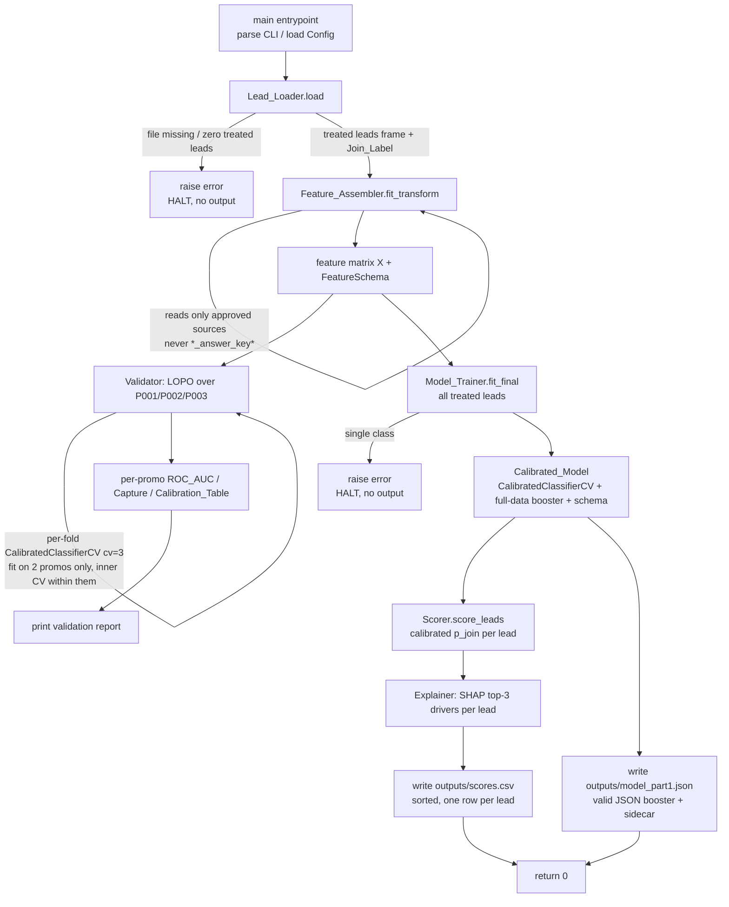
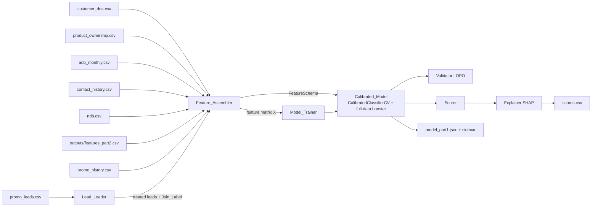

# Design Document

## Overview

Part1_Optin_Pipeline is a batch machine-learning pipeline built on pandas, scikit-learn, XGBoost, and SHAP. For each treated lead (a client messaged about a promo), it assembles a feature row from several client data sources, trains an XGBoost binary classifier wrapped in out-of-fold isotonic probability calibration (`CalibratedClassifierCV(method="isotonic", cv=3)`) to predict opt-in (`joined`), validates the model with leave-one-promo-out (LOPO) cross-validation across P001/P002/P003, explains every scored lead with its top-3 SHAP drivers, and writes a model artifact plus a scores file. It also exposes a `score_promo(promo_dict, clients_df)` function that estimates calibrated join probabilities for a brand-new, previously unseen promo by reapplying the fitted feature schema and calibrated model without retraining.

The design mirrors the existing `part2_network` package exactly: a frozen `Config` dataclass holding input/output paths plus domain constants, one module per named component, absolute imports (`from part1_optin...`), a `main(argv) -> int` entrypoint with argparse overrides, and a `raise SystemExit(main())` guard. The pipeline runs as `python -m part1_optin.main` with `PYTHONPATH=src`.

The system decomposes into the six components named in the requirements — Lead_Loader (Requirement 1), Feature_Assembler (Requirement 2), Model_Trainer / Calibrated_Model (Requirements 3, 6), Validator (Requirement 4), Explainer (Requirement 5), and Scorer (Requirements 6, 7) — plus a thin `main` entrypoint that owns configuration and wiring.

### Key Design Decisions

- **Configurable paths with canonical defaults.** All eight input paths and the two output paths live as `Config` defaults pointing at the requirement-specified locations, overridable via CLI, following the `part2_network` pattern (Requirement 7.8). No input is ever hard-coded at a call site.
- **A fitted `FeatureSchema` is the contract between training and scoring.** The single most important design decision. Because `score_promo` must build feature rows for unseen promos whose column set, order, and categorical encodings match the trained model exactly (Requirements 7.2, 2.1), the Feature_Assembler is split into a **fit** phase that learns the schema (the ordered column list, every categorical `value -> code` map, the discovered `product_type` columns, and the part2 column list) and a **transform** phase that reapplies a *frozen* schema to produce an aligned matrix. Scoring never re-derives columns from its own data; it transforms through the schema captured at training time. This makes column-set/order/encoding stability a structural guarantee rather than a coincidence.
- **Out-of-fold isotonic calibration via `CalibratedClassifierCV`.** The model is calibrated out-of-fold, not in-sample. `Model_Trainer.fit` builds `CalibratedClassifierCV(estimator=XGBClassifier(random_state=RANDOM_SEED, ...), method="isotonic", cv=StratifiedKFold(n_splits=3, shuffle=True, random_state=RANDOM_SEED))` and fits it on whatever training leads it is given; its internal 3-fold CV produces out-of-fold predictions that the isotonic maps are fit on, so no lead's calibrated score is derived from a booster that saw that lead during fitting. This replaces any single held-out calibration split or in-sample calibration.
- **The `Calibrated_Model` wrapper separates the calibrated predictor from the explainable booster.** A consequence of `cv=3` is that `CalibratedClassifierCV` fits three internal booster clones and averages their calibrated outputs — there is no single booster inside it. So the wrapper holds *two* fitted models: (1) the `CalibratedClassifierCV` used for all PREDICTION/validation/scoring (the out-of-fold calibrated `p_join`), and (2) a separate single plain `XGBClassifier` fit on ALL the given training rows with the same seed, which serves as both the booster persisted to `outputs/model_part1.json` (Requirement 6.1) and the tree model SHAP `TreeExplainer` runs on (Requirement 5.1). The `FeatureSchema` is also bundled. One object still transforms raw client data into the aligned matrix, predicts, calibrates, and explains — in both the batch path and `score_promo`.
- **`p_join` comes from the calibrated CV model; SHAP drivers come from the single full-data booster.** This split is sound: isotonic calibration is monotonic, so it does not reorder scores — the driver ranking from the base booster is the intended explanation of the ranking the calibrated model produces. This aligns with Requirement 5.1, which already specifies SHAP on the underlying XGBoost model of the Calibrated_Model.
- **Artifact format honors "valid JSON XGBoost booster document" (Requirement 6.1).** `outputs/model_part1.json` is written via XGBoost's native `booster.save_model(path)` with a `.json` extension on the single full-data booster, so the file *is* a valid JSON XGBoost booster document that reloads with `booster.load_model`. The `CalibratedClassifierCV` and `FeatureSchema` are not pure-booster XGBoost artifacts and cannot live inside the booster JSON without corrupting it; they are kept as the in-memory `Calibrated_Model` for the remainder of the same run (which is all the batch pipeline and `score_promo` need within one invocation) and, for out-of-process reuse, persisted to a **sidecar** `outputs/model_part1.sidecar.json`. The requirement-named artifact at `outputs/model_part1.json` stays a pure, valid booster document; the sidecar carries the schema and the calibration representation needed to reconstruct the calibrated predictor.
- **Determinism everywhere.** A single `RANDOM_SEED` drives XGBoost (`random_state`) and the seeded `StratifiedKFold(n_splits=3, shuffle=True, random_state=RANDOM_SEED)` used as the `CalibratedClassifierCV` splitter; isotonic calibration is itself deterministic, and SHAP tie-breaks by ascending predictor name. Two runs on identical inputs produce byte-identical scores and drivers (Requirements 3.2, 5.3).
- **LOPO leakage is enforced by partitioning on `promo_id` before any fit.** In each fold the `CalibratedClassifierCV` (classifier *and* its internal isotonic calibration) sees only the two training promos' leads; its internal 3-fold CV splits *within* those two-promo leads, and the held-out promo's leads never enter the fit — inner or outer (Requirements 3.3, 3.4, 4.1).
- **Answer-key prohibition is absolute.** No module references, opens, or imports any path containing `_answer_key`. The Feature_Assembler reads only the eight approved sources enumerated in `Config` (Requirement 2.14).

## Architecture

The pipeline is a linear flow. Lead_Loader is the first halt gate (missing file / zero treated leads); Model_Trainer is the second (single-class). No output is written until the final model fit succeeds, so any earlier failure leaves `outputs/` untouched (Requirements 6.2, 7.7).



### Data flow, raw CSV to outputs



### Component Responsibilities

| Component | Module | Requirements | Responsibility | May halt run? |
|-----------|--------|--------------|----------------|---------------|
| `main` entrypoint | `main.py` | 7.6, 7.7, 7.8 | Load `Config`, parse CLI overrides, wire components in order, map failures to exit codes | Propagates halts |
| Lead_Loader | `leads.py` | 1 | Load promo leads, filter to treated P001/P002/P003, dedup, label | Yes (missing file, zero leads) |
| Feature_Assembler | `features.py` | 2 | Fit/transform one Feature_Row per lead from all approved sources; own the `FeatureSchema` | No |
| Model_Trainer / Calibrated_Model | `model.py` | 3, 6.1, 6.2 | Fit out-of-fold `CalibratedClassifierCV(cv=3)` + a separate full-data booster; bundle calibrated model + booster + schema; save artifact | Yes (single class) |
| Validator | `validation.py` | 4 | LOPO cross-validation; per-promo ROC_AUC, capture rate, calibration table; report | No |
| Explainer | `explain.py` | 5 | SHAP values on the booster; per-lead top-3 drivers with tie-break and padding | No |
| Scorer | `scoring.py` | 6, 7 | Batch-score treated leads to `scores.csv`; `score_promo` for unseen promos | No (warns on unseen mechanic) |

## Components and Interfaces

### Module structure

```
src/part1_optin/
    __init__.py
    config.py          # Config dataclass: input/output paths + domain constants
    leads.py           # Lead_Loader
    features.py        # Feature_Assembler + FeatureSchema
    model.py           # Model_Trainer + Calibrated_Model
    validation.py      # Validator
    explain.py         # Explainer
    scoring.py         # Scorer (batch + score_promo)
    main.py            # entrypoint: wiring + CLI argument parsing
```

### `config.py` — Config and domain constants

A frozen dataclass holding every path, plus the fixed domain constants, so discrepancy-prone values live in one place (mirrors `part2_network/config.py`).

```python
@dataclass(frozen=True)
class Config:
    # Inputs (Requirement 1.1, 2.*, 7.8)
    promo_leads_path: Path = Path("data/promo_leads.csv")
    customer_dna_path: Path = Path("data/customer_dna.csv")
    product_ownership_path: Path = Path("data/product_ownership.csv")
    adb_monthly_path: Path = Path("data/adb_monthly.csv")
    contact_history_path: Path = Path("data/contact_history.csv")
    ndb_path: Path = Path("data/ndb.csv")
    features_part2_path: Path = Path("outputs/features_part2.csv")
    promo_history_path: Path = Path("data/promo_history.csv")
    # Outputs (Requirement 6.1, 6.3)
    model_output_path: Path = Path("outputs/model_part1.json")
    scores_output_path: Path = Path("outputs/scores.csv")

# control_group value marking a Treated_Lead (Requirement 1.2).
TREATED_CONTROL_GROUP = 0
# The only promo_ids kept for training (Requirement 1.3) and the LOPO folds (Requirement 4.1).
PROMO_IDS = ["P001", "P002", "P003"]
# Fixed seed for all stochastic operations (Requirement 3.2).
RANDOM_SEED = 42
# Calibration table bin count over [0, 1] (Requirement 4.4).
N_CALIBRATION_BINS = 10
# Top-quintile fraction for capture rate (Requirement 4.3).
TOP_QUINTILE = 0.20
# Customer_DNA categorical columns encoded to numeric codes (Requirement 2.1).
DNA_CATEGORICAL_COLUMNS = ["segment", "age_band", "region", "sec_class",
                           "inflow_type", "online_shopper"]
# Customer_DNA numeric/binary columns passed through as-is (Requirement 2.1).
DNA_NUMERIC_COLUMNS = ["tenure_years", "digital_app_user", "frugal_flag",
                       "investment_propensity_decile", "email_valid", "mobile_valid"]
# Promo mechanic is a categorical predictor (Requirement 2.13).
PROMO_MECHANIC_COLUMN = "mechanic"
# Mechanics observed in the known promos, for the unseen-mechanic warning (Requirement 7.4).
KNOWN_MECHANICS = ["TOP_UP", "NEW_ACCOUNT", "ADB_INCREASE"]
# Substring that marks a forbidden Answer_Key_File (Requirement 2.14).
ANSWER_KEY_MARKER = "_answer_key"
```

CLI overrides map `--promo-leads`, `--customer-dna`, `--product-ownership`, `--adb`, `--contact-history`, `--ndb`, `--features-part2`, `--promo-history`, `--model-out`, and `--scores-out` onto these fields (Requirement 7.8).

### `leads.py` — Lead_Loader

```python
class Lead_Loader:
    def __init__(self, config: Config) -> None: ...
    def load(self) -> pd.DataFrame
```

`load` reads the Promo_Leads_File and returns the training population frame carrying the original lead columns plus a `Join_Label` column. Steps, in order:

1. **Existence** — if `promo_leads_path` does not exist, raise `FileNotFoundError` naming the path and halt before any downstream work (Requirement 1.7).
2. **Read** — `pd.read_csv` with `control_group` and `joined` coerced via `pd.to_numeric(errors="coerce")` so quoted/typed values compare reliably (same approach as `part2_network/validation.read_leads`).
3. **Filter treated** — keep `control_group == TREATED_CONTROL_GROUP` (Requirement 1.2).
4. **Filter promo** — keep `promo_id in PROMO_IDS` (Requirement 1.3).
5. **Label** — set `Join_Label = joined` (Requirement 1.5).
6. **Drop bad labels** — drop rows whose `joined` is NaN or not in `{0, 1}` (Requirement 1.6).
7. **Dedup** — `drop_duplicates(subset=["promo_id", "client_id"], keep="first")` so each pair appears at most once (Requirement 1.4).
8. **Zero-lead guard** — if the result is empty, raise `ValueError` indicating no treated leads were found, halting before any output (Requirement 1.8).

### `features.py` — Feature_Assembler and FeatureSchema

```python
@dataclass
class FeatureSchema:
    columns: list[str]                       # ordered final column set
    categorical_maps: dict[str, dict]        # column -> {category_value: code}
    product_type_columns: list[str]          # one active_count_* per product_type
    part2_columns: list[str]                 # part2 feature column names
    def to_dict(self) -> dict: ...           # sidecar persistence
    @classmethod
    def from_dict(cls, d: dict) -> "FeatureSchema": ...

class Feature_Assembler:
    def __init__(self, config: Config) -> None: ...
    def fit_transform(self, leads: pd.DataFrame) -> tuple[pd.DataFrame, FeatureSchema]
    def transform(self, leads: pd.DataFrame, schema: FeatureSchema) -> pd.DataFrame
```

**Answer-key safety (Requirement 2.14).** The assembler reads only the eight `Config` source paths. No code path references a `_answer_key` file. A guard helper asserts each path it is about to open does not contain `ANSWER_KEY_MARKER`, turning the prohibition into a runtime invariant.

**`fit_transform`** is used at training time. It reads all approved sources, builds per-lead feature blocks, *learns* the schema (category maps, discovered product-type columns, part2 columns, final ordered column list), and returns the aligned feature matrix `X` plus the `FeatureSchema`. **`transform`** is used at scoring time: it rebuilds the same blocks for a new set of leads/clients but applies the *frozen* schema — reusing the learned category maps (unseen category values map to a reserved `0` code), reindexing onto the exact `schema.columns` in order, zero-filling any column the new data lacks. This is the stability contract behind Requirements 7.2 and 2.1.

Feature blocks (each joined on `client_id`, missing clients handled per requirement):

- **Customer_DNA (Requirements 2.1, 2.2).** Categorical columns in `DNA_CATEGORICAL_COLUMNS` are ordinal-encoded via a deterministic `value -> code` map built from the sorted distinct values at fit time (code `0` reserved for missing/unseen). Numeric columns in `DNA_NUMERIC_COLUMNS` pass through. A lead whose `client_id` is absent gets all DNA predictors `0` and `Customer_DNA_Missing_Flag = 1`, else `0`.
- **Product ownership (Requirements 2.3, 2.4).** One `active_count_<product_type>` column per distinct `product_type` discovered at fit time, each holding the count of that client's `status == "Active"` rows; absent client/product pairs are `0`.
- **ADB (Requirements 2.5, 2.6, 2.7).** `latest_adb` is the `adb_php` at the client's max `month`; `adb_trend` is the least-squares slope of `adb_php` vs. ascending month index over the last up-to-3 months (single month → slope `0`). Absent client → both `0` and `ADB_Missing_Flag = 1`, else `0`.
- **Contact history (Requirements 2.8, 2.9).** `avg_contacts_per_month` = total contact rows ÷ distinct `YYYY-MM` months with a contact; no contacts → `0` (guarded division).
- **NDB (Requirement 2.10).** `ndb_flag` = 1 if the `client_id` appears in the NDB_File, else `0`.
- **Part2 features (Requirements 2.11, 2.12).** Join all part2 columns on `client_id`; absent client → those columns `0` and `Part2_Features_Missing_Flag = 1`, else `0`.
- **Promo attributes (Requirement 2.13).** Join `mechanic` and `threshold_php` on `promo_id`; `mechanic` is ordinal-encoded via its own deterministic map; `threshold_php` passes through numerically.

The final column order is fixed and recorded in `schema.columns`: DNA numeric → DNA categorical codes → `Customer_DNA_Missing_Flag` → product-type active counts (sorted) → `latest_adb`, `adb_trend`, `ADB_Missing_Flag` → `avg_contacts_per_month` → `ndb_flag` → part2 columns → `Part2_Features_Missing_Flag` → `mechanic` code → `threshold_php`.

### `model.py` — Model_Trainer and Calibrated_Model

```python
@dataclass
class Calibrated_Model:
    calibrated: CalibratedClassifierCV  # out-of-fold calibrated predictor (for p_join)
    booster: xgboost.Booster            # single full-data booster (for SHAP + artifact)
    schema: FeatureSchema               # feature contract for transform-at-score-time
    def predict_proba(self, X: pd.DataFrame) -> np.ndarray   # calibrated p in [0,1]
    def save(self, model_path: Path) -> None                 # booster JSON + sidecar

class Model_Trainer:
    def __init__(self, config: Config) -> None: ...
    def fit(self, X: pd.DataFrame, y: pd.Series, schema: FeatureSchema) -> Calibrated_Model
```

`fit` builds an out-of-fold calibrated predictor:

```python
cv = StratifiedKFold(n_splits=3, shuffle=True, random_state=RANDOM_SEED)
calibrated = CalibratedClassifierCV(
    estimator=xgboost.XGBClassifier(random_state=RANDOM_SEED, ...),
    method="isotonic",
    cv=cv,
)
calibrated.fit(X, y)
```

The internal 3-fold CV produces **out-of-fold** predictions that the isotonic maps are fit on, so calibration is never in-sample. `fit` then *separately* trains one plain `xgboost.XGBClassifier(random_state=RANDOM_SEED, ...)` on **all** the given rows (`X`/`y`) and extracts its `Booster`; this single full-data booster is what gets persisted as the artifact and what SHAP explains. The returned `Calibrated_Model` bundles both. `predict_proba` delegates to `calibrated.predict_proba` (taking the positive-class column) and clips to `[0, 1]` (Requirement 3.5). The fixed `RANDOM_SEED` drives the `XGBClassifier` estimators and the seeded `StratifiedKFold` splitter, so repeated runs yield identical scores (Requirement 3.2).

**Why two models.** `CalibratedClassifierCV` with `cv=3` fits three internal booster clones and averages their calibrated outputs; there is no single booster to persist or to hand to SHAP. The calibrated CV model is therefore the source of `p_join` (prediction/validation/scoring), while the single full-data booster is the source of (a) the valid JSON booster artifact (Requirement 6.1) and (b) SHAP driver attribution (Requirement 5.1). This is sound because isotonic calibration is monotonic and does not reorder scores, so the base booster's driver ranking is the intended explanation of the calibrated ranking — consistent with Requirement 5.1's statement that SHAP is computed on the underlying XGBoost model of the Calibrated_Model.

**Single-class guard (Requirement 3.6).** Before fitting, if the `Join_Label` for that fit has only one unique class, raise `ValueError` indicating that calibration requires both opt-in and non-opt-in examples, halting without producing a `Calibrated_Model` (`CalibratedClassifierCV` with internal CV likewise cannot calibrate a single class). Because `cv=3` needs enough minority-class examples for each of the three folds to contain both classes, the stratified splitter is used to spread the minority class across folds; if a fold would still end up single-class (too few minority examples), surface a clear error rather than letting the internal fit fail opaquely. The production default is `cv=3`; callers are expected to provide training data with at least three minority-class examples.

**`save` (Requirements 6.1, 6.7).** Creates `outputs/` if absent, writes the single full-data booster via `booster.save_model(model_path)` so `outputs/model_part1.json` is a valid JSON XGBoost booster document, and writes the calibration representation (the `CalibratedClassifierCV`'s per-fold calibrated classifiers / isotonic breakpoints needed to reconstruct the calibrated predictor out of process) plus `schema.to_dict()` to the sidecar `outputs/model_part1.sidecar.json`. `save` is called only after the final fit succeeds, so a failed run writes nothing (Requirement 6.2).

### `validation.py` — Validator

```python
@dataclass
class PromoFoldResult:
    promo_id: str
    roc_auc: float | None               # None when undefined (no joiners / single class)
    capture_rate_top_quintile: float | None
    calibration_table: list[dict]       # [{bin_lo, bin_hi, mean_pred, observed_rate, count}]
    joiners: int
    n: int

@dataclass
class ValidationResult:
    folds: list[PromoFoldResult]        # one per P001/P002/P003

class Validator:
    def __init__(self, config: Config) -> None: ...
    def run(self, X: pd.DataFrame, y: pd.Series, promo_ids: pd.Series,
            schema: FeatureSchema) -> ValidationResult
    def print_report(self, result: ValidationResult) -> None
```

`run` performs LOPO over `PROMO_IDS`: for each held-out promo it fits a fresh `Model_Trainer` on the other two promos' leads only — so the `CalibratedClassifierCV(cv=3)` is fit solely on those two training promos' leads, and its internal 3-fold CV splits *within* that two-promo subset — then predicts the held-out leads (Requirements 3.3, 3.4, 4.1). The held-out promo's leads enter neither the outer fit nor the inner calibration CV. Per held-out promo it computes:

- **ROC_AUC** via `sklearn.metrics.roc_auc_score`, only when the held-out set has both a joiner and a non-joiner; otherwise `None` (Requirements 4.2, 4.5).
- **Capture_Rate_Top_Quintile** when there is ≥1 joiner: cutoff position `ceil(TOP_QUINTILE * N)`; all leads whose predicted probability is `>=` the probability at the cutoff position count as top-quintile; rate = joiners-in-top ÷ total joiners, in `[0, 1]` (Requirements 4.3, 4.5).
- **Calibration_Table**: 10 equal-width bins over `[0, 1]`; per non-empty bin report mean predicted probability, observed join rate, and count; empty bins are omitted (Requirement 4.4).

`print_report` prints the three metrics separately per held-out promo (Requirement 4.6), marking AUC/capture as undefined for zero-joiner folds without halting the other folds (Requirement 4.5).

### `explain.py` — Explainer

```python
class Explainer:
    def __init__(self, model: Calibrated_Model) -> None: ...
    def shap_values(self, X: pd.DataFrame) -> np.ndarray             # (rows, predictors)
    def top_drivers(self, X: pd.DataFrame, k: int = 3) -> list[tuple[str, str, str]]
```

`shap_values` builds a `shap.TreeExplainer` on the Calibrated_Model's single full-data XGBoost booster (the tree model; the calibrated CV model has no single booster for SHAP) and returns one SHAP contribution per predictor per row (Requirement 5.1). `top_drivers` selects, per row, the `k` predictors with the largest absolute SHAP contribution, ordered largest-to-smallest (Requirement 5.2); ties on `|SHAP|` break by ascending predictor name for run-to-run determinism (Requirement 5.3); positions beyond the count of non-zero-contribution predictors are filled with `""` (Requirement 5.4).

### `scoring.py` — Scorer

```python
class Scorer:
    def __init__(self, model: Calibrated_Model, config: Config) -> None: ...
    def score_leads(self, leads: pd.DataFrame, X: pd.DataFrame) -> pd.DataFrame
    def write_scores(self, scored: pd.DataFrame, path: Path) -> None

def score_promo(promo_dict: dict, clients_df: pd.DataFrame,
                model: Calibrated_Model, config: Config) -> pd.DataFrame
```

`score_leads` calibrated-scores every treated lead, attaches top-3 SHAP drivers, and returns a frame with `promo_id`, `client_id`, `p_join`, `top_driver_1..3`. `write_scores` (Requirements 6.3–6.7) creates `outputs/` if absent, rounds `p_join` to 6 dp in `[0, 1]`, sorts by ascending `promo_id` then `client_id`, writes exactly one row per scored lead with the fixed header and no index column.

`score_promo` (Requirement 7) builds eligible-client leads from `clients_df` using the supplied promo's `mechanic`/`threshold_php`, calls `Feature_Assembler.transform` with the model's frozen `schema` so columns/order/encoding match the trained matrix (Requirement 7.2), applies the existing `Calibrated_Model` without retraining (Requirement 7.3), returns one calibrated probability in `[0, 1]` per client plus top-3 SHAP drivers with empty padding (Requirement 7.5). If the promo's `mechanic` is not in `KNOWN_MECHANICS`, it still scores every client but emits a `warnings.warn` that predictions are less reliable for unseen mechanics (Requirement 7.4).

### `main.py` — entrypoint

```python
def main(argv: list[str] | None = None) -> int
```

Parses CLI overrides into a `Config`, then orchestrates: Lead_Loader.load → Feature_Assembler.fit_transform → Validator.run + print_report → Model_Trainer.fit (final model on all treated leads) → Scorer.score_leads + Explainer → `Calibrated_Model.save` + `write_scores`. Returns `0` on full success (Requirement 7.6). Any step's exception is caught, reported to stderr naming the failing step, and mapped to a non-zero exit code with no artifact or scores written (Requirement 7.7). Ends with `raise SystemExit(main())`.

## Data Models

### Input schemas (grounded in the real CSVs)

| File | Key columns | Used by |
|------|-------------|---------|
| `data/promo_leads.csv` | `promo_id`, `client_id`, `control_group`, `channel_sent`, `joined`, `join_date` | Lead_Loader (treated filter, `Join_Label`) |
| `data/customer_dna.csv` | `segment`, `age_band`, `region`, `sec_class`, `inflow_type`, `online_shopper` (categorical); `tenure_years`, `digital_app_user`, `frugal_flag`, `investment_propensity_decile`, `email_valid`, `mobile_valid` (numeric/binary) | Feature_Assembler DNA block |
| `data/product_ownership.csv` | `client_id`, `product_code`, `product_type`, `open_date`, `status` | Active_Product_Count |
| `data/adb_monthly.csv` | `client_id`, `month` (`YYYY-MM`), `adb_php` | Latest_ADB, ADB_Trend |
| `data/contact_history.csv` | `client_id`, `contact_date`, `campaign_id`, `channel` | Avg_Contacts_Per_Month |
| `data/ndb.csv` | `client_id`, `flag_type`, `flag_date` | NDB_Flag |
| `outputs/features_part2.csv` | `client_id` + ~20 numeric feature columns | Part2 join |
| `data/promo_history.csv` | `promo_id`, `promo_name`, `product_type`, `mechanic`, `threshold_php`, `reward`, `start_date`, `end_date`, `channels` | Promo_Attributes (P001=TOP_UP/500000, P002=NEW_ACCOUNT/1000, P003=ADB_INCREASE/50000) |

**Forbidden:** any `*_answer_key*` file (`data/_answer_key_clients.csv`, `data/_answer_key_promos.csv`) is never read (Requirement 2.14).

### Leads frame (Lead_Loader output)

Original lead columns plus `Join_Label` (int in `{0, 1}`), filtered to treated P001/P002/P003 leads, deduplicated on `(promo_id, client_id)`.

### Feature matrix and FeatureSchema

The feature matrix `X` is one Feature_Row per lead, columns exactly `schema.columns` in order. `FeatureSchema` is the fitted contract:

| Field | Meaning |
|-------|---------|
| `columns` | The ordered final column list — the authoritative schema reapplied at score time |
| `categorical_maps` | `{column: {category_value: code}}` for each DNA categorical and `mechanic`; code `0` reserved for missing/unseen |
| `product_type_columns` | One `active_count_<product_type>` per distinct `product_type` discovered at fit time |
| `part2_columns` | The part2 feature column names joined in |

Added engineered columns: `Customer_DNA_Missing_Flag`, `ADB_Missing_Flag`, `Part2_Features_Missing_Flag`, `latest_adb`, `adb_trend`, `avg_contacts_per_month`, `ndb_flag`, `threshold_php`.

### Calibrated_Model wrapper

Bundles `calibrated` (the out-of-fold `CalibratedClassifierCV(method="isotonic", cv=3)`, used for `p_join` prediction), `booster` (the single full-data XGBoost booster, used for SHAP and the artifact), and `schema` (the `FeatureSchema`). `predict_proba` returns calibrated probabilities in `[0, 1]` from the calibrated CV model; `save` writes the full-data booster to `outputs/model_part1.json` (valid JSON booster) and the calibration representation + schema to the sidecar.

### ValidationResult structure

`ValidationResult.folds` is a list of three `PromoFoldResult`, one per held-out promo, each carrying `roc_auc` (or `None`), `capture_rate_top_quintile` (or `None`), `calibration_table` (list of per-bin dicts with `bin_lo`, `bin_hi`, `mean_pred`, `observed_rate`, `count`), `joiners`, and `n`.

### Scores_File schema (`outputs/scores.csv`)

Fixed column order, single header row, no index column (Requirement 6.3):

| Column | Type | Notes |
|--------|------|-------|
| `promo_id` | str | primary sort key |
| `client_id` | str | secondary sort key |
| `p_join` | float | in `[0, 1]`, rounded to 6 dp (Requirement 6.4) |
| `top_driver_1` | str | largest `|SHAP|`, `""` if padded |
| `top_driver_2` | str | second, `""` if padded |
| `top_driver_3` | str | third, `""` if padded |

Exactly one row per scored treated lead, sorted by `promo_id` then `client_id` (Requirements 6.5, 6.6).

### Model_Artifact (`outputs/model_part1.json`)

A valid JSON XGBoost booster document (the single full-data booster) written by `booster.save_model` (Requirement 6.1). The companion `outputs/model_part1.sidecar.json` carries the calibration representation needed to reconstruct the out-of-fold `CalibratedClassifierCV` predictor and `FeatureSchema.to_dict()` for out-of-process reuse; the requirement-named artifact itself stays a pure booster document.

## Correctness Properties

*A property is a characteristic or behavior that should hold true across all valid executions of a system — essentially, a formal statement about what the system should do. Properties serve as the bridge between human-readable specifications and machine-verifiable correctness guarantees.*

These properties are derived from the prework classification of each acceptance criterion. Only criteria classified as PROPERTY appear here; criteria classified EXAMPLE, EDGE_CASE, SMOKE, or INTEGRATION are covered in the Testing Strategy instead. Redundant criteria were consolidated during property reflection: the three missing-flag rules (2.2, 2.7, 2.12) fold into one missing-flag family property; the LOPO structural and leakage rules (3.3, 3.4, 4.1) fold into one leakage property; the schema-stability rule shared by 2.1 and 7.2 is stated once; and the SHAP driver rules (5.2, 5.3, 7.5) are stated once.

### Property 1: Treated-lead selection keeps exactly the valid treated P001/P002/P003 rows

*For any* promo-leads frame, the loaded training population contains exactly the rows whose `control_group == 0`, whose `promo_id` is in {P001, P002, P003}, and whose `joined` is in {0, 1}, with each `(promo_id, client_id)` pair appearing at most once, and `Join_Label` equal to `joined` for every surviving row.

**Validates: Requirements 1.2, 1.3, 1.4, 1.5, 1.6**

### Property 2: Feature assembly is deterministic with stable categorical encoding

*For any* set of approved source frames, assembling features twice produces identical matrices, and within a run each categorical value (DNA categoricals and `mechanic`) maps to exactly one numeric code.

**Validates: Requirements 2.1**

### Property 3: Missing-source flags and zero-fill track client presence

*For any* leads and sources, a lead whose `client_id` is absent from Customer_DNA (resp. ADB, Part2) has the corresponding missing flag set to 1 with those predictor columns filled with 0, and a lead whose `client_id` is present has the flag set to 0.

**Validates: Requirements 2.2, 2.7, 2.12**

### Property 4: Active product counts equal the Active-status row counts per product_type

*For any* product-ownership frame, each client's `active_count_<product_type>` equals the number of that client's rows with `status == "Active"` for that `product_type` (0 when none).

**Validates: Requirements 2.3, 2.4**

### Property 5: Latest ADB and ADB trend match an independent recompute

*For any* ADB history, each client's `latest_adb` equals the `adb_php` at the client's chronologically most recent `month`, and `adb_trend` equals the least-squares slope of `adb_php` against ascending month index over the client's most recent up-to-three months, with a single month yielding slope 0.

**Validates: Requirements 2.5, 2.6**

### Property 6: Average contacts per month equals contacts over distinct months

*For any* contact history, each client's `avg_contacts_per_month` equals the client's total contact-row count divided by the number of distinct `YYYY-MM` months in which the client has at least one contact, and equals 0 when the client has no contacts.

**Validates: Requirements 2.8, 2.9**

### Property 7: NDB flag equals NDB membership

*For any* leads and NDB frame, each lead's `ndb_flag` is 1 exactly when its `client_id` appears in the NDB_File and 0 otherwise.

**Validates: Requirements 2.10**

### Property 8: Promo attributes match the joined promo's mechanic and threshold

*For any* lead, the Feature_Row's `threshold_php` equals the lead's promo's `threshold_php` from the Promo_History_File and its `mechanic` code is the deterministic encoding of that promo's `mechanic`.

**Validates: Requirements 2.11, 2.13**

### Property 9: The fitted schema reapplies identically at score time

*For any* fitted `FeatureSchema` and any disjoint set of clients, the matrix produced by transforming those clients through the schema has the identical column set and column order as the trained matrix and reuses the fitted categorical `value -> code` maps.

**Validates: Requirements 2.1, 7.2**

### Property 10: Calibrated scoring is deterministic under a fixed seed

*For any* training inputs, two runs of training and scoring with the fixed seed produce identical calibrated `p_join` for every lead.

**Validates: Requirements 3.2**

### Property 11: Leave-one-promo-out fitting never touches the held-out promo

*For any* treated-lead population spanning the three promos, the LOPO scheme produces exactly three folds with each promo held out once, and in every fold the `CalibratedClassifierCV(cv=3)` — classifier and its internal isotonic calibration alike — is fit using only the two training promos' leads, with the internal 3-fold CV splitting within that two-promo subset; none of the held-out promo's leads enter any fit, inner or outer.

**Validates: Requirements 3.3, 3.4, 4.1**

### Property 12: Calibrated probabilities are bounded in [0, 1]

*For any* clients scored by the Calibrated_Model, every returned calibrated probability lies in the inclusive range 0 to 1.

**Validates: Requirements 3.5, 7.3**

### Property 13: ROC_AUC is bounded when defined

*For any* held-out promo containing both a joiner and a non-joiner, the reported ROC_AUC lies in the inclusive range 0 to 1.

**Validates: Requirements 4.2**

### Property 14: Capture rate matches the cutoff/tie definition and is bounded

*For any* held-out promo with at least one joiner, the Capture_Rate_Top_Quintile lies in [0, 1] and equals the number of actual joiners whose predicted probability is greater than or equal to the probability at cutoff position `ceil(0.20 * N)` divided by the total number of joiners.

**Validates: Requirements 4.3**

### Property 15: Calibration table bins are well-formed

*For any* held-out promo, the Calibration_Table reports only non-empty bins among 10 equal-width bins over [0, 1]; each reported bin's mean predicted probability falls within that bin's `[lo, hi)` range, its observed rate lies in [0, 1], and the reported bin counts sum to the number of held-out leads.

**Validates: Requirements 4.4**

### Property 16: SHAP matrix has one contribution per predictor per scored row

*For any* scored matrix, the SHAP contribution array has exactly one value per Feature_Row predictor for each scored row.

**Validates: Requirements 5.1**

### Property 17: Top-3 SHAP drivers are the largest-by-absolute, name-tie-broken, empty-padded

*For any* scored lead, the three drivers are the predictors with the largest absolute SHAP contribution ordered largest-to-smallest, ties on absolute contribution are broken by ascending predictor name, and any position beyond the count of non-zero-contribution predictors is the empty string — deterministically across repeated runs.

**Validates: Requirements 5.2, 5.3, 5.4, 7.5**

### Property 18: Written p_join values are bounded and rounded

*For any* scored leads, every `p_join` written to the Scores_File lies in [0, 1] and equals its own value rounded to 6 decimal places.

**Validates: Requirements 6.4**

### Property 19: Scores are ordered by promo_id then client_id

*For any* scored leads, the rows of the Scores_File are in ascending order by `promo_id` and then by `client_id`.

**Validates: Requirements 6.5**

### Property 20: Exactly one scores row per treated lead

*For any* treated-lead population, the Scores_File contains exactly one row per scored treated lead, and the set of `(promo_id, client_id)` rows equals the treated-lead set.

**Validates: Requirements 6.6**

## Error Handling

The pipeline has two halt gates and never writes outputs before the final model fit succeeds, so any earlier failure leaves `outputs/` free of `model_part1.json` and `scores.csv` (Requirements 6.2, 7.7).

| Condition | Requirement | Component | Exception / behavior | Side effects |
|-----------|-------------|-----------|----------------------|--------------|
| Promo_Leads_File absent | 1.7 | Lead_Loader | `FileNotFoundError` naming the path; halt | None (no output) |
| Zero treated leads after filtering | 1.8 | Lead_Loader | `ValueError` indicating no treated leads; halt | None |
| Single-class fitting data (or a single-class CV fold) | 3.6 | Model_Trainer | `ValueError` ("requires both opt-in and non-opt-in"); halt, no Calibrated_Model. `CalibratedClassifierCV(cv=3)` also cannot calibrate a single class; too few minority-class examples for 3 stratified folds surfaces a clear error | None |
| Failure before final fit | 6.2, 7.7 | Model_Trainer / main | No `model_part1.json` or `scores.csv` written; non-zero exit; stderr names failing step | None |
| Any step failure | 7.7 | main | Caught, reported to stderr with failing step, non-zero exit | None |

Handled by construction rather than by exception:

- **Zero-joiner held-out promo (Requirement 4.5):** the Validator omits ROC_AUC and Capture_Rate for that fold and marks them undefined, continuing the other folds rather than raising.
- **Unseen promo mechanic (Requirement 7.4):** `score_promo` does not raise; it emits a `warnings.warn` about reduced reliability and still returns a calibrated probability in `[0, 1]` for every client. This is the one place a non-training input produces a soft warning rather than a hard error.
- **Divide-by-zero guards:** `avg_contacts_per_month` with no contacts → 0; `adb_trend` with a single month → 0; absent clients → zero-filled predictors plus the appropriate missing flag.
- **Unseen categorical values at score time:** mapped to the reserved `0` code via the frozen schema rather than raising.

## Testing Strategy

This feature combines pure, input-sensitive logic (lead selection, feature assembly, metric computation, SHAP driver selection, score formatting) with model-fitting and file side effects. The pure logic has many universal invariants — selection membership, encoding determinism, bounded metrics, calibration-bin structure, schema stability, LOPO leakage — so property-based testing is appropriate there. Model-fitting wiring, artifact validity, CLI orchestration, and the answer-key prohibition are scenario-specific and covered by example, edge-case, smoke, and integration tests.

### Tooling and conventions

- **Test runner:** `pytest`.
- **Property-based testing library:** **Hypothesis** (the standard Python choice, mirroring `part2_network`). Properties are NOT implemented from scratch. Composite Hypothesis strategies generate valid leads/source frames: small client-id pools, `control_group`/`joined` with injected bad values, `promo_id` drawn from the three promos plus out-of-set ids, DNA categoricals from the known domains, ADB monthly series of varied length, contact histories, product-ownership rows with varied `status`, and promo dicts with known and unseen mechanics.
- **Execution:** tests run with `.venv\Scripts\python.exe` and `PYTHONPATH=src` on Windows. Dependencies (`pandas`, `numpy`, `scikit-learn`, `xgboost`, `shap`, `pytest`, `hypothesis`) are already in `requirements.txt`.
- **Answer-key safety in the suite:** no test fixture, path, or helper references a `_answer_key` file; a dedicated guard test asserts the pipeline opens no path containing `_answer_key` (by recording paths passed to `pandas.read_csv` / `open`), and a repo-grep test asserts the `part1_optin` package contains no `_answer_key` reference.
- **Cost control:** property tests that fit XGBoost use tiny trees (`n_estimators` small, shallow depth) and small generated frames so 100+ iterations stay fast; where fitting is incidental to the property, a lightweight stub model exercising the calibration/scoring/SHAP wiring is used.
- **CV fold sizing in tests:** the production default is `CalibratedClassifierCV(cv=3)`, which needs at least three minority-class examples so each stratified fold has both classes. Property and edge tests that actually fit the calibrated model must generate small data with enough per-class examples for `cv=3`, or reduce the fold count in tiny fixtures (e.g. `cv=2`) while leaving the production default at `cv=3`. Determinism tests must hold the seeded `StratifiedKFold(n_splits=3, shuffle=True, random_state=RANDOM_SEED)` fixed so run-to-run results stay byte-identical.

### Property tests (minimum 100 iterations each)

Each correctness property (Properties 1–20) is implemented by a **single** Hypothesis-driven test with `@settings(max_examples=100)` (or higher), tagged with a comment:

`# Feature: part1-optin, Property {number}: {property_text}`

- **Reduction properties** (4, 5, 6, 8, 14) assert equality against an independent, straightforward reference recompute (model-based testing against an obvious implementation).
- **Determinism properties** (2, 10, 17) run the operation twice on identical inputs and assert equality; Property 10 fixes the seeded `StratifiedKFold` splitter so the out-of-fold calibration is reproducible; Property 17 additionally forces `|SHAP|` ties to exercise the ascending-name tie-break and `<3` non-zero contributions to exercise empty padding.
- **Leakage Property 11** instruments the per-fold fit to record which client_ids/promos entered the `CalibratedClassifierCV` fit — including its internal 3-fold CV splits — and asserts the held-out promo never appears in any inner or outer fit, across all three folds.
- **Schema-stability Property 9** fits a schema on one client set and transforms a disjoint set, asserting identical column set/order and reused encodings.
- **Bound/structure properties** (12, 13, 15, 18, 19, 20) assert the stated ranges, orderings, and counts over generated inputs.

### Example-based unit tests

Covering criteria classified EXAMPLE/SMOKE in the prework:

- Lead_Loader reads the configured default path (1.1) and labels a small valid frame (1.5).
- Missing Promo_Leads_File raises `FileNotFoundError` naming the path (1.7).
- Model_Trainer fits a booster on a small two-class set and predicts probabilities (3.1).
- The validation result has a per-promo entry for each of P001/P002/P003 with the three metric fields (4.6).
- `outputs/model_part1.json` reloads as an XGBoost booster (the single full-data booster) and produces predictions (6.1); the sidecar carries the calibration representation + schema.
- `scores.csv` header is exactly the six columns in order with no index column (6.3); a missing `outputs/` directory is created on write (6.7).
- `score_promo` accepts a `promo_dict` with `promo_id`/`mechanic`/`threshold_php` and a `clients_df` and returns per-client results (7.1).
- CLI path overrides are applied to `Config` before load/write (7.8).

### Edge-case unit tests

- Zero treated leads after filtering raises the no-treated-leads error with no output (1.8).
- Single-class fitting data raises the both-classes error and writes no artifact (3.6).
- Single-month ADB client yields `adb_trend == 0` (2.6); no-contact client yields `avg_contacts_per_month == 0` (2.9); inactive-only client yields `active_count == 0` (2.4).
- Zero-joiner held-out promo omits/marks ROC_AUC and Capture_Rate undefined and the other folds still report (4.5).
- `score_promo` with an unseen mechanic emits a warning and still returns valid `[0, 1]` probabilities for every client (7.4).
- A pre-final-fit failure leaves `model_part1.json` absent (6.2); a mid-pipeline failure yields a non-zero exit, a stderr message naming the failing step, and no outputs (7.7).
- Fewer than three non-zero SHAP contributions pads trailing drivers with `""` (5.4).

### Integration / smoke test

- One end-to-end run of `python -m part1_optin.main` with `PYTHONPATH=src` against the real `data/` CSVs and `outputs/features_part2.csv` confirms the pipeline loads treated leads, prints the three-promo LOPO report, writes a valid-booster `outputs/model_part1.json` plus sidecar, writes a sorted `outputs/scores.csv` with one row per treated lead and the six fixed columns, and returns exit code 0 (Requirement 7.6) — a single representative execution, not a property. The same test asserts no `_answer_key` file was opened during the run (Requirement 2.14).
