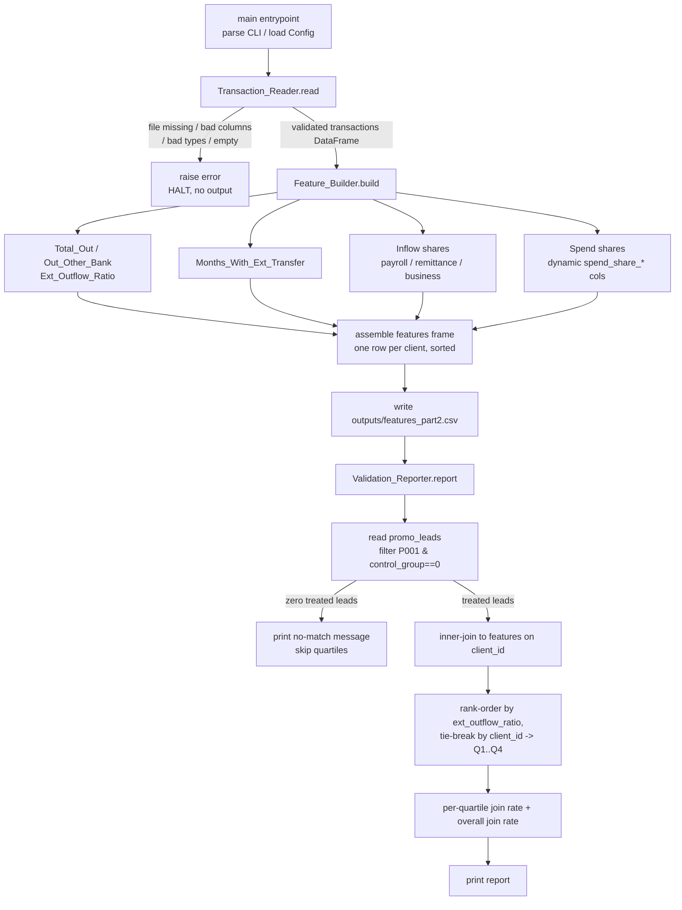

# Design Document

## Overview

Part2_Network_Pipeline is a single-pass, batch feature-engineering pipeline built on pandas. It reads the client transactions CSV, validates its structure and types, computes a fixed and a dynamic set of per-client network- and money-flow features, writes exactly one feature row per client to `outputs/features_part2.csv`, and then runs a validation report that joins the engineered features to the P001 treated promo leads and prints the promo-join rate across external-outflow-ratio quartiles.

The design decomposes the system into three cooperating components named in the requirements — Transaction_Reader (Requirement 1), Feature_Builder (Requirements 2–8), and Validation_Reporter (Requirement 9) — plus a thin `main` entrypoint that wires them together and owns configuration. All aggregation is expressed as vectorized pandas `groupby` operations over the full transactions frame rather than per-client Python loops, so the pipeline is deterministic and fast on the ~2000-client, three-month dataset.

Two cross-cutting concerns drive the design:

- **Reproducibility and correctness of per-client aggregates** are the primary goals. Every feature is defined as a closed-form reduction over a filtered slice of the transactions frame, rounded to the precision the requirements specify, so re-running the pipeline on the same input always yields byte-identical output.
- **Halt-on-invalid-input** (Requirement 1) is enforced entirely inside Transaction_Reader before any feature work begins, so a malformed input can never produce a partial `outputs/features_part2.csv`.

### Key Design Decisions

- **Configurable input paths with canonical defaults (design decision for the path concern).** The requirements name the inputs as `data/transactions.csv` and `data/promo_leads.csv`, and the actual workspace files are present at exactly those paths. To keep the pipeline robust to relocation and to avoid ever copying data, the input and output paths are not hard-coded at the call sites. They are defined as module-level `Config` defaults and are overridable via CLI arguments (`--transactions`, `--promo-leads`, `--out`). The canonical defaults point at the requirement-specified locations (`data/transactions.csv`, `data/promo_leads.csv`, `outputs/features_part2.csv`), so the pipeline runs against the real data with no arguments, while a caller can redirect it to an alternate data root (for example a `data/promo_navigator_synthetic_csv/` layout) without editing code or duplicating files.
- **Vectorized over iterative.** All features are computed with `groupby`/`pivot_table` reductions on the whole frame. This is both faster and less error-prone than iterating clients, and it makes the "one row per client" and "ordered by client_id" guarantees (Requirement 8) fall out of a single reindex against the sorted distinct-client index.
- **Client universe is the distinct `client_id` set of the transactions input** (Requirement 8.2). Every feature frame is reindexed onto this universe so clients with only inflows, only outflows, or no outflows still appear with the correct zero-filled values (Requirements 2.2, 3.3, 4.2, 5.2, 6.2, 7.5).
- **Dynamic spend-share columns are discovered once, globally** (Requirement 7.2), from the distinct outflow `counterparty_category` values across all clients, so every output row carries the identical complete column set.

## Architecture

The pipeline is a linear flow with a single validation gate at the front. Transaction_Reader is the only component permitted to halt the run; once a validated frame exists, Feature_Builder and Validation_Reporter cannot fail on input-shape grounds.



### Component Responsibilities

| Component | Requirements | Responsibility | May halt run? |
|-----------|--------------|----------------|---------------|
| `main` entrypoint | — | Load `Config`, parse CLI overrides, invoke components in order | Propagates reader errors |
| Transaction_Reader | 1 | Load, structurally validate, and type-coerce the transactions CSV | Yes (the only gate) |
| Feature_Builder | 2–8 | Compute all per-client features and write `features_part2.csv` | No |
| Validation_Reporter | 9 | Join features to P001 treated leads, bin by quartile, print join rates | No (prints no-match message instead) |

## Components and Interfaces

### Module structure

```
src/part2_network/
    __init__.py
    config.py          # Config dataclass: input/output paths + constants
    reader.py          # Transaction_Reader
    features.py        # Feature_Builder
    validation.py      # Validation_Reporter
    main.py            # entrypoint: wiring + CLI argument parsing
```

### `config.py` — Config

A frozen dataclass holding paths and the fixed domain constants, so the discrepancy-prone values live in one place.

```python
@dataclass(frozen=True)
class Config:
    transactions_path: Path = Path("data/transactions.csv")
    promo_leads_path: Path = Path("data/promo_leads.csv")
    output_path: Path = Path("outputs/features_part2.csv")

REQUIRED_COLUMNS = ["client_id", "txn_date", "direction",
                    "amount_php", "counterparty_type", "counterparty_category"]
EXTERNAL_COUNTERPARTY_TYPE = "Other bank"
INFLOW_SOURCES = ["Payroll", "Remittance", "Business receipts"]
INFLOW_SHARE_COLUMNS = {
    "Payroll": "inflow_share_payroll",
    "Remittance": "inflow_share_remittance",
    "Business receipts": "inflow_share_business_receipts",
}
P001_PROMO_ID = "P001"
TREATED_CONTROL_GROUP = 0
```

CLI overrides map `--transactions`, `--promo-leads`, and `--out` onto the three path fields. (Supports the configurable-path design decision; Requirements 1.1, 8.1, 9.1.)

### `reader.py` — Transaction_Reader

```python
def read(path: Path) -> pd.DataFrame
```

Loads and validates the transactions file, returning a frame guaranteed to have all required columns, numeric `amount_php`, and `datetime64` `txn_date`. Validation order (each failure raises before the next check, so the first structural problem is reported):

1. **Existence** — if `path` does not exist, raise `FileNotFoundError` naming the path (Requirement 1.2).
2. **Read** — `pd.read_csv(path, dtype=str, keep_default_na=False)` so raw values can be checked before coercion.
3. **Empty** — if the frame has zero data rows, raise `ValueError` stating the file has no transaction records (Requirement 1.6).
4. **Columns** — if any of `REQUIRED_COLUMNS` is absent, raise `ValueError` listing every missing column (Requirement 1.3).
5. **`amount_php` coercion** — `pd.to_numeric(..., errors="coerce")`; any resulting NaN marks an unparseable row. If present, raise `ValueError` naming the column and at least one offending `txn_id` (or row index if `txn_id` is absent) (Requirements 1.4, 1.5).
6. **`txn_date` coercion** — `pd.to_datetime(..., format="%Y-%m-%d", errors="coerce")`; any NaT marks an unparseable row; raise the same style of error naming the column and an offending row identifier (Requirements 1.4, 1.5).

The reader never writes anything, so any raised error leaves `outputs/` untouched (halt-without-output guarantee of Requirement 1).

### `features.py` — Feature_Builder

```python
def build(txns: pd.DataFrame) -> pd.DataFrame        # returns features frame
def write(features: pd.DataFrame, path: Path) -> None # creates outputs/ dir, writes CSV
```

`build` derives the client universe (`clients = sorted(txns.client_id.unique())`) and a `txn_month` column (`txns.txn_date.dt.strftime("%Y-%m")`), then computes each feature block as a reindexed, zero-filled Series/frame and concatenates them. `write` runs `path.parent.mkdir(parents=True, exist_ok=True)` (Requirement 8.4) then `to_csv(index=False)`.

### `validation.py` — Validation_Reporter

```python
def report(features: pd.DataFrame, promo_leads_path: Path) -> None
```

Reads promo leads, filters to P001 treated leads, inner-joins to features, assigns quartiles by rank order, computes and prints join rates. Prints a no-match message and returns early when no treated leads exist (Requirement 9.9). This component only prints; it returns `None` and writes no files.

### `main.py` — entrypoint

```python
def main(argv: list[str] | None = None) -> int
```

Parses CLI overrides into a `Config`, calls `Transaction_Reader.read`, `Feature_Builder.build` + `write`, then `Validation_Reporter.report`, in that order. A reader error propagates out of `main` (non-zero exit) before any output is produced.

## Data Models

### Input: Transactions_File schema (`data/transactions.csv`)

| Column | Raw type | Coerced type | Used by |
|--------|----------|--------------|---------|
| `txn_id` | str | str | error messages (row identifier) |
| `client_id` | str | str | client universe, all groupings |
| `txn_date` | str `YYYY-MM-DD` | datetime64 | `txn_month` for Requirement 5 |
| `direction` | str (`IN`/`OUT`) | str | inflow/outflow split |
| `amount_php` | str | float64 (≥ 0) | all sums |
| `counterparty_id` | str | str | unused by features |
| `counterparty_type` | str | str | External_Outflow test (`"Other bank"`) |
| `counterparty_category` | str | str | inflow source & spending category |
| `channel` | str | str | unused by features |

Required-for-validation subset: `client_id`, `txn_date`, `direction`, `amount_php`, `counterparty_type`, `counterparty_category` (Requirement 1.3).

### Input: Promo_Leads_File schema (`data/promo_leads.csv`)

| Column | Type | Used by |
|--------|------|---------|
| `promo_id` | str | filter to `"P001"` |
| `client_id` | str | inner-join key to features |
| `control_group` | int | filter to `0` (treated) |
| `channel_sent` | str | unused |
| `joined` | int (0/1) | numerator of Join_Rate |
| `join_date` | str (may be empty) | unused |

### Intermediate structures (in-memory)

- `txn_month: Series[str]` — `"YYYY-MM"` per transaction row.
- `outflows = txns[txns.direction == "OUT"]`, `inflows = txns[txns.direction == "IN"]`.
- `ext_outflows = outflows[outflows.counterparty_type == EXTERNAL_COUNTERPARTY_TYPE]` (NaN/other types excluded, Requirement 3.2).
- `clients: Index` — sorted distinct `client_id`; the reindex target for every feature block (Requirement 8.2, 8.5).
- `spend_categories: list[str]` — sorted distinct `counterparty_category` on `outflows`, discovered once globally (Requirement 7.2).

### Output: Features_File schema (`outputs/features_part2.csv`)

Fixed columns, in this order:

| Column | Type | Rounding | Requirement |
|--------|------|----------|-------------|
| `client_id` | str | — | 8.3 (first column) |
| `total_out` | float | 2 dp | 2.3 |
| `out_other_bank` | float | 2 dp | 3.4 |
| `ext_outflow_ratio` | float | 4 dp | 4.4 |
| `months_with_ext_transfer` | int | integer | 5.5 |
| `inflow_share_payroll` | float | 6 dp | 6.6 |
| `inflow_share_remittance` | float | 6 dp | 6.6 |
| `inflow_share_business_receipts` | float | 6 dp | 6.6 |

Followed by the **dynamic** spend-share columns, one per discovered outflow category (Requirement 7.2, 7.3):

- Column name = `spend_share_` + the category lowercased with each run of non-alphanumeric characters collapsed to a single underscore. For this dataset the categories are Grocery, Restaurants, Utilities, Telco, Retail, Fuel, Health, Education, Travel, E-commerce, Insurance premium, Bank transfer, P2P transfer — yielding e.g. `spend_share_grocery`, `spend_share_e_commerce`, `spend_share_insurance_premium`, `spend_share_bank_transfer`, `spend_share_p2p_transfer`.
- Normalization: `re.sub(r"[^0-9a-z]+", "_", value.lower()).strip("_")`.

Every row carries the identical complete column set; a client absent from a category gets `0.0` for that column (Requirements 7.4, 8.2).

### Feature computation approach (vectorized)

- **`total_out`** (Requirement 2): `outflows.groupby("client_id").amount_php.sum()` reindexed onto `clients`, `fillna(0)`, `round(2)`.
- **`out_other_bank`** (Requirement 3): `ext_outflows.groupby("client_id").amount_php.sum()` reindexed, `fillna(0)`, `round(2)`.
- **`ext_outflow_ratio`** (Requirement 4): `where(total_out > 0, out_other_bank / total_out, 0)`; division guarded so `total_out == 0` yields `0`; `round(4)`. Because `ext_outflows ⊆ outflows`, the numerator never exceeds the denominator, so the value is intrinsically within `[0, 1]`.
- **`months_with_ext_transfer`** (Requirement 5): `ext_outflows.groupby("client_id").txn_month.nunique()` reindexed, `fillna(0)`, cast to `int`. `nunique` collapses multiple same-month external transfers to one (Requirement 5.4), and with three observed months the value is bounded to `0..3`.
- **Inflow shares** (Requirement 6): `inflow_totals = inflows.groupby("client_id").amount_php.sum()`; `by_source = inflows[inflows.counterparty_category.isin(INFLOW_SOURCES)].groupby(["client_id","counterparty_category"]).amount_php.sum().unstack(fill_value=0)`; divide each source column by `inflow_totals`, with rows where `inflow_totals == 0` forced to `0` (Requirement 6.2), reindex onto all three sources and all clients, `round(6)`. Shares use the **full** inflow total as denominator, so when every inflow is one of the three sources they sum to 1 (Requirement 6.5); when some inflows fall outside the set the three shares sum to ≤ 1 by construction.
- **Spend shares** (Requirement 7): `pivot = outflows.pivot_table(index="client_id", columns="counterparty_category", values="amount_php", aggfunc="sum", fill_value=0)`; divide each column by `total_out`, rows with `total_out == 0` forced to `0` (Requirement 7.5), reindex onto `spend_categories` and `clients`, `round(6)`. Since the categories partition all outflows, nonzero-`total_out` shares sum to 1 (Requirement 7.7).

## Correctness Properties

*A property is a characteristic or behavior that should hold true across all valid executions of a system — essentially, a formal statement about what the system should do. Properties serve as the bridge between human-readable specifications and machine-verifiable correctness guarantees.*

These properties are derived from the prework classification of each acceptance criterion. Only criteria classified as PROPERTY appear here; criteria classified EXAMPLE, EDGE_CASE, SMOKE, or INTEGRATION are covered in the Testing Strategy instead.

### Property 1: Total outflow equals the sum of a client's OUT amounts

*For any* valid transactions frame, each client's `total_out` equals the sum of `amount_php` over that client's `direction == "OUT"` transactions (0 when the client has none), rounded to 2 decimal places.

**Validates: Requirements 2.1, 2.2, 2.3**

### Property 2: Outflow to other banks equals the sum of a client's External_Outflow amounts

*For any* valid transactions frame, each client's `out_other_bank` equals the sum of `amount_php` over that client's `OUT` transactions whose `counterparty_type` equals "Other bank", with missing or non-"Other bank" types excluded (0 when the client has none), rounded to 2 decimal places.

**Validates: Requirements 3.1, 3.2, 3.3, 3.4**

### Property 3: External outflow ratio is a bounded fraction of total outflow

*For any* valid transactions frame, each client's `ext_outflow_ratio` lies in the inclusive range `[0, 1]`, equals `out_other_bank / total_out` when `total_out > 0`, and equals `0` when `total_out == 0`.

**Validates: Requirements 4.1, 4.2, 4.3, 4.4**

### Property 4: Months with external transfer is a bounded distinct-month count

*For any* valid transactions frame, each client's `months_with_ext_transfer` is a non-negative integer equal to the number of distinct `YYYY-MM` months in which the client has at least one External_Outflow (counting a month once regardless of how many external transfers it contains), and never exceeds the number of distinct months present in the data.

**Validates: Requirements 5.1, 5.2, 5.3, 5.4**

### Property 5: Inflow shares are bounded source fractions of total inflow

*For any* valid transactions frame, each of a client's three inflow shares lies in `[0, 1]` and equals that source's inflow sum divided by the client's total inflow when total inflow is positive, and equals `0` for every source when the client's total inflow is `0`.

**Validates: Requirements 6.1, 6.2, 6.3, 6.4**

### Property 6: Inflow shares sum to one when all inflows are known sources

*For any* valid transactions frame and any client whose total inflow is positive and every one of whose inflow transactions has a `counterparty_category` in {Payroll, Remittance, Business receipts}, the three inflow shares sum to `1` within an absolute tolerance of `0.001`.

**Validates: Requirements 6.5**

### Property 7: Spending shares are bounded category fractions of total outflow

*For any* valid transactions frame, each of a client's spend shares lies in `[0, 1]` and equals that category's outflow sum divided by the client's `total_out` when `total_out > 0`, and equals `0` for every category when `total_out == 0`.

**Validates: Requirements 7.1, 7.4, 7.5, 7.6**

### Property 8: Spending shares sum to one for clients with outflow

*For any* valid transactions frame and any client whose `total_out` is greater than `0`, the spend shares across all spend-share columns sum to `1` within an absolute tolerance of `0.001`.

**Validates: Requirements 7.7**

### Property 9: Spend-share columns match the global distinct outflow categories

*For any* valid transactions frame, the set of `spend_share_*` columns corresponds exactly to the normalized distinct `counterparty_category` values appearing on OUT transactions across all clients, and every output row contains the identical complete set of those columns.

**Validates: Requirements 7.2**

### Property 10: Category-name normalization is well-formed and deterministic

*For any* category string, the normalized column suffix is lowercase, contains only characters in `[a-z0-9_]`, contains no run of more than one consecutive underscore arising from non-alphanumeric input, and is produced deterministically for a given input.

**Validates: Requirements 7.3**

### Property 11: Exactly one output row per distinct client

*For any* valid transactions frame, the Features_File contains exactly one row for each distinct `client_id` present in the input, with no duplicate `client_id` and no `client_id` absent from the input.

**Validates: Requirements 8.2**

### Property 12: Output rows are ordered by ascending client_id

*For any* valid transactions frame, the `client_id` column of the Features_File is in strictly ascending order.

**Validates: Requirements 8.5**

### Property 13: Missing required columns are reported exactly

*For any* valid transactions frame with a non-empty subset of required columns removed, Transaction_Reader halts and raises an error whose message names every removed column and no column that is still present.

**Validates: Requirements 1.3**

### Property 14: Unparseable values are reported with column and offending row

*For any* otherwise-valid transactions frame into which at least one unparseable `amount_php` value (or one unparseable `txn_date` value) is injected, Transaction_Reader halts and raises an error naming the affected column and at least one offending row identifier, without producing output.

**Validates: Requirements 1.4, 1.5**

### Property 15: Treated-lead selection is exactly the P001 control-group-0 rows

*For any* promo-leads frame, the selected treated-lead set equals exactly the rows where `promo_id == "P001"` and `control_group == 0`.

**Validates: Requirements 9.2**

### Property 16: Quartile binning is near-equal, order-respecting, and deterministically tie-broken

*For any* non-empty set of joined P001 treated leads, the four quartile bins have counts differing by at most one, and for any two leads the one assigned to a higher-numbered quartile never has a smaller `(ext_outflow_ratio, client_id)` sort key than one assigned to a lower-numbered quartile.

**Validates: Requirements 9.4, 9.5**

### Property 17: Per-quartile join rate is a bounded mean of the joined flag

*For any* non-empty quartile of joined P001 treated leads, the reported Join_Rate lies in `[0, 1]` and equals the count of leads with `joined == 1` divided by the count of leads in that quartile.

**Validates: Requirements 9.6**

### Property 18: Overall inner-join rate is a bounded fraction

*For any* promo-leads frame and features frame, the overall join rate lies in `[0, 1]` and equals the count of P001 treated leads matched to the Features_File divided by the total count of P001 treated leads.

**Validates: Requirements 9.8**

## Error Handling

All input-shape and type errors are detected by Transaction_Reader before any feature computation or file write, satisfying the halt-without-output guarantee of Requirement 1. The reader validates in a fixed order so the first structural defect is the one reported.

| Condition | Requirement | Exception | Message content | Side effects |
|-----------|-------------|-----------|-----------------|--------------|
| Transactions file absent | 1.2 | `FileNotFoundError` | The missing file path | None (no output) |
| Zero data rows | 1.6 | `ValueError` | States the file contains no transaction records | None |
| Missing required column(s) | 1.3 | `ValueError` | Names every missing column | None |
| Non-numeric `amount_php` | 1.4, 1.5 | `ValueError` | Names `amount_php` and ≥1 offending row id | None |
| Non-date `txn_date` | 1.4, 1.5 | `ValueError` | Names `txn_date` and ≥1 offending row id | None |

Because the reader raises before Feature_Builder runs, `outputs/features_part2.csv` is never partially written on a validation failure. Offending-row identifiers are taken from `txn_id` when present, falling back to the zero-based row index.

Validation_Reporter does not raise on data conditions. When filtering yields zero P001 treated leads it prints a no-match message and returns without attempting quartile computation (Requirement 9.9). A missing promo-leads file surfaces as a standard `FileNotFoundError` from the read, consistent with the reader's file-missing behavior.

Numeric edge cases handled by construction rather than by exception:
- `total_out == 0` and `total inflow == 0` yield `0` shares/ratios via guarded division (`np.where`/masking), never `NaN` or division-by-zero (Requirements 4.2, 6.2, 7.5).
- `amount_php` is treated as a non-negative magnitude in all sums (Requirements 2.1, 3.1).

## Testing Strategy

This feature is a pure pandas computation over tabular inputs with closed-form reductions and several universal invariants (bounded shares and ratios, sum-to-one, integer month counts, one row per client). Property-based testing is therefore appropriate for the Feature_Builder and Validation_Reporter logic. The input-reading and file-side-effect behaviors are scenario-specific and are covered by example and edge-case unit tests.

### Tooling

- **Test runner:** `pytest`.
- **Property-based testing library:** **Hypothesis** (the standard choice for Python). Properties are NOT implemented from scratch. A composite Hypothesis strategy generates valid transactions frames: a small set of client ids, `direction` in {IN, OUT}, `amount_php` as non-negative floats, `txn_date` drawn from the three observed months, and `counterparty_type`/`counterparty_category` drawn from the known domains (with targeted strategies that force the preconditions of Properties 6 and 8, and that inject missing/other counterparty types for Property 2).
- Add `pandas`, `pytest`, and `hypothesis` to `requirements.txt`.

### Property tests (minimum 100 iterations each)

- Each correctness property (Properties 1–18) is implemented by a **single** Hypothesis-driven test configured with `@settings(max_examples=100)` (or higher).
- Each property test is tagged with a comment in the form:
  `# Feature: part2-network, Property {number}: {property_text}`
- Properties referencing a precondition (6 and 8) use `hypothesis.assume(...)` or a dedicated strategy so only qualifying inputs are exercised.
- Reduction properties (1, 2, 5, 7) assert equality against an independent, straightforward reference computation (a simple non-vectorized recompute) — model-based testing against an obvious implementation.
- Binning Property 16 generates lead sets of varied sizes (including sizes not divisible by 4 and sets with tied ratios) to exercise near-equal counts and the `client_id` tie-break.

### Example-based unit tests

Covering the criteria classified EXAMPLE/SMOKE in the prework:

- Reader opens the configured default path (1.1) and parses a small valid frame to float/datetime dtypes (1.4).
- Missing file raises `FileNotFoundError` naming the path (1.2).
- Header-only file raises the no-records error (1.6).
- Output has a single header row (8.1), `client_id` first (8.3), the three named inflow-share columns present (6.6), and a missing `outputs/` directory is created on write (8.4).
- Validation_Reporter reads the configured leads path (9.1), inner-joins with a mix of matching and non-matching client ids (9.3), and prints exactly four lines in order Q1–Q4 with label, count, and rate (9.7).

### Edge-case unit tests

- Zero distinct clients produces a header-only Features_File (8.6).
- `ext_outflow_ratio`, inflow shares, and spend shares respect their stated decimal rounding (4.4, 6.4, 7.6).
- Zero P001 treated leads prints the no-match message and performs no quartile computation (9.9).

### Integration / smoke test

- One end-to-end run against the real `data/transactions.csv` and `data/promo_leads.csv` confirms the pipeline writes `outputs/features_part2.csv` with 2000 client rows, the expected fixed columns plus the dynamic `spend_share_*` columns, and prints the four-quartile report plus overall join rate — a single representative execution, not a property.
