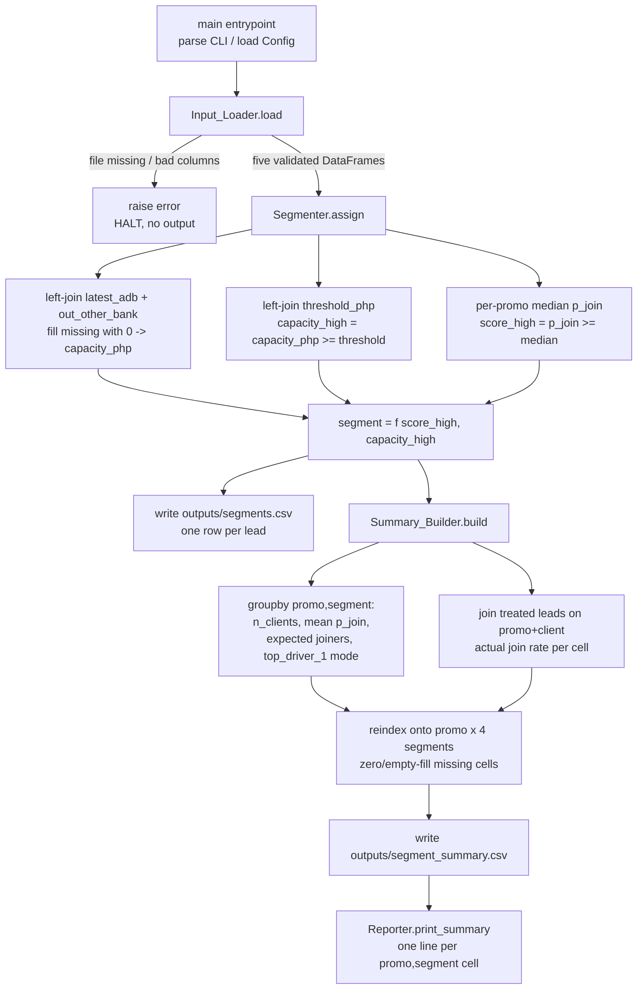

# Design Document

## Overview

Part3_Segments_Pipeline is a single-pass, batch pandas pipeline that places every scored promo lead on a 2x2 matrix of propensity (score) against financial capacity, writes a per-lead assignment file and a per-cell summary file, and prints the summary to standard output. A Lead is one row of `outputs/scores.csv`, keyed by the pair (`promo_id`, `client_id`).

The design decomposes the system into four cooperating components named in the requirements — Input_Loader (Requirement 1), Segmenter (Requirements 2 and 3), Summary_Builder (Requirement 4), and Reporter (Requirement 5) — plus a thin `main` entrypoint that wires them together and owns configuration. The pipeline reads five inputs (scored leads, Part 2 network features, monthly average-daily-balance history, promo history, and the promo lead list). The promo lead list feeds validation only: the observed join rate among treated leads per cell. All aggregation is expressed as vectorized pandas `groupby`/`merge` operations over the full leads frame rather than per-lead Python loops, so the pipeline is deterministic and fast.

Two cross-cutting concerns drive the design:

- **Reproducibility and correctness of per-lead assignments and per-cell aggregates** are the primary goals. Capacity, score, and segment are closed-form functions of the joined input columns; the summary is a closed-form reduction over the assigned leads crossed with the fixed four-segment set. Re-running on the same inputs yields byte-identical output.
- **Defined edge-case handling.** Missing client in the ADB or features source contributes 0 to capacity (Requirement 1.5); a promo absent from the promo history forces Capacity_High to false for its leads (Requirement 1.6); a tie at the promo median counts as score-high because the comparison is `>=` (Requirement 2.3); a cell with zero treated leads has an empty Actual_Join_Rate (Requirement 4.4); a cell with zero leads still appears with zeroed/empty values (Requirements 4.1, 4.5).

### Key Design Decisions

- **Configurable input/output paths with canonical defaults.** The five input paths and two output paths are defined as module-level `Config` defaults pointing at the requirement-specified locations (`outputs/scores.csv`, `outputs/features_part2.csv`, `data/adb_monthly.csv`, `data/promo_history.csv`, `data/promo_leads.csv`, `outputs/segments.csv`, `outputs/segment_summary.csv`) and are overridable via CLI arguments, matching the part2_network convention. The pipeline runs against the real data with no arguments.
- **Missing source = zero contribution to capacity (design decision for the missing-client concern).** Rather than halting when a scored client is absent from the ADB or features inputs, the pipeline left-joins those sources onto the leads and fills the missing `latest_adb` or `out_other_bank` with 0. This keeps every scored lead in the output and makes capacity a total function of the leads. The alternative (halting) was rejected because scores and features are produced by independent upstream stages and partial coverage is expected.
- **Missing promo threshold = capacity-low (design decision for the missing-promo concern).** A `promo_id` in the scores file that is absent from the promo history has no threshold. Left-joining the promo history leaves `threshold_php` as NaN for such leads; the capacity test `capacity_php >= threshold_php` is evaluated so that a NaN threshold yields Capacity_High = false for every lead of that promo (Requirement 1.6), placing them in the low-capacity column.
- **Vectorized over iterative.** Capacity, the per-promo median, score, and segment are computed with vectorized joins and `groupby.transform("median")` over the whole leads frame; the summary is a `groupby` reduction reindexed onto the full promo x four-segment cross product. This makes the "one row per lead" (Requirement 3.2) and "every promo x four segments present" (Requirements 4.1, 4.5) guarantees fall out of a single reindex.
- **Fixed four-segment universe.** The four segment labels are a constant ordered list in `config.py`, so both the summary cross product and the printed order are stable and independent of which segments happen to be populated.

## Architecture

The pipeline is a linear flow. Input_Loader is the only component permitted to halt the run; once validated frames exist, the Segmenter, Summary_Builder, and Reporter cannot fail on input-shape grounds.



### Component Responsibilities

| Component | Requirements | Responsibility | May halt run? |
|-----------|--------------|----------------|---------------|
| `main` entrypoint | 5.1 | Load `Config`, parse CLI overrides, invoke components in order | Propagates loader errors |
| Input_Loader | 1 | Load, structurally validate, and type-coerce the five inputs | Yes (the only gate) |
| Segmenter | 2, 3 | Compute capacity, score, segment; write `segments.csv` | No |
| Summary_Builder | 4 | Build per-cell summary incl. treated-lead join rate; write `segment_summary.csv` | No |
| Reporter | 5 | Print the summary; own the CLI entry point | Propagates loader errors (5.4) |

## Components and Interfaces

### Module structure

```
src/part3_segments/
    __init__.py
    config.py          # Config dataclass: input/output paths + constants
    loader.py          # Input_Loader
    segments.py        # Segmenter (capacity, score, segment, write segments.csv)
    validation.py      # Summary_Builder (per-cell summary incl. treated join rate)
    main.py            # entrypoint: wiring + CLI argument parsing + Reporter print
```

This mirrors the part2_network layout (config / loader / logic / validation / main).

### `config.py` — Config

A frozen dataclass holding paths and the fixed domain constants.

```python
@dataclass(frozen=True)
class Config:
    scores_path: Path = Path("outputs/scores.csv")
    features_path: Path = Path("outputs/features_part2.csv")
    adb_monthly_path: Path = Path("data/adb_monthly.csv")
    promo_history_path: Path = Path("data/promo_history.csv")
    promo_leads_path: Path = Path("data/promo_leads.csv")
    segments_out_path: Path = Path("outputs/segments.csv")
    summary_out_path: Path = Path("outputs/segment_summary.csv")

SCORES_COLUMNS = ["promo_id", "client_id", "p_join",
                  "top_driver_1", "top_driver_2", "top_driver_3"]
FEATURES_REQUIRED = ["client_id", "out_other_bank"]
ADB_REQUIRED = ["client_id", "month", "adb_php"]
PROMO_HISTORY_REQUIRED = ["promo_id", "threshold_php"]
PROMO_LEADS_REQUIRED = ["promo_id", "client_id", "control_group", "joined"]
SEGMENTS = ["Ready Toppers", "Willing but Stretched",
            "Untapped Wealth", "Not Now"]
TREATED_CONTROL_GROUP = 0
```

CLI overrides map onto the path fields. (Requirements 1.1, 3.1, 4.6, 5.1.)

### `loader.py` — Input_Loader

```python
def load(cfg: Config) -> dict[str, pd.DataFrame]
```

Loads and validates the five inputs, returning a dict of frames keyed `scores`, `features`, `adb`, `promo_history`, `promo_leads`. For each file, in a fixed order so the first problem is the one reported:

1. **Existence** — if the path does not exist, raise `FileNotFoundError` naming the path (Requirement 1.2).
2. **Read** — `pd.read_csv(path, dtype=str, keep_default_na=False)` so raw values can be checked before coercion.
3. **Columns** — if any required column for that file is absent, raise `ValueError` naming the file and every missing column (Requirement 1.3).
4. **Numeric coercion** — `pd.to_numeric(...)` for `p_join`, `out_other_bank`, `adb_php`, `threshold_php`; `month` kept as a `YYYY-MM` string (Requirement 1.4).

The loader never writes anything, so a raised error leaves `outputs/` untouched (halt-without-output guarantee of Requirement 1).

### `segments.py` — Segmenter

```python
def assign(frames: dict[str, pd.DataFrame]) -> pd.DataFrame     # returns per-lead frame
def write(leads: pd.DataFrame, path: Path) -> None              # creates outputs/, writes segments.csv
```

`assign` builds the per-lead frame from the scores frame:

- **latest_adb**: from the ADB frame, select for each client the row with the lexicographically greatest `month`, take `adb_php`; left-join onto leads by `client_id`, `fillna(0)` (Requirements 1.5, 2.1).
- **out_other_bank**: left-join the features `out_other_bank` onto leads by `client_id`, `fillna(0)` (Requirement 1.5).
- **capacity_php**: `latest_adb + out_other_bank` (Requirement 2.1).
- **threshold_php**: left-join the promo-history `threshold_php` onto leads by `promo_id` (NaN when the promo is absent).
- **capacity_high**: `capacity_php >= threshold_php`, evaluated so NaN threshold yields `False` (Requirements 1.6, 2.2).
- **promo_median**: `leads.groupby("promo_id").p_join.transform("median")` (Requirement 2.3).
- **score_high**: `p_join >= promo_median` (Requirement 2.3).
- **segment**: vectorized map of `(score_high, capacity_high)` onto the four labels via `np.select` (Requirement 2.4).

`write` runs `path.parent.mkdir(parents=True, exist_ok=True)` (Requirement 3.3) then `to_csv(index=False)` with the exact column order of Requirement 3.1.

### `validation.py` — Summary_Builder

```python
def build(leads: pd.DataFrame, promo_leads: pd.DataFrame) -> pd.DataFrame
def write(summary: pd.DataFrame, path: Path) -> None
```

`build` groups the assigned leads by (`promo_id`, `segment`) to compute client count, mean `p_join`, Expected_Joiners (sum of `p_join`), and the most common `top_driver_1` (pandas mode; ties broken by first in sorted order for determinism). Treated-lead join rate: filter `promo_leads` to `control_group == 0`, inner-join onto the assigned leads on (`promo_id`, `client_id`) to attach each treated lead's segment, then per cell compute `joined.mean()`; cells with zero treated leads get an empty value (Requirements 4.3, 4.4). The result is reindexed onto the full cross product of distinct scores `promo_id` x the four `SEGMENTS`, with missing cells zero/empty-filled (Requirements 4.1, 4.5). `write` creates `outputs/` and writes the CSV (Requirement 4.6).

### `main.py` — entrypoint and Reporter

```python
def main(argv: list[str] | None = None) -> int
```

Parses CLI overrides into a `Config`, calls `Input_Loader.load`, `Segmenter.assign` + `write`, `Summary_Builder.build` + `write`, then prints the summary (one line per cell, Requirements 5.1, 5.2), rendering empty join-rate / top-driver fields as 0 or blank (Requirement 5.3). A loader error propagates out of `main` before any output is produced (Requirement 5.4).

## Data Models

### Input: Scores_File schema (`outputs/scores.csv`)

| Column | Raw type | Coerced type | Used by |
|--------|----------|--------------|---------|
| `promo_id` | str | str | lead key, promo grouping |
| `client_id` | str | str | lead key, join to adb/features |
| `p_join` | str | float64 | score, mean, expected joiners |
| `top_driver_1` | str | str | summary mode, output passthrough |
| `top_driver_2` | str | str | output passthrough |
| `top_driver_3` | str | str | output passthrough |

### Input: Features_File schema (`outputs/features_part2.csv`)

| Column | Type | Used by |
|--------|------|---------|
| `client_id` | str | join key |
| `out_other_bank` | float64 | capacity term |

All other columns are ignored.

### Input: Adb_Monthly_File schema (`data/adb_monthly.csv`)

| Column | Type | Used by |
|--------|------|---------|
| `client_id` | str | join key |
| `month` | str `YYYY-MM` | latest-month selection (lexicographic max) |
| `adb_php` | float64 | capacity term (latest month only) |

### Input: Promo_History_File schema (`data/promo_history.csv`)

| Column | Type | Used by |
|--------|------|---------|
| `promo_id` | str | join key |
| `threshold_php` | float64 | capacity_high test |

All other columns are ignored.

### Input: Promo_Leads_File schema (`data/promo_leads.csv`)

| Column | Type | Used by |
|--------|------|---------|
| `promo_id` | str | join key to cell |
| `client_id` | str | join key to cell |
| `control_group` | int | filter to 0 (treated) |
| `joined` | int (0/1) | numerator of actual join rate |

`channel_sent` and `join_date` are ignored.

### Intermediate structures (in-memory)

- `latest_adb: Series[float]` indexed by `client_id` — `adb_php` at the lexicographically greatest `month` per client.
- `leads` — the scores frame augmented with `latest_adb`, `out_other_bank`, `capacity_php`, `threshold_php`, `capacity_high`, `promo_median`, `score_high`, `segment`.
- `treated` = `promo_leads[promo_leads.control_group == 0]` joined to `leads[["promo_id","client_id","segment"]]` on (`promo_id`, `client_id`).
- `cells` — the cross product of distinct scores `promo_id` x `SEGMENTS`, the reindex target for the summary.

### Output: Segments_File schema (`outputs/segments.csv`)

Columns, in this exact order (Requirement 3.1):

| Column | Type | Source |
|--------|------|--------|
| `promo_id` | str | scores |
| `client_id` | str | scores |
| `p_join` | float | scores |
| `capacity_php` | float | computed (latest_adb + out_other_bank) |
| `segment` | str | computed |
| `top_driver_1` | str | scores |
| `top_driver_2` | str | scores |
| `top_driver_3` | str | scores |

One row per Lead (Requirement 3.2).

### Output: Segment_Summary_File schema (`outputs/segment_summary.csv`)

One row per (promo, segment) cell — every distinct scores `promo_id` crossed with all four segments (Requirements 4.1, 4.5):

| Column | Type | Meaning | Requirement |
|--------|------|---------|-------------|
| `promo_id` | str | the promo | 4.1 |
| `segment` | str | one of the four labels | 4.1 |
| `n_clients` | int | count of leads in the cell (0 when empty) | 4.2, 4.5 |
| `mean_p_join` | float | mean `p_join` in the cell (0 when empty) | 4.2, 4.5 |
| `expected_joiners` | float | sum of `p_join` in the cell (0 when empty) | 4.2, 4.5 |
| `actual_join_rate` | float or empty | treated-lead join fraction (empty when no treated leads) | 4.3, 4.4 |
| `top_driver_1` | str or empty | most common `top_driver_1` in the cell (empty when no leads) | 4.5 |

## Correctness Properties

*A property is a characteristic or behavior that should hold true across all valid executions of a system — essentially, a formal statement about what the system should do. Properties serve as the bridge between human-readable specifications and machine-verifiable correctness guarantees.*

These properties are derived from the prework classification of each acceptance criterion. Only criteria classified as PROPERTY appear here; criteria classified EXAMPLE, EDGE_CASE, SMOKE, or INTEGRATION are covered in the Testing Strategy instead. The property set is deliberately capped at six: the two loader-validation criteria (1.2, 1.3) and the bounded treated-lead join-rate criterion (4.3) are strong candidates but are covered as example/edge tests to respect the cap, and the remaining PROPERTY criteria are consolidated so each of the six properties below provides unique validation value.

### Property 1: Capacity equals latest-month ADB plus external outflow, with missing sources treated as zero

*For any* scores frame, ADB-monthly frame, and features frame, each Lead's `capacity_php` equals that client's `adb_php` at the lexicographically greatest `month` present for the client (0 when the client has no ADB row) plus that client's `out_other_bank` (0 when the client has no features row).

**Validates: Requirements 1.5, 2.1**

### Property 2: Segment matches the 2x2 quadrant of score-high by capacity-high

*For any* assigned Leads frame, each Lead's `segment` equals "Ready Toppers" when both `score_high` and `capacity_high` are true, "Willing but Stretched" when only `score_high` is true, "Untapped Wealth" when only `capacity_high` is true, and "Not Now" when both are false; `capacity_high` is true exactly when `capacity_php >= threshold_php` and false whenever the Lead's promo has no threshold (absent from the promo history).

**Validates: Requirements 1.6, 2.2, 2.4**

### Property 3: Score-high is the at-or-above-median test within each promo, with ties counting as high

*For any* scores frame, within each promo `score_high` is true exactly for the Leads whose `p_join` is greater than or equal to the median `p_join` of that promo's Leads; in particular every Lead whose `p_join` equals its promo median is `score_high`.

**Validates: Requirements 2.3**

### Property 4: Expected joiners per cell equals the sum of p_join of the cell's leads

*For any* assigned Leads frame, each (promo, segment) cell's `expected_joiners` equals the sum of `p_join` over the Leads assigned to that cell, and the four cells of any single promo have `expected_joiners` values summing to that promo's total `p_join`.

**Validates: Requirements 4.2**

### Property 5: The summary contains every promo crossed with all four segments, with empty cells zero- and blank-filled

*For any* scores frame, the Segment_Summary_File contains exactly one row for every combination of a distinct scores `promo_id` with each of the four segment labels (so the row count equals four times the number of distinct promos), and every (promo, segment) cell to which no Lead is assigned has `n_clients` equal to 0, `mean_p_join` equal to 0, `expected_joiners` equal to 0, an empty `actual_join_rate`, and an empty `top_driver_1`; any cell with no treated leads likewise has an empty `actual_join_rate`.

**Validates: Requirements 4.1, 4.4, 4.5**

### Property 6: The segments output has exactly one row per lead with preserved and bounded values

*For any* scores frame, the Segments_File contains exactly one row for each distinct (`promo_id`, `client_id`) Lead in the scores frame (no duplicates, none missing), each row's `p_join` equals that Lead's input `p_join`, and each row's `capacity_php` equals the Lead's `latest_adb` plus `out_other_bank` and is non-negative given non-negative ADB and outflow inputs.

**Validates: Requirements 3.2**

## Error Handling

All input-shape errors are detected by Input_Loader before any segment computation or file write, satisfying the halt-without-output guarantee of Requirement 1. The loader validates each of the five files in a fixed order (existence, then required columns), so the first structural defect is the one reported.

| Condition | Requirement | Exception | Message content | Side effects |
|-----------|-------------|-----------|-----------------|--------------|
| Any input file absent | 1.2 | `FileNotFoundError` | The missing file path | None (no output) |
| Missing required column(s) | 1.3 | `ValueError` | Names the affected file and every missing column | None |

Because the loader raises before the Segmenter runs, neither `outputs/segments.csv` nor `outputs/segment_summary.csv` is partially written on a validation failure, and the Reporter prints no summary (Requirement 5.4).

Numeric and coverage edge cases are handled by construction rather than by exception:

- A scored client absent from the ADB or features input contributes 0 to capacity via left-join `fillna(0)` (Requirement 1.5), never `NaN`.
- A promo in the scores file absent from the promo history has a `NaN` threshold; the comparison `capacity_php >= threshold_php` yields `False`, so all its leads are capacity-low (Requirement 1.6).
- A (promo, segment) cell with zero treated leads has its `actual_join_rate` left empty rather than producing a division-by-zero (Requirement 4.4), printed as 0 or blank (Requirement 5.3).
- A (promo, segment) cell with zero leads is still emitted with zeroed counts and blank text fields via the reindex onto the full promo x four-segment cross product (Requirements 4.1, 4.5).
- Ties at the promo median are score-high because the comparison is `>=` (Requirement 2.3).

## Testing Strategy

This feature is a pure pandas computation over tabular inputs with closed-form per-lead assignments and several universal invariants (capacity as a sum of joined terms, the 2x2 segment mapping, at-or-above-median score test, expected-joiners as a sum, completeness of the promo x segment cross product, one row per lead). Property-based testing is therefore appropriate for the Segmenter and Summary_Builder logic. The input-loading, printing, and file-side-effect behaviors are scenario-specific and are covered by example and edge-case unit tests.

### Tooling

- **Test runner:** `pytest`, run with `PYTHONPATH=src` using the project virtualenv `.\.venv\Scripts\python.exe` on Windows (matching the part1/part2 convention).
- **Property-based testing library:** **Hypothesis** (already a project dependency; the standard choice for Python). Properties are NOT implemented from scratch. A composite Hypothesis strategy generates valid scores frames (a small set of promos and clients, non-negative `p_join` in `[0, 1]`, categorical `top_driver_1` values) together with matching ADB-monthly frames (multiple `YYYY-MM` months per client, including clients omitted to exercise the missing-source fallback), features frames (`out_other_bank`, with some clients omitted), promo-history frames (with at least one promo omitted to exercise the missing-threshold path), and promo-leads frames (mix of `control_group` 0 and 1, and cells with zero treated leads). A shared `strategies.py`-style module provides these generators, following the existing `tests/strategies.py` convention.
- Tests live under `tests/` named `test_part3_*.py`, matching the `test_part1_*` / part2 naming conventions.

### Property tests (minimum 100 iterations each; MAX 6 total)

Exactly six property tests, one per correctness property (Properties 1–6), each configured with `@settings(max_examples=100)` (or higher) and tagged with a comment in the form `# Feature: part3-segments, Property {number}: {property_text}`:

- **Property 1** (`test_part3_capacity_property.py`): capacity equals latest-month ADB plus external outflow with missing sources as 0.
- **Property 2** (`test_part3_segment_quadrant_property.py`): segment matches the 2x2 quadrant, including capacity-high `>=` / NaN-threshold behavior.
- **Property 3** (`test_part3_median_tiebreak_property.py`): score-high is the at-or-above-median test within each promo, ties high.
- **Property 4** (`test_part3_expected_joiners_property.py`): per-cell expected joiners equals the sum of `p_join`.
- **Property 5** (`test_part3_summary_completeness_property.py`): every promo x four segments present, zero/empty-filled cells.
- **Property 6** (`test_part3_segments_rows_property.py`): one row per lead with preserved `p_join` and non-negative `capacity_php`.

Reduction properties (1, 4) assert equality against an independent, straightforward reference computation (a simple non-vectorized recompute) — model-based testing against an obvious implementation.

### Example-based unit tests (kept light)

Covering the criteria classified EXAMPLE/SMOKE/EDGE_CASE in the prework:

- Loader reads the five configured default paths (1.1) and coerces `p_join`, `out_other_bank`, `adb_php`, `threshold_php` to numeric while keeping `month` as a `YYYY-MM` string (1.4).
- Missing input file raises `FileNotFoundError` naming the path (1.2) — one small example per the five files or a parametrized case.
- Missing required column raises `ValueError` naming the file and the removed columns (1.3).
- Segments_File header equals the exact ordered column list (3.1); writing to a path whose parent is absent creates `outputs/` (3.3, 4.6).
- Actual join rate uses treated leads only and is bounded in `[0, 1]`; control-group rows are never counted (4.3); a cell with zero treated leads shows an empty rate (4.4).
- Reporter prints one line per summary cell with the seven fields (5.2), renders empty rate/driver as 0 or blank (5.3), and a loader error propagates so `main` writes nothing and prints no summary (5.4).

### Integration / smoke test

- One end-to-end run against the real `outputs/scores.csv`, `outputs/features_part2.csv`, `data/adb_monthly.csv`, `data/promo_history.csv`, and `data/promo_leads.csv` confirms the pipeline writes `outputs/segments.csv` (one row per scored lead) and `outputs/segment_summary.csv` (four rows per distinct promo) and prints the summary — a single representative execution, not a property (5.1).

### Notes on temporary output

Any temporary or debug output produced during implementation (scratch CSVs, dumps, ad-hoc prints to files) MUST go to a gitignored `scratch/` folder at the repository root, never the repo root itself or a committed path. The repository `.gitignore` already ignores `outputs/`, `_*.txt`, and `*_out*.txt`; add `scratch/` there if it is not already ignored. The pipeline's own outputs go only to `outputs/segments.csv` and `outputs/segment_summary.csv`.
