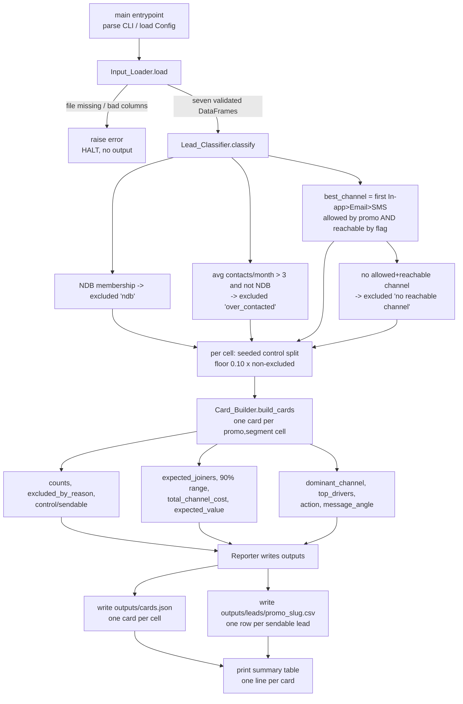

# Design Document

## Overview

Part4_Cards_Pipeline is a single-pass, batch pandas pipeline that turns the Part 3 per-lead segment output into per-(promo, segment) "action cards". A Lead is one row of `outputs/segments.csv`, keyed by the pair (`promo_id`, `client_id`). For every Lead the pipeline decides whether it is excluded (national do-not-contact list, over-contacted, or unreachable on any allowed channel), picks the single best contact channel, and splits each Cell's reachable Leads into a reproducible 10% control holdout and the remaining sendable Leads. For each Cell it then builds one Card carrying client counts, exclusion and control breakdowns, expected joiners with a 90% range, the dominant channel, total channel cost, expected value, the top drivers, a recommended action, and a fixed message angle.

The design decomposes the system into four cooperating components named in the requirements — Input_Loader (Requirement 1), Lead_Classifier (Requirements 2, 3, 4), Card_Builder (Requirement 5), and Reporter (Requirement 6) — plus a thin `main` entrypoint that wires them together and owns configuration. The pipeline reads seven inputs: the Part 3 segments and summary files plus five reference files (NDB, contact history, channel costs, customer DNA, promo history). The Segment_Summary_File is loaded for completeness but is a largely passthrough input; the Cards are built from the Segments_File (Requirement 1.1). It produces three outputs: a cards JSON file (one Card per Cell), one sendable-lead CSV per Cell under `outputs/leads/`, and a summary table printed to standard output.

All logic is deterministic pandas; there is no LLM or AI. The only randomness is the control holdout, governed by a single fixed `Control_Seed`, so re-running on the same inputs yields the identical control set and byte-identical output.

Two cross-cutting concerns drive the design:

- **Reproducibility and correctness of per-lead classification and per-cell aggregates** are the primary goals. Exclusion, best_channel, expected value, and action are closed-form functions of the joined input columns; the control split is a seeded, per-cell-deterministic draw. Re-running on the same inputs is byte-identical.
- **Defined edge-case handling.** A client with no contact rows has `Avg_Contacts_Per_Month = 0` and is not over-contacted (Requirement 2.4); an NDB client is excluded with reason "ndb" even if also over-contacted (Requirement 2.1 precedence); a Lead with no allowed-and-reachable channel is excluded "no reachable channel" (Requirement 3.5); a Cell with `floor(0.1 × non-excluded) == 0` gets zero control Leads (Requirement 4.3); a Cell with zero Sendable_Leads emits a zeroed/empty Card (Requirement 5.6).

### Key Design Decisions

- **Configurable input/output paths with canonical defaults.** The seven input paths and two output paths are defined as `Config` defaults pointing at the requirement-specified locations (`outputs/segments.csv`, `outputs/segment_summary.csv`, `data/ndb.csv`, `data/contact_history.csv`, `data/channel_costs.csv`, `data/customer_dna.csv`, `data/promo_history.csv`, `outputs/cards.json`, `outputs/leads/`) and are overridable via CLI arguments, matching the part3_segments convention. The pipeline runs against the real data with no arguments.
- **Config constants stated as labelled assumptions.** `VALUE_PER_JOIN_PHP = 1000` (int), `CONTROL_SEED` (a fixed integer literal, `42`), `CONTROL_FRACTION = 0.10`, `CHANNEL_PRIORITY = ["In-app", "Email", "SMS"]`, `SEGMENTS` (the four Part 3 labels), `MESSAGE_ANGLES` (segment → fixed text), and `Z_90 = 1.645` are module-level constants each commented as an assumption (Requirement 1.4).
- **NDB precedence over over-contact, evaluated in a fixed order.** Exclusion is computed as an ordered cascade: NDB membership first (reason "ndb"), then over-contact (reason "over_contacted"), then unreachable (reason "no reachable channel"). Evaluating NDB first guarantees an NDB client never receives the "over_contacted" reason (Requirement 2.1), independent of its contact history.
- **Channel label equals cost key equals DNA gate — a direct map.** The Channel_Costs_File `channel` values ("Email", "SMS", "In-app") match the best_channel labels exactly, so cost lookup is a direct `channel → cost_php_per_message` map (In-app = 1.17, Email = 0.053, SMS = 0.264). Each channel is gated by one DNA flag: In-app by `digital_app_user`, Email by `email_valid`, SMS by `mobile_valid`.
- **Seeded, per-cell-deterministic control split.** For each Cell the non-excluded Leads are sorted by `client_id` (a stable, input-order-independent key) and `floor(CONTROL_FRACTION × count)` of them are drawn using a NumPy `Generator` seeded from a stable combination of `CONTROL_SEED` and the Cell key (`promo_id`, `segment`). Seeding per Cell from a fixed base seed makes the draw reproducible run-to-run and independent of Cell processing order (Requirement 4.5). Excluded Leads are never eligible, so control Leads are always a subset of non-excluded Leads (Requirement 4.4).
- **`build_cards` is the in-memory public API; the Reporter owns side effects.** `build_cards(segments_df, promo_dict)` returns the list of Cards in memory and never writes or prints (Requirement 5.8). The file-writing and printing live only in the Reporter / `main`, so an application can embed card building without triggering output.
- **Fixed four-segment universe.** The four segment labels are a constant ordered list in `config.py`, so the Card set and printed order are stable.

## Architecture

The pipeline is a linear flow. Input_Loader is the only component permitted to halt the run; once validated frames exist, the Lead_Classifier, Card_Builder, and Reporter cannot fail on input-shape grounds. No output directory or file is created until all three preceding components complete (Requirements 6.1, 6.6).



### Component Responsibilities

| Component | Requirements | Responsibility | May halt run? |
|-----------|--------------|----------------|---------------|
| `main` entrypoint | 6.1 | Load `Config`, parse CLI overrides, invoke components in order | Propagates loader errors |
| Input_Loader | 1 | Load, structurally validate, and type-coerce the seven inputs | Yes (the only gate) |
| Lead_Classifier | 2, 3, 4 | Per-lead exclusion, best_channel, and the control/sendable split | No |
| Card_Builder | 5 | Aggregate Leads into per-Cell Cards; expose `build_cards` | No |
| Reporter | 6 | Write `cards.json` and the per-Cell lead CSVs; print the summary; own the CLI entry point | Propagates loader errors (6.6) |

## Components and Interfaces

### Module structure

```
src/part4_cards/
    __init__.py
    config.py          # Config dataclass: input/output paths + constants
    loader.py          # Input_Loader
    classify.py        # Lead_Classifier (exclusion, best_channel, control split)
    cards.py           # Card_Builder (per-cell cards + build_cards public API)
    main.py            # entrypoint: wiring + CLI argument parsing + Reporter (write + print)
```

This mirrors the part1/part2/part3 layout (config / loader / classifier / cards-builder / main).

### `config.py` — Config

A frozen dataclass holding paths, plus the fixed domain constants and required-column lists.

```python
@dataclass(frozen=True)
class Config:
    segments_path: Path = Path("outputs/segments.csv")
    segment_summary_path: Path = Path("outputs/segment_summary.csv")
    ndb_path: Path = Path("data/ndb.csv")
    contact_history_path: Path = Path("data/contact_history.csv")
    channel_costs_path: Path = Path("data/channel_costs.csv")
    customer_dna_path: Path = Path("data/customer_dna.csv")
    promo_history_path: Path = Path("data/promo_history.csv")
    cards_out_path: Path = Path("outputs/cards.json")
    leads_out_dir: Path = Path("outputs/leads/")

# --- labelled assumptions (config constants) ---
VALUE_PER_JOIN_PHP = 1000          # ASSUMPTION: peso value of one join
CONTROL_SEED = 42                  # ASSUMPTION: fixed seed for the control holdout (never changes between runs)
CONTROL_FRACTION = 0.10            # ASSUMPTION: control holdout fraction per cell
Z_90 = 1.645                       # ASSUMPTION: z-score for a 90% two-sided range
CHANNEL_PRIORITY = ["In-app", "Email", "SMS"]   # ASSUMPTION: strict best_channel priority
SEGMENTS = ["Ready Toppers", "Willing but Stretched",
            "Untapped Wealth", "Not Now"]        # the four Part 3 labels
MESSAGE_ANGLES = {                 # ASSUMPTION: fixed per-segment message angle
    "Ready Toppers":          "Top up now and unlock your next reward tier",
    "Willing but Stretched":  "A smaller step that still moves you forward",
    "Untapped Wealth":        "Bring your savings home and keep your status",
    "Not Now":                "Stay with us — here when you are ready",
}

# channel -> DNA reachability flag that gates it
CHANNEL_FLAG = {"In-app": "digital_app_user", "Email": "email_valid", "SMS": "mobile_valid"}

# required-column constants per file (for validation)
SEGMENTS_REQUIRED       = ["promo_id", "client_id", "p_join", "segment", "top_driver_1"]
CUSTOMER_DNA_REQUIRED   = ["client_id", "digital_app_user", "email_valid", "mobile_valid"]
PROMO_HISTORY_REQUIRED  = ["promo_id", "channels", "mechanic"]
CHANNEL_COSTS_REQUIRED  = ["channel", "cost_php_per_message"]
NDB_REQUIRED            = ["client_id"]
CONTACT_HISTORY_REQUIRED = ["client_id", "contact_date"]
```

CLI overrides map onto the path fields exactly as in part3_segments (Requirements 1.1, 1.4, 6.1). `MESSAGE_ANGLES["Untapped Wealth"]` is exactly `"Bring your savings home and keep your status"` (Requirement 1.4).

### `loader.py` — Input_Loader

```python
def load(cfg: Config) -> dict[str, pd.DataFrame]
```

Loads and validates the seven inputs, returning a dict of frames keyed `segments`, `segment_summary`, `ndb`, `contact_history`, `channel_costs`, `customer_dna`, `promo_history`. Processing is split into two ordered passes so that the first problem of each kind is the one reported and so that nothing is read halfway:

1. **Existence pass** — for every configured path in the fixed order above, if the path does not exist, raise `FileNotFoundError` naming the first missing path (Requirement 1.2).
2. **Read** — `pd.read_csv(path, dtype=str, keep_default_na=False)` for each file, so raw values can be checked before coercion.
3. **Columns pass** — validate each file against its required-column constant. If any file is missing columns, raise a single `ValueError` naming each affected file together with every column missing from that file (Requirement 1.3). The Segment_Summary_File has no required-column check (it is a passthrough input).
4. **Numeric coercion** — `p_join` → float; `digital_app_user`, `email_valid`, `mobile_valid` → int; `cost_php_per_message` → float. `contact_date` kept as a `YYYY-MM-DD` string.

The loader never writes anything, so a raised error leaves `outputs/` untouched and no output directory is created (the halt-without-output guarantee of Requirement 1, reinforced at Requirement 6.6).

### `classify.py` — Lead_Classifier

```python
def classify(frames: dict[str, pd.DataFrame], cfg: Config) -> pd.DataFrame
```

Returns a per-Lead frame: the Segments_File columns plus `excluded` (bool), `exclusion_reason` (str, empty when not excluded), `best_channel` (str, empty when excluded), and `control` (int 0/1). The computation runs in a deterministic order:

- **Avg_Contacts_Per_Month** — from the Contact_History_File, derive a `YYYY-MM` month from each `contact_date`; per `client_id`, `avg = total event count / number of distinct YYYY-MM months`. Clients absent from contact history are treated as `0` (Requirements 2.3, 2.4). Left-joined onto Leads by `client_id`, missing filled with `0`.
- **Exclusion cascade (fixed order, first match wins):**
  1. `client_id` ∈ NDB `client_id` set → `excluded=True, exclusion_reason="ndb"` (Requirement 2.1; evaluated first so NDB clients never get "over_contacted").
  2. else `Avg_Contacts_Per_Month > 3` → `exclusion_reason="over_contacted"` (Requirement 2.2).
  3. else compute best_channel (below); if none → `exclusion_reason="no reachable channel"` (Requirement 3.5).
- **best_channel** — for a not-yet-excluded Lead, walk `CHANNEL_PRIORITY` = In-app → Email → SMS and pick the first channel that is both in the promo's `Allowed_Channels` and reachable by the client's gating flag (`CHANNEL_FLAG[channel] == 1`): In-app gated by `digital_app_user`, Email by `email_valid`, SMS by `mobile_valid` (Requirements 3.1–3.4). `Allowed_Channels` comes from `promo_dict` (parsed from the promo's `channels`). If no channel qualifies, the Lead is excluded "no reachable channel" and `best_channel` is left empty (Requirement 3.5).
- **Control split** — per Cell (`promo_id`, `segment`): take the non-excluded Leads, sort by `client_id`, and draw `k = floor(CONTROL_FRACTION × count)` of them with a NumPy `Generator` seeded from a stable hash of `(CONTROL_SEED, promo_id, segment)`. Drawn Leads get `control=1`; the rest of the non-excluded get `control=0` (Sendable); excluded Leads get `control=0` but are never Sendable (Requirements 4.1–4.5). When `k == 0`, every non-excluded Lead is Sendable (Requirement 4.3). The per-Cell seeding makes the control set identical on re-run with the same seed (Requirement 4.5).

`Sendable = not excluded and control == 0`. The classifier never writes anything.

### `cards.py` — Card_Builder

```python
def build_cards(frames: dict[str, pd.DataFrame], cfg: Config) -> list[dict]      # internal: classifies frames, builds cards
def build_cards(segments_df, promo_dict) -> list[dict]                            # public convenience wrapper (see below)
```

To keep the public API clean while threading in the reference data the classifier needs, the module exposes two forms:

- **`build_cards(segments_df, promo_dict)`** — the public API named in Requirement 5.8. `promo_dict` maps `promo_id → {"mechanic": str, "channels": list[str] (Allowed_Channels), ...}`. The wrapper loads the reference frames (NDB, contact history, channel costs, customer DNA) via `Config` defaults, assembles a `frames` dict with the supplied `segments_df`, runs the classifier internally, and returns the list of Cards **in memory without writing any file or printing** (Requirement 5.8).
- **`_build_cards_from_frames(frames, cfg)`** — the internal entry the Reporter uses when it already holds the loaded-and-classified frames, avoiding a second load.

For each Cell (`promo_id`, `segment`) the builder computes, from the classified Leads:

- `segment`, `n_clients` (Lead count in the Cell), `excluded_by_reason` (dict `reason → count`), `control_count`, `sendable_count` (Requirement 5.1).
- `top_drivers` — the three most common `top_driver_1` values among the Cell's Leads, ordered by descending count then ascending value; fewer than three when the Cell has fewer than three distinct values (Requirement 5.2).
- `dominant_channel` — the most common `best_channel` among Sendable_Leads, ties broken by `CHANNEL_PRIORITY`; empty when the Cell has no Sendable_Leads (Requirements 5.3, 5.6).
- `expected_joiners` = sum of `p_join` over Sendable_Leads; `total_channel_cost` = sum over Sendable_Leads of `cost_map[best_channel]`; `expected_value` = `expected_joiners × VALUE_PER_JOIN_PHP − total_channel_cost` (Requirement 5.4).
- `joiners_90_low`/`joiners_90_high` — binomial normal approximation over Sendable_Leads: `mean = Σ p_join`, `var = Σ p_join·(1−p_join)`, range `mean ± Z_90·√var`, with `low` clamped to a lower bound of 0 (Requirement 5.5).
- **Empty Cell (zero Sendable_Leads):** `expected_joiners=0`, both range bounds `0`, `total_channel_cost=0`, `expected_value=0`, `dominant_channel=""` (Requirement 5.6).
- `action` — `"Prioritize"` if `segment == "Ready Toppers"` and `EV > 0`; else `"Offer lower tier"` if the promo `mechanic == "TOP_UP"` and `segment == "Willing but Stretched"` and `EV > 0`; else `"Include"` if `EV > 0`; else `"Skip"` (Requirement 5.7).
- `message_angle` = `MESSAGE_ANGLES[segment]` (Requirement 5.8).

### `main.py` — entrypoint and Reporter

```python
def main(argv: list[str] | None = None) -> int
```

Parses CLI overrides into a `Config`, then: `Input_Loader.load` → `Lead_Classifier.classify` → `Card_Builder` build. Only after all three complete without error does the Reporter (Requirement 6.1):

- Parse each promo's `channels` string into `Allowed_Channels` (split on comma, strip whitespace) and build `promo_dict`.
- Write `outputs/cards.json` as a JSON list with exactly one Card per Cell, creating `outputs/` first if absent (Requirement 6.2). Floats are rounded sensibly (expected/value/cost to 2 decimals, probabilities to 4); `excluded_by_reason` serializes as a JSON object; `top_drivers` as a JSON array.
- Write one CSV per Cell to `outputs/leads/<promo_id>_<segment_slug>.csv`, creating `outputs/leads/` first if absent. `segment_slug` = the segment lowercased with every run of one or more non-alphanumeric characters replaced by a single underscore. Each file has columns `client_id`, `best_channel`, `p_join`, `control`, one row per Sendable_Lead, `control` always `0`; no Control or Excluded Leads are written (Requirements 6.3, 6.4).
- Print one summary line per Card: `promo_id`, `segment`, `n_clients`, `sendable_count`, `expected_joiners`, `expected_value`, `action` (Requirement 6.5).

A loader error propagates out of `main` before any output directory or file is created and before any print (Requirement 6.6). The module ends with the standard `if __name__ == "__main__": raise SystemExit(main())` guard, so the package runs as `python -m part4_cards.main` with `PYTHONPATH=src`.

## Data Models

### Input: Segments_File schema (`outputs/segments.csv`)

| Column | Raw type | Coerced type | Used by |
|--------|----------|--------------|---------|
| `promo_id` | str | str | Lead key, Cell key, promo join |
| `client_id` | str | str | Lead key, join to ndb/contact/dna |
| `p_join` | str | float64 | expected joiners, cost, range |
| `capacity_php` | str | str | passthrough (not used by cards) |
| `segment` | str | str | Cell key, action, message angle |
| `top_driver_1` | str | str | top_drivers aggregation |
| `top_driver_2` | str | str | passthrough |
| `top_driver_3` | str | str | passthrough |

### Input: Segment_Summary_File schema (`outputs/segment_summary.csv`)

The Part 3 per-cell summary. Loaded for completeness; a largely passthrough input — Cards are built from the Segments_File (Requirement 1.1). No required-column validation.

### Input: Ndb_File schema (`data/ndb.csv`)

| Column | Type | Used by |
|--------|------|---------|
| `client_id` | str | membership test (exclusion reason "ndb") |
| `flag_type` | str | ignored |
| `flag_date` | str | ignored |

### Input: Contact_History_File schema (`data/contact_history.csv`)

| Column | Type | Used by |
|--------|------|---------|
| `client_id` | str | per-client grouping |
| `contact_date` | str `YYYY-MM-DD` | distinct-month derivation for Avg_Contacts_Per_Month |
| `campaign_id` | str | ignored |
| `channel` | str | ignored |

`Avg_Contacts_Per_Month` = total event count / number of distinct `YYYY-MM` months derived from `contact_date`.

### Input: Channel_Costs_File schema (`data/channel_costs.csv`)

| Column | Type | Used by |
|--------|------|---------|
| `channel` | str | cost-map key; values exactly "Email", "SMS", "In-app" |
| `cost_php_per_message` | float64 | per-send cost (In-app 1.17, Email 0.053, SMS 0.264) |
| `source` | str | ignored |

Channel labels match the best_channel labels exactly, so the cost lookup is a direct `channel → cost_php_per_message` map.

### Input: Customer_Dna_File schema (`data/customer_dna.csv`)

| Column | Type | Used by |
|--------|------|---------|
| `client_id` | str | join key |
| `digital_app_user` | int 0/1 | gates "In-app" |
| `email_valid` | int 0/1 | gates "Email" |
| `mobile_valid` | int 0/1 | gates "SMS" |
| `segment` | str | **ignored** — NOT the Part 3 segment; cards use the segment from the Segments_File |

All other DNA columns (`age_band`, `tenure_years`, `region`, `sec_class`, `inflow_type`, `online_shopper`, `frugal_flag`, `investment_propensity_decile`) are ignored.

### Input: Promo_History_File schema (`data/promo_history.csv`)

| Column | Type | Used by |
|--------|------|---------|
| `promo_id` | str | join key, Cell key |
| `mechanic` | str | action rule (e.g. "TOP_UP", "NEW_ACCOUNT") |
| `channels` | str | parsed into Allowed_Channels (quoted, comma-space list e.g. `"Email, In-app"`) |

`promo_name`, `product_type`, `threshold_php`, `reward`, `start_date`, `end_date` are present but not needed by the cards. `channels` is parsed by splitting on comma and stripping whitespace to yield `Allowed_Channels`.

### Intermediate structures (in-memory)

- `avg_contacts: Series[float]` indexed by `client_id` — total contact events / distinct `YYYY-MM` months; `0` for clients with no contact rows.
- `ndb_set: set[str]` — the `client_id` values in the NDB file.
- `cost_map: dict[str, float]` — `channel → cost_php_per_message`.
- `promo_dict: dict[str, dict]` — `promo_id → {"mechanic", "channels" (Allowed_Channels list), ...}`.
- `leads` — the Segments_File augmented with `avg_contacts`, DNA flags, `excluded`, `exclusion_reason`, `best_channel`, `control`.
- `cells` — groupby of classified `leads` on (`promo_id`, `segment`); one Card per group.

### Output: Cards_File schema (`outputs/cards.json`)

A JSON list, one object per Cell:

| Field | Type | Meaning | Requirement |
|-------|------|---------|-------------|
| `promo_id` | str | the promo | 5.1, 6.2 |
| `segment` | str | one of the four labels | 5.1 |
| `n_clients` | int | Leads in the Cell | 5.1 |
| `excluded_by_reason` | object (str→int) | exclusion counts by reason | 5.1 |
| `control_count` | int | Control_Lead count | 5.1 |
| `sendable_count` | int | Sendable_Lead count | 5.1 |
| `expected_joiners` | float | Σ `p_join` over Sendable (0 when empty) | 5.4, 5.6 |
| `joiners_90_low` | float | mean − Z_90·√var, clamped ≥ 0 (0 when empty) | 5.5, 5.6 |
| `joiners_90_high` | float | mean + Z_90·√var (0 when empty) | 5.5, 5.6 |
| `dominant_channel` | str | most common Sendable best_channel, tie by priority (empty when none) | 5.3, 5.6 |
| `total_channel_cost` | float | Σ cost over Sendable (0 when empty) | 5.4, 5.6 |
| `expected_value` | float | `expected_joiners × VALUE_PER_JOIN_PHP − total_channel_cost` (0 when empty) | 5.4, 5.6 |
| `top_drivers` | array[str] | ≤ 3 most common `top_driver_1`, desc count then asc value | 5.2 |
| `action` | str | Prioritize / Offer lower tier / Include / Skip | 5.7 |
| `message_angle` | str | `MESSAGE_ANGLES[segment]` | 5.8 |

### Output: per-Cell Leads_File schema (`outputs/leads/<promo_id>_<segment_slug>.csv`)

One row per Sendable_Lead (Requirement 6.4); `segment_slug` per Requirement 6.3.

| Column | Type | Source |
|--------|------|--------|
| `client_id` | str | Lead |
| `best_channel` | str | classifier |
| `p_join` | float | Lead |
| `control` | int | always `0` |

Control_Leads and Excluded_Leads are never written to this file.

## Correctness Properties

*A property is a characteristic or behavior that should hold true across all valid executions of a system — essentially, a formal statement about what the system should do. Properties serve as the bridge between human-readable specifications and machine-verifiable correctness guarantees.*

These properties are derived from the prework classification of each acceptance criterion. Only criteria classified as PROPERTY appear here; criteria classified EXAMPLE, EDGE_CASE, SMOKE, or INTEGRATION are covered in the Testing Strategy instead. The property set is deliberately capped at six. The loader-validation criteria (1.2, 1.3), the top-drivers and dominant-channel aggregations (5.2, 5.3), the message-angle/`build_cards` API (5.8), and the slug/output-shape criteria (6.2–6.5) are strong example/edge candidates but are covered as example, edge, or integration tests to respect the cap. The remaining PROPERTY criteria are consolidated so each of the six properties below provides unique validation value.

### Property 1: Exclusion is exactly the ordered cascade, NDB taking precedence over over-contact

*For any* Segments, NDB, and Contact_History frames, a Lead is excluded if and only if its `client_id` is in the NDB set, or (its `client_id` is not in the NDB set and its `Avg_Contacts_Per_Month` is strictly greater than 3), or it has no allowed-and-reachable channel; and the recorded `exclusion_reason` is "ndb" whenever the client is in the NDB set — even if that client also has more than 3 contacts per month — and "over_contacted" for a Lead not in the NDB set with more than 3 contacts per month, where `Avg_Contacts_Per_Month` equals the client's total contact events divided by its number of distinct `YYYY-MM` months and is 0 for a client with no contact rows.

**Validates: Requirements 2.1, 2.2, 2.3, 2.4**

### Property 2: best_channel is the first allowed-and-reachable channel in priority order, else the Lead is excluded unreachable

*For any* classified Leads frame, every non-excluded Lead's `best_channel` is the first channel in [In-app, Email, SMS] that is both present in its promo's Allowed_Channels and reachable by the client's gating flag (In-app by `digital_app_user`, Email by `email_valid`, SMS by `mobile_valid`); `best_channel` is always a member of that promo's Allowed_Channels; and every Lead that has no channel both allowed and reachable is excluded with `exclusion_reason` "no reachable channel" and no `best_channel`.

**Validates: Requirements 3.1, 3.2, 3.3, 3.4, 3.5**

### Property 3: The control holdout is a reproducible floor-10% subset of the non-excluded Leads

*For any* classified Leads frame, each Cell's `control_count` equals `floor(0.10 × the count of that Cell's non-excluded Leads)`, every Control_Lead is one of that Cell's non-excluded Leads, the Sendable_Leads are exactly the non-excluded Leads that are not Control_Leads, and classifying the identical inputs again with the same `Control_Seed` yields the identical set of Control_Leads.

**Validates: Requirements 4.1, 4.3, 4.5**

### Property 4: Each Cell's Leads partition into excluded, control, and sendable

*For any* classified Leads frame, each Cell satisfies `n_clients == excluded_count + control_count + sendable_count`, the counts in `excluded_by_reason` sum to `excluded_count`, the Sendable_Leads are exactly the Cell's non-excluded, non-control Leads, and no Excluded_Lead is ever a Control_Lead or a Sendable_Lead.

**Validates: Requirements 5.1, 4.2, 4.4**

### Property 5: Expected joiners, channel cost, expected value, and the 90% range are the defined reductions over Sendable Leads

*For any* Cell, `expected_joiners` equals the sum of `p_join` over the Cell's Sendable_Leads, `total_channel_cost` equals the sum over those Sendable_Leads of the per-send cost of each Lead's `best_channel`, `expected_value` equals `expected_joiners × VALUE_PER_JOIN_PHP − total_channel_cost`, and the 90% range satisfies `0 ≤ joiners_90_low ≤ expected_joiners ≤ joiners_90_high` with `joiners_90_low` clamped to a lower bound of 0; a Cell with zero Sendable_Leads has all of these equal to 0.

**Validates: Requirements 5.4, 5.5, 5.6**

### Property 6: Action follows the four-way decision rule exactly

*For any* Card, `action` equals "Prioritize" when the segment is "Ready Toppers" and `expected_value > 0`, otherwise "Offer lower tier" when the promo's `mechanic` equals "TOP_UP" and the segment is "Willing but Stretched" and `expected_value > 0`, otherwise "Include" when `expected_value > 0`, and otherwise "Skip".

**Validates: Requirements 5.7**

## Error Handling

All input-shape errors are detected by Input_Loader before any classification, card building, output directory creation, or file write, satisfying the halt-without-output guarantee of Requirement 1 and reinforced by Requirement 6.6. The loader validates existence first (all seven paths, reporting the first missing one), then required columns (reporting every affected file with its missing columns).

| Condition | Requirement | Exception | Message content | Side effects |
|-----------|-------------|-----------|-----------------|--------------|
| Any input file absent | 1.2 | `FileNotFoundError` | The first missing file path | None (no output dir/file) |
| Missing required column(s) | 1.3 | `ValueError` | Names each affected file and every missing column | None |

Because the loader raises before the Lead_Classifier runs, neither `outputs/cards.json`, nor `outputs/leads/`, nor any per-Cell lead CSV is created on a validation failure, and the Reporter prints no summary (Requirement 6.6).

Numeric and coverage edge cases are handled by construction rather than by exception:

- A client absent from the Contact_History_File has `Avg_Contacts_Per_Month = 0` and is never excluded "over_contacted" (Requirement 2.4).
- An NDB client is excluded "ndb" before the over-contact test is applied, so it never receives "over_contacted" (Requirement 2.1 precedence).
- A Lead with no channel both allowed by its promo and reachable by its flags is excluded "no reachable channel" rather than being left without a channel (Requirement 3.5).
- A Cell with `floor(0.10 × non-excluded) == 0` gets zero Control_Leads; all its non-excluded Leads are Sendable (Requirement 4.3).
- A Cell with zero Sendable_Leads emits a Card with `expected_joiners`, both range bounds, `total_channel_cost`, and `expected_value` all 0 and `dominant_channel` empty, avoiding division/selection over an empty set (Requirement 5.6).
- The `customer_dna` `segment` column is deliberately ignored to avoid confusing it with the Part 3 segment (the cards use the Segments_File segment).

## Testing Strategy

This feature is a pure, deterministic pandas computation over tabular inputs with closed-form per-lead classification and several universal invariants (the exclusion cascade, best_channel priority, the floor-10% reproducible control split, the Lead partition, the expected-value reduction, and the action decision). Property-based testing is therefore appropriate for the Lead_Classifier and Card_Builder logic. There is no LLM or AI; the only randomness is the seeded control holdout, which is reproducible. The input-loading, serialization, slug, aggregation-ordering, and file-side-effect behaviors are scenario-specific and are covered by example, edge-case, and integration tests.

### Tooling

- **Test runner:** `pytest`, run with `PYTHONPATH=src` using the project virtualenv `.\.venv\Scripts\python.exe` on Windows (matching the part1/part2/part3 convention).
- **Property-based testing library:** **Hypothesis** (already a project dependency; the standard choice for Python). Properties are NOT implemented from scratch. A shared `tests/strategies_part4.py` composite strategy generates a coherent set: a `segments_df` (a small set of promos × clients, `segment` drawn from the four labels, `p_join` in `[0, 1]`, categorical `top_driver_1`) together with matching reference frames — `ndb` (some Lead clients included), `contact_history` (clients with >3 contacts/month, clients with few contacts, and clients omitted entirely), `customer_dna` (varied `digital_app_user`/`email_valid`/`mobile_valid` flags, including clients unreachable on all channels), `channel_costs` (the three fixed channels), and `promo_history` (promos with restricted/partial `channels`, at least one `TOP_UP` promo, and cells engineered to have 0 Sendable_Leads).
- Tests live under `tests/` named `test_part4_*.py`, matching the `test_part1_*` / `test_part2_*` / `test_part3_*` naming conventions.

### Property tests (minimum 100 iterations each; MAX 6 total)

Exactly six property tests, one per correctness property (Properties 1–6), each configured with `@settings(max_examples=100)` (or higher) and tagged with a comment in the form `# Feature: part4-cards, Property {number}: {property_text}`:

- **Property 1** (`test_part4_exclusion_property.py`): exclusion is the ordered cascade with NDB precedence; `Avg_Contacts_Per_Month` folded in as a reference recompute.
- **Property 2** (`test_part4_best_channel_property.py`): best_channel is the first allowed-and-reachable channel in priority order; else excluded "no reachable channel".
- **Property 3** (`test_part4_control_split_property.py`): control is a reproducible floor-10% subset of non-excluded Leads (classify twice, assert identical control set).
- **Property 4** (`test_part4_partition_property.py`): per-Cell partition into excluded/control/sendable and `excluded_by_reason` sums to excluded count.
- **Property 5** (`test_part4_expected_value_property.py`): expected joiners/cost/value equal the defined reductions and the 90% range brackets the mean with low clamp — asserted against an independent non-vectorized recompute (model-based testing).
- **Property 6** (`test_part4_action_property.py`): action equals the four-way decision function.

Reduction properties (5) assert equality against a simple reference computation; Property 3 asserts reproducibility by classifying identical inputs twice.

### Example-based and edge-case unit tests (kept light)

Covering the criteria classified EXAMPLE/EDGE_CASE in the prework:

- Loader reads the seven configured default paths and returns the keyed frames (1.1); coerces `p_join`, the three DNA flags, and `cost_php_per_message` while keeping `contact_date` as `YYYY-MM-DD` (1.4).
- Missing input file raises `FileNotFoundError` naming the first missing path, and `outputs/` is untouched (1.2) — parametrized across the seven files.
- Missing required column raises `ValueError` naming the file(s) and every missing column, with no output written (1.3) — covering segments, customer_dna, promo_history, and channel_costs.
- Config constants assert `VALUE_PER_JOIN_PHP == 1000`, `CONTROL_SEED` is a fixed int, and `MESSAGE_ANGLES["Untapped Wealth"] == "Bring your savings home and keep your status"` (1.4).
- `Avg_Contacts_Per_Month` ratio example (events / distinct months) and the contactless-client → 0 edge case (2.3, 2.4).
- `top_drivers` ordering: desc count then asc value, with ties and with fewer than three distinct values (5.2).
- `dominant_channel` tie-break by priority and empty when no Sendable_Leads (5.3, 5.6).
- `message_angle` maps each segment to its fixed text, and `build_cards(segments_df, promo_dict)` returns a list of Cards in memory, writing no file and printing nothing (5.8).
- `segment_slug` lowercases and collapses runs of non-alphanumeric characters to a single underscore (6.3) — edge cases with spaces and punctuation.
- `cards.json` serialization shape (one object per Cell, `excluded_by_reason` object, `top_drivers` array, rounded floats) (6.2) and per-Cell lead CSV shape (columns `client_id,best_channel,p_join,control`, `control` always 0, no control/excluded rows) (6.4).
- Reporter prints one line per Card with the seven fields (6.5); a loader error propagates so `main` creates no `outputs/`, writes nothing, and prints no summary (6.6).

### Integration / smoke test

- One end-to-end run of `python -m part4_cards.main` against the real `outputs/segments.csv`, `outputs/segment_summary.csv`, `data/ndb.csv`, `data/contact_history.csv`, `data/channel_costs.csv`, `data/customer_dna.csv`, and `data/promo_history.csv`, directing output to a temporary scratch location, confirms the pipeline writes `cards.json` with exactly one Card per (promo, segment) Cell, writes one per-Cell lead file per Cell under `leads/`, and prints the summary — a single representative execution, not a property (6.1, 6.2, 6.3).

### Notes on temporary output

Any temporary or debug output produced during implementation (scratch CSVs, JSON dumps, ad-hoc prints to files) MUST go to a gitignored `scratch/` folder at the repository root, never the repo root itself or a committed path. The integration/smoke test directs the pipeline's output paths into `scratch/` (or a `tmp_path`) rather than overwriting the committed `outputs/`. The repository `.gitignore` already ignores `outputs/`; add `scratch/` there if it is not already ignored. The pipeline's own production outputs go only to `outputs/cards.json` and `outputs/leads/`.
