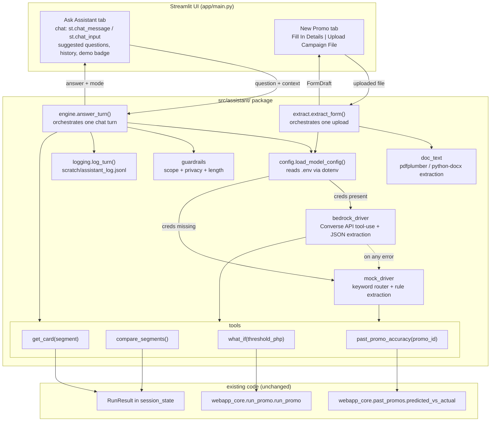

# Design Document

## Overview

Part 6 Assistant adds two capabilities to the existing Part 5 Streamlit webapp, both living in a new `src/assistant/` package:

1. A **conversational assistant** that replaces the static placeholder body of the "Ask Assistant" tab in `app/main.py` with a real chat surface.
2. A **campaign-file upload** on the New Promo tab that extracts text from a PDF/DOCX brief and pre-fills the promo form for review before any run.

The assistant answers an analyst's natural-language questions about the current promo run and past promos. It never computes campaign numbers itself: it exposes four tools that wrap existing Python (`webapp_core.run_promo.run_promo`, the current `RunResult` cards, and `webapp_core.past_promos.predicted_vs_actual`), and every number in a reply comes from a tool output and cites which tool produced it.

Two answer paths share one tool layer, and the same two-path split drives both chat and the campaign-file field extraction:

- **Bedrock Mode** -- when `.env` supplies valid AWS credentials, the assistant drives the conversation through Amazon Bedrock's boto3 Converse API with tool use. The model decides which tool to call; the assistant runs it and returns the result for the model to ground its answer. For uploads, Bedrock is asked to return strict JSON matching the promo form fields.
- **Mock Mode** -- when credentials are missing or any Bedrock call raises, the assistant falls back to a fully offline keyword router (for chat) and simple keyword/peso-amount rules (for upload extraction). No AWS call is attempted, and a small demo badge is shown.

Guardrails (segment-level only, scope refusal, ~120-word cap) and per-turn JSON Lines logging to `scratch/assistant_log.jsonl` apply to the chat paths. Upload processing keeps its temporary output under `scratch/` and never logs individual client data from a file.

### Design Goals

- **Reuse, never recompute.** Tools call the same functions the webapp already uses, so the assistant's numbers match the Results, What-If, and Past Promos tabs exactly.
- **Offline-first demo.** Every suggested question and every upload answers/extracts end to end with zero AWS configuration.
- **One contract, two drivers.** Bedrock and Mock Mode produce the same shapes (`ToolResult` for chat, `FormDraft` for upload); only the routing differs.
- **Privacy and safety by construction.** Tools return segment-level data only; extraction never auto-runs; invalid extracted values are dropped rather than trusted.

### Scope

In scope: the `src/assistant/` package, the chat UI wired into the Ask Assistant tab, the Upload Campaign File sub-tab on the New Promo tab, the four tools, the Bedrock and Mock drivers (chat + extraction), guardrails, and logging. Out of scope: any change to model training, the Part 1-4 pipelines, or the other webapp tabs; OCR of scanned PDFs (text-layer extraction only); any persistence beyond the append-only log.

## Architecture



### Component Responsibilities

| Component | File | Responsibility |
|---|---|---|
| Chat UI | `app/main.py` (`_render_ask_assistant_tab`) | Render history, suggested questions, input box, and demo badge; call the engine; store history in session state. |
| Upload UI | `app/main.py` (`_render_new_promo_tab`) | Render the Fill In Details / Upload Campaign File sub-tabs; accept the file; call the extractor; pre-fill and mark the form. |
| Engine | `src/assistant/engine.py` | Orchestrate one chat turn: choose driver, apply guardrails, log, return an `AssistantReply`. |
| Extractor | `src/assistant/extract.py` | Orchestrate one upload: get text, choose driver, validate, return a `FormDraft`. |
| Config | `src/assistant/config.py` | Load `ModelConfig` from `.env`; report whether Bedrock is usable. |
| Tools | `src/assistant/tools.py` | The four tool functions + their JSON schemas; wrap existing code; return `ToolResult`. |
| Doc text | `src/assistant/doc_text.py` | Extract plain text from a PDF (pdfplumber) or DOCX (python-docx) locally. |
| Bedrock driver | `src/assistant/bedrock_driver.py` | Run the Converse API tool-use loop (chat) and the strict-JSON extraction call (upload). |
| Mock driver | `src/assistant/mock_driver.py` | Keyword-route a question (chat) and rule-extract form fields (upload). |
| Guardrails | `src/assistant/guardrails.py` | Scope refusal, privacy scrub, length cap. |
| Logging | `src/assistant/logging_util.py` | Append one JSON line per turn under `scratch/`. |
| Prompts | `src/assistant/prompts.py` | System prompt text, tool-citation instructions, and the strict-JSON extraction prompt. |

### Turn Flow (chat)

1. The UI collects the question (typed or from a clicked suggested question) and the current `RunResult` from session state, then calls `engine.answer_turn(question, run_result)`.
2. The engine loads `ModelConfig`. If credentials are present it tries the Bedrock driver; if they are absent, or the Bedrock call raises, it uses the Mock driver and marks the turn `mock`.
3. The chosen driver may invoke one of the four tools. Tools read the `RunResult` (or `outputs/`) and return a segment-level `ToolResult`.
4. The engine applies guardrails (privacy scrub, scope check, length cap) to the final text.
5. The engine logs the turn to `scratch/assistant_log.jsonl` and returns an `AssistantReply` (`text`, `mode`, `tool_called`).
6. The UI appends the user message and the reply to history and reruns.

### Upload Flow (campaign file)

1. On the Upload Campaign File sub-tab, `st.file_uploader(type=["pdf", "docx"])` accepts one file; any other type is rejected with a clear message.
2. `extract.extract_form(file_bytes, filename, segment_options)` calls `doc_text` to get `Campaign_Text` locally.
3. If Bedrock is usable, the extractor asks it for strict JSON matching the form fields; otherwise (or on error) it uses the Mock rule extractor.
4. The returned values are validated field by field; invalid ones are dropped. The result is a `FormDraft` marking each field Found or Needs_Input.
5. The UI renders the pre-filled form (same widgets as Fill In Details, seeded from the `FormDraft`) with a Found/Needs Input badge per field; the user edits and presses Run Analysis. Nothing runs automatically.

## Components and Interfaces

## Data Models

```python
# src/assistant/models.py
from __future__ import annotations
from dataclasses import dataclass, field
from typing import Any, Literal

Mode = Literal["bedrock", "mock"]
FieldStatus = Literal["found", "needs_input"]

@dataclass(frozen=True)
class ModelConfig:
    """Bedrock settings read from .env (Requirement 3.2)."""
    aws_access_key_id: str | None
    aws_secret_access_key: str | None
    aws_region: str | None
    bedrock_model_id: str | None

    @property
    def is_usable(self) -> bool:
        """True only when all four Bedrock settings are present (Req 3.1, 4.1)."""
        return all((
            self.aws_access_key_id, self.aws_secret_access_key,
            self.aws_region, self.bedrock_model_id,
        ))

@dataclass(frozen=True)
class ToolResult:
    """Segment-level result of one tool call, tagged with its source (Req 2.6)."""
    tool_name: str          # "get_card" | "compare_segments" | "what_if" | "past_promo_accuracy"
    ok: bool                # False for not-available / needs-a-run
    data: dict[str, Any]    # segment-level only; never a client_id
    note: str = ""          # e.g. "no card for that segment", "run a promo first"

@dataclass(frozen=True)
class AssistantReply:
    """What the engine returns to the UI for one chat turn."""
    text: str
    mode: Mode
    tool_called: str | None

@dataclass(frozen=True)
class FieldDraft:
    """One pre-filled form field and whether it was found (Requirement 7.7)."""
    value: Any             # validated value, or a safe default when needs_input
    status: FieldStatus    # "found" | "needs_input"

@dataclass(frozen=True)
class FormDraft:
    """The seven Promo_Form_Fields extracted from a Campaign_File, each a
    FieldDraft marked found/needs_input, plus the mode that produced it."""
    product_type: FieldDraft
    mechanic: FieldDraft
    threshold_php: FieldDraft
    reward: FieldDraft
    eligible_segments: FieldDraft  # value is list[str]
    min_adb: FieldDraft
    channels: FieldDraft           # value is list[str] of Allowed_Channel_Label
    mode: Mode
```

### Config

```python
# src/assistant/config.py
def load_model_config() -> ModelConfig:
    """Read AWS_ACCESS_KEY_ID, AWS_SECRET_ACCESS_KEY, AWS_REGION, and
    BEDROCK_MODEL_ID from .env via python-dotenv, falling back to the process
    environment. Never hardcodes credentials (Requirement 3.2)."""
```

`load_dotenv()` is called once; values are read with `os.getenv`. `.env` is already listed in `.gitignore` (Requirement 3.4 is already satisfied -- the design keeps it there).

### Tools (chat)

All tools return a `ToolResult` and take a `RunResult | None` where they need the current run. They are pure wrappers over existing code and perform the privacy reduction before returning.

```python
# src/assistant/tools.py
SEGMENT_LABELS = ["Ready Toppers", "Willing but Stretched", "Untapped Wealth", "Not Now"]

def get_card(segment: str, run_result: RunResult | None) -> ToolResult:
    """Return one segment's decision card from the current RunResult
    (action, dominant_channel, message_angle, expected_joiners + 90% range,
    expected_value, top_drivers, excluded_by_reason). ok=False with a note
    when no run exists (Req 1.4) or that segment has no card (Req 2.2)."""

def compare_segments(run_result: RunResult | None) -> ToolResult:
    """Return all four current-run decision cards together (Req 2.3)."""

def what_if(threshold_php: float, run_result: RunResult | None,
            run_context: RunContext) -> ToolResult:
    """Rebuild a PromoSpec from run_result.promo_spec with only threshold_php
    changed, rerun webapp_core.run_promo.run_promo over the current eligible
    audience (no retraining), and return per-segment totals plus the delta vs
    the current run (Req 2.4)."""

def past_promo_accuracy(promo_id: str) -> ToolResult:
    """Return predicted vs actual join rate per segment for a past promo from
    outputs/cards.json and data/promo_leads.csv via
    webapp_core.past_promos.predicted_vs_actual (Req 2.5)."""
```

Tool-to-source mapping:

- `get_card` / `compare_segments` read `run_result.cards` (list of card dicts already shaped with the keys the Results tab uses: `action`, `dominant_channel`, `message_angle`, `expected_joiners`, `joiners_90_low`, `joiners_90_high`, `expected_value`, `top_drivers`, `excluded_by_reason`).
- `what_if` uses `dataclasses.replace(run_result.promo_spec, threshold_php=...)` then calls `run_promo(spec, model, config, data)`. Because `what_if` needs the model, config, and data bundle, the engine passes a small `RunContext` (the reloaded model, `Part1Config`, and the `data/` bundle) built the same way `app/main.py._execute_run` builds them. On a missing-model error the tool returns `ok=False` with the run-pipeline note rather than raising.
- `past_promo_accuracy` mirrors `_render_past_promos_tab`: load `outputs/cards.json`, read `data/promo_leads.csv`, call `read_sendable_ids_by_cell`, then `predicted_vs_actual`, and keep only `(segment, predicted, actual)` per row for the requested `promo_id`.

Each tool's JSON schema (for Bedrock tool use) is declared alongside it in a `TOOL_SPECS` list: `get_card` takes a `segment` enum over `SEGMENT_LABELS`, `compare_segments` takes no args, `what_if` takes a numeric `threshold_php`, and `past_promo_accuracy` takes a string `promo_id`.

### Doc Text (extraction source)

```python
# src/assistant/doc_text.py
def extract_text(file_bytes: bytes, filename: str) -> str:
    """Return plain text from a Campaign_File. A `.pdf` is read with pdfplumber
    (page text joined with newlines); a `.docx` with python-docx (paragraph text
    joined). Extraction is fully local (Requirement 7.3). Raises UnsupportedFile
    for any other extension/content type (Requirement 7.2)."""
```

The UI already restricts the `st.file_uploader` to `["pdf", "docx"]`, but `extract_text` revalidates the extension so the rejection rule holds even if called directly. No bytes are sent to any network service for extraction; only the resulting text may later be sent to Bedrock for field parsing when credentials exist.

### Extractor (upload orchestration)

```python
# src/assistant/extract.py
def extract_form(file_bytes: bytes, filename: str,
                 segment_options: list[str]) -> FormDraft:
    """One upload end to end: extract text locally, ask Bedrock for strict
    JSON when usable else rule-extract, validate every field, and return a
    FormDraft. Never raises on a Bedrock error -- it falls back to Mock."""
```

Orchestration:

1. `Campaign_Text = doc_text.extract_text(file_bytes, filename)`.
2. `cfg = load_model_config()`. If `cfg.is_usable`, try `bedrock_driver.extract_fields_json(Campaign_Text, cfg)`; on any exception, or when not usable, call `mock_driver.extract_fields_rules(Campaign_Text)`. The chosen path sets `FormDraft.mode`.
3. Both drivers return a plain `dict[str, Any]` of raw candidate values. `extract_form` then runs a shared `validate_fields(candidates, segment_options)` pass that drops any invalid value and builds the seven `FieldDraft`s.

Validation rules (Requirement 7.4, 7.6, identical for both modes so the model can never inject a bad value):

| Field | Accepted when | Dropped to Needs_Input when |
|---|---|---|
| `product_type` | in `PRODUCT_TYPE_OPTIONS` (Savings, Time Deposit, Investment, Credit Card) | not a recognized product |
| `mechanic` | in `MECHANIC_OPTIONS` (TOP_UP, NEW_ACCOUNT, ADB_INCREASE, OTHER) | not a recognized mechanic |
| `threshold_php` | a finite number >= 0 | non-numeric or negative |
| `reward` | a non-empty string | empty |
| `eligible_segments` | a non-empty subset of `segment_options` (Customer_DNA segments) | no value matches |
| `min_adb` | a finite number >= 0 | non-numeric or negative |
| `channels` | a non-empty subset of {"In-app", "Email", "SMS"} after mapping | no name maps to an Allowed_Channel_Label |

Channel mapping (Requirement 7.6) normalizes case and common synonyms to exactly one label: `in-app / inapp / app / push / notification -> "In-app"`; `email / e-mail -> "Email"`; `sms / text / message -> "SMS"`. Any unmappable name is dropped. A field that survives validation is `found`; any dropped or missing field is `needs_input` with a safe default (e.g. the current form default), so the user fills it in.

### Bedrock Driver

The same module serves both paths, sharing one boto3 `bedrock-runtime` client built from `ModelConfig`.

```python
# src/assistant/bedrock_driver.py
def answer_with_bedrock(question, run_result, run_context, config) -> tuple[str, str | None]:
    """Drive the Converse API tool-use loop. Returns (final_text, tool_called).
    Raises on any boto3/Bedrock error so the engine can fall back to Mock."""

def extract_fields_json(campaign_text, config) -> dict[str, Any]:
    """Ask Bedrock to return STRICT JSON matching the seven form fields (Req 7.4).
    Parse the JSON; return the raw candidate dict. Raises on any error or unparsable
    output so extract_form falls back to Mock (Req 7.5)."""
```

Chat loop:

1. Build a boto3 `bedrock-runtime` client from `ModelConfig`.
2. Call `client.converse(modelId=..., system=[{"text": SYSTEM_PROMPT}], messages=[...], toolConfig={"tools": [{"toolSpec": s} for s in TOOL_SPECS]})`.
3. If `stopReason == "tool_use"`, extract the `toolUse` block, dispatch to the matching tool function, and send the `ToolResult` back as a `toolResult` content block in a new user turn. Repeat, bounded to a small max (e.g. 3 iterations) to prevent runaway loops.
4. When the model returns text, return that text and the name of the tool that was called (if any).

Extraction call: a single `converse` call with a system prompt that demands JSON-only output with the seven keys and their allowed values, and the `Campaign_Text` as the user message. The response text is parsed with `json.loads` (after stripping any code fence); anything unparsable raises.

Any exception (missing credentials surfaced late, network failure, throttling, bad model id, unparsable JSON) propagates to the caller, which then switches to Mock Mode (Requirements 4.1, 7.5).

### Mock Driver

```python
# src/assistant/mock_driver.py
def answer_with_mock(question, run_result, run_context) -> tuple[str, str | None]:
    """Keyword-route the question to one tool, run it, and render a templated,
    tool-citing answer (Requirement 4.2). Never calls AWS."""

def extract_fields_rules(campaign_text) -> dict[str, Any]:
    """Derive raw form-field candidates from Campaign_Text using simple keyword
    and peso-amount rules (Requirement 7.5). Never calls AWS."""
```

Chat keyword routing (first match wins, so suggested questions all resolve):

| Signal in the question | Tool |
|---|---|
| a threshold number or the words "threshold" / "what if" | `what_if` |
| a past-promo id pattern (e.g. `P001`) or "accurate" / "actual" | `past_promo_accuracy` |
| "compare" / "all segments" / "which segment" / "skip" | `compare_segments` |
| a known segment label, or "why" + a segment name | `get_card` |
| none of the above | scope refusal (no tool) |

Each branch has a short template that interpolates the `ToolResult` numbers and names the tool, e.g. `"Based on get_card: Ready Toppers -- Include, In-app, ~N expected joiners (90% L-H). (source: get_card)"`. Templates are capped to the length guardrail.

Upload rule extraction (Mock): scan `Campaign_Text` case-insensitively for each field -- product/mechanic keywords and synonyms, a peso amount for `threshold_php` / `min_adb` (regex over `P\w?\s>[0-9,.]+` and `₱`, taking the first near "threshold" / "minimum ADB"), segment names, and channel names. The raw candidates go through the same `validate_fields` pass as the Bedrock path.

### Guardrails

```python
# src/assistant/guardrails.py
def is_in_scope(question: str) -> bool: ...        # Req 5.3
def scrub_privacy(text: str) -> str: ...           # Req 5.1, 5.2
def cap_length(text: str, max_words: int = 120) -> str: ...  # Req 5.4
```

- **Privacy:** Tools never emit a `client_id`, so the primary defense is structural. `scrub_privacy` is a defense-in-depth pass that removes any token matching a `client_id` shape before the text is returned or logged (Requirements 5.1, 5.2, 6.3, and 7.9 for upload-derived text).
- **Scope:** `is_in_scope` checks for campaign vocabulary (segment names, "promo", "threshold", "joiners", a promo id); out-of-scope questions get a fixed polite redirect in both modes (Requirement 5.3). In Bedrock Mode the system prompt also instructs refusal; the local check is the backstop.
- **Length:** `cap_length` trims to ~120 words with an ellipsis if needed (Requirement 5.4).

### Logging

```python
# src/assistant/logging_util.py
def log_turn(question, tool_called, answer, mode) -> None:
    """Append one JSON object as a single line to scratch/assistant_log.jsonl,
    creating scratch/ if needed. Never writes a client_id (Requirement 6)."""
```

Record shape: `{"ts": <iso>, "question": ..., "tool_called": ... | null, "answer": ..., "mode": "bedrock" | "mock"}`. Written with `json.dumps(record)` + `"\n"` in append mode so earlier lines are never rewritten (Requirement 6.2). The answer is already privacy-scrubbed before logging (Requirement 6.3). The path is always under `scratch/`, created with `Path("scratch").mkdir(exist_ok=True)` (Requirement 6.4). Only chat turns are logged; upload processing writes no log record and keeps any temporary output under `scratch/` (Requirement 7.9).

### UI Wiring

**Ask Assistant tab** (`_render_ask_assistant_tab`) is rewritten to:

- Initialize `st.session_state["assistant_history"]` (a list of `{"role", "content"}` dicts) if absent (Requirement 1.3).
- Render a title and one-line description inside a `theme.card` so the Poppins / red-gradient / rounded style is preserved (Requirement 1.1).
- Render four suggested questions as buttons (threshold, segment-priority, segment-skip, past-promo-accuracy). A click sets a pending question in session state and reruns (Requirement 1.2).
- Replay history with `st.chat_message`, read new input with `st.chat_input`, and on a new question (typed or pending) call `engine.answer_turn(...)`, then append both messages (Requirement 1.3).
- Show a small demo badge (a `theme.chip`) above or beside the answer when the reply's `mode == "mock"` (Requirement 4.3).
- When `run_result` is `None` and the question needs the current run, the tool returns a needs-a-run note and the assistant replies that the user should run a promo first (Requirement 1.4).

**New Promo tab** (`_render_new_promo_tab`) is restructured into two sub-tabs with `st.tabs(["Fill In Details", "Upload Campaign File"])` (Requirement 7.1):

- **Fill In Details** holds today's promo form unchanged.
- **Upload Campaign File** shows an `st.file_uploader(type=["pdf", "docx"])`. On upload it calls `extract.extract_form(...)` with the distinct Customer_DNA `segment_options` (the same list the manual form offers), stores the returned `FormDraft` in session state, and renders the same promo form widgets seeded from it. Each field carries a small **Found** or **Needs Input** badge (a `theme.chip`) per its `FieldDraft.status`, and a demo badge when `FormDraft.mode == "mock"` (Requirements 7.7, 4.3).
- The Run Analysis button lives inside the same form; nothing about the upload triggers a run, so the existing submit-then-`_execute_run` path is the only way to start a run (Requirement 7.8). The upload only seeds widget defaults.

## Correctness Properties

These properties are the executable specification, validated with property-based tests (Hypothesis), following the existing `tests/strategies_part5.py` convention. Each names the function under test and the invariant.

### Property 1: Mode selection is total and credential-driven
For any `ModelConfig`, `engine` selects Bedrock only when `config.is_usable` is true, and Mock otherwise; and when a Bedrock attempt raises, the engine still returns an `AssistantReply` with `mode == "mock"` (never propagates the exception).

**Validates: Requirements 3.1, 4.1**

### Property 2: Numbers come only from tools, with a citation
For any answered turn that reports a campaign number, `tool_called` is non-null and the answer text names that tool. No number appears in a reply whose `tool_called` is null (scope refusals and needs-a-run notices carry no campaign numbers).

**Validates: Requirements 2.1, 2.6**

### Property 3: Tool outputs equal the webapp's own numbers
For any current `RunResult`, `get_card(segment)` returns exactly the card dict fields for that segment in `run_result.cards` (or `ok=False` when absent), and `compare_segments()` returns exactly the four cards the Results tab renders. `what_if(t)` equals `run_promo(replace(spec, threshold_php=t), ...)` segment totals. `past_promo_accuracy(id)` equals the `predicted_vs_actual` rows for that id.

**Validates: Requirements 2.2, 2.3, 2.4, 2.5**

### Property 4: No individual client data ever leaves the boundary
For any tool result, reply text, and log record, no `client_id` (nor any individual client field) appears. `scrub_privacy` is idempotent and removes client-id-shaped tokens.

**Validates: Requirements 5.1, 5.2, 6.3, 7.9**

### Property 5: Replies respect the length cap
For any reply, `cap_length` yields text of at most ~120 words.

**Validates: Requirements 5.4**

### Property 6: Logging is append-only valid JSON Lines, under scratch/
For any sequence of turns, each appended line is independently valid JSON with the required keys, earlier lines are unchanged, and the file is created under `scratch/` when missing.

**Validates: Requirements 6.1, 6.2, 6.4**

### Property 7: Offline suggested questions answer end to end
With no credentials configured, each of the four suggested questions produces a non-empty `AssistantReply` with `mode == "mock"` and no AWS client is constructed.

**Validates: Requirements 4.4**

### Property 8: Out-of-scope questions are refused in both modes
For a question lacking any campaign vocabulary, both the Mock driver and the guarded Bedrock path return the fixed redirect with no tool called.

**Validates: Requirements 5.3**

### Property 9: Local extraction by file type
For any PDF, `extract_text` routes to pdfplumber; for any DOCX, to python-docx; for any other extension it raises UnsupportedFile. No network call is made during extraction.

**Validates: Requirements 7.2, 7.3**

### Property 10: Extracted fields are always valid or dropped
For any candidate dict from either driver, `validate_fields` yields a `FormDraft` where every `found` field's value is in its allowed set (`product_type`/`mechanic` in options, numbers finite and >= 0, segments a subset of `segment_options`, channels a subset of the three Allowed_Channel_Labels), and every other field is `needs_input`. No invalid or unrecognized value is ever marked `found`.

**Validates: Requirements 7.4, 7.6**

### Property 11: Upload never auto-runs
Extraction returns only a `FormDraft` and never calls `run_promo`; a run happens only through the existing Run Analysis form submit path.

**Validates: Requirements 7.8**

## Error Handling

| Condition | Handling | Requirement |
|---|---|---|
| Missing AWS credentials | `config.is_usable` is false; engine/extractor use Mock Mode, no AWS client built. | 4.1, 4.4, 7.5 |
| Bedrock call raises (network, throttling, bad model id) | Caught in the engine/extractor; fall back to Mock Mode, mark `mock`, show demo badge. | 4.1, 4.3, 7.5 |
| Bedrock returns unparsable/invalid extraction JSON | `extract_fields_json` raises; extractor falls back to Mock rules. | 7.4, 7.5 |
| No promo run in session state | Tools needing the run return `ok=False` with a needs-a-run note; assistant asks the user to run a promo first. | 1.4 |
| Segment has no card | `get_card` returns `ok=False` with a not-available note. | 2.2 |
| Missing model artifact during `what_if` | `run_promo` raises `FileNotFoundError`; tool returns `ok=False` with the run-pipeline message. | 2.4 |
| Missing `cards.json` / `promo_leads.csv` | `past_promo_accuracy` returns `ok=False` with a not-available note. | 2.5 |
| Unsupported upload file type | UI restricts to pdf/docx; `extract_text` raises UnsupportedFile and the tab shows a clear rejection message. | 7.2 |
| Empty / unreadable document text | Extraction yields a FormDraft with all fields `needs_input`; the user fills the form manually. | 7.7 |
| Unknown / out-of-scope question | Scope guardrail returns the fixed redirect, no tool called. | 5.3 |
| `scratch/` missing | Created before the first write. | 6.4, 7.9 |

Guardrails and logging run regardless of path, so a failure in one mode never bypasses privacy or the audit log. Extraction never raises on a Bedrock failure -- it always degrades to Mock and then to an all-Needs_Input form when nothing could be parsed.

## Testing Strategy

- **Property-based tests** (Hypothesis) implement Properties 1-11 in `tests/`, reusing and extending `tests/strategies_part5.py` with generators for `ModelConfig`, `RunResult`-shaped cards, questions, and synthetic `Campaign_Text` snippets. Naming follows the existing `test_part6_*_property.py` convention.
- **Unit tests** cover: `config.load_model_config` precedence, each tool's not-available branch, the Mock router's keyword table for all four suggested questions, the channel mapper (each synonym -> label, unmappable dropped), the peso-amount regex, `scrub_privacy` idempotence, `cap_length` boundaries, and `log_turn` append semantics.
- **Doc-text tests** use small fixture files (a one-paragraph DOCX built with python-docx and a one-page PDF) under `scratch/`, asserting the right library is used and that an unsupported extension raises.
- **Integration tests** drive (1) `engine.answer_turn` for each suggested question with no credentials (offline, tool-cited, length-capped, logged -- Properties 2, 5, 6, 7) and (2) `extract.extract_form` over a sample brief with no credentials, asserting a reviewable `FormDraft` with validated fields and no auto-run (Properties 10, 11).
- **Bedrock paths** are tested with a stubbed boto3 client: a fake `converse` returning a scripted `tool_use` then text exercises the chat tool-use loop; a fake `converse` returning strict JSON exercises extraction; a raising stub verifies the Mock fallback for both (Property 1).
- All tests run under ``.\\.venv\\Scripts\\python.exe`` with `PYTHONPATH=src`. New Python files are saved UTF-8 without BOM; any scratch output stays under `scratch/`.
