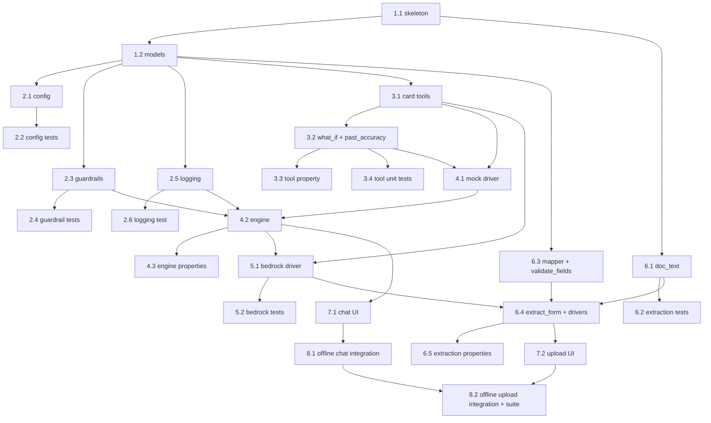

# Implementation Plan: Part 6 Assistant

## Overview

Build the `src/assistant` package incrementally and test-first, in Python (the design uses concrete Python, so no language selection is needed). Start with package scaffolding and the data model, then the `ModelConfig` loader and guardrails and logging (all pure and UI-free), then the four tools over the existing `webapp_core` functions, then the Mock chat driver and the engine orchestrator, then the Bedrock chat driver, then the document-text extraction plus the upload field-extraction pipeline (Mock rules, Bedrock strict JSON, and the shared validator), and finally wire both the chat UI into the Ask Assistant tab and the two New Promo sub-tabs into `app/main.py`. Each logic block is paired with its Hypothesis property test (Properties 1-11) and light unit/edge tests so correctness is validated as the package grows. Tests live under `tests/` as `test_part6_*.py` and run with `PYTHONPATH=src` under the project virtualenv ``.\\.venv\\Scripts\\python.exe``. New Python files are saved UTF-8 without a BOM; any temporary output stays under `scratch/`.

## Tasks

- [x] 1. Set up package scaffolding, dependencies, and the data model
  - [x] 1.1 Create the package skeleton
    - Create `src/assistant/__init__.py` and empty module files `models.py`, `config.py`, `guardrails.py`, `logging_util.py`, `tools.py`, `prompts.py`, `mock_driver.py`, `bedrock_driver.py`, `engine.py`, `doc_text.py`, `extract.py` to anchor imports
    - Confirm `python-dotenv`, `pdfplumber`, `python-docx`, `pytest`, and `hypothesis` are present in `requirements.txt` (all were added already; add any that are missing). `boto3` is used only on the Bedrock path and imported lazily
    - _Requirements: 3.2_

  - [x] 1.2 Implement `models.py` with the shared dataclasses and literals
    - Define `Mode = Literal["bedrock", "mock"]` and `FieldStatus = Literal["found", "needs_input"]`
    - Define frozen dataclasses `ModelConfig` (with the `is_usable` property true only when all four Bedrock settings are present), `ToolResult` (`tool_name`, `ok`, `data`, `note`), `AssistantReply` (`text`, `mode`, `tool_called`), `FieldDraft` (`value`, `status`), and `FormDraft` (the seven `FieldDraft` fields plus `mode`)
    - _Requirements: 3.1, 4.1, 2.6, 7.7_

- [x] 2. Implement config, guardrails, and logging (pure core)
  - [x] 2.1 Implement `config.load_model_config`
    - Call `load_dotenv()` once and read `AWS_ACCESS_KEY_ID`, `AWS_SECRET_ACCESS_KEY`, `AWS_REGION`, and `BEDROCK_MODEL_ID` via `os.getenv`, returning a `ModelConfig`; never hardcode credentials
    - _Requirements: 3.2, 3.4_

  - [x] 2.2 Write unit tests for `load_model_config`
    - All four vars set yields `is_usable == True`; any missing yields `False`; no credential value is hardcoded in source
    - _Requirements: 3.2, 3.4, 4.1_

  - [x] 2.3 Implement the guardrails in `guardrails.py`
    - `is_in_scope(question)` true only when campaign vocabulary is present (segment names, "promo", "threshold", "joiners", a promo id); `scrub_privacy(text)` removes any `client_id`-shaped token and is idempotent; `cap_length(text, max_words=120)` trims to ~120 words with an ellipsis
    - Expose the fixed out-of-scope redirect string used by both drivers
    - _Requirements: 5.1, 5.2, 5.3, 5.4_

  - [x] 2.4 Write property tests for the privacy and length guardrails
    - **Property 4: No individual client data ever leaves the boundary (scrub_privacy removes client-id-shaped tokens and is idempotent)**
    - **Validates: Requirements 5.1, 5.2, 6.3, 7.9**
    - **Property 5: Replies respect the length cap (cap_length yields at most ~120 words)**
    - **Validates: Requirements 5.4**

  - [x] 2.5 Implement `logging_util.log_turn`
    - Create `scratch/` with `Path("scratch").mkdir(exist_ok=True)`, then append one `json.dumps({"ts", "question", "tool_called", "answer", "mode"})` plus `"\n"` to `scratch/assistant_log.jsonl` without rewriting earlier lines; the answer is already privacy-scrubbed before it is passed in
    - _Requirements: 6.1, 6.2, 6.3, 6.4_

  - [x] 2.6 Write property test for logging
    - **Property 6: Logging is append-only valid JSON Lines under scratch/ (each line independently valid JSON with the required keys, earlier lines unchanged, file created when missing)**
    - **Validates: Requirements 6.1, 6.2, 6.4**

- [x] 3. Implement the four tools over the existing webapp_core functions
  - [x] 3.1 Implement the current-run card tools in `tools.py`
    - `get_card(segment, run_result)` returns that segment's card dict fields (`action`, `dominant_channel`, `message_angle`, `expected_joiners`, `joiners_90_low`/`joiners_90_high`, `expected_value`, `top_drivers`, `excluded_by_reason`) from `run_result.cards`; `compare_segments(run_result)` returns all four cards together
    - Return `ok=False` with a needs-a-run note when `run_result is None`, and `ok=False` with a not-available note when the segment has no card; never include a `client_id`
    - Define `SEGMENT_LABELS` and the `TOOL_SPECS` JSON schemas (`get_card` segment enum, `compare_segments` no-args, `what_if` numeric `threshold_php`, `past_promo_accuracy` string `promo_id`)
    - _Requirements: 2.1, 2.2, 2.3, 2.6, 1.4_

  - [x] 3.2 Implement the what_if and past_promo_accuracy tools
    - `what_if(threshold_php, run_result, run_context)` rebuilds the spec with `dataclasses.replace(run_result.promo_spec, threshold_php=...)`, reruns `webapp_core.run_promo.run_promo(spec, model, config, data)` using the passed `RunContext`, and returns per-segment totals plus the delta vs the current run; on `FileNotFoundError` return `ok=False` with the run-pipeline note
    - `past_promo_accuracy(promo_id)` loads `outputs/cards.json`, reads `data/promo_leads.csv`, calls `read_sendable_ids_by_cell` then `predicted_vs_actual`, and keeps only `(segment, predicted, actual)` per row for that id; missing files return `ok=False` with a not-available note
    - Define the `RunContext` helper (the reloaded model, `Part1Config`, and the `data/` bundle) built the same way `app/main.py._execute_run` builds them
    - _Requirements: 2.1, 2.4, 2.5, 2.6_

  - [x] 3.3 Write property test that tool outputs equal the webapp's own numbers
    - **Property 3: Tool outputs equal the webapp's own numbers (get_card/compare_segments mirror run_result.cards, what_if equals a re-run with the replaced threshold, past_promo_accuracy equals predicted_vs_actual)**
    - **Validates: Requirements 2.2, 2.3, 2.4, 2.5**

  - [x] 3.4 Write unit tests for the tool not-available branches
    - `get_card`/`compare_segments` with `run_result=None` return `ok=False` needs-a-run notes; `get_card` for a segment with no card returns not-available; missing `cards.json`/`promo_leads.csv` makes `past_promo_accuracy` return not-available
    - _Requirements: 1.4, 2.2, 2.5_

- [x] 4. Implement the Mock chat driver and the engine orchestrator
  - [x] 4.1 Implement `mock_driver.answer_with_mock`
    - Keyword-route first-match-wins: threshold number or "threshold"/"what if" -> `what_if`; a promo-id pattern or "accurate"/"actual" -> `past_promo_accuracy`; "compare"/"all segments"/"which segment"/"skip" -> `compare_segments`; a known segment label -> `get_card`; else the scope refusal with no tool
    - Run the routed tool and render a templated answer that interpolates the `ToolResult` numbers and cites the tool; never call AWS; return `(answer_text, tool_called)`
    - _Requirements: 4.2, 2.1, 2.6, 5.3_

  - [x] 4.2 Implement `engine.answer_turn`
    - Load `ModelConfig`; if `is_usable` try the Bedrock driver in a `try` and on any exception fall back to Mock; if not usable go straight to Mock (no AWS client constructed)
    - Apply the scope check, privacy scrub, and length cap; log the turn; return an `AssistantReply(text, mode, tool_called)` where `mode` reflects the path actually taken
    - _Requirements: 3.1, 4.1, 4.3, 5.1, 5.2, 5.3, 5.4, 6.1, 1.4_

  - [x] 4.3 Write property tests for mode selection, citation, and scope
    - **Property 1: Mode selection is total and credential-driven (Bedrock only when is_usable, Mock otherwise, and a raising Bedrock attempt still yields mode==mock)**
    - **Validates: Requirements 3.1, 4.1**
    - **Property 2: Numbers come only from tools, with a citation (any reply reporting a number has a non-null tool_called that the text names; a null tool_called carries no campaign number)**
    - **Validates: Requirements 2.1, 2.6**
    - **Property 8: Out-of-scope questions are refused in both modes (the fixed redirect with no tool called)**
    - **Validates: Requirements 5.3**

- [x] 5. Implement the Bedrock chat driver (Converse API tool use)
  - [x] 5.1 Implement `prompts.py` and `bedrock_driver.answer_with_bedrock`
    - Add the system prompt (tool-citation and scope-refusal instructions) in `prompts.py`
    - Build a lazily-imported boto3 `bedrock-runtime` client from `ModelConfig`; call `converse` advertising `TOOL_SPECS`; on `stopReason == "tool_use"` dispatch the named tool, return its `ToolResult` as a `toolResult` block, and loop (bounded to ~3 iterations); return `(final_text, tool_called)` and raise on any boto3/Bedrock error so the engine falls back to Mock
    - _Requirements: 3.1, 3.3_

  - [x] 5.2 Write unit tests for the Bedrock chat loop with a stubbed client
    - A fake `converse` that returns a scripted `tool_use` then text drives the loop through one tool call and names the tool; a raising fake client makes `answer_with_bedrock` raise (so the engine can fall back)
    - _Requirements: 3.1, 3.3, 4.1_

- [x] 6. Implement local document text extraction and the upload field-extraction pipeline
  - [x] 6.1 Implement `doc_text.extract_text`
    - Route by extension: `.pdf` -> pdfplumber (page text joined), `.docx` -> python-docx (paragraph text joined); raise `UnsupportedFile` for any other extension; extraction is fully local with no network call
    - _Requirements: 7.2, 7.3_

  - [x] 6.2 Write property/doc-text tests for extraction routing
    - **Property 9: Local extraction by file type (PDF -> pdfplumber, DOCX -> python-docx, any other extension raises UnsupportedFile, no network call)**
    - **Validates: Requirements 7.2, 7.3**
    - Use small fixture files (a one-paragraph DOCX built with python-docx and a one-page PDF) written under `scratch/`

  - [x] 6.3 Implement the channel mapper and shared `validate_fields` in `extract.py`
    - Channel mapping: `in-app/inapp/app/push/notification -> "In-app"`, `email/e-mail -> "Email"`, `sms/text/message -> "SMS"`; drop any unmappable name
    - `validate_fields(candidates, segment_options)` builds the seven `FieldDraft`s: accept `product_type`/`mechanic` only in their option lists, numbers only when finite and >= 0, `reward` only when non-empty, `eligible_segments` only as a non-empty subset of `segment_options`, `channels` only as a non-empty mapped subset; drop everything else to `needs_input` with a safe default
    - _Requirements: 7.4, 7.6, 7.7_
- [x] 6.4 Implement the Mock rule extractor, the Bedrock JSON extractor, and `extract_form`
    - `mock_driver.extract_fields_rules(campaign_text)`: case-insensitive keywords for product/mechanic/segments/channels and a peso-amount regex for `threshold_php`/`min_adb`, returning a raw candidate dict; never call AWS
    - `bedrock_driver.extract_fields_json(campaign_text, config)`: one `converse` call demanding strict JSON with the seven keys; parse with `json.loads` after stripping any code fence; raise on any error or unparsable output
    - `extract.extract_form(file_bytes, filename, segment_options)`: get text, try Bedrock when `is_usable` else Mock, fall back to Mock on any Bedrock exception, run `validate_fields`, and return a `FormDraft` with the `mode` actually used; never call `run_promo`
    - _Requirements: 7.3, 7.4, 7.5, 7.6, 7.7, 7.8_
- [x] 6.5 Write property tests for validation and no-auto-run
    - **Property 10: Extracted fields are always valid or dropped (every found field's value is in its allowed set; every other field is needs_input; no invalid value is ever marked found, for candidates from either driver)**
    - **Validates: Requirements 7.4, 7.6**
    - **Property 11: Upload never auto-runs (extract_form returns only a FormDraft and never calls run_promo)**
    - **Validates: Requirements 7.8**

- [x] 7. Wire the UI into app/main.py
  - [x] 7.1 Replace the Ask Assistant placeholder with the chat UI
    - In `_render_ask_assistant_tab`, initialize `st.session_state["assistant_history"]`, render a title/description in a `theme.card`, show four clickable suggested questions (threshold, segment-priority, segment-skip, past-promo-accuracy), replay history with `st.chat_message`, read `st.chat_input`, call `engine.answer_turn`, append both messages, and show a `theme.chip` demo badge when `mode == "mock"`
    - When no run exists and the question needs it, relay the needs-a-run reply; preserve Poppins/red-gradient/rounded/Title Case style
    - _Requirements: 1.1, 1.2, 1.3, 1.4, 4.3_

  - [x] 7.2 Add the New Promo Fill In Details / Upload Campaign File sub-tabs
    - Restructure `_render_new_promo_tab` with `st.tabs(["Fill In Details", "Upload Campaign File"])`; Fill In Details keeps today's form unchanged
    - Upload Campaign File shows `st.file_uploader(type=["pdf", "docx"])`, calls `extract.extract_form(..., segment_options)`, stores the `FormDraft` in session state, renders the same form widgets seeded from it with a Found/Needs Input `theme.chip` per field and a demo badge when `mode == "mock"`; reject other file types with a clear message
    - Keep Run Analysis as the only run trigger (the existing submit-then-`_execute_run` path); the upload only seeds widget defaults
    - _Requirements: 7.1, 7.2, 7.7, 7.8, 4.3_

- [x] 8. End-to-end integration and offline verification
  - [x] 8.1 Write the offline chat integration test
    - With no credentials configured, drive `engine.answer_turn` for each of the four suggested questions and assert a non-empty, tool-cited, length-capped, logged answer with `mode == "mock"` and no AWS client constructed
    - **Property 7: Offline suggested questions answer end to end (each yields a non-empty mock-mode reply with no AWS client constructed)**
    - **Validates: Requirements 4.4**

  - [x] 8.2 Write the offline upload integration test and run the suite
    - Drive `extract.extract_form` over a sample PDF and DOCX brief with no credentials and assert a reviewable `FormDraft` with validated fields, channels mapped to the three labels, and no run triggered
    - Run the full `test_part6_*` suite with `PYTHONPATH=src` under the virtualenv and fix any failures; remove temporary fixture files from `scratch/`
    - _Requirements: 2.1, 4.4, 7.7, 7.8, 7.9_
## Task Dependency Graph



**Critical path:** 1.1 -> 1.2 -> 3.1 -> 3.2 -> 4.1 -> 4.2 -> 7.1 -> 8.1 -> 8.2. The document-extraction branch (6.1-6.5, 7.2) and the Bedrock branch (5.1-5.2) can proceed in parallel once their shared prerequisites (the data model, tools, and engine) exist.

```json
{
  "waves": [
    { "wave": 1, "tasks": ["1.1"], "description": "Package skeleton and dependencies" },
    { "wave": 2, "tasks": ["1.2"], "description": "Shared dataclasses and literals" },
    { "wave": 3, "tasks": ["2.1", "2.3", "2.5", "3.1", "6.1", "6.3"], "description": "Pure core (config, guardrails, logging), card tools, and doc-text/validation building blocks" },
    { "wave": 4, "tasks": ["2.2", "2.4", "2.6", "3.2", "6.2"], "description": "Tests for config/guardrails/logging, the remaining tools, and extraction routing" },
    { "wave": 5, "tasks": ["3.3", "3.4", "4.1"], "description": "Tool property/unit tests and the Mock chat driver" },
    { "wave": 6, "tasks": ["4.2", "5.1", "6.4"], "description": "Engine orchestrator, Bedrock chat driver, and the extract_form pipeline" },
    { "wave": 7, "tasks": ["4.3", "5.2", "6.5", "7.1"], "description": "Engine/Bedrock/extraction tests and the chat UI" },
    { "wave": 8, "tasks": ["7.2", "8.1"], "description": "Upload UI and the offline chat integration test" },
    { "wave": 9, "tasks": ["8.2"], "description": "Offline upload integration and the full suite run" }
  ]
}
```

## Notes

- **Test-first pairing.** Each logic block is followed immediately by its property test or unit test so Properties 1-11 are validated as the package grows rather than at the end.
- **Reuse over rebuild.** The four tools wrap the existing `webapp_core.run_promo.run_promo`, the current `RunResult.cards`, and `webapp_core.past_promos.predicted_vs_actual`; no campaign number is computed in the assistant package.
- **Offline-first.** `boto3` is imported lazily on the Bedrock path only; every test and both integration runs work with no AWS credentials, and the Bedrock unit tests use a stubbed client (no network).
- **Channel labels.** The extraction mapper must emit exactly `In-app`, `Email`, `SMS` to match Part 4's channel labels; any other spelling makes leads unreachable.
- **Environment.** Run everything with ``.\\.venv\\Scripts\\python.exe`` and `PYTHONPATH=src`; save new Python files as UTF-8 without a BOM; write any temporary output (including test fixtures and the assistant log) only under `scratch/`.
