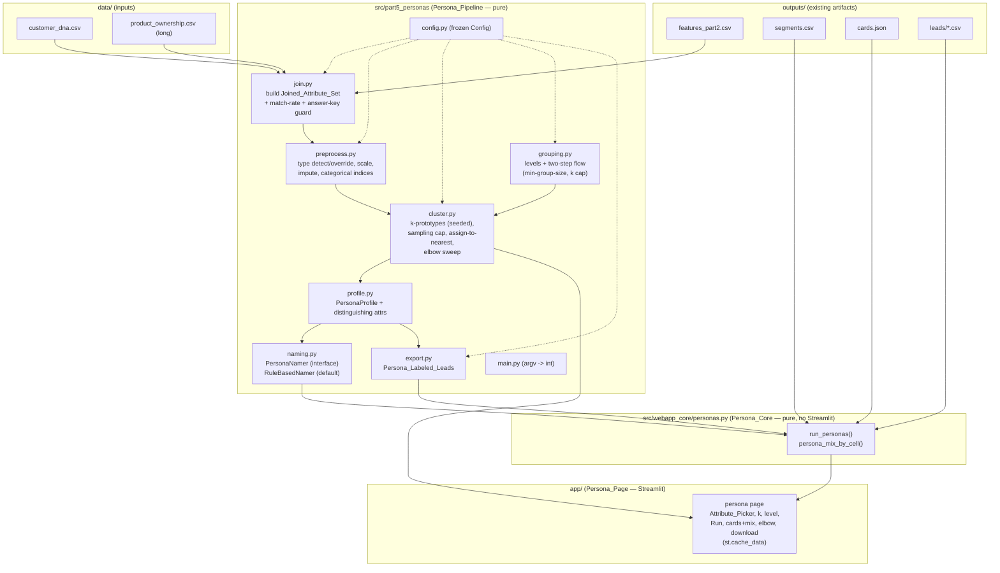

# Design Document

## Overview

The persona-segmentation feature adds a persona layer on top of DataWave's existing decision cards. It clusters leads on mixed numeric/categorical attributes using **k-prototypes** (from the `kmodes` library), turns each cluster into a named **Persona** with a profile, distinguishing attributes, and recommended actions, and layers a per-cell **Persona_Mix** onto the existing Part 4 cards. Personas can be generated for the whole lead list (`all`), per distinct business-segment value (`business-segment`), or for a single campaign's audience (`campaign`), with an optional two-step grouping flow.

The feature is delivered as three layers, matching the repo's existing convention:

1. **`src/part5_personas`** — the pure `Persona_Pipeline` package (no Streamlit imports): a frozen `Config`, a join/data builder, a preprocessing stage, a k-prototypes clustering stage, a profiling stage, a naming interface + rule-based implementation, the grouping/two-step orchestration, the leads export, and a `main(argv) -> int` CLI entry point.
2. **`src/webapp_core/personas.py`** — a `webapp_core`-style pure orchestration module (`Persona_Core`) that wires the `Persona_Pipeline` APIs into a single in-memory run for the page. No Streamlit imports, no modelling beyond the pipeline.
3. **`app/`** — the Streamlit `Persona_Page` (presentation and session-state wiring only), which owns `st.cache_data` caching and delegates all computation to `Persona_Core` / `Persona_Pipeline`.

The feature **reuses** the existing `outputs/` artifacts (`features_part2.csv`, `segments.csv`, `cards.json`, `scores.csv`, per-cell `leads/*.csv`) and the Part 3/Part 4 in-memory APIs (`assign_segments`, `build_cards`) rather than recomputing upstream results. It makes **no edits** to any `part1_optin`/`part2_network`/`part3_segments`/`part4_cards` module and is **not** added to `run_pipeline.py`. The only new dependency is `kmodes`.

Every module cites its governing requirement in its docstring (e.g. "Requirement 2.4"), matching the repo's docstring/spec-citation convention.

### Scope boundaries carried from requirements

- No changes to the Ask Assistant surface.
- No actual AWS Bedrock LLM integration — only a clean replaceable interface (resolved below).
- No campaign-response dataset.
- No change to the behavior of existing `run_pipeline.py` stages.

---

## Resolved Design Decisions

These five decisions resolve the user directives and the Requirement 7 open question. They are binding on the implementation.

### D1 — Persona mix attaches to existing per-cell cards only (resolves the Requirement 7 OPEN DESIGN QUESTION)

**Decision:** The persona layer attaches the `Persona_Mix` to the **existing per-cell Part 4 cards only**. This spec does **not** build card merging.

**Rationale / evidence:** The Part 4 cards module (`src/part4_cards/cards.py`) builds exactly one card per cell `(promo_id, segment)`:

- `build_cards_from_classified(leads, frames)` groups the classified leads `for (promo_id, segment), cell in leads.groupby(["promo_id", "segment"], ...)` and appends one card per group.
- `build_cards(segments_df, promo_dict)` is the in-memory public wrapper used by the webapp (`webapp_core/run_promo.py`), and `main.py` writes one `cards.json` entry per cell.

There is **no merge function** anywhere in `part4_cards`. Per Requirement 7.6, when merging is unsupported the persona layer attaches to per-cell cards only. Therefore the persona layer computes a per-cell `Persona_Mix` and **joins it onto the Part 4 cards by the key `(promo_id, segment)`** in the presentation/orchestration layer, leaving every Part 4 card field byte-for-byte identical (Requirements 7.2, 7.3, 7.4). No Part 4 code is touched.

### D2 — Distinguishing attributes use standardized / proportion-difference scores (Requirement 4.3)

**Decision:** Distinctiveness is ranked on **standardized** scores, never raw values, and numeric and categorical scores are made comparable on a common scale.

For a `Persona_Set` with personas `p = 1..K`, let a persona's profile hold `mean_p[f]` for each numeric attribute `f` and `prop_p[f][c]` for each category `c` of each categorical attribute `f`.

- **Numeric attribute `f` for persona `p`** — standardized deviation of the persona's mean from the across-persona distribution of persona means:

  ```
  mu_f    = mean over personas q of mean_q[f]
  sigma_f = population std over personas q of mean_q[f]      # ddof = 0
  score_numeric(p, f) = abs(mean_p[f] - mu_f) / sigma_f       if sigma_f > 0
                      = 0.0                                    if sigma_f == 0
  ```

  This is a z-score of the persona's mean against the K persona means. Dividing by `sigma_f` puts every numeric attribute on a unit-free scale so attributes measured in pesos and attributes measured in counts are directly comparable.

- **Categorical attribute `f` for persona `p`** — the maximum absolute category-proportion difference against the pooled other-personas proportion:

  ```
  For each category c of f:
    prop_other(p, f, c) = (sum over q != p of count_q[f][c]) / (sum over q != p of size_q)
    diff(p, f, c)       = abs(prop_p[f][c] - prop_other(p, f, c))     # a "lift" magnitude in [0, 1]
  score_categorical(p, f) = max over c of diff(p, f, c)
  ```

  `prop_p[f][c]` and `prop_other` are both proportions in `[0, 1]`, so their absolute difference is already on a `[0, 1]` scale — directly comparable to the standardized numeric score, which is also a dimensionless magnitude. (When there is only one persona, or every other persona is empty, the categorical score is `0.0`.)

- **Top-3 selection:** Compute one distinctiveness score per selected attribute (numeric via `score_numeric`, categorical via `score_categorical`), then take the 3 attributes with the largest scores. Ties are broken deterministically by ascending attribute name, so the ranking is a pure function of the profiles (Requirement 4.3, and the determinism of Requirement 2.11 extends here). When fewer than 3 attributes were clustered on, report all of them.

This is fully deterministic: the same `Persona_Set` profiles always yield the same top-3 per persona.

**Presentation note (Requirement 4.10):** these standardized scores and the top-3 ranking are the backend computation and are unchanged. The Persona_Page never shows z-scores or raw deviations to the user; it renders each distinguishing attribute as a plain business sentence (e.g. "Higher inflows and fewer products than other personas") computed in the `app/` layer by comparing the persona's standardized value to the across-persona average. This is a display transform over already-computed profile values and adds no modelling.

### D3 — Performance: sampling cap + nearest-prototype assignment, caching, shared elbow subsample (performance directive)

k-prototypes is slow, and the elbow sweep fits it five times (k=2..6) on top of the main run. The design keeps the Streamlit page responsive with three concrete mechanisms.

- **Sampling cap + assign-to-nearest-prototype.** The `Config` exposes `max_sample_size` (default `2000`). When a group's lead count exceeds `max_sample_size`, the clustering stage fits k-prototypes on a **seeded random subsample** of exactly `max_sample_size` rows (drawn with a `numpy.random.default_rng(Random_Seed)` over the group sorted by `client_id`, so the sample is a pure function of the inputs and the seed). k-prototypes is fit on that subsample to learn the `K` cluster prototypes (numeric centroids + categorical modes). The **full** group is then labeled by an **assignment step**: each lead is assigned to the prototype minimizing the k-prototypes mixed dissimilarity

  ```
  dissim(lead, prototype) = sum_over_numeric_f (lead[f] - proto_numeric[f])^2
                          + gamma * sum_over_categorical_f (lead[f] != proto_cat[f])
  ```

  using the same `gamma` the fit used (read back from the fitted `KPrototypes` object, `model.gamma_`). This guarantees **every** lead in the group receives exactly one persona label even though the fit saw only a subsample. When a group is at or below the cap, the fit and the assignment run over the whole group (the subsample is the whole group), so the two paths are consistent.

- **Caching.** All cluster fits and the joined attribute set are cached at the **`app/` layer** using `st.cache_data`, because `st.cache_data` must not live in `webapp_core` (Requirement 6.8 — the pure layer has no Streamlit imports). The pure layer exposes **deterministic, hashable-input functions** (`build_joined_attributes`, `run_personas`) so they are cache-friendly: given identical inputs they return identical outputs. What is cached:
  - the **Joined_Attribute_Set** keyed on `(data_fingerprint,)` where `data_fingerprint` is a hash of the source file paths + their modification stamps;
  - the **fit result** (`Persona_Set` + labels + elbow costs) keyed on a hash of `(sorted selected clustering attributes, sorted grouping attributes, k, level, business_segment_field, campaign_pool_id, max_sample_size, min_match_rate, Random_Seed)`.

  A What-If threshold tweak in the New Promo flow changes neither key, so persona results are served from cache without refitting. Re-renders (widget toggles that do not change the key) likewise hit the cache.

- **Elbow sweep reuses the subsample.** The Elbow_Plot fits k-prototypes for each candidate `k = 2..6` on the **same seeded subsample** used for the main fit (not the full population), so the five extra fits are bounded by `max_sample_size` rows rather than the full audience. Only the chosen-k fit's prototypes drive the full-population assignment.

### D4 — Config defaults, justified

The frozen `Config` carries concrete, justified defaults (full sketch in [Config](#configpy)).

- **`min_match_rate = 0.5`** — a run halts if any source matches fewer than half the leads. Half is a sensible floor: below it, the joined attribute set is mostly imputed and the personas would reflect imputation artifacts more than real data. Configurable so a looser or stricter gate can be chosen per run.
- **`min_group_size = 30`** — a group with fewer than 30 leads is flagged "too small to cluster" and produces no personas. 30 is the conventional small-sample floor; clustering a handful of leads into 2–6 personas yields unstable, uninterpretable groups.
- **`max_sample_size = 2000`** — the sampling cap above; 2000 rows keeps a single k-prototypes fit (and the five-fit elbow sweep) comfortably interactive while still being a representative sample.
- **`random_seed = 42`**, **`default_k = 3`**, **`k_min = 2`**, **`k_max = 6`** — the fixed seed (Requirement 2.11), the default k when the user specifies none (Requirement 2.8), and the inclusive k range (Requirements 2.9, 2.10, 2.12).

### D5 — Persona_Namer interface (Requirement 4.8)

**Decision:** Naming/description/action generation sits behind a narrow interface so an AWS Bedrock implementation can be dropped in later **without changing any caller**.

```python
class PersonaNaming(TypedDict):     # the naming output for one persona
    name: str
    description: str
    actions: list[str]              # 2 or 3 recommended campaign actions

class PersonaNamer(Protocol):       # the interface the pipeline depends on
    def name(self, profile: PersonaProfile, taken: set[str]) -> PersonaNaming: ...
```

- The pure `Persona_Pipeline` depends **only** on the `PersonaNamer` interface; it never imports a concrete namer type. The orchestrator passes a concrete namer in (default `RuleBasedNamer()`), so swapping implementations is a one-line change at the call site.
- **`RuleBasedNamer`** (the default) derives name, one-line description, and 2–3 actions purely from the `PersonaProfile` fields. The actions are phrased as **campaign guidance** a campaign planner can act on and, where the profile supports it, name a **suggested channel and an offer angle** (e.g. "Best reached by SMS with a savings-bundle offer", Requirement 4.5). The channel is chosen deterministically from the profile — for example the dominant category of a channel-like attribute when present, otherwise a deterministic default — and the offer angle is derived from the persona's top distinguishing attributes (e.g. high inflows → a savings/deposit angle, low product count → a cross-sell bundle). Because every step reads only the profile, an identical profile yields identical name/description/actions (Requirement 4.6 — determinism). The `taken` set lets the namer guarantee **unique names within a `Persona_Set`** (Requirement 4.9): if a derived base name is already in `taken`, the namer appends a deterministic suffix (e.g. the persona index) until the name is unique, then the caller adds it to `taken` before naming the next persona. Naming personas in a fixed order (ascending cluster label) keeps the disambiguation deterministic. These wording changes stay inside `RuleBasedNamer` and do not change the `PersonaNamer` interface or any caller.
- **Where Bedrock slots in:** a future `BedrockNamer(PersonaNamer)` living in its own module implements the same `name(profile, taken)` signature and is passed to `run_personas(..., namer=BedrockNamer(...))`. No pipeline or page code changes. (Bedrock itself is explicitly out of scope.)
- **Direction-aware base name (Requirement 4.4, revised).** `RuleBasedNamer._base_name` composes the name from the persona's top distinguishing attributes rendered in **plain business labels** plus a **direction word** — High/Low for numeric attributes, More/Fewer for categorical/flag attributes (e.g. "More app users") — so two personas that share the same top attributes but differ in direction get different names (killing most "(cluster N)" collisions). The direction is a pure, deterministic function of the already-computed stats, stored on the profile as a new `PersonaProfile.distinguishing_directions: dict[str, str]` field (one of `high`/`low`/`more`/`fewer`/`flat` per distinguishing attribute) that the profiling stage fills alongside `distinguishing` — so the `PersonaNamer.name(profile, taken)` **signature is unchanged** (Requirement 4.8) and the namer still reads only the profile. The distinguishing-attribute *ranking* (D2 / Requirement 4.3) is untouched. Disambiguation first extends to the third distinguishing attribute, then falls back to a letter suffix (" (A)", " (B)") instead of "(cluster N)"; names stay unique within a set (Requirement 4.9). The plain-label map is shared so the pure pipeline does not import `app/`. Recommended actions are unchanged.

---

## Architecture

### Component / data-flow diagram



The Part 3 (`assign_segments`) and Part 4 (`build_cards`) APIs are reused read-only through `Persona_Core` for the New Promo live flow; for past promos the `Persona_Core` reads the on-disk `outputs/` artifacts. No arrow writes into `part1..part4`.

### Persona run sequence (level = `business-segment`, two-step flow)

```mermaid
sequenceDiagram
    participant U as User (Persona_Page)
    participant A as app/ (cache)
    participant C as Persona_Core
    participant P as Persona_Pipeline

    U->>A: pick grouping attrs, clustering attrs, k, level, field; Run
    A->>A: validate config (>=1 attr, 2<=k<=6, level set)
    A->>C: run_personas(spec)  [cache key miss]
    C->>P: build_joined_attributes(cfg)
    P->>P: pivot product_ownership -> one-hot flags
    P->>P: left-join flags + features_part2 onto customer_dna
    P->>P: compute Match_Rate per source
    alt any Match_Rate < min_match_rate OR answer-key input
        P-->>C: raise (halt before output)
        C-->>A: error
    else ok
        P->>P: partition by Grouping_Attributes -> groups
        loop each group
            alt size < min_group_size
                P->>P: flag "too small to cluster" (no personas)
            else
                P->>P: cap k to group size if needed
                P->>P: subsample (<= max_sample_size), scale, impute
                P->>P: fit k-prototypes (seed=42), learn prototypes
                P->>P: assign full group to nearest prototype
                P->>P: elbow sweep k=2..6 on subsample
                P->>P: profile + distinguishing attrs
                P->>P: namer.name(profile, taken) per persona
            end
        end
        P-->>C: Persona_Sets, labels, elbow costs
        C->>C: persona_mix_by_cell() over (promo_id, segment)
        C-->>A: result (cached)
    end
    A->>U: summary cards, cluster chart, elbow, cards+mix, enable download
```

---

## Components and Interfaces

### `src/part5_personas` package layout

| Module | Responsibility | Requirements |
| --- | --- | --- |
| `config.py` | Frozen `Config` of `Path` fields + domain constants (defaults from D4). | 1.9, 2.8, 2.9, 3.12, 9.1 |
| `join.py` | Build the `Joined_Attribute_Set`; pivot product ownership; compute `Match_Rate`; answer-key guard. | 1.1–1.10 |
| `preprocess.py` | Type auto-detect + user override, standard-scale numerics, impute (mean/mode), categorical-index computation, empty-column guard. | 2.2–2.7 |
| `cluster.py` | Seeded k-prototypes fit; sampling cap; assign-to-nearest-prototype; k validation; elbow cost sweep. | 2.1, 2.8–2.12 |
| `profile.py` | `PersonaProfile` stats + distinguishing attributes (D2); drop zero-size personas. | 4.1, 4.2, 4.3, 4.7 |
| `naming.py` | `PersonaNamer` Protocol + `PersonaNaming` + `RuleBasedNamer` (D5); actions read as campaign guidance with a suggested channel + offer angle where the profile supports it. | 4.4, 4.5, 4.6, 4.8, 4.9 |
| `grouping.py` | Clustering levels (`all`/`business-segment`/`campaign`), two-step flow, min-group-size flag, k cap. | 3.2, 3.4–3.11, 5.4, 5.5 |
| `export.py` | `Persona_Labeled_Leads` (persona label + group column; empty label outside campaign pool; richer attributes left-joined), plus the default `Campaign_Leads_Export` column subset; both one row per Part 4 lead. | 8.1–8.9 |
| `main.py` | `main(argv) -> int` CLI; output-last write safety; missing-artifact halt. | 9.1, 9.3, 9.5–9.8 |

### `src/webapp_core/personas.py` (Persona_Core)

Pure orchestration — **no Streamlit imports** (Requirement 6.8). Public functions:

- `run_personas(spec: PersonaRunSpec, namer: PersonaNamer, cfg: Config, *, live_leads: pd.DataFrame | None = None) -> PersonaRunResult` — builds the joined set, runs levels/grouping/clustering/profiling/naming, returns the `PersonaSet`s, per-lead labels, and elbow costs. Deterministic given its inputs (cache-friendly).
- `persona_mix_by_cell(labels: pd.DataFrame, cards: list[dict]) -> dict[tuple[str, str], PersonaMix]` — computes the per-cell persona shares keyed by `(promo_id, segment)` and aligns them to the Part 4 cards (D1). Never mutates the cards.
- For the campaign live flow it reuses `run_promo`'s `RunResult` (session state) for the sendable-lead pool; for past promos it reads `promo_leads.csv` / `outputs/leads/`.

### `app/` Persona_Page

Streamlit composition + session state only; owns `st.cache_data` wrappers around the two pure functions (D3). It is written for a CRM manager or campaign planner who is not a data scientist, so every control carries a plain business label and statistical machinery is hidden or explained. These are presentation-and-wording concerns in `app/` only; the `Persona_Core` / `Persona_Pipeline` contracts and all backend behavior are unchanged. The page renders:

- **Clustering_Level selector** — shown as the plain labels "All leads", "By customer segment", and "By campaign", mapped to the internal values `all` / `business-segment` / `campaign` (Requirement 3.4). The internal values passed to `run_personas` are unchanged.
- **k selector** — labeled "Number of personas", integers 2–6, defaulting to 3 (Requirement 6.1).
- **Attribute_Picker** — the Joined_Attribute_Set columns grouped under the Attribute_Group headings Demographics, Lifestyle, Products owned, and Spending behavior, each shown with an Attribute_Display_Label (e.g. "Owns deposit account" for `owns_deposit`) while the raw column name is the value passed to the pipeline (Requirement 3.1). A Default_Attribute_Set is preselected so Run works immediately (Requirement 3.13). The numeric/categorical **type-override control is not rendered** — auto-detection runs in the backend (Requirement 2.2) and the override stays available through the Config/API (Requirements 2.3, 3.14). A small raw-column → `(Attribute_Group, Attribute_Display_Label)` mapping and the Default_Attribute_Set live in the `app/` layer (presentation only); columns with no mapping fall back to a title-cased label under a default group so the picker degrades gracefully.
- **Optional two-step control** — a single optional control phrased "Split by [attributes] first, then create personas within each group" (Requirement 3.8). The attributes chosen there become the `grouping_attributes` in the `PersonaRunSpec`; the Attribute_Picker selection stays the `clustering_attributes`; the "Number of personas" value stays the per-group k. The spec fields handed to the pipeline (and thus the Requirement 3.8–3.9 backend behavior) are identical to before; only the page's two separate attribute controls are collapsed into one.
- **Campaign pool selector** — the live New Promo session leads or a past promo selected by `promo_id` in {P001, P002, P003}, disabling the live choice when no run exists (Requirements 5.1, 5.2). When a promo name or date is available it is shown next to the `promo_id` while selection stays keyed on `promo_id` (Requirements 3.15, 5.3). The `promo_id → label` lookup is read from the available promo metadata in the `app/` layer; absent a label, the bare `promo_id` is shown.
- **Run control** and **persona summary cards** — one card per persona showing name, description, integer size, one-decimal percentage, the distinguishing attributes rendered as plain sentences (e.g. "Higher inflows and fewer products than other personas", Requirement 4.10) rather than z-scores, and the recommended actions phrased as campaign guidance (Requirement 4.5). The plain-sentence rendering is a presentation transform in `app/` over `PersonaProfile.distinguishing` (whose ranking is still the D2 computation): for each distinguishing attribute the page compares the persona's standardized value against the across-persona average and emits a "higher/lower/more/fewer … than other personas" phrase; it reads only already-computed profile values and adds no modelling.
- **"How the Personas Differ" comparison table** — a side-by-side table (not a chart) with one row per persona carrying the name, size, percentage, and plain-language **trait tags** (e.g. "Higher inflows", "Fewer products", "Mostly SMS-reachable") derived from the persona's distinguishing attributes and the across-persona direction signal; **no z-scores, standardized values, or clustering cost values are shown** (Requirement 6.4, revised). The tag/table builder is a pure `app/`-layer function over already-computed profile values. *(This supersedes the earlier `st.bar_chart` of standardized differences, which is removed.)*
- **No Elbow_Plot on the page (revised Requirement 6.5).** The backend still computes the elbow cost sweep (`PersonaSet.elbow_costs`, Requirement 2.12), but the page does **not** render it; the earlier "Advanced" expander holding the `Elbow_Plot` is removed to keep the default view CRM-friendly.
- **Group selector (Requirements 3.16–3.19).** When a run yields more than one group (the two-step flow, or the "By customer segment" level, which likewise produces one set per segment), the page shows a group dropdown (first group default, plus an "All groups" option). Selecting one group scopes the *entire* page to that group — persona cards, the comparison table, the Decision Cards With Persona Mix (mix computed from only that group's leads), and the download (file + filename scoped to the group, with a caption) — while a too-small group still appears and shows its actionable message. Switching groups is a pure in-memory filter over the already-cached `PersonaRunResult` (no refit, Requirement 3.19) and never changes the underlying per-lead assignments. The filter helpers (scope a `PersonaRunResult`/labels/mix inputs/download frame to one group) live in the `app/` layer as pure, unit-testable functions.
- **Decision cards + Persona_Mix** — the existing Part 4 cards, each annotated with their `Persona_Mix` badge/tab (D1), with the "persona context unavailable" fallback (Requirement 7.5).
- **Actionable messages** — validation errors (Requirement 6.2) and the "too small to cluster" flag (Requirements 3.10, 6.10) are rendered as instructions the user can act on (e.g. "This segment has only 12 leads. Pick a larger segment or combine segments."), not bare status flags. The message strings live in the `app/` layer; the backend flag/exception they are rendered from is unchanged.
- **Download controls** — defaulting to the Campaign_Leads_Export (`client_id`, persona label, group, `best_channel`, `p_join`, `control`) with the full Persona_Labeled_Leads offered as a clearly labeled optional second download, both disabled until a run completes (Requirements 6.6, 6.7, 8.8–8.10). Optionally (Requirement 10) a Persona_Brief download.

---

## Data Models

```python
# --- clustering / profiling ---

@dataclass(frozen=True)
class PersonaProfile:
    cluster_label: int                       # the raw k-prototypes label
    size: int                                # non-negative lead count (Req 4.1)
    pct_of_leads: float                      # 0.0..100.0, 1 decimal (Req 4.1)
    numeric_mean: dict[str, float]           # mean per numeric attribute
    numeric_median: dict[str, float]         # median per numeric attribute
    top_categories: dict[str, list[tuple[str, int]]]  # top-3 (cat, count) per categorical attr (Req 4.1, 4.2)
    distinguishing: list[str]                # top-3 attribute names (D2 / Req 4.3)

@dataclass(frozen=True)
class Persona:
    name: str                                # unique within its set (Req 4.9)
    description: str
    actions: list[str]                       # 2..3 (Req 4.5)
    profile: PersonaProfile

@dataclass(frozen=True)
class PersonaSet:
    group_key: str                           # "" for level=all; segment value or promo_id otherwise
    personas: list[Persona]                  # zero-size personas omitted (Req 4.7)
    k_used: int                              # possibly capped (Req 3.11)
    elbow_costs: dict[int, float]            # cost per candidate k 2..6 (Req 2.12)
    too_small: bool = False                  # group below min_group_size (Req 3.10)

@dataclass(frozen=True)
class PersonaMix:
    promo_id: str
    segment: str
    shares: dict[str, float]                 # persona name -> share; sums to ~100.0 when cell has leads (Req 7.1)
    available: bool                          # False -> render "persona context unavailable" (Req 7.5)

# --- run specification / result ---

@dataclass(frozen=True)
class PersonaRunSpec:
    level: str                               # "all" | "business-segment" | "campaign" (Req 3.4)
    clustering_attributes: list[str]         # >= 1 (Req 3.2, 3.3)
    grouping_attributes: list[str]           # two-step only; [] otherwise (Req 3.8)
    k: int                                   # 2..6 inclusive (Req 2.9, 2.10)
    business_segment_field: str | None       # "segment" | "segment_label" (Req 3.5)
    campaign_pool: str | None                # "live" | promo_id in {P001,P002,P003} (Req 5.1, 5.3)
    type_overrides: dict[str, str]           # attribute -> "numeric"|"categorical" (Req 2.3)

@dataclass(frozen=True)
class PersonaRunResult:
    persona_sets: list[PersonaSet]
    labels: pd.DataFrame                     # client_id, group, persona_name (per clustered lead)
    joined_attributes: pd.DataFrame          # the Joined_Attribute_Set used
```

### Joined_Attribute_Set construction (Requirement 1)

1. **Pivot** long `product_ownership.csv` into one row per `client_id` with one `owns_<product_type>` flag column per distinct `product_type`, where a flag is `1` when the client has at least one row of that type and `0` otherwise (Requirement 1.2). Each flag is a **categorical** feature taking exactly `{0, 1}` (Requirement 1.3).
2. **Left-join** the pivoted flags and `outputs/features_part2.csv` onto `customer_dna.csv` on `client_id`, producing exactly one row per `client_id` in `customer_dna.csv` (Requirement 1.1). Behavioral features come **only** from the existing `features_part2.csv` — Part 2 is never recomputed (Requirement 1.5).
3. **Clients absent from product ownership** get all ownership flags set to `0` (Requirement 1.4).
4. **Match_Rate** per source = fraction of leads with a matching row in that source (Requirement 1.6). If any source's rate is `0` or below `min_match_rate`, halt before any output, naming the source and its rate (Requirement 1.8).
5. **Imputation** of unmatched/missing values follows the Requirement 2 rules below (Requirement 1.7).
6. **Answer-key guard:** any input path containing the `_answer_key` marker is rejected with a halt that names the file, before any output (Requirement 1.10), mirroring `part1_optin`'s `ANSWER_KEY_MARKER` check.

### Preprocessing (Requirement 2)

- **Type classification:** a column is numeric when its declared schema dtype is integer/float, categorical otherwise (Requirement 2.2); a user `type_overrides` entry wins over auto-detection (Requirement 2.3).
- **Scaling:** each numeric feature is standardized to zero mean / unit variance across the clustered leads before clustering (Requirement 2.4).
- **Imputation:** every missing numeric value → the column mean of non-missing values; every missing categorical value → the column mode; the clustered input then contains zero missing values (Requirement 2.5). If, after imputation, a selected column still has zero non-missing values, reject the run naming that column and produce no assignments (Requirement 2.6).
- **Categorical indices:** the categorical column indices are passed to k-prototypes so categorical columns are matched by the categorical dissimilarity (Requirement 2.7).

---

## Clustering, Levels, and the Two-Step Flow

- **k-prototypes** from `kmodes.kprototypes.KPrototypes`, seeded with `random_seed=42` so identical inputs/options give identical assignments (Requirements 2.1, 2.11).
- **k validation:** default `k=3` when unspecified (Requirement 2.8); accept integer `k` in `[2, 6]` (Requirement 2.9); reject non-integer or out-of-range k with an error and no assignments (Requirement 2.10).
- **Sampling cap + assignment:** as in D3.
- **Elbow sweep:** fit for each `k = 2..6` on the shared subsample, recording the k-prototypes `cost_` per k into `PersonaSet.elbow_costs` (Requirement 2.12).

**Levels** (Requirement 3.4; default `all`):

- `all` — one `PersonaSet` over the whole lead list.
- `business-segment` — the user picks `Business_Segment_Field` as either `customer_dna.segment` or the Part 3 `Segment_Label` (Requirement 3.5); the pipeline produces **one `PersonaSet` per distinct field value** present (Requirement 3.6). If the chosen field has no non-null values, reject with a clear message (Requirement 3.7).
- `campaign` — cluster only the chosen `Campaign_Lead_Pool` (live New Promo session leads or a past promo's leads selected by `promo_id` in `{P001, P002, P003}`), excluding every lead outside the pool (Requirements 5.1, 5.3, 5.4). No `Business_Segment_Field` is used as a clustering input at `campaign` level (Requirement 5.5). An empty pool reports an empty-audience message and does not cluster (Requirement 5.6).

**Two-step flow** (Requirement 3.8–3.11): the page collects, in order, the `Grouping_Attributes`, then the `Clustering_Attributes` (separate controls), then k per group. The pipeline first partitions leads into groups by each distinct combination of `Grouping_Attributes` values, then clusters each group on the `Clustering_Attributes` (Requirement 3.9). A group below `min_group_size` is flagged "too small to cluster" and yields no personas (Requirement 3.10, `PersonaSet.too_small=True`); a group at/above `min_group_size` but below the requested k has k capped to its lead count (Requirement 3.11).

---

## Persona Mix on Cards (Requirement 7, resolved per D1)

1. After clustering, each clustered lead carries `(client_id, promo_id-or-group, segment, persona_name)`. For each decision-card cell `(promo_id, segment)`, `persona_mix_by_cell` computes the share of that cell's leads assigned to each persona, normalized so the shares across the personas present in the cell **sum to 100%** (Requirement 7.1).
2. The mix is **joined onto the existing Part 4 cards by `(promo_id, segment)`**. The page renders it as a visually distinct badge/tab adjacent to the card, without overwriting, hiding, or reordering any existing field (Requirement 7.2); every existing field keeps its exact Part 4 value (Requirements 7.3, 7.4).
3. **Unavailable-mix fallback:** if no persona assignment exists for any lead in a cell (so the mix cannot be computed), that card is rendered with its existing guidance intact plus a "persona context unavailable" indication, and the remaining cards still render (Requirement 7.5, `PersonaMix.available=False`).

Part 4 code is untouched; the mix is computed and attached entirely in `Persona_Core` / the page.

---

## Leads Export (Requirement 8)

`export.py` produces the `Persona_Labeled_Leads`:

- Exactly one row per lead in the Part 4 leads input, each carrying a `persona_label` column assigning it to exactly one persona (Requirement 8.1).
- Columns: the Part 4 `client_id`, `best_channel`, `p_join`, `control`, **plus** the richer attributes left-joined from `customer_dna.csv`, the pivoted product ownership, and `features_part2.csv`, every source column name preserved exactly (Requirements 8.2, 8.3). A left join keyed on the Part 4 leads drops no lead and introduces no duplicate rows (Requirement 8.3); unmatched source attributes are left empty (Requirement 8.4).
- A `group` column names the lead's business-segment value or the campaign identifier per the level (Requirement 8.6).
- At `campaign` level, leads outside the chosen pool keep **both** `persona_label` and `group` empty, so only pool leads carry a label (Requirement 8.7).
- The export is the **last** step, produced only after clustering and profiling both succeed; it is not written if either fails (Requirements 8.5, 9.8).
- **Two download variants (Requirements 8.8–8.10).** `export.py` exposes the same assignment in two column shapes, both one row per Part 4 lead:
  - the **`Campaign_Leads_Export`** — the *default* — with exactly `client_id`, the `persona_label` column, the `group` column, `best_channel`, `p_join`, and `control` and no richer joined attributes (a column projection of the full frame, so it agrees with the full export row-for-row on `client_id`, persona label, and group);
  - the **full `Persona_Labeled_Leads`** — the *optional second download* — carrying all the richer joined attributes above in addition to those columns.
  Both are derived from the one assignment, so the one-row-per-lead guarantee (Requirement 8.1) holds for each. The Persona_Page defaults its download control to the `Campaign_Leads_Export` and offers the full `Persona_Labeled_Leads` as a clearly labeled optional second download (Requirement 8.10). The CLI `main` continues to write the full `Persona_Labeled_Leads` to `labeled_leads_out_path`; the default-vs-full *choice* is a Persona_Page concern and does not change the CLI artifact.

---

## Optional: Persona Brief (Requirement 10)

The Persona_Brief is an **optional** one-page summary for campaign proposals; it is additive and skippable, and skipping it affects nothing else. A pure builder (for example `persona_brief(persona_set) -> str | bytes` living in the `app/` layer or a small pure helper beside `webapp_core/personas.py`) renders, per persona in a `PersonaSet`, the persona's **name**, its **size** (integer lead count), its **key traits** as the same plain sentences shown on the cards (Requirement 4.10), and its **recommended campaign angle** derived from the persona's recommended actions (Requirement 4.5). Because it reads only an already-computed `PersonaSet`, an identical `PersonaSet` yields an identical brief (Requirement 10.3), so it is covered by a determinism-style test. The Persona_Page exposes it as a download control that stays disabled until a run has completed (Requirement 10.4). No backend clustering/profiling/naming contract changes.

---

## Config

### `config.py`

```python
from __future__ import annotations
from dataclasses import dataclass, field
from pathlib import Path

@dataclass(frozen=True)
class Config:
    """Input/output paths + domain constants for the Persona_Pipeline.

    CLI overrides map --customer-dna, --product-ownership, --features-part2,
    --segments, --cards, --leads-dir, --promo-leads, and --labeled-leads-out
    onto these fields (Requirement 9.1).
    """
    # Inputs reused read-only (Requirements 1.1, 1.5, 9.4)
    customer_dna_path: Path = Path("data/customer_dna.csv")
    product_ownership_path: Path = Path("data/product_ownership.csv")
    features_part2_path: Path = Path("outputs/features_part2.csv")
    segments_path: Path = Path("outputs/segments.csv")
    cards_path: Path = Path("outputs/cards.json")
    leads_dir: Path = Path("outputs/leads/")
    promo_leads_path: Path = Path("data/promo_leads.csv")
    # Output (Requirements 8.1, 8.5)
    labeled_leads_out_path: Path = Path("outputs/persona_labeled_leads.csv")

    # --- domain constants (Requirement 1.9, 2.8, 2.9, 3.12) ---
    min_match_rate: float = 0.5        # halt gate per source (Req 1.8, 1.9) — D4
    min_group_size: int = 30           # too-small-to-cluster floor (Req 3.10, 3.12) — D4
    max_sample_size: int = 2000        # sampling cap for fit + elbow (D3)
    random_seed: int = 42              # all stochastic ops (Req 2.11)
    default_k: int = 3                 # when k unspecified (Req 2.8)
    k_min: int = 2                     # inclusive k lower bound (Req 2.9, 2.10)
    k_max: int = 6                     # inclusive k upper bound (Req 2.9, 2.10)

# Substring marking a forbidden answer-key input (Requirement 1.10).
ANSWER_KEY_MARKER = "_answer_key"
# Candidate k values for the elbow sweep (Requirement 2.12).
ELBOW_K_RANGE = (2, 3, 4, 5, 6)
# Allowed past-promo ids for a campaign pool (Requirement 5.3).
CAMPAIGN_PROMO_IDS = ("P001", "P002", "P003")
```

---

## Correctness Properties

*A property is a characteristic or behavior that should hold true across all valid executions of a system — essentially, a formal statement about what the system should do. Properties serve as the bridge between human-readable specifications and machine-verifiable correctness guarantees.*

### Property 1: Cluster label count equals k (or the capped k)

*For any* group of leads at or above `min_group_size` and any requested `k` in `[2, 6]`, the number of distinct persona cluster labels produced for that group equals `min(k, group_size)`.

**Validates: Requirements 2.9, 3.11**

### Property 2: Every clustered lead is assigned exactly one persona

*For any* audience and valid run spec, every lead that is eligible for clustering (in a group at or above `min_group_size`, within the campaign pool when the level is `campaign`) appears in the labels frame exactly once with exactly one non-empty persona label.

**Validates: Requirements 2.1, 5.4, 8.1**

### Property 3: Persona mix sums to 100% per non-empty cell

*For any* decision-card cell `(promo_id, segment)` that has at least one lead with a persona assignment, the per-persona shares in its `PersonaMix` sum to 100.0 (within floating-point tolerance).

**Validates: Requirements 7.1**

### Property 4: Determinism under fixed seed

*For any* fixed inputs and identical run spec, two runs with `random_seed=42` produce identical cluster assignments, identical profiles, and identical persona names/descriptions/actions.

**Validates: Requirements 2.11, 4.6**

### Property 5: Scaling yields zero mean and unit variance

*For any* set of numeric clustering attributes with at least one non-missing value and non-zero variance, each scaled numeric feature has mean ~0 and variance ~1 across the clustered leads.

**Validates: Requirements 2.4**

### Property 6: Imputation leaves zero missing values

*For any* selected attributes containing missing values where every selected column has at least one non-missing value, the preprocessed clustering input contains zero missing values, with numeric blanks filled by the column mean and categorical blanks by the column mode.

**Validates: Requirements 2.5**

### Property 7: Persona names are unique within a set

*For any* `PersonaSet`, no two personas share a name.

**Validates: Requirements 4.9**

### Property 8: Export row count equals the input lead count

*For any* Part 4 leads input, the `Persona_Labeled_Leads` has exactly one row per input lead — no lead dropped, no duplicate introduced.

**Validates: Requirements 8.1, 8.3**

### Property 9: Group column correctness

*For any* clustered lead, its `group` value equals its business-segment value (at `business-segment` level) or the campaign identifier (at `campaign` level); and at `campaign` level every lead outside the chosen pool has an empty persona label and empty group.

**Validates: Requirements 8.6, 8.7**

### Property 10: Distinguishing-metric determinism and standardization

*For any* `PersonaSet`, the top-3 distinguishing attributes per persona are a deterministic function of the persona profiles, computed from standardized numeric z-scores and categorical proportion differences (never raw values), with ties broken by ascending attribute name.

**Validates: Requirements 4.3**

### Property 11: Sampling-then-assign covers all leads

*For any* group whose size exceeds `max_sample_size`, fitting k-prototypes on the seeded subsample and then assigning the full group to the nearest learned prototype yields a persona label for every lead in the group (coverage is total).

**Validates: Requirements 2.1, 8.1**

### Property 12: Percentage bounds and size consistency

*For any* `PersonaSet`, each persona's `pct_of_leads` is in `[0.0, 100.0]` rounded to one decimal, its `size` is a non-negative integer, and the sizes of the personas in the set sum to the number of clustered leads in the group.

**Validates: Requirements 4.1, 4.7**

---

## Error Handling

All gates halt **before** any output write, leaving existing `outputs/` artifacts untouched (output-last safety, Requirements 8.5, 9.8).

| Condition | Handling | Requirement |
| --- | --- | --- |
| Match_Rate below `min_match_rate` (or zero) | Halt before output; error names the source and its rate. | 1.8 |
| Answer-key input supplied | Reject and halt; error names the rejected file. | 1.10 |
| Column with zero non-missing values after imputation | Reject run; no assignments; error names the column. | 2.6 |
| Invalid k (non-integer or outside 2–6) | Reject; no assignments; error states the valid range. | 2.10 |
| Business-segment field with no usable values | Reject; message names the field. | 3.7 |
| Group below `min_group_size` | Backend flags "too small to cluster" (no personas, other groups proceed); the Persona_Page renders it as an actionable instruction naming the lead count. | 3.10, 6.10 |
| Empty audience / empty campaign pool | Report empty-audience; do not cluster; retain configuration. | 5.6, 6.2 |
| Fewer than one attribute / invalid page config | Page rejects run; retains selections and current results; shows an actionable message naming the offending input and how to fix it. | 3.3, 6.2 |
| Missing `outputs/` upstream artifact (CLI) | `main` halts before any write, returns non-zero, names the missing artifact. | 9.5 |
| Any persona stage fails (CLI) | `main` returns non-zero, names the failing step. | 9.7 |
| No persona assignment for a card cell | Render card intact + "persona context unavailable"; other cards unaffected. | 7.5 |

The CLI `main(argv) -> int` returns `0` on success (Requirement 9.6) and a non-zero code naming the failing step otherwise (Requirement 9.7), matching the Part 4 `main` convention (loader/gates are the only stages allowed to halt before output).

---

## Testing Strategy

Property-based tests (hypothesis) are the dominant style, complemented by example-based unit tests for specific scenarios and edge cases, matching the repo's `tests/` conventions. Each property test runs a **minimum of 100 iterations** and is tagged `# Feature: persona-segmentation, Property N: <text>`. Tests live under `tests/` named `test_part5_personas_<kind>.py` (kind ∈ `property`/`unit`/`edge`/`integration`), keeping them distinct from the existing webapp `test_part5_*` files. Shared input generators extend `tests/strategies_part5.py` (or a new `tests/strategies_part5_personas.py`) and never hardcode `sys.path` (that is provided by `tests/conftest.py`).

**Property tests (one per correctness property):**

- `test_part5_personas_cluster_count_property.py` — Property 1.
- `test_part5_personas_assignment_property.py` — Properties 2, 11.
- `test_part5_personas_mix_sum_property.py` — Property 3.
- `test_part5_personas_determinism_property.py` — Properties 4, 10.
- `test_part5_personas_scaling_property.py` — Property 5.
- `test_part5_personas_imputation_property.py` — Property 6.
- `test_part5_personas_naming_unique_property.py` — Property 7.
- `test_part5_personas_export_rows_property.py` — Properties 8, 9.
- `test_part5_personas_profile_bounds_property.py` — Property 12.

**Unit / edge / integration tests:**

- `test_part5_personas_join_unit.py` — pivot one-hot correctness, match-rate values, imputation of absent-product clients, answer-key rejection message.
- `test_part5_personas_cluster_unit.py` — invalid-k rejection message, default k=3, elbow costs cover k=2..6.
- `test_part5_personas_naming_unit.py` — rule-based name/description/2–3 actions for representative profiles; disambiguation suffix path.
- `test_part5_personas_grouping_edge.py` — too-small group flag, k-cap-to-group-size, empty business-segment field, empty campaign pool.
- `test_part5_personas_cards_mix_unit.py` — mix joined by `(promo_id, segment)`; Part 4 card fields unchanged byte-for-byte; unavailable-mix fallback.
- `test_part5_personas_main_unit.py` — `main` exit codes, missing-artifact halt, output-last write safety (no file written on mid-run failure).
- `test_part5_personas_integration.py` — end-to-end run over the sample `data/`+`outputs/` producing a labeled-leads CSV and per-cell mixes; confirms `run_pipeline.py` behavior and `outputs/` byte-identity are unaffected (Requirements 9.2, 9.3).
- `test_part5_personas_page_unit.py` — pure-helper unit tests for the Persona_Page presentation layer: the raw-column → (Attribute_Group, Attribute_Display_Label) mapping and Default_Attribute_Set, the level-label ↔ internal-value mapping, the plain-sentence rendering of distinguishing attributes, the standardized cluster-comparison transform, the `Campaign_Leads_Export` column projection, and the actionable too-small / validation message strings (Requirements 3.1, 3.4, 3.8, 3.13, 3.14, 4.5, 4.10, 6.2, 6.4, 6.5, 6.10, 8.8).
- `test_part5_personas_brief_unit.py` *(optional, Requirement 10)* — the Persona_Brief builder carries each persona's name/size/key traits/campaign angle and is a deterministic function of the `PersonaSet`.

PBT is appropriate here because the pipeline is largely **pure data transformation and clustering logic** with clear input/output behavior and universal invariants (coverage, determinism, normalization, uniqueness). The Streamlit page itself is covered by targeted unit tests of the pure functions it calls, not by PBT.

---

## Requirements Traceability

| Requirement | Design coverage |
| --- | --- |
| **1** Join & pivot source data | [Joined_Attribute_Set construction](#joined_attribute_set-construction-requirement-1); `join.py`; Property 8 |
| **2** k-prototypes clustering | [Preprocessing](#preprocessing-requirement-2), [Clustering](#clustering-levels-and-the-two-step-flow); `preprocess.py`, `cluster.py`; Properties 1, 2, 4, 5, 6, 11 |
| **3** Attribute & level selection | [Clustering, Levels, Two-Step Flow](#clustering-levels-and-the-two-step-flow); `grouping.py`; [app/ Persona_Page](#app-persona_page) controls — plain level labels (3.4), grouped/relabeled Attribute_Picker (3.1), Default_Attribute_Set (3.13), hidden type override with backend intact (3.14), single two-step control (3.8), past-promo label (3.15) |
| **4** Profiles, names, actions | [Data Models](#data-models), D2 (plain-sentence presentation note, 4.10), D5 (campaign-guidance actions with channel/offer angle, 4.5); `profile.py`, `naming.py`; Properties 7, 10, 12 |
| **5** Per-campaign personas | [Levels — `campaign`](#clustering-levels-and-the-two-step-flow); `grouping.py` + Persona_Core live/past pool |
| **6** Streamlit page | [app/ Persona_Page](#app-persona_page) (CRM-friendly presentation: k label 6.1, "How the Personas Differ" comparison table 6.4, no on-page Elbow_Plot (backend sweep kept, 6.5), group selector 3.16-3.19, actionable messages 6.2/6.10, default+optional downloads 6.6/6.7), D3 (caching in `app/`), Req 6.8 pure `Persona_Core` |
| **7** Integrate with decision cards | **D1 — per-cell only**; [Persona Mix on Cards](#persona-mix-on-cards-requirement-7-resolved-per-d1); Property 3; Part 4 untouched |
| **8** Export leads with labels | [Leads Export](#leads-export-requirement-8); `export.py` — default `Campaign_Leads_Export` (8.8) + optional full `Persona_Labeled_Leads` (8.9) + Persona_Page download defaults (8.10); Properties 8, 9 |
| **9** Optional, isolated add-on | [Overview](#overview), [Config](#config), `main.py`; [Error Handling](#error-handling); integration test for `outputs/` byte-identity |
| **10** Persona brief (optional) | [Optional: Persona Brief](#optional-persona-brief-requirement-10); additive Persona_Page download + pure builder; `test_part5_personas_brief_unit.py` |

Requirement 7's open design question is resolved to **per-cell cards only** (D1); the traceability above reflects that the persona layer joins onto existing Part 4 cards by `(promo_id, segment)` and builds no merged cards.
