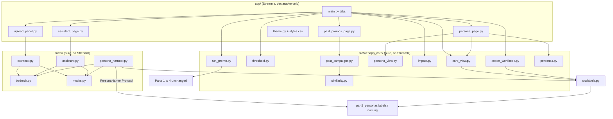
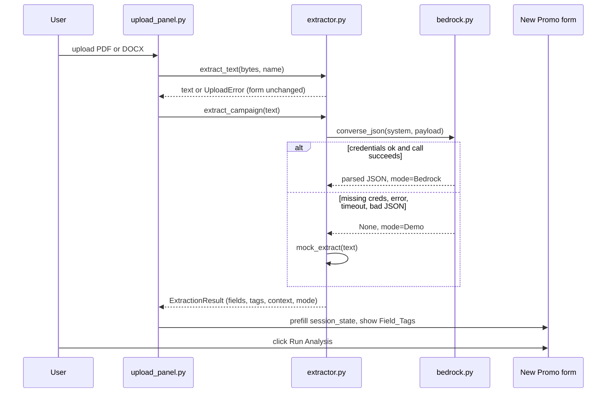

# Design Document

## Overview

Part 7 adds an AI-text layer and a set of finishing features on top of the existing Promo Audience Navigator. Nothing in Parts 1 to 4 changes, and the persona clustering stays as is. The work falls into five groups:

1. **Bedrock layer with Demo Mode** (Requirements 1, 2, 3, 6): one shared Bedrock client, a campaign file extractor, a campaign-only assistant, and a Bedrock-backed persona namer. Every feature has a deterministic rule-based Mock, so the app runs with no AWS credentials.
2. **Presentation of existing numbers** (Requirements 4, 7): a single Label_Map, plain-language decision cards, and a clearer Expected Joiners By Persona section. These are pure view-model functions in `src/` and thin renderers in `app/`.
3. **Inputs** (Requirement 5): four threshold types with fixed ranges, including a per-client percentage-of-ADB type.
4. **Outputs** (Requirements 8, 9): an Impact_Summary banner and an Excel Export_Workbook.
5. **History** (Requirement 11): a Past Promos tab with deterministic similarity scoring, sorting, filtering, and paging.

Requirement 10 (tests, screenshots, report) is covered in the Testing Strategy.

### Findings From Inspecting The Repository

These facts shaped the design.

- **Layering.** `app/main.py` (649 lines) and `app/persona_page.py` (2137 lines) are the Streamlit layer. `src/webapp_core/` has no Streamlit imports and holds `run_promo.py`, `personas.py`, `past_promos.py`, `audience.py`, `model_io.py`, and `promo_id.py`. New logic goes in `src/` with only thin rendering in `app/`.
- **Two copies of decision-card rendering.** `app/main.py::_decision_card_html` and `app/persona_page.py::_part4_card_readonly_html` both print raw `top_drivers` and `excluded_by_reason`, and both use stat chips. The persona copy titles cards with `"<promo_id> -- <segment>"`. Requirement 4 needs one shared pure view-model used by both, so the two cannot drift.
- **Real card data.** `outputs/cards.json` carries drivers such as `mechanic`, `spend_share_retail`, `out_other_bank`, `ndb_flag`, `avg_contacts_per_month`, `investment_propensity_decile`, `digital_app_user`, and exclusion codes `over_contacted`, `ndb`, `no reachable channel`. The driver is `ndb_flag`, while Requirement 4.1 lists `ndb` as an exclusion code. The Label_Map covers both. Card actions are `Prioritize`, `Offer lower tier`, `Include`, `Skip`.
- **Persona naming has a seam.** `part5_personas.grouping.build_persona_sets(..., namer: PersonaNamer | None)` takes any object matching the `PersonaNamer` Protocol (`name(profile, taken) -> PersonaNaming`). The Persona_Narrator plugs in there with no change to clustering. The default `RuleBasedNamer` emits the feature-code phrasing Requirement 6.10 bans, so Demo Mode needs a new plain-language Mock namer; `RuleBasedNamer` itself stays untouched so its existing tests keep passing.
- **Persona joiners already exist.** `webapp_core.personas.expected_joiners_by_persona` and `expected_joiners_for_group` return `CardPersonaBreakdown` and `GroupCardBreakdown` with `PersonaJoinerRow` rows (name, leads, joiners, rate, kind, `show_joiners`). Requirement 7 is a new view over these, not new math.
- **Part 3 takes one threshold.** `assign_segments(scored, promo_dict, frames)` reads a single `threshold_php`. Its output already carries `capacity_php`, `latest_adb`, `score_high`, and `capacity_high`. For the per-client Balance Increase type, `run_promo` post-processes the returned frame (recomputes `capacity_high`, re-maps the quadrant label) so no Part 3 code changes (Requirement 5.9).
- **Channel costs exist for all three channels.** `data/channel_costs.csv` has `channel, cost_php_per_message, source` for Email, SMS, In-app.
- **Sendable lead files.** `outputs/leads/*.csv` columns are `client_id, best_channel, p_join, control`, which matches the Send List sheet columns.
- **`promo_history.csv` is thin.** It has `promo_id, promo_name, product_type, mechanic, threshold_php, reward, start_date, end_date, channels`. It has no audience, objective, or customer-need columns, so several Similarity_Components must be derived locally or reported "Unavailable" (see Data Models).
- **Dependencies.** `boto3`, `pdfplumber`, `python-docx`, and `openpyxl` are not installed in `.venv` today. They are imported lazily where possible, and tests inject fakes for boto3.
- **Existing helper reuse.** `webapp_core.audience.latest_adb` already returns `client_id, latest_adb`, and `part5_personas.labels.attribute_label` already holds persona attribute wording (not to be changed).

### Key Design Decisions

| Decision | Rationale |
|---|---|
| All AI code lives under `src/ai/` with no Streamlit import | Matches the layering rule and makes every AI path testable with a fake client. |
| One entry function `converse_json` / `converse_text` in `src/ai/bedrock.py`, with an injectable boto3 client | One place enforces the timeout, single attempt, privacy guard, and Demo Mode reporting. |
| Demo Mode is a per-call result field (`mode`), never session state | Satisfies Requirement 1.8 (not latched). |
| Hard 30 s timeout via a worker thread with `future.result(timeout=30)` | boto3 `read_timeout` bounds each socket read, not the whole call. The thread timeout is the real cap. `botocore.Config(retries={"max_attempts": 1})` gives one attempt. |
| Privacy guard is a structural check on the payload before any network call | Rejects `client_id` keys, client-id-shaped values, DataFrames, and lists of per-client records. |
| Label_Map in `src/labels.py` delegates persona attributes to `part5_personas.labels.attribute_label` | One map for the whole UI without changing the persona wording. Fallback is Title Case with spaces, never raw underscores. |
| Card display logic is a pure `card_view.py`, and the Part 4 card dicts are never mutated | Requirement 4.11: `cards.json` stays byte-for-byte unchanged. |
| `PromoSpec` gains optional `threshold_type` and `threshold_pct` with defaults | Old constructors and tests stay valid. Balance Increase is handled inside `run_promo`. |
| `RunResult` gains an optional `non_excluded` frame | The Baseline_Plan needs every eligible, non-excluded lead (including control). Today only sendable leads are kept. A default empty frame keeps old constructors valid. |
| Threshold type and slider move outside the `st.form` | Widgets inside `st.form` do not rerun on change, so Requirement 5.3 (reset on type change) cannot work inside the form. The slider key includes the type so a type change resets it naturally. |
| Similarity components that cannot be computed are "Unavailable" and weights are rescaled | Requirement 11.11: no invented values. |

## Architecture

### Layers And Module Map



### New And Changed Files

| File | Kind | Purpose | Requirements |
|---|---|---|---|
| `src/ai/__init__.py` | new | Package marker | 1 |
| `src/ai/bedrock.py` | new | Shared Converse client, privacy guard, Demo Mode reporting | 1 |
| `src/ai/extractor.py` | new | PDF/DOCX text extraction, JSON validation, Mock extraction | 2 |
| `src/ai/assistant.py` | new | Campaign-only Q&A, routing rules, Assistant_Log | 3 |
| `src/ai/persona_narrator.py` | new | `BedrockNamer` (a `PersonaNamer`) with validation and Mock fallback | 6 |
| `src/ai/mocks.py` | new | Deterministic Mock extractor, assistant, and persona namer | 1, 2, 3, 6 |
| `src/labels.py` | new | Label_Map | 4 |
| `src/webapp_core/card_view.py` | new | Pure decision-card view-model | 4 |
| `src/webapp_core/threshold.py` | new | Threshold types, ranges, conversion | 5 |
| `src/webapp_core/persona_view.py` | new | Pure "Expected Joiners By Persona" lines | 7 |
| `src/webapp_core/impact.py` | new | Baseline vs Recommended plan math | 8 |
| `src/webapp_core/export_workbook.py` | new | openpyxl workbook builder | 9 |
| `src/webapp_core/similarity.py` | new | Similarity_Score components | 11 |
| `src/webapp_core/past_campaigns.py` | new | Load, filter, sort, page, detail for Past Promos | 11 |
| `src/webapp_core/run_promo.py` | edit | Optional `threshold_type`/`threshold_pct` on `PromoSpec`; optional `non_excluded` on `RunResult`; Balance Increase post-processing | 5, 8 |
| `src/webapp_core/personas.py` | edit | Accept a narration mode; carry `narration_source` on `PersonaRunResult` | 6 |
| `src/part5_personas/naming.py` | edit (additive) | Add `NotRequired` `difference` key to `PersonaNaming` | 6 |
| `app/upload_panel.py` | new | Upload Campaign File tab, Field_Tags, prefill | 2 |
| `app/assistant_page.py` | new | Ask Assistant chat | 3 |
| `app/past_promos_page.py` | new | Past Promos controls, list, detail | 11 |
| `app/main.py` | edit | New Promo tabs, threshold controls, Results banner/export, route new pages | 2, 4, 5, 8, 9 |
| `app/persona_page.py` | edit | Use `card_view` and `persona_view`; Demo badge; Label_Map | 4, 6, 7 |
| `app/theme.py`, `app/styles.css` | edit | Badge, banner, stat tile, bar, tooltip helpers using existing tokens | all UI |
| `requirements.txt` | edit | Add `boto3`, `pdfplumber`, `python-docx`, `openpyxl` (unpinned) | scope |
| `.gitignore` | verify | `.env` and `scratch/` already listed | 1.3 |

Part 1 to 4 modules, `run_pipeline.py`, `outputs/`, and `data/` are not modified.

### Request Flow: Upload To Analysis



Extraction never starts an analysis (Requirement 2.12).

## Components and Interfaces

### 1. Bedrock Client (`src/ai/bedrock.py`)

```python
@dataclass(frozen=True)
class BedrockResult:
    mode: Literal["Bedrock", "Demo"]
    text: str | None          # raw model text, None in Demo
    parsed: Any | None        # parsed JSON when expect_json, else None
    reason: str = ""          # short non-secret code: "no_credentials", "error", "timeout", "bad_json", "payload_rejected"

class PayloadRejected(ValueError): ...

TIMEOUT_SECONDS = 30
REQUIRED_ENV = ("AWS_ACCESS_KEY_ID", "AWS_SECRET_ACCESS_KEY", "AWS_REGION", "BEDROCK_MODEL_ID")

def assert_private(payload: Any) -> None: ...
def credentials_available(env: Mapping[str, str] | None = None) -> bool: ...
def converse(system: str, payload: Mapping[str, Any], *, expect_json: bool = False,
             client: Any | None = None, env: Mapping[str, str] | None = None) -> BedrockResult: ...
```

Behavior:

- `converse` is the single function every AI_Feature calls (Requirement 1.1). It never raises to the caller. Every failure becomes `BedrockResult(mode="Demo", ...)`.
- Order of checks: (1) `assert_private(payload)`; on failure return Demo with reason `payload_rejected`, zero boto3 calls (1.11). (2) Read the four variables via `python-dotenv` (`load_dotenv(override=False)` each call) and trim whitespace; any missing or empty returns Demo without a network call (1.5). (3) Build or use the injected client; call `converse` in a worker thread, `future.result(timeout=30)` (1.4). (4) Extract the text from the response; empty text, an exception, or a timeout returns Demo (1.6). (5) If `expect_json`, parse with `json.loads`; a single surrounding Markdown code fence is stripped first, nothing more lenient. Parse failure returns Demo (1.6).
- boto3 is imported lazily. An `ImportError` returns Demo (so tests and machines without boto3 work).
- boto3 client config: `botocore.config.Config(connect_timeout=5, read_timeout=30, retries={"max_attempts": 1})`. One attempt, no automatic retry.
- Return values are unchanged model output. There is no pricing, scoring, or numeric logic in this module (1.12).
- Credential values are never logged, never included in `reason`, and never placed in exception text (1.13). `reason` is one of a fixed set of codes.
- Demo Mode is reported per call. A later successful call returns `mode="Bedrock"` (1.8).

`assert_private` rules (structural, recursive over dicts, lists, tuples):

1. Reject any dict key that, lower-cased with non-alphanumerics removed, equals `clientid`.
2. Reject any string value that matches the client id pattern `\bC\d{5,}\b`.
3. Reject any `pandas.DataFrame` or `pandas.Series` instance.
4. Reject any list of two or more dicts where any dict has a key in `{"client_id", "p_join", "best_channel", "control"}` (a per-client record shape).

Persona aggregates (a list of trait dicts such as `{"label": "Retail Spend", "direction": "high"}`) pass; per-client rows do not. This is a heuristic and is called out as a known limitation; the callers also build payloads only from aggregate dataclasses, so the guard is a second line of defense.

### 2. Campaign Extractor (`src/ai/extractor.py`)

```python
MAX_UPLOAD_BYTES = 10 * 1024 * 1024
MAX_PROMPT_CHARS = 30_000
EXTRACTION_BUDGET_SECONDS = 60

class UploadError(Exception):
    cause: Literal["type", "size", "unreadable", "empty"]

@dataclass(frozen=True)
class ExtractionResult:
    fields: dict[str, Any]          # validated Campaign_Fields; only valid keys present
    tags: dict[str, Literal["Found in Document", "Needs Input"]]  # one per Campaign_Field
    context: dict[str, str]         # objective, target_audience, offer_details, timeline, key_messages
    mode: Literal["Bedrock", "Demo"]
    document_text: str

def extract_text(data: bytes, filename: str) -> str: ...        # raises UploadError
def validate_fields(raw: Mapping[str, Any]) -> dict[str, Any]: ...
def extract_campaign(text: str, *, client=None, env=None, clock=time.monotonic) -> ExtractionResult: ...
```

- `extract_text`: checks extension (`.pdf`, `.docx`), size (at most 10 MB), then reads locally with `pdfplumber` or `python-docx` (lazy imports). Raises `UploadError` with a specific `cause` so the page can say which cause applies (2.3). Empty text raises `cause="empty"`. The page catches it and leaves every form field and session value unchanged.
- `extract_campaign`: sends at most the first 30,000 characters of text (2.4) plus a system prompt that demands strict JSON with the Campaign_Fields and Campaign_Context keys. `converse(..., expect_json=True)`.
- `validate_fields` is the pure validation core (Requirement 2.5, 2.7). It drops, never repairs, each invalid value:
  - `product_type` must be in `PRODUCT_TYPE_OPTIONS`; `mechanic` in `MECHANIC_OPTIONS`; `threshold_type` in the four `ThresholdType` values.
  - `threshold_value` must be a finite number inside the range for the (valid) `threshold_type`; if `threshold_type` is dropped the value is dropped too.
  - `reward` is a trimmed non-empty string of at most 200 characters.
  - `eligible_segments` is a list restricted to known Customer_DNA segments.
  - `min_adb` is a finite number at or above 0.
  - `channels` are case-insensitively mapped to exactly `In-app`, `Email`, `SMS`; anything else is dropped; duplicates removed; order follows `CHANNEL_OPTIONS`.
- Tags: `Found in Document` if `fields` has the key, else `Needs Input` (2.11). Fields tagged `Needs Input` are not set, so the form default or empty value stays.
- Fallback: not-JSON, or `mode == "Demo"`, uses `mocks.mock_extract(text)` for the whole document (2.6, 2.8). If the elapsed time at the end exceeds `EXTRACTION_BUDGET_SECONDS` (60), the Mock result is used (2.10). The single 30 s Bedrock call plus local parsing keeps the normal path well inside 60 s.
- `mock_extract` is keyword and peso-amount rules: regex for `₱`/`PHP`/`Php` amounts near words like "top-up", "minimum balance", "open", "opening"; mechanic and product keyword tables; channel word matches; "Context" fields come from labeled lines ("Objective:", "Timeline:") when present. It is deterministic.
- The page stores `document_text` and `context` in session state, replacing any earlier upload (2.13).

### 3. Campaign Assistant (`src/ai/assistant.py`)

```python
MAX_QUESTION_CHARS = 500
MAX_ANSWER_WORDS = 150
LOG_PATH = ROOT / "scratch" / "assistant_log.jsonl"

SUGGESTED_QUESTIONS = (
    "Summarize This Campaign",
    "What's Missing From This Proposal?",
    "Draft An SMS For This Offer",
    "Is The Eligibility Clear?",
)

@dataclass(frozen=True)
class CampaignGrounding:
    form: Mapping[str, Any]          # form fields only
    tags: Mapping[str, str]
    context: Mapping[str, str]
    document_text: str

@dataclass(frozen=True)
class AssistantAnswer:
    text: str
    mode: Literal["Bedrock", "Demo", "Local"]   # Local = routed message, no model
    log_saved: bool

def validate_question(q: str) -> str | None: ...        # returns error message or None
def route(q: str) -> Literal["model_results", "off_topic", "campaign"]: ...
def missing_items(g: CampaignGrounding) -> list[str]: ...
def answer(q: str, g: CampaignGrounding, *, client=None, env=None, log_path=LOG_PATH) -> AssistantAnswer: ...
def truncate_words(text: str, limit: int = 150) -> str: ...
```

- Empty, whitespace-only, or over-500-character questions return a validation message from `validate_question`; no Bedrock call, no log write (3.6).
- No form values and no document: the page shows the "fill in or upload first" prompt and never calls `answer` (3.12).
- `route` uses keyword sets: "score", "segment", "persona", "model", "probability", "p_join" go to `model_results` and return a fixed message pointing to the Results or Personas page without any model call (3.4). A campaign-vocabulary check (offer, mechanic, eligibility, channel, timeline, copy, SMS, email, draft, summarize, missing, gap, clear, proposal, campaign, reward, threshold) separates `campaign` from `off_topic`; off-topic returns the "only answers questions about the current campaign proposal" message (3.5). The four suggested-question labels always route to `campaign`.
- Grounding payload to Bedrock has only form fields, tags, context, and document text (3.1, 3.13). No scores, segments, or personas ever enter it.
- `missing_items` is deterministic and also used by the Mock and by the system prompt: a channel listed with no budget stated, no control group stated, and each field tagged `Needs Input` (3.3). "Budget stated" and "control group stated" are checked by regex over document text and context.
- Mock (Demo Mode) answers are templates keyed by the four suggested-question intents plus a generic summary, built only from form fields and context (3.9).
- Every answer passes through `truncate_words(…, 150)` (3.7). Each returned answer appends one JSON line `{question, answer, timestamp}` (ISO 8601 UTC) to the log, creating `scratch/` when absent (3.10). A write failure sets `log_saved=False` and the page shows a non-blocking notice (3.11). Routed messages (model-results or off-topic) are also logged as answers, since they are answers returned by the assistant.

### 4. Persona Narrator (`src/ai/persona_narrator.py`)

```python
@dataclass(frozen=True)
class PersonaAggregate:
    size: int
    share_pct: float
    traits: tuple[Trait, ...]         # plain label, direction, optional rounded value text
    top_categories: tuple[tuple[str, str], ...]   # (plain attribute label, category text)
    response_rate_pct: float | None

class BedrockNamer:                    # satisfies PersonaNamer
    def __init__(self, *, client=None, env=None, mock: PersonaNamer | None = None): ...
    def name(self, profile: PersonaProfile, taken: set[str]) -> PersonaNaming: ...
    @property
    def sources(self) -> dict[str, Literal["Bedrock", "Demo"]]: ...   # persona name -> source

def build_aggregate(profile: PersonaProfile) -> PersonaAggregate: ...
def validate_narration(obj: Any, agg: PersonaAggregate, taken: set[str]) -> PersonaNaming | None: ...
```

- `BedrockNamer` implements the existing `PersonaNamer` Protocol, so `build_persona_sets(..., namer=BedrockNamer())` is the only integration point. Clustering, preprocessing, and assignment are not touched (6.1).
- `build_aggregate` converts a `PersonaProfile` to plain-language aggregates using the Label_Map and `part5_personas.labels` helpers. No raw column codes, no client ids, no per-client rows reach the payload (6.2, 6.13). One request per persona; it contains only that persona's aggregate. The "why it differs" input is that persona's own distinguishing traits with their direction against the baseline, so no cross-persona payload is needed.
- `validate_narration` (pure, the core of Requirements 6.3 to 6.7) returns a `PersonaNaming` only if all hold, otherwise `None` (caller then uses the Mock for that persona only, 6.8):
  - parsed JSON is a dict with non-empty `name`, `description`, `difference`, `actions`;
  - `name`: 2 to 4 words, at most 40 characters; `description`: 1 to 2 sentences, at most 300 characters; `difference`: at most 200 characters;
  - `actions`: a list of 2 to 3 dicts, each with `channel` exactly in `{"In-app","Email","SMS"}`, a non-empty `angle`, and `message` of at most 160 characters (6.3, 6.4, 6.6);
  - every number in `name`, `description`, `difference` also appears in the aggregate's number set (values, rounded values, and digits within category text) (6.5);
  - no raw feature code or underscore appears in any text (6.10);
  - `name` is not in `taken` (6.7). On a collision the later persona uses the Mock, whose name uniqueness is guaranteed by the same disambiguation scheme the existing namer uses (extend with a third trait, then letter suffix).
- Actions are returned in the existing `PersonaNaming["actions"]: list[str]` shape as `"<Channel>: <Angle>. <Message>"` strings. `difference` is stored in a new `NotRequired[str]` key on `PersonaNaming` (additive; existing code that ignores it is unaffected).
- `sources` records `"Bedrock"` or `"Demo"` per persona so the Personas page shows the Demo badge whenever any persona text is a Mock (6.11).
- `mocks.MockPersonaNamer` builds name, description, difference, and actions as pure functions of the `PersonaAggregate` (6.9, 6.12), within the same length and channel rules, with no feature codes and none of the banned phrases (6.10). Channel choice uses the aggregate's channel reach if present, otherwise `In-app`.

### 5. Label_Map (`src/labels.py`)

```python
FEATURE_LABELS: dict[str, str]     # driver/feature codes to plain phrases
EXCLUSION_LABELS: dict[str, str]   # exclusion codes to plain phrases
HIDDEN_DRIVER_CODES = frozenset({"mechanic", "threshold_php"})

def plain_label(code: str) -> str: ...
def is_known(code: str) -> bool: ...
def plain_driver_phrase(code: str, max_chars: int = 60) -> str: ...
```

- `plain_label(code)` resolves in order: `EXCLUSION_LABELS`, `FEATURE_LABELS`, then the persona attribute path (`part5_personas.labels.attribute_label(code).title()` for codes it knows), then the fallback: underscores to single spaces, collapse whitespace, Title Case (4.3). The result never contains an underscore.
- Seed entries (all non-fallback): `out_other_bank` "Money Sent To Other Banks", `ext_outflow_ratio` "Share Of Spending Leaving The Bank", `spend_share_retail` "Retail Spending", `latest_adb` "Current Average Balance", `avg_contacts_per_month` "Recent Contact Frequency", `digital_app_user` "Uses The Mobile App", `ndb_flag` "On The Do Not Bother List", `investment_propensity_decile` "Investment Interest", `over_contacted` "Contacted Too Often", `ndb` "On The Do Not Bother List", `no reachable channel` "No Reachable Channel", plus the full `part5_personas.labels` coverage via delegation. Exact wording is finalized during implementation, constrained by Requirement 4.5 (at most 60 characters per driver phrase) and Title Case.
- Both `card_view` and the Personas page call `plain_label`; the Excel export uses it for the Decision Cards sheet (9.4).

### 6. Card View-Model (`src/webapp_core/card_view.py`)

```python
@dataclass(frozen=True)
class StatView:
    label: str       # "About 16 Likely To Join"
    tooltip: str     # at most 120 characters

@dataclass(frozen=True)
class CardView:
    title: str                        # "NEW-001 · Untapped Wealth"
    action: str; channel: str; angle: str
    why_heading: str                  # "Why This Group:"
    drivers: tuple[str, ...]          # up to 3 plain phrases
    not_contacted_heading: str        # "Not Contacted:"
    exclusions: tuple[str, ...]       # "<Plain Reason>: N", sorted
    stats: tuple[StatView, StatView, StatView]
    persona_lines: PersonaSection | None

def round_half_up(x: float) -> int: ...
def build_card_view(card: Mapping, *, persona: ... | None = None) -> CardView: ...
```

- Input is a read-only Part 4 card dict. It is never modified, and `outputs/cards.json` is never rewritten (4.11).
- Drivers: drop `HIDDEN_DRIVER_CODES`, keep the first three remaining codes in card order, map each through `plain_driver_phrase` (4.4, 4.5).
- Exclusions: map reasons through `plain_label`, sort by count descending then plain reason alphabetically, format `"<Plain Reason>: N"` with N at least 1 (zero-count entries are dropped). With no exclusions the card shows the heading with the text "None"; the choice is fixed in a module constant so every card agrees (4.6, 4.7).
- Stats: N, L, H are `round_half_up` of `expected_joiners`, `joiners_90_low`, `joiners_90_high`. Because rounding is monotone, `L <= N <= H` holds whenever the source values satisfy it; to guard against bad input, `build_card_view` clamps `L = min(L, N)` and `H = max(H, N)`. Value is a whole peso with thousands separators and a ₱ prefix (4.8). Each stat carries a tooltip of at most 120 characters (4.9).
- Title: `f"{promo_id} · {segment}"` (4.10). The persona page and the Results page both call this function, so the old `"-- "` title disappears from both (4.12).
- Both `app/main.py` and `app/persona_page.py` render a `CardView` through one `theme.py` helper, replacing the two duplicate HTML builders.

### 7. Threshold Types (`src/webapp_core/threshold.py`)

```python
class ThresholdType(str, Enum):
    TOP_UP = "Top-Up Amount"
    MIN_BALANCE = "Minimum Balance To Maintain"
    BALANCE_INCREASE = "Balance Increase"
    OPENING_AMOUNT = "Opening Amount For A New Account"

@dataclass(frozen=True)
class ThresholdSpec:
    type: ThresholdType
    label: str          # widget label with unit, e.g. "Top-Up Amount (₱)"
    minimum: int; maximum: int; step: int
    is_percent: bool

THRESHOLD_SPECS: dict[ThresholdType, ThresholdSpec]   # exactly four, ranges per Requirement 5.1
def default_value(t: ThresholdType) -> int: ...          # min + 25% of width, floored to step
def format_value(t: ThresholdType, v: float) -> str: ...  # "₱50,000" or "35%"
def per_client_amounts(pct: float, latest_adb: pd.Series) -> pd.Series: ...
def effective_threshold(t: ThresholdType, value: float, latest_adb: pd.Series | None) -> ThresholdResolution: ...

@dataclass(frozen=True)
class ThresholdResolution:
    threshold_php: float | None
    per_client: pd.Series | None      # only for BALANCE_INCREASE
    error: str | None                 # "percentage threshold cannot be applied" when no usable ADB
    note: str | None                  # at most 200 characters, BALANCE_INCREASE only
```

- Ranges: Top-Up 50,000 to 2,000,000 step 10,000; Minimum Balance 10,000 to 5,000,000 step 10,000; Balance Increase 5 to 100 step 5; Opening Amount 1,000 to 100,000 step 1,000 (5.1).
- `default_value` = `minimum + floor((0.25 * (maximum - minimum)) / step) * step`, which is on the step grid and inside the range. This equals "min plus 25% of width, rounded down to the nearest step" (5.3). Note the result stays on the grid only because every range's minimum is itself a multiple of its step (50,000/10,000; 10,000/10,000; 5/5; 1,000/1,000), which a unit test asserts.
- Non-percent types: `threshold_php = value` (5.4).
- Balance Increase: `amounts = (pct / 100) * latest_adb`; clients with missing ADB are excluded from the median and fail the capacity check; `threshold_php = median(usable amounts)` (5.5, 5.6, 5.10). If no client has a usable ADB, `error` is set and the page shows it and does not start the analysis (5.11). The note explains the per-client conversion and the median in at most 200 characters (5.7).
- Mapping to existing code (5.9): `PromoSpec(threshold_php=resolution.threshold_php, threshold_type=…, threshold_pct=…)`. In `run_promo`, after `assign_segments`, when `threshold_type is BALANCE_INCREASE` the code recomputes `capacity_high = capacity_php >= pct * latest_adb` (NaN ADB gives False), then re-derives the segment label with the same quadrant mapping Part 3 uses (via `part3_segments.segments._assign_quadrant_labels`, a read-only call into an existing private helper, or an equivalent four-way `np.select` if reviewers prefer not to touch a private name), and passes the updated frame to `build_cards`. No Part 3 file changes.
- The What-If tab uses the same `THRESHOLD_SPECS`, replacing `_whatif_slider_bounds` (5.8). The What-If rerun passes the changed `threshold_value` through `effective_threshold` again, so the per-client amounts and median are recomputed.

### 8. Persona Joiners View (`src/webapp_core/persona_view.py`)

```python
@dataclass(frozen=True)
class PersonaLine:
    text: str            # "<Persona Name>: about N of M likely to join (P%)" or "...: no leads in this group"
    bar_pct: float       # 0.0 to 100.0
    joiners: float

@dataclass(frozen=True)
class PersonaSection:
    lines: tuple[PersonaLine, ...]
    total_line: str      # "Total For <Segment Name>"
    note: str            # "<Persona Name> is N of the <Segment Name> total"
    takeaway: str
    unavailable_text: str | None

def build_persona_section(breakdown, card_expected_joiners: float, segment: str) -> PersonaSection: ...
```

- Source rows come from the existing `CardPersonaBreakdown`/`GroupCardBreakdown`. N = round(expected joiners), M = lead count, P = `min(100, max(0, N_raw / M * 100))` rounded to a whole percent (7.1, 7.2). `M == 0` gives "no leads in this group" with an empty bar and no division (7.3).
- "Other Personas" row: joiners = `card_expected_joiners - sum(listed rows)`, shown only when greater than 0 (7.6). It takes M from the folded rows' lead count.
- Total row text: `f"Total For {segment}"` (7.4). The group index never appears in any string this module produces (7.12).
- Takeaway: the highest-joiner row among listed personas and "Other Personas"; ties go to the first in displayed order (7.7, 7.8); if all are zero, the "no persona stands out" sentence (7.9).
- Note: replaces `group_note_text`. Wording follows Requirement 7.5 (`"<Persona Name> is N of the <Segment Name> total"`), naming the takeaway persona. In group-scoped views the note names the highest-joiner persona of the group (assumption, see Open Questions).
- No persona data: a single line "Personas were not generated for this run." and the rest of the card is unchanged (7.10).
- The sum of rows including Other equals the card's expected joiners within 0.5 (7.11) because Other is defined as the remainder, clamped at 0, and the listed rows are drawn from the same lead set.

### 9. Impact Summary (`src/webapp_core/impact.py`)

```python
@dataclass(frozen=True)
class PlanTotals:
    messages: int
    expected_joiners: float
    channel_cost: float

@dataclass(frozen=True)
class ImpactSummary:
    baseline: PlanTotals
    recommended: PlanTotals
    messages_saved: int
    joiners_kept_pct: int | None      # Y
    fewer_clients_pct: int | None     # X
    cost_saved: int | None            # Z, None when costs unavailable
    available: bool                   # False when baseline has 0 messages or 0 joiners
    cost_available: bool
    banner: str | None                # "Messaging X% Fewer Clients Keeps Y% Of Expected Joiners And Saves ₱Z In Channel Costs"
    neutral_message: str | None

def load_channel_costs(path: Path) -> dict[str, float] | None: ...
def plan_totals(frame: pd.DataFrame, costs: Mapping[str, float] | None) -> PlanTotals: ...
def compute_impact(run: RunResult, costs: Mapping[str, float] | None) -> ImpactSummary: ...
```

- Baseline frame: `RunResult.non_excluded` (eligible, non-excluded leads including control, each on its best channel). Recommended frame: concatenation of `sendable_by_segment[s]` for each segment `s` whose card action is not `Skip` (8.1, 8.2). Expected joiners per lead is `p_join`; cost per lead is `costs[best_channel]`.
- Subset property: sendable leads are a subset of non-excluded leads (sendable means `~excluded & control == 0`), `p_join >= 0` and cost `>= 0`, so Recommended messages and joiners never exceed Baseline (8.10).
- `X = round_half_up((B_msgs - R_msgs) / B_msgs * 100)`, `Y = round_half_up(R_joiners / B_joiners * 100)`, `Z = round(B_cost - R_cost)`, with clamps to 0 to 100 for X and Y (8.3, 8.4). Zero baseline messages or joiners: `available=False`, neutral message, no percentages, no division (8.7).
- Missing, unreadable, or incomplete cost file, or a used channel with no cost: `cost_available=False`; the page shows a "cost savings are unavailable" message and still shows Messages Saved and Joiners Kept (8.8). Decision cards and the run result are unchanged.
- Tiles: Messages Saved, Joiners Kept (%), Cost Saved (₱), each with a tooltip of at most 200 characters stating its formula (8.5). What-If recomputes from the rescored `RunResult` (8.6). Everything is Python arithmetic; Bedrock is never asked for a number (8.9).
- `run_promo` populates `RunResult.non_excluded`. `_sendable_by_segment` already calls `classify`; the design extends it to also return the non-excluded frame from the same call, with no change to classification.

### 10. Export Workbook (`src/webapp_core/export_workbook.py`)

```python
def build_workbook(run: RunResult, impact: ImpactSummary, persona_result: PersonaRunResult | None,
                   narration_source: str, run_date: date) -> bytes: ...
def workbook_filename(promo_id: str) -> str: ...      # "<promo_id>_campaign_summary.xlsx"
```

- Sheets: `Summary`, `Decision Cards`, `Personas`, plus one `Send List` sheet per segment with action not `Skip` and at least one sendable lead. Sheet names are the segment name truncated to 31 characters (9.7, 9.8).
- Summary: promo_id, product type, mechanic, Threshold_Type, Threshold_Php, reward, channels, Impact_Summary values, run date `YYYY-MM-DD`, and the AI source text "Demo Mode" or "Bedrock" (9.3).
- Decision Cards: four rows, one per segment, with plain drivers and plain exclusion text with counts via the Label_Map, no raw codes (9.4).
- Personas: one row per persona (name, description, size, likely joiners rounded to a whole number, recommended actions), or a single row "Personas were not generated for this run." (9.5, 9.6).
- Send List columns: `client_id`, `Best Channel`, `Join Chance`, `Control Flag`. `client_id` is allowed here because the file is local (9.13).
- Formatting: Title Case headers, bold header row, `ws.freeze_panes = "A2"` (the row directly below the header), column widths clamped to 10 to 60, `0.0%` number format for join chance and shares, `"₱"#,##0` for money (9.9). Text cells contain no em dash or `--`.
- The builder uses only the in-memory `RunResult`, `ImpactSummary`, and persona result (9.10). `workbook_to_bytes` writes to a `BytesIO`; the result opens with `openpyxl.load_workbook` (9.11).
- On any exception the page shows a plain-language error, starts no download, and leaves the Results page and run result unchanged (9.12). The "Export Summary" button is hidden or disabled with a message when no run exists (9.2).

### 11. Similarity And Past Campaigns (`src/webapp_core/similarity.py`, `past_campaigns.py`)

```python
WEIGHTS = {
    "audience": 30, "need": 20, "product_mechanic": 15, "economics": 10,
    "duration": 10, "channels": 5, "objective": 5, "name_summary": 5,
}   # sums to 100

@dataclass(frozen=True)
class ComponentScore:
    key: str
    fraction: float | None      # None means Unavailable
    weight: float               # rescaled so available weights sum to 100
    points: float | None        # fraction * weight
    max_points: float | None    # weight, None when unavailable

@dataclass(frozen=True)
class SimilarityResult:
    components: tuple[ComponentScore, ...]
    score: float | None         # 0 to 100, None means Not Enough Data

def similarity(current: NewPromoProfile, past: CampaignProfile) -> SimilarityResult: ...
def duration_days(start: date, end: date) -> int: ...     # inclusive: same day gives 1
def rescale_weights(available: Mapping[str, bool]) -> dict[str, float]: ...
def sort_campaigns(rows: Sequence[CampaignRow], mode: SortMode) -> list[CampaignRow]: ...
def filter_campaigns(rows, product_type: str, audience: str) -> list[CampaignRow]: ...
def page(rows, visible: int) -> tuple[list[CampaignRow], bool]: ...   # (shown, show_view_more)
```

- Each component is `fraction in [0, 1]` times its weight (11.9). Fractions are pure functions of the two profiles (11.8), so identical inputs always give identical scores. The fraction rules (all deterministic, documented in code):
  - **Audience and eligibility (30):** Jaccard of the new promo's eligible Customer_DNA segments with the campaign's audience segments (segments that make up at least 10% of that campaign's leads, derived locally from `promo_leads.csv` joined to `customer_dna.csv`). Unavailable if either side is empty.
  - **JTBD and customer need (20):** Jaccard over need tags derived by a fixed keyword lexicon applied to product type, mechanic, reward text, and (new promo) objective text. Unavailable if either tag set is empty.
  - **Product and mechanic (15):** 0.5 for equal normalized product type (an alias table maps the form's "Savings" and "Time Deposit" to the history's "Deposit") plus 0.5 for equal mechanic. Unavailable if both values are missing on either side.
  - **Offer economics (10):** `min(a, b) / max(a, b)` of threshold amounts when both are positive peso thresholds of compatible meaning; otherwise Unavailable.
  - **Duration (10):** `min(d1, d2) / max(d1, d2)` using inclusive day counts. Unavailable when the new promo has no timeline (the form has no date fields; dates come from the uploaded Campaign_Context when parseable).
  - **Channels (5):** Jaccard of channel sets. Unavailable if either is empty.
  - **Objective (5):** Jaccard of need tags from the new promo's objective text against tags from the campaign's name and reward. Unavailable if the new promo has no objective.
  - **Name and summary (5):** token Jaccard (lower-cased words, stop words removed) between the new promo's name/summary text and the campaign's name plus reward. Unavailable if the new promo has none.
- `rescale_weights` multiplies each available weight by `100 / sum(available weights)`, so the displayed maximum points of available components sum to 100 (11.11). If none is available, `score = None` and the UI shows "Not Enough Data"; those campaigns sort after all scored ones under "Most Similar" (11.12).
- Display score is the whole-number rounding of the 0 to 100 sum.
- Sorting: "Newest" is `start_date` descending, "Oldest" ascending, with `promo_id` ascending as a stable tie-break; "Most Similar" is score descending (None last), ties by newest `start_date`, then ascending `promo_id` (11.13). Sorting is a pure function of the rows and the sort mode, so it is independent of input order.
- Paging: 5 initial rows, "View More" adds 5 and hides when all are shown; any sort or filter change resets to 5 (11.6, 11.7). Zero matches shows the no-match message and hides "View More" (11.5).
- Without a New Promo in session state, "Newest" is the default, "Most Similar" is disabled with an explanatory label, and no score is computed (11.3).
- Detail view: a horizontal bar chart of all eight components with points and max points (Unavailable labeled), campaign dates, inclusive duration, product, audience, channels, actual opt-in rate = joined / treated leads (`control_group == 0`) with one decimal (shown as "Not Available" when there are zero treated leads), and segment responses (11.14 to 11.16).
- Predicted vs actual comes from the existing `predicted_vs_actual` and `read_sendable_ids_by_cell`, unchanged (11.17, 11.20). It is shown only when valid artifacts exist for that campaign.
- Missing or unreadable `promo_history.csv` or `promo_leads.csv` produces an error naming the file and no partial data (11.18). The module imports no AWS, LLM, embedding, or network code (11.19).

### 12. UI Wiring In `app/`

- **New Promo** gets two tabs: "Upload Campaign File" and "Fill In Details". The Threshold_Type selector and slider sit above the `st.form` so type changes rerun (slider key `threshold_slider_<type>`). Upload prefill writes session-state widget values at the top of the rerun, before widgets are created, with a Field_Tag caption under each field. The existing "Run Analysis" button remains the only trigger (2.12).
- **Results** shows the Impact banner and three stat tiles above the Decision Cards, then the Export Summary button.
- **What-If** uses `THRESHOLD_SPECS` and refreshes the banner and tiles from the rescored result.
- **Personas** passes `use_bedrock` (a hashable bool) into the cached runner; the narrator is built inside `_run_personas_impl` so `st.cache_data` hashing is unaffected. The result carries a `narration_source` map for the Demo badge.
- **Ask Assistant** replaces the placeholder with the chat (using `st.chat_input`-style limits enforced by `validate_question`).
- **Past Promos** keeps its predicted-vs-actual content (moved under "details") and adds the sort, filter, list, and detail controls.
- **Visual language.** The Demo badge, impact banner, stat tiles, persona bars, and Field_Tags reuse existing tokens and the red gradient, rounded cards, and typography in `app/theme.py` and `app/styles.css`. No new hardcoded hex values or font names appear in page code, and the font stack stays unchanged unless the user confirms Poppins (Requirement 10.14, 10.15; open question below). Following the project's UI guidelines, the visual treatment of each new element should be shown for approval during implementation before final styling.
- All new UI strings are Title Case for headings, labels, and buttons and contain no em dash or `--`.

## Data Models

### Environment

| Variable | Use |
|---|---|
| `AWS_ACCESS_KEY_ID` | Bedrock credentials |
| `AWS_SECRET_ACCESS_KEY` | Bedrock credentials |
| `AWS_REGION` | Bedrock region |
| `BEDROCK_MODEL_ID` | Converse model id |

All four are read from `.env` (git-ignored). Missing or whitespace-only means Demo Mode.

### Extended Existing Dataclasses

```python
@dataclass(frozen=True)
class PromoSpec:
    # existing fields unchanged ...
    threshold_type: str = "Top-Up Amount"      # ThresholdType value; default keeps old behavior
    threshold_pct: float | None = None         # set only for Balance Increase

@dataclass
class RunResult:
    # existing fields unchanged ...
    non_excluded: pd.DataFrame = field(default_factory=pd.DataFrame)
    # columns: client_id, segment, best_channel, p_join, control (eligible, not excluded)

class PersonaNaming(TypedDict):
    name: str; description: str; actions: list[str]
    difference: NotRequired[str]
```

`PersonaRunResult` gains `narration_source: Mapping[str, str]` (persona name to `"Bedrock"` or `"Demo"`), defaulting to empty.

### Campaign Fields And Context

| Field | Type | Domain |
|---|---|---|
| `product_type` | str | `PRODUCT_TYPE_OPTIONS` |
| `mechanic` | str | `MECHANIC_OPTIONS` |
| `threshold_type` | str | four `ThresholdType` values |
| `threshold_value` | float | inside the selected type's range |
| `reward` | str | 1 to 200 characters |
| `eligible_segments` | list[str] | known Customer_DNA segments |
| `min_adb` | float | at least 0 |
| `channels` | list[str] | subset of `In-app`, `Email`, `SMS` |

Context keys: `objective`, `target_audience`, `offer_details`, `timeline`, `key_messages` (strings).

### Assistant_Log Line

```json
{"question": "Summarize This Campaign", "answer": "…", "timestamp": "2026-05-01T09:30:00+00:00"}
```

### Similarity Inputs

```python
@dataclass(frozen=True)
class NewPromoProfile:
    name: str | None; summary: str | None; objective: str | None
    product_type: str | None; mechanic: str | None
    threshold_php: float | None
    eligible_segments: tuple[str, ...]; channels: tuple[str, ...]
    start: date | None; end: date | None

@dataclass(frozen=True)
class CampaignProfile:
    promo_id: str; name: str; product_type: str; mechanic: str
    threshold_php: float | None; reward: str
    start: date | None; end: date | None
    channels: tuple[str, ...]; audience_segments: tuple[str, ...]
    opt_in_rate: float | None; treated_leads: int

@dataclass(frozen=True)
class CampaignRow:
    profile: CampaignProfile
    similarity: SimilarityResult | None     # None when no New Promo exists
```

### Export Workbook Layout

| Sheet | Columns |
|---|---|
| Summary | Field, Value |
| Decision Cards | Segment, Action, Dominant Channel, Why This Group, Not Contacted, About Likely To Join, Expected Value |
| Personas | Persona, Description, Size, Likely Joiners, Recommended Actions |
| Send List sheets | client_id, Best Channel, Join Chance, Control Flag |


## Correctness Properties

*A property is a characteristic or behavior that should hold true across all valid executions of a system-essentially, a formal statement about what the system should do. Properties serve as the bridge between human-readable specifications and machine-verifiable correctness guarantees.*

Part 7 has a hard cap of 8 property tests in total (Requirement 10.1). After the prework and a reflection pass, the highest-value pure logic was reduced to exactly 8 properties. The two "no raw code reaches the UI" candidates (label fallback and card text) were merged into Property 3. Everything else (Bedrock fault handling, routing, workbook layout, paging, threshold ranges, persona narration rules, UI behavior) is covered by unit, example, edge, or integration tests listed in the Testing Strategy.

### Property 1: Bedrock payload privacy

*For any* payload built from nested dicts, lists, and strings, if it contains a `client_id` key (in any letter case or with separators), a string value shaped like a client id, a DataFrame or Series, or a list of two or more per-client records, `converse` SHALL return Demo Mode and make zero calls to the boto3 client. *For any* payload built only from promo fields, document text, and persona or segment aggregates, the guard SHALL accept it. The payloads actually produced by the Campaign_Extractor, Campaign_Assistant, and Persona_Narrator from generated inputs SHALL always pass the guard and SHALL contain no `client_id` key or value.

**Validates: Requirements 1.10, 1.11, 3.13, 6.2, 6.13, 9.13**

### Property 2: Extraction output is always valid and tagged

*For any* model output (a well-formed JSON object with arbitrary valid and invalid field values, JSON of the wrong shape, or arbitrary text), `extract_campaign` SHALL return a result in which every present field value is inside its form domain (known product type, mechanic, and threshold type; a threshold value inside its type's range; channels a subset of exactly `In-app`, `Email`, `SMS` with no duplicates; non-negative minimum ADB), every one of the Campaign_Fields has a Field_Tag, a field is tagged "Found in Document" exactly when it is present and "Needs Input" otherwise, and unparseable output yields the Mock result with `mode == "Demo"`. The function SHALL never raise.

**Validates: Requirements 2.5, 2.6, 2.7, 2.9, 2.11**

### Property 3: No raw codes reach decision-card text

*For any* string code, `plain_label(code)` SHALL contain no underscore, and for an unmapped code SHALL equal the code with underscores replaced by single spaces in Title Case. *For any* Part 4 card dict (arbitrary driver codes including `mechanic` and `threshold_php`, arbitrary exclusion reasons with positive counts, and arbitrary non-negative joiner statistics with `low <= expected <= high`), the `CardView` SHALL contain at most 3 drivers, none of them `mechanic` or `threshold_php`, each at most 60 characters; exclusion lines in the form `"<Plain Reason>: N"` with `N >= 1` ordered by count descending then reason alphabetically; stats with whole numbers `L <= N <= H`; and no underscore anywhere in the card text. The input card dict SHALL be unchanged after the call.

**Validates: Requirements 4.3, 4.4, 4.5, 4.6, 4.8, 4.11, 4.12**

### Property 4: Balance Increase threshold equals the median of per-client amounts

*For any* percentage on the 5 to 100 step-5 grid and any series of latest ADB values that may include missing values, `effective_threshold` for Balance Increase SHALL return per-client amounts equal to `pct / 100 * latest_adb`, a `threshold_php` equal to the median of the amounts over clients with a usable ADB, a failed capacity check for every client with missing ADB, and an error with no analysis started when no client has a usable ADB. *For any* of the three peso threshold types and any value on its grid, `threshold_php` SHALL equal the selected value.

**Validates: Requirements 5.4, 5.5, 5.6, 5.10, 5.11**

### Property 5: Impact summary invariants

*For any* baseline frame of non-excluded leads (non-negative `p_join`, channel from the cost table) and any subset of it chosen as the recommended leads, `compute_impact` SHALL return Recommended messages and expected joiners each less than or equal to Baseline, `X` and `Y` as whole numbers in 0 to 100, `Messages Saved` equal to Baseline messages minus Recommended messages, `Z` equal to the rounded cost difference and non-negative, and, when Baseline has zero messages or zero expected joiners, no percentage banner, the neutral message, and no exception.

**Validates: Requirements 8.3, 8.4, 8.7, 8.10**

### Property 6: Persona rows account for the whole card

*For any* card expected-joiners total and any list of persona rows whose joiners sum to no more than that total plus 0.5 (with lead counts at or above zero), `build_persona_section` SHALL produce lines in which every percentage is a whole number in 0 to 100, every row with zero leads reads "no leads in this group" with an empty bar and no division error, an "Other Personas" line appears only when the remainder is greater than 0, and the sum of the listed joiners plus the Other Personas joiners equals the card's expected joiners within 0.5.

**Validates: Requirements 7.1, 7.2, 7.3, 7.6, 7.11**

### Property 7: Similarity score bounds, determinism, and renormalization

*For any* pair of a New Promo profile and a past campaign profile with arbitrary missing components, `similarity` SHALL return the same result on repeated calls, each available component fraction in 0 to 1, the maximum points of the available components summing to 100 (within floating-point tolerance) after rescaling, a score in 0 to 100 equal to the sum of the available components' points, and `score is None` exactly when every component is unavailable. For any start date and an end date at or after it, `duration_days` SHALL be at least 1 and equal to the day difference plus 1.

**Validates: Requirements 11.8, 11.9, 11.10, 11.11, 11.12**

### Property 8: Past campaign ordering is deterministic

*For any* list of campaign rows with arbitrary scores (some `None`), start dates, and promo ids, and *for any* permutation of that list, `sort_campaigns` under "Most Similar" SHALL return the same id order, with scored rows by score descending, ties by newest start date then ascending promo id, and all unscored rows after every scored row. Under "Newest" and "Oldest" the order SHALL be by start date descending or ascending with ascending promo id as the tie-break, again independent of input order.

**Validates: Requirements 11.2, 11.12, 11.13**

## Error Handling

| Situation | Behavior | Requirement |
|---|---|---|
| Missing or blank AWS variable | `converse` returns Demo, no network call, no error shown | 1.5, 1.9 |
| Bedrock exception, empty text, 30 s timeout, or invalid JSON | Demo for that call; the caller uses its Mock | 1.6 |
| Payload fails the privacy guard | Demo, zero boto3 calls, reason `payload_rejected` | 1.11 |
| boto3 not importable | Treated as Demo | 1.6 |
| Wrong file type, over 10 MB, unreadable, or no text | Specific error message; form fields and session state untouched | 2.3 |
| Extraction over 60 s | Mock extraction | 2.10 |
| Invalid extracted field value | That value is dropped and tagged "Needs Input" | 2.5, 2.11 |
| Empty, whitespace, or over-500-character question | Validation message; no model call; no log write | 3.6 |
| `scratch/` missing | Created on first log write | 3.10 |
| Assistant_Log write failure | Answer still shown; non-blocking notice | 3.11 |
| Code missing from Label_Map | Title Case fallback, never an underscore | 4.3 |
| Balance Increase with no usable ADB | Error message; analysis not started | 5.11 |
| Persona narration invalid for one persona | Mock for that persona only; others keep Bedrock text | 6.4 to 6.8 |
| Persona with zero leads in a segment | "no leads in this group" row, no division | 7.3 |
| No persona data for a card | One line saying personas were not generated; rest of card unchanged | 7.10 |
| Zero baseline messages or joiners | Neutral "no comparison" message, no percentages | 8.7 |
| Missing or incomplete `channel_costs.csv` | "Cost savings unavailable"; other tiles still shown | 8.8 |
| Workbook build fails | Plain-language error; no download; run result unchanged | 9.12 |
| `promo_history.csv` or `promo_leads.csv` missing | Error naming the file; no partial data | 11.18 |
| Zero treated leads for a campaign | Opt-in rate "Not Available" | 11.16 |
| Filters match nothing | No-match message; "View More" hidden | 11.5 |

Principles carried over from the repo: failures name the step, output-producing steps run last, and a failure in an optional feature (AI, export, past promos) never blocks the Part 1 to 4 flow or alters their outputs.

## Testing Strategy

### Dual Approach

Both kinds are used. Property tests cover the eight universal properties above. Unit, example, edge, and integration tests cover everything else. Per the project convention, tests live in `tests/` as `test_part7_<area>_<kind>.py`, share generators in `tests/strategies_part7.py`, and use `tests/conftest.py` for the `src/` path. Run with `./.venv/bin/python -m pytest tests/test_part7_*.py`.

### Property-Based Tests (library: Hypothesis, already a dependency)

- Exactly 8 property tests in Part 7, one test per property, none implemented from scratch.
- Each uses `@settings(max_examples=100, deadline=None)` at minimum (`deadline=None` on every Part 7 hypothesis test, Requirement 10.13).
- Each carries a tag comment: `# Feature: part7-AI-and-finishing, Property N: <title>`.

| File | Property |
|---|---|
| `tests/test_part7_bedrock_privacy_property.py` | 1 |
| `tests/test_part7_extraction_validity_property.py` | 2 |
| `tests/test_part7_card_view_property.py` | 3 |
| `tests/test_part7_threshold_property.py` | 4 |
| `tests/test_part7_impact_property.py` | 5 |
| `tests/test_part7_persona_section_property.py` | 6 |
| `tests/test_part7_similarity_property.py` | 7 |
| `tests/test_part7_past_sort_property.py` | 8 |

A test that checks the cap (counting `@given` uses in `tests/test_part7_*.py`) is optional; if added it is an example test, not a property test.

### Example, Edge, And Integration Tests

All Bedrock tests inject a fake client and never touch the network or boto3.

- **Bedrock client (Req 1):** four Demo cases (missing credentials, failed call, slow call with a shortened timeout constant, invalid JSON) for each AI_Feature (Req 10.5); Demo not latched across calls; credential values absent from `reason` and from exception text; single attempt (no retry) with a fake that counts calls; `.env` and `scratch/` in `.gitignore`.
- **Extractor (Req 2):** DOCX and PDF fixtures built in `scratch/` or `tmp_path`; wrong type, oversize, unreadable, and empty-text errors with the specific cause; 30,000-character truncation captured from the fake; valid JSON accepted, and missing field, wrong type, and invalid value rejected (Req 10.4); Mock keyword and peso rules on a sample proposal; 60 s budget using an injected clock.
- **Assistant (Req 3):** question validation edge cases (0, 1, 500, 501 characters, whitespace); routing for model-result and off-topic questions; `missing_items` for the three conditions; four suggested questions; 150-word truncation; log line is valid JSON with the three keys; log write failure still returns the answer; empty-campaign prompt makes no call.
- **Label_Map (Req 4, 10.2):** an enumeration test collects every driver code from `outputs/cards.json`, every feature code the UI can show, and every exclusion code from `part4_cards.classify`, and asserts each is known (not fallback) and has no underscore. `outputs/cards.json` hash is compared before and after rendering to confirm it is untouched (4.11). Title format `"NEW-001 · Untapped Wealth"`, tooltip lengths, and the "None" exclusion choice are checked.
- **Thresholds (Req 5, 10.3):** for each of the four types, min, max, step, default inside the range and on the step grid; formatting with ₱ and `%`; note length at most 200; `run_promo` integration with Balance Increase confirms segments match the recomputed per-client capacity and that Part 3 files are untouched.
- **Persona narrator (Req 6):** valid JSON accepted; each rule violation rejected individually (missing field, wrong type, bad channel, number not in aggregate, over-length, 1 or 4 actions, duplicate name); one failing persona does not affect others; Mock output has no underscore or banned phrase and is stable across repeated runs; clustering labels and sizes with `BedrockNamer` in Demo Mode equal those with `RuleBasedNamer` at seed 42.
- **Persona view (Req 7):** wording, `Total For <Segment Name>`, note and takeaway rules including ties and all-zero, missing persona data line, no group index in any string. Existing tests that assert the old wording (`test_part5_personas_breakdown_render_unit.py`, `test_part5_personas_group_breakdown_unit.py`, and any that match `"Total for"` or the `" -- "` card title) are updated for the intentional wording change, and each such update is listed in the final report.
- **Impact (Req 8, 10.7):** a hand-computed example for X, Y, Z and the three tiles; zero baseline messages and zero baseline joiners; missing cost file keeps the other two tiles; What-If rescore recomputes.
- **Export (Req 9, 10.8):** the workbook opens with `openpyxl.load_workbook`; required sheets exist; Skip or empty segments have no Send List sheet; each sheet has a bold header row and `freeze_panes == "A2"`; sheet names are at most 31 characters; widths are between 10 and 60; no raw feature code or `client_id` outside Send List sheets.
- **Past promos (Req 11):** inclusive duration (same day equals 1); weight table sums to 100; unavailable component rendering; opt-in rate division guard; paging (5, then 10, "View More" hidden at the end); reset on sort or filter change; default "Newest" with "Most Similar" disabled when no New Promo; missing-file errors; existing `predicted_vs_actual` tests untouched and passing.
- **UI text rule (Req 10.9):** an example test scans the string constants and rendered text of the new Part 7 modules for an em dash or `--`.
- **AppTest smoke:** extend the pattern in `tests/test_part5_personas_apptest_smoke.py` to open New Promo (both tabs), Results with a seeded run, Personas, What-If, Ask Assistant, and Past Promos with no AWS variables set, asserting no exception (Req 1.9). `tests/test_part5_personas_apptest_smoke.py` and `tests/test_part5_theme.py` (if present) must keep passing.

### Why Property Testing Applies Here, And Where It Does Not

The eight properties target pure functions with large input spaces (payload guard, field validation, card view, threshold conversion, impact math, persona line math, similarity, sorting). Bedrock behavior, file parsing, Excel layout, paging, Streamlit rendering, and prompt content depend on external services, file formats, or UI, so they use fakes and examples instead of generated inputs.

### Verification And Finishing (Requirement 10)

1. Install new dependencies into the repo venv with `./.venv/bin/python -m pip install -r requirements.txt` (they are not installed today; this is a medium-risk step to confirm at implementation time).
2. Run `./.venv/bin/python -m pytest tests` and report pass and fail counts. The six existing Part 1 Hypothesis timeout failures are expected and are left unchanged (10.13).
3. Start the app with `PYTHONPATH=src ./.venv/bin/python -m streamlit run app/main.py` (the user runs this; it is a long-running command) and save six screenshots to `scratch/`: New Promo upload tab, New Promo details tab, Results, Personas, What-If, Ask Assistant (10.10). Fix and recapture any screen that errors (10.11).
4. Deliver the report with modified files, assumptions, known limitations, and the test commands with counts (10.12).
5. Clean up temporary verification files under `scratch/` that are not required deliverables.

## Open Questions And Assumptions

1. **Poppins vs current fonts (Req 10.14, 10.15).** The repo defines Dax, Avenir Next, and Manrope. The design keeps the current stack until the user confirms Poppins should replace it.
2. **Past Promos metadata gaps.** `promo_history.csv` has no audience, objective, or customer-need columns, and the New Promo form has no date fields. The design derives audience from the campaign's leads joined to `customer_dna.csv`, derives need tags from a keyword lexicon, and marks Duration, Objective, and Name and Summary "Unavailable" unless the uploaded Campaign_Context supplies them. Please confirm this is acceptable, or say whether to add optional start and end date fields to the form.
3. **Target Audience filter values.** Assumed to be the derived Customer_DNA audience segments of each past campaign.
4. **Group-scoped persona note (Req 7.5).** The old note named a group index. The new wording names a persona and the segment total; in group-scoped views the design names the group's highest-joiner persona. Confirm if a different phrasing is wanted.
5. **Part 3 private helper.** Balance Increase re-derives segment labels by calling the existing `_assign_quadrant_labels` helper or an equivalent four-way mapping in `run_promo`, without editing Part 3. Either choice leaves Part 3 files unchanged.
6. **Privacy guard heuristic.** The "list of per-client rows" check keys on record shape (`client_id`, `p_join`, `best_channel`, `control`) and DataFrame types; it is a safeguard, not a proof, and the builders only ever construct aggregates.
7. **Dependencies.** `boto3`, `pdfplumber`, `python-docx`, and `openpyxl` must be installed in `.venv` before the full suite and the app can run those paths.
