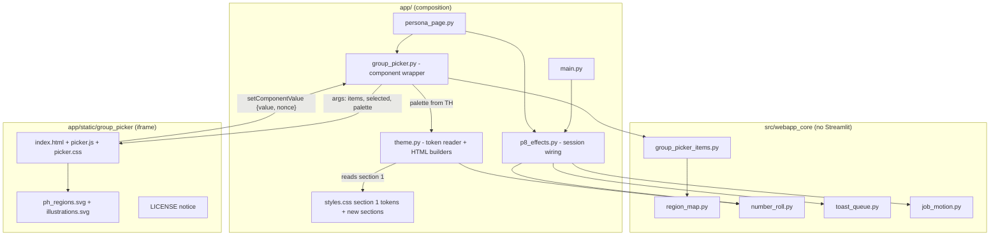

# Design Document: Part 8 New UI Features

## Overview

Part 8 is presentation only. It touches `app/` (composition, CSS, one static component) and adds small pure helpers under `src/webapp_core/`. Parts 1 to 4, `run_pipeline.py`, `outputs/`, `data/`, `requirements.txt`, `labels.py` and all `part5_personas` code stay at zero changed lines (Requirement 2).

What I found in the code that shapes the design:

- `main()` calls `theme.utility_bar()`, `theme.nav_bar()` and `theme.context_banner()`, then the hero. Tests call `nav_bar()` and `header()` directly and never render `main.py`, so F1 only removes two calls.
- There is no promo name field on New Promo (Promo ID is auto-generated and disabled). The analysis Start_Toast therefore uses the Promo ID (approved, D2).
- Only two `st.text_input` exist (Promo ID, disabled; Reward). There is no `st.text_area`. `st.chat_input` is not a Text_Entry_Widget under the glossary.
- Both jobs already run inside `theme.loading(...)`, a fixed overlay that appears after 350 ms (800 ms for rescore) with a translucent scrim. It is a plain `st.markdown` block, which proves `position: fixed` works from inside Streamlit containers in this app.
- The persona group dropdown (`persona_group_select`) is created before the "Personas" subheader. Group keys for a multi-column split are joined with `" | "` (for example `NCR | 25-34`). `group_options()` returns `[]` for zero or one persona set.
- `_handle_run()` ends in `st.rerun()` after storing `PERSONA_FLASH_KEY`. `main.py` does the same after Run Analysis with `FLASH_KEY`.
- AppTest smoke tests render only `render_persona_tab`, not `main()`. Everything the Personas tab needs (toasts, reveal, picker) must work when called from `persona_page.py` alone.

Streamlit 1.66.1 facts checked in `.venv/Lib/site-packages/streamlit` (read from the shipped JS bundle; I had no browser, so DOM claims are from source, not runtime):

| Question | Finding |
|---|---|
| Component API | `components.declare_component(name, path=...)` serves a static folder with `index.html`. Messages are `streamlit:componentReady`, `streamlit:setComponentValue`, `streamlit:setFrameHeight` from the iframe; `streamlit:render` comes back. |
| Theme in the iframe | The `render` message carries `args`, `disabled` and a `theme` object (colours, font). It has no explicit light/dark flag, so the iframe derives the mode from `backgroundColor` luminance. Whether it is re-posted on a theme switch without a rerun is not confirmed; to check in the browser. |
| Iframe sandbox | Includes `allow-scripts` and `allow-same-origin`, so the component can load sibling files. |
| Container keys | `st.container(key="x")` yields class `st-key-x`. |
| Text input DOM | `data-testid="stTextInput"` > `stTextInputRootElement` > `stTextInputField` (the `<input>`). Number input: `stNumberInputContainer`, `stNumberInputField`, `stNumberInputStepUp/Down`. Existing CSS selects `div[data-baseweb="input"]`, which may not exist in 1.66; new CSS uses `data-testid` first. Confirm by DOM inspection in the first F4 task. |
| `st.markdown(unsafe_allow_html=True)` | Rendered through `rehype-raw`, no DOMPurify. `<style>` works. `<script>` does not run. Inline `<svg>` should keep `<filter>`; not seen in a browser, so F3 starts with a 5-minute check and has a fallback. |
| Alert DOM | `data-testid="stAlertContainer"` inside `stAlert`, with `stAlertDynamicIcon` for the icon. The alert kind is not in the DOM, so flashes are wrapped in `p8_quiet_*` containers. |
| Element containers | Every element sits in `div[data-testid="stElementContainer"]`; while a rerun has not yet re-rendered it, it carries `data-stale="true"` and the frontend dims it with a reduced opacity and a transition (exact values are in the minified bundle and not pinned here). |
| Tab panels | `stTabPanel` exists in the bundle (BaseWeb tab panel with the `hidden` attribute toggled client-side). Selector to confirm in the browser. |

## Reference Images

I did not open the four image files. The descriptions come from the brief. Every number is approximate. None of the images is used for geometry, logos or traced shapes.

| # | Image | What it shows | Approximate values | Maps to |
|---|---|---|---|---|
| 1 | BPI banner | Deep red field fading darker at the edges, layered diagonal translucent bands, thin gold sparkles. Mood and colour only; wordmark and collage never reproduced. | red ~#A31F25, dark edge ~#6E0F14, gold accent | `--pan-primary`, hero gradient, lattice tones `--pan-map-fill-a/b`. |
| 2 | Vecteezy 3D PH map (watermarked) | Landmasses with extruded edges and a soft shadow on a pale blue-grey gradient. Silhouette and raised depth only. | edge depth ~6 to 10 px | Hover lift `--pan-lift: 3px` (approved, milder), `--pan-map-shadow`. Geometry comes from the approved source. |
| 3 | Shutterstock pictogram row (watermarked) | Solid stick figures from toddler to elder. Style only: flat, one colour, height progression. Cane excluded. | single flat colour | One accent token per illustration, neutral tokens for the rest. |
| 4 | Shutterstock icon (watermarked) | Flat icon, thick dark outline, coin jar with a falling coin. Style reference for money. | outline ~3 px, two-colour fill | Money symbols use the peso sign and tokens. |

## Architecture

Three delivery paths, chosen to keep iframes and vendored files at the minimum (Requirement 1.8):

1. Injected CSS and HTML in the main page: toasts, running state, completion stories, number roll, input pills, quiet alerts, reveal, stale override, tab fade. No iframe and no vendored file. The one exception is the page lock script (`app/static/p8_page_lock.js`, decision A7), copied into the main page with `st.components.v1.html`. Streamlit logs that this will be replaced by `st.iframe`; if removed, the CSS click block remains.
2. One iframe component (`group_picker`): map, ring with glass depth, Toggle_Card. It needs JS for the ring layout and animation, keyboard handling and returning a value.
3. Pure Python in `src/webapp_core/`: everything that can be unit tested without Streamlit.



Dataflow rules:

- Tokens: `styles.css` section 1 stays the single source. `theme.py` parses it and hands light and dark values to the iframe (Requirement 3.5, 3.10). Nothing is migrated.
- Every effect is driven by session state set in Python. CSS never decides whether an animation plays; Python decides whether the animating markup exists in this render.
- The injected effect markup lives in a keyed container `p8_fx` styled `position: absolute; height: 0` so it adds no layout gap, and it is not `display: none` (that would hide its fixed children).

### One-shot mechanics (Requirement 5)

A rerun re-executes the whole script, so a CSS animation would replay if its markup were rendered every time. The rule: animating markup is emitted only in the render that consumes a flag; every other render emits the final static markup.

- `p8_oneshot_analysis` and `p8_oneshot_personas` are set to `True` when a job succeeds, immediately before `st.rerun()`.
- The render that plays the effect reads them with `consume_flag(state, key)`, which is `state.pop(key, False)`. After that render the key is gone (Requirement 5.2).
- A carousel or map click changes the component value, which reruns the script. That rerun has no flag set, so cards render without the reveal class, the toast queue holds nothing new, and the iframe only receives new `selected` args. Nothing can replay (Requirement 5.4).
- On an error path nothing sets a flag and the queue gets no completion toast (Requirement 5.6).

## Components and Interfaces

### New and changed files

| File | Kind | Purpose |
|---|---|---|
| `src/webapp_core/region_map.py` | new, pure | Region_Mapping: four Map_Areas, PSGC shape codes (outlines only), lead-count entries. |
| `src/webapp_core/number_roll.py` | new, pure | Digit diff plan for the CSS roll. |
| `src/webapp_core/toast_queue.py` | new, pure | Toast queue: add, expire, trim to 3, negative delays. Also `consume_flag`. |
| `src/webapp_core/group_picker_items.py` | new, pure | Which visual to show, the items, glass level, and the component-value sync rule. |
| `src/webapp_core/job_motion.py` | new, pure | `ring_phase` and `is_duplicate_submit` for the F2 redesign. |
| `app/p8_effects.py` | new | Session wiring: queue, one-shot flags, `p8_fx` container, Job_Button ring slot, job-end record, duplicate-submit guard, stale styles. |
| `app/group_picker.py` | new | `declare_component` wrapper and `pending_selection()`. |
| `app/static/group_picker/` | new | `index.html`, `picker.js`, `picker.css`, `ph_regions.svg`, `illustrations.svg`, licence notice. |
| `scripts/build_ph_regions.py` | new, one-off | Offline geometry preprocessing (stdlib only): dissolve and simplify. |
| `app/theme.py` | changed | Token reader, palette hand-off, HTML builders; `loading()` gains `keep_on_success`; `card()` gains optional `reveal_index` and `xfade` flags; `finishing_overlay_html()`; `utility_bar`/`nav_bar`/`header` unchanged. |
| `app/styles.css` | changed | New tokens in section 1; new sections 8 to 14 for toasts, running state, stories, roll, pills, reveal, stale override, tab fade. |
| `app/main.py`, `app/persona_page.py` | changed | Wiring only. |
| `tests/test_part8_*_unit.py` | new | Unit and Hypothesis tests. |

`scripts/` is a new top-level folder. I chose it over `src/webapp_core/` because the script runs once by hand, is not imported by the app, and should not widen the pure package. It imports the mapping from `webapp_core.region_map` (run with `PYTHONPATH=src`) so the mapping has one home. `data/` is off limits.

### `app/theme.py` additions

```python
class TokenError(KeyError): ...          # names the token or the unreadable block

def read_tokens(css_path: Path = _STYLES_PATH) -> dict[str, tuple[str, str]]:
    """Parse section 1. Returns {token_name: (light, dark)}.
    A plain value returns (v, v). light-dark(a, b) is split at its top-level comma.
    var(--x) references are resolved. Raises TokenError if the block is unreadable."""

def token_pair(name: str) -> tuple[str, str]:
    """(light, dark) for one token. Raises TokenError naming the missing token. No fallback."""

def iframe_palette(names: Sequence[str]) -> dict[str, dict[str, str]]:
    """{'light': {name: value}, 'dark': {name: value}} for the picker args."""

PALETTE_TOKENS: dict[str, str]           # PALETTE key -> token name (used by the mirror test)

def toast_stack_html(views: Sequence[ToastView]) -> str: ...
def job_ring_html(state: Literal["running", "done", "error"], phase: float) -> str: ...  # replaces running_style_html / settle_style_html
def roll_number_html(cells: Sequence[RollCell], *, plain: str, css_class: str) -> str: ...
def completion_story_html(job: Literal["analysis", "personas"]) -> str: ...
def hero_kpi_html(number: str, label: str, foot: str = "", *, prev: str | None = None) -> str: ...
```

`hero_kpi_html` keeps its current output when `prev` is `None`. `PALETTE` gains `MAP_RED` and `MAP_RED_SELECTED` (light values of `--pan-map-fill-a` and `--pan-map-selected`). Both hex values are written in section 1, so `test_build_css_contains_every_palette_color` still passes. `test_config_toml_parses_and_carries_palette_colors` compares only primary, text and background, so it is unaffected. A new test checks `PALETTE_TOKENS` against `read_tokens()` (Requirement 3.7, 3.8).

### Pure modules

```python
# region_map.py
MAP_AREAS: tuple[str, ...] = ("NCR", "Luzon", "Visayas", "Mindanao")
AREA_SHAPES: dict[str, tuple[int, ...]]           # area -> PSGC adm1 codes (used for outlines only)

@dataclass(frozen=True)
class MapAreaEntry:
    region: str; lead_count: int; selectable: bool; shape_codes: tuple[int, ...]

@dataclass(frozen=True)
class RegionMapResult:
    entries: tuple[MapAreaEntry, ...]             # always the four areas, fixed order
    unmatched: tuple[str, ...]                    # input order

def build_region_map(group_lead_counts: Iterable[tuple[str, int]]) -> RegionMapResult: ...
def area_label(entry: MapAreaEntry) -> str: ...   # "Visayas, 362 leads" (aria-label text)
def shape_owner(code: int) -> str | None: ...
def unassigned_shape_codes(source_codes: Iterable[int]) -> tuple[int, ...]: ...
```

```python
# number_roll.py
@dataclass(frozen=True)
class RollCell:
    char: str
    prev: str | None
    kind: Literal["static", "roll", "enter"]

def plan_roll(prev: str | None, cur: str, placeholders: Sequence[str] = ("--",)) -> tuple[RollCell, ...]: ...
```

```python
# toast_queue.py
LIFE_S = 4.2; ENTER_S = 0.21; MAX_VISIBLE = 3

@dataclass(frozen=True)
class Toast:
    id: str; job: Literal["analysis", "personas"]; kind: Literal["start", "done"]
    text: str; created_at: float

@dataclass(frozen=True)
class ToastView:
    toast: Toast; slot: int; elapsed_s: float; evicting: bool

def push(queue: Sequence[Toast], toast: Toast) -> list[Toast]: ...
def prune(queue: Sequence[Toast], now: float) -> list[Toast]: ...       # drops age >= LIFE_S
def plan_view(queue: Sequence[Toast], now: float) -> tuple[ToastView, ...]: ...
def settle(queue: Sequence[Toast]) -> list[Toast]: ...                  # drops evicted overflow
def start_text(job: str, label: str) -> str: ...
def consume_flag(state: MutableMapping[str, Any], key: str) -> bool: ...
```

```python
# group_picker_items.py
PickerKind = Literal["none", "map", "carousel", "toggle"]
MAX_COMBINED_GROUPS = 12
MULTI_SEP = " | "            # existing group-key separator for multi-column splits

@dataclass(frozen=True)
class PickerItem:
    value: str; label: str; lead_count: int; selectable: bool; art: str   # art = sprite id

@dataclass(frozen=True)
class PickerPlan:
    kind: PickerKind; column: str | None; items: tuple[PickerItem, ...]
    yes_no: bool = False          # Toggle_Card layout: column icon + check/cross
    unmatched: tuple[str, ...] = ()

def plan_picker(split_columns: Sequence[str], group_keys: Sequence[str],
                lead_counts: Mapping[str, int]) -> PickerPlan: ...

def group_changed(prev: str | None, current: str | None, *, reveal: bool) -> bool:
    """True iff prev and current are both not None, prev != current, and not reveal."""

def shortest_step(front: int, target: int, n: int) -> int:
    """Signed ring steps from front to target, minimal magnitude, in [-(n//2), n//2].
    d = ((target - front + n + n // 2) % n) - n // 2. A tie (even n, opposite item) resolves to
    -(n//2), i.e. rotate left. Mirrored in picker.js (Property 13)."""

def glass_level(index: int, front: int, n: int) -> int:
    """0 for the front item, 1 for ring distance 1, 2 for distance >= 2.
    Distance is min((index-front) % n, (front-index) % n), so it is symmetric and
    wraps. For n <= 4 only level 1 exists (levels are capped at 1)."""

@dataclass(frozen=True)
class SyncDecision:
    apply: str | None; last: object

def resolve_component_value(last: object, new: object, options: Sequence[str]) -> SyncDecision: ...
```

### Dropdown to visual sync (Requirement 12.15 to 12.17; used by F6 and F7)

The component keeps its key, so the iframe persists across reruns and receives new `selected` args. In `picker.js`, each `streamlit:render` message compares the new `selected` with the one currently shown:

- Ring: rotate to the new item by the shortest direction. `d = ((target - front + n + n/2) % n) - n/2` (integer halves), rotate `d` steps in one transition of `--pan-dur-slow` with `--pan-ease`, with the Glass_Layer opacity crossfade running in step. The same rule is the pure Python `shortest_step`, mirrored in JS.
- Map: move the `is-selected` and `is-dimmed` classes (transform and opacity transitions within the Micro_Interaction budget).
- Toggle_Card: move the selected state.
- First render after a build (reveal render): set the state with no rotation or transition.
- "All groups": no item selected, nothing dimmed; the ring keeps its current front item and only clears the selected marking.
- Reduced motion: all of the above instant.
- No feedback loop: only user actions (click, key, arrow) post `setComponentValue`. An args-driven change never posts. Combined with the nonce and `resolve_component_value`, one user action causes one rerun.

### Component wrapper (`app/group_picker.py`)

```python
_component = components.declare_component("p8_group_picker", path=str(_STATIC / "group_picker"))

def render_group_picker(plan: PickerPlan, selected: str | None, *, key: str = "p8_group_picker") -> None:
    """Calls the component with args {kind, items, selected, palette, labels, height}. Returns nothing.
    Skips silently (no error shown) if the static folder or geometry file is missing."""

def pending_selection(state, options: Sequence[str]) -> str | None:
    """Reads state['p8_group_picker'], applies resolve_component_value against
    state['p8_group_last'], updates 'p8_group_last', and returns the option to select or None."""
```

Event schema from JS: `{"value": "<group key>", "nonce": <int>}`. The nonce increases on every click, so clicking the same area twice after a dropdown change is a new value.

### Session-state keys

| Key | Holds | Set by |
|---|---|---|
| `p8_toasts` | `list[Toast]` | `p8_effects.push_toast` |
| `p8_toast_seq` | int for toast ids | same |
| `p8_oneshot_analysis`, `p8_oneshot_personas` | `True` until consumed | job success |
| `p8_job_end` | `{job: {"ok", "started_at", "ended_at", "signature"}}`; the ring part is consumed once, the record is kept for the duplicate guard | job end (success or error), before `st.rerun()`; replaces `p8_settle_*` |
| `p8_job_started` | `{job: started_at}` | click handling, before the Job |
| `p8_num_prev` | `{key: formatted text}` | `roll_number_html` call sites |
| `p8_group_picker` | component value (widget key) | Streamlit |
| `p8_group_last` | last component value already handled | `pending_selection` |
| `p8_last_split` | split columns of the last persona run | `_handle_run` |
| `p8_group_prev` | Selected_Group used on the previous Personas render | `persona_page` render, every render |

New container keys (not widget keys; Requirement 2.4 is unaffected): `p8_btn_run_analysis`, `p8_btn_build_personas`, `p8_fx`, `p8_group_visual`.

## Data Models

- Toast: `Toast` above. `created_at` is `time.time()` on the server. A toast is dropped once `now - created_at >= LIFE_S`.
- Picker item `art` values are sprite symbol ids in `illustrations.svg` (listed in the Category list section), and `unknown` for the placeholder.
- Region geometry file `ph_regions.svg`: one `<g data-area="NCR|Luzon|Visayas|Mindanao">` per area holding a single dissolved `<path>`, plus the NCR bubble (circle, enlarged NCR copy in the same `data-area="NCR"` group, and a leader line). No per-region paths. Written by the script; no runtime parsing in Python.
- Palette arg: `{"light": {token: value}, "dark": {token: value}}` for the token names listed in `PICKER_TOKENS` in `theme.py`.

### New tokens (section 1, `light-dark()` pairs where they are colours)

| Token | Value (approximate for colours) | Used by |
|---|---|---|
| `--pan-ease-in-out` | `cubic-bezier(0.4, 0, 0.2, 1)` | superseded (old trace lap); remove if unused |
| `--pan-dur-trace` / `-pulse` / `-cycle` | 1200ms / 800ms / 2400ms | superseded by the F2 redesign; removed with section 12 |
| `--pan-dur-breath` | 1600ms | Job_Button hover breath |
| `--pan-scale-breath` | 1.02 | hover breath glow plate scale |
| `--pan-scale-press` | 0.97 | Job_Button press |
| `--pan-dur-ring-lap` | 1400ms | running ring lap (linear, approved) |
| `--pan-dur-ring-fill` | 300ms | ring fill on success |
| `--pan-dur-spark` | 600ms | completion sparks |
| `--pan-ring-dash` | 22 | running dash length out of `pathLength` 100 |
| `--pan-z-ring` | 1000 | job container while a ring is present (above the loader at 999) |
| `--pan-dur-toast` | 4200ms | toast life (0.21 s in, 3.78 s hold, 0.21 s out) |
| `--pan-dur-story` | 1500ms | completion stories |
| `--pan-dur-roll` | 600ms | number roll (Requirement 11.2; outside the 120 to 250 ms band by design) |
| `--pan-dur-xfade` | 180ms | crossfades: tab panels, picker kind switch (within 150 to 200) |
| `--pan-reveal-base` / `-step` | 80ms / 50ms | results reveal |
| `--pan-dur-xfade-short` | 150ms | Group_Change_Crossfade (opacity only) |
| `--pan-dur-hold` | 250ms | finishing overlay hold before its fade |
| `--pan-lift`, `--pan-dim` | 3px, 0.6 | map hover and dimming |
| `--pan-map-fill-a/b` | light #AE1319 / #C41E25, dark #9C1218 / #B71C22 | lattice tones |
| `--pan-map-selected` | light #D8232A, dark #E5373D | selected area |
| `--pan-map-muted` | light #C9CDD3, dark #3C4350 | zero-lead area |
| `--pan-map-shadow` | `var(--pan-shadow-strong)` | hover shadow layer |
| `--pan-input-pill-bg` | light #ECEEF2, dark #2A2D34 | input pill fill |
| `--pan-input-pill-min` | 120px | input pill minimum width |
| `--pan-input-outline` | reuses the `--pan-border-control` pair (light ~#868C97, about 3.4:1 on white) | 1 px outline on pills and number inputs. Dark value is verified at implementation; if it is under 3:1 against the dark page, a lighter dark value is written here. |
| `--pan-input-outline-hover` | slightly stronger tone of the same pair | hover only |
| `--pan-toast-edge` | `var(--pan-border-control)` | toast border (the plain `--pan-border` is about 1.3:1 and would fail Requirement 20.3) |
| `--pan-toast-shadow` | `0 8px 24px var(--pan-shadow)` | toast |
| `--pan-loader-ok` | `var(--pan-success)` | the drawn check mark |
| `--pan-glass-blur-1` / `-2` | 4px / 8px (plain) | ring glass levels |
| `--pan-glass-sat-1` / `-2` | 1.2 / 1.4 (plain) | ring glass levels |
| `--pan-glass-tint-1` / `-2` | light-dark pairs, translucent surface tones (level 2 denser) | ring glass tint |
| `--pan-glass-edge` | light-dark pair, bright top-left highlight | static inner edge |
| `--pan-glass-shadow` | `0 6px 16px var(--pan-shadow)` | static soft shadow |
| `--pan-glass-fallback-1` / `-2` | light-dark pairs, solid translucent tints | no `backdrop-filter` fallback |
| `--pan-glass-scale-1` / `-2` | 0.92 / 0.86 | non-front item scale |
| `--pan-group-visual-h` | 360px | reserved height of the Group_Visual |
| `--pan-stale-opacity` | 0.85 | floor for stale elements |
| `--pan-stale-delay` | 300ms | wait before a stale element dims |

Hex values and numbers in the table are proposals; they are written once in section 1 and nowhere else. The 1 px outline width is a plain length written in the pill rule, not a colour or duration token.

## Feature Designs

### F1. Remove the two header lines (Requirement 6)

Delete the calls `theme.utility_bar()` and `theme.nav_bar()` in `main()`. Keep both functions, `header()`, and the `.pan-utility`/`.pan-nav` CSS. The first element becomes `theme.context_banner(...)`, then the hero. The `<hr class="pan-rule">` came from those two functions, so it goes with them and no blank band remains. `APP_TITLE` and `page_title` stay. Test impact: none.

### F2. Job button running state (Requirement 7, redesign approved after testing)

The first build (container `p8_btn_*`, `running_style_html` in `p8_fx`, rotating conic trace plus container pulse, `settle_style_html`) shipped in tasks 4.1 to 4.5 and is superseded by this redesign. The container keys `p8_btn_run_analysis` / `p8_btn_build_personas` stay; widget keys, labels, `type` and form membership do not change.

**Why the old version jittered:**

1. The trace lap used ease-in-out per lap, so the line sped up and slowed every lap.
2. A conic gradient rotated around the centre of a wide button moves at uneven speed along the border (fast at corners, slow mid-edge).
3. The pulse scaled the whole container including the label, so the text shimmered.
4. The 350 ms loader scrim (z-index 999) covered the ring, so it looked like it stopped.
5. The running style switched the red gradient to grey and removed the hover lift instantly (a hard cut).
6. On completion the running `<style>` vanished in one frame and the settle keyframes started at `scale(1.02)` (a jump).
7. The shared hover `translateY(-1px)` moved the label.

**Ring element.** Each keyed Job_Button container holds a ring slot: an `st.empty()` created before the button inside the same container (for Run Analysis, inside the form). The slot holds an inline `<svg class="p8-ring">` with one `<rect pathLength="100" rx=...>` sized by CSS (`width`/`height: calc(100% - 2px)`, `x`/`y: 1px`), hugging the button 2 to 3 px outside its edge. The slot's element container is absolutely positioned over the button (out of flow, no layout space), `pointer-events: none`. While a ring is present the job container gets `position: relative` and `z-index: var(--pan-z-ring)` (1000, above the loader overlay's 999).

**States** are driven by the ring markup in the slot (`:has(.p8-ring--running)`, `--done`, `--error` on the container), not by a separate `<style>` block:

| State | What the user sees | How |
|---|---|---|
| Hover breath | Soft glow behind the button breathes; label still | Revised 2026-11-10 (decision A4) after diagnosing the jitter: two glow layers fought each other (a scaling plate inside the button plus a container glow growing from `scale(0)`), the ease-out curve bounced at each turn of the alternate loop, and the scaled plate's edge poked past the rounded corners. Now: the hover colour lives on a `button::after` plate that only fades (no scale). The breath is ONE halo on the container `::before` (box-shadow in `--pan-breath-glow`, behind the button's element container). Its opacity is `--p8-hover × --p8-breath`, two `@property` numbers: `--p8-hover` transitions 0↔1 on hover/leave over `--pan-dur-slow` with `--pan-ease`; `--p8-breath` loops 0.45↔1 together with `scale(1 → --pan-scale-breath)`, alternate, half of `--pan-dur-breath` per leg, `--pan-ease-breath`. The loop always runs, so leaving fades out from any phase and hovering never restarts it. `will-change: transform, opacity`. Job buttons drop the shared `translateY(-1px)` hover lift. |
| Press | Button dips to 0.97 and releases | `:active` `transform: scale(var(--pan-scale-press))` over `--pan-dur-fast`, release over `--pan-dur`. |
| Running | Red line travels round the border at constant speed | Rect stroke `--pan-primary`, `stroke-dasharray: var(--pan-ring-dash) calc(100 - var(--pan-ring-dash))` (22 78), `stroke-dashoffset` 0 to -100, `linear`, infinite, `--pan-dur-ring-lap` 1400 ms. Seamless because the dash pattern repeats exactly every 100 units of `pathLength`. Ring fades in over `--pan-dur-fast`. A `button::before` plate with the disabled tokens crossfades in by `opacity`; label colour transitions over `--pan-dur`. Container `pointer-events: none`; the breath fades out on its own as the handoff. |
| Done | Line grows to fill the border, border glows, ~10 sparks burst once, then rest | `.p8-ring--done` drawn at the same slot index. Fill: dasharray from `22 78` to `100 0`, starting at the phase offset, over `--pan-dur-ring-fill` 300 ms, `--pan-ease`. Glow: a wider duplicate rect at low opacity fades in and out (~200 ms). Sparks: 10 absolutely positioned spans at corners and edge midpoints/thirds, each `rotate(<outward angle>) translateX(0)` to `translateX(14px)` with a `scaleX` shrink and `opacity` 1 to 0, staggered 0 to 60 ms, over `--pan-dur-spark` 600 ms, colours `--pan-primary`, `--pan-primary-to`, `--pan-gold`. Ring fades out at the end; about 1 s total. The disabled plate fades out at the start. The Completion_Toast enters as the sparks fade. |
| Error | Line fades out where it is; no fill, no sparks | `.p8-ring--error` continues the running loop from the phase and fades out over `--pan-dur-slow`. |
| Reduced motion | Static | No breath, no press scale. Running: static full rect stroke. Done: full rect highlight fading out within 150 ms. Error: instant removal. |

**Stacking (revised 2026-11-10).** The container takes `z-index: var(--pan-z-ring)` whenever any ring is present (`:has(.p8-ring)`: running, done or error), not only while running, so the fill, glow and sparks are never drawn under a scrim. F3's finishing overlay must sit below `--pan-z-ring`.

**Reduced motion done (revised 2026-11-10).** The full-ring highlight holds for `--pan-dur-hold`, then fades over `--pan-dur-xfade-short` (150 ms).

**Hook for F3.** The sparks end at `--pan-dur-ring-fill + --pan-dur-spark` (about 900 ms) after the completion render; the Completion_Toast should enter as they fade.

**Phase continuity.** Python records `started_at` (server time) when the click is processed. Every ring markup carries `--p8-phase = ((now - started_at) / lap) mod 1`, from `ring_phase`. The running loop uses `animation-delay: calc(var(--p8-phase) * var(--pan-dur-ring-lap) * -1)`, so a re-mounted ring continues where it was. The done and error rings start from the same phase. Latency error is a few percent of the perimeter.

**Completion render.** The completion render writes `.p8-ring--done` into the slot with `st.markdown` directly (not empty-then-fill), so React updates the element in place and the stale running ring keeps moving until it is replaced. Persona exceptions (no rerun) replace the slot content in place with the error ring. Analysis errors, the empty audience and the missing model are drawn on the post-rerun render with the error ring (success follows D3: analysis success means cards are present).

**Job end record.** `p8_job_end[job] = {"ok": bool, "started_at": float, "ended_at": float, "signature": str}` is set before `st.rerun()` and consumed once on the completion render (one-shot). It replaces `p8_settle_<job>`.

**Keyboard guard (Requirement 7.12).** On a click, `is_duplicate_submit(last_end, signature, now, window_s=1.5)` is checked first; when true the click is ignored (no Job, no Start_Toast, no Completion_Toast). Revised 2026-11-10 (decision A6): a keypress during a Job makes Streamlit interrupt the run at its next Streamlit call, which is the loader's cleanup. So the results, flash messages and `end_job` record are now stored inside the `theme.loading` block, before that cleanup; otherwise the first Job's messages were lost and the guard never saw an end record. The signature is the PromoSpec fields except `promo_id` for analysis, and the persona spec fingerprint for personas. `last_end` is the last job-end record for that job, kept after the one-shot is consumed.

**New pure helpers** in `src/webapp_core/job_motion.py`:

```python
def ring_phase(started_at: float, now: float, lap_s: float) -> float:
    """((now - started_at) / lap_s) mod 1, always in [0, 1)."""

def is_duplicate_submit(last_end: Mapping | None, signature: str, now: float,
                        window_s: float = 1.5) -> bool:
    """True only when last_end exists, its signature equals signature,
    and 0 <= now - last_end['ended_at'] <= window_s."""
```

`theme.job_ring_html(state: Literal["running", "done", "error"], phase: float) -> str` replaces `running_style_html` and `settle_style_html`; those two and their call sites are removed. `styles.css` section 12 is replaced by the redesign CSS.

The existing loader overlay stays (approved, D1); the ring sits above it by z-index. Its exit on success is the finishing overlay (section l).

### F3. Toasts and completion stories (Requirement 8, 9)

Approaches compared (Requirement 8.12):

| | A. CSS/HTML recreation via `st.markdown` | B. Sonner in a custom component |
|---|---|---|
| Criteria 1 to 7 | All met in CSS; hover pause with `animation-play-state` | Sonner meets them natively |
| Iframe | None | An iframe cannot float over the page; it would have to mount into `window.parent`, which Streamlit does not support |
| Vendored asset | None | Sonner 2.0.8 plus React and ReactDOM, with a build step |
| Behaviour across `st.rerun()` | Queue in session state; re-rendered with an elapsed offset | Iframe state resets or must be re-fed |

Recommendation (approved): A. No vendored file, no iframe, no build step (Requirement 19.6).

- Stack. `.p8-toasts` is `position: fixed` at the bottom-right inset by spacing tokens, `pointer-events: none` (toasts `auto`). Each toast is `position: absolute` at the bottom. The newest (slot 0) sits at the front; older ones get `translateY(-slot * offset) scale(1 - 0.05 * slot)` and lower `z-index`. An expired toast leaves no gap and nothing reflows.
- Look. Surface background, `--pan-toast-edge` border, radius `--pan-radius-lg` (14 px), `--pan-toast-shadow`, `role="status" aria-live="polite"`.
- Life. One keyframes per toast on `--pan-dur-toast`: 0 to 5% rise 12 px plus fade in (the shared `p8-rise`); 5 to 95% hold; 95 to 100% fade out (the shared `p8-fade-out`), then `visibility: hidden` and `pointer-events: none`. Enter and exit are 0.21 s, ease-out. Dismissal begins 3.99 s after appearing, inside the 4 s ± 0.25 s window.
- Hover pause. `.p8-toasts:hover .p8-toast { animation-play-state: paused }` pauses every toast (Requirement 8.6).
- Eviction. `plan_view` marks the overflow beyond 3 as `evicting` for the one render in which the 4th arrives; that toast gets a 180 ms opacity fade. `settle()` then drops it.
- Surviving `st.rerun()`. Each toast carries `--p8-el: <elapsed seconds>` and uses `animation-delay: calc(0s - var(--p8-el))`. A toast already past its entry renders mid-hold, so it does not replay or restart its timer. Toasts older than `LIFE_S` are pruned. Honest limit: hover pause cannot carry across a rerun, because elapsed time is measured by the server clock.
- Start timing. The Start_Toast is pushed and rendered before the blocking call, so it animates while the job runs.
- Texts (approved, D2). Run Analysis: "Running analysis for <Promo ID>...". Build Personas: "Building personas by <labels>..." using `attribute_display_label` for each selected column in order; with no split, "Building personas for all leads...". Completion: "Analysis complete" and "Personas ready".
- Completion toast timing (approved, D3, revised). The Completion_Toast is queued on the completion render, not before `st.rerun()`, because queueing it earlier used up its time during the rerun. It enters after `--pan-dur-toast-delay` (ring fill plus half the sparks, about 600 ms), as the sparks fade (Requirement 7.7); the reveal starts 80 ms later (Requirement 17.1). Run Analysis shows it only when `result.cards` is non-empty. The empty-audience warning and the missing-model error show none.
- Toast element identity. Each toast is wrapped in its own custom element (`<p8-toast-tN>`, `display: contents`). React reuses a DOM element when the tag at a position is unchanged, so without this a new toast inherited the previous toast's finished animation clock. The group crossfade alternates two identical keyframes for the same reason.
- Flash alerts. `st.success` and `st.warning` keep text, role and trigger. Streamlit 1.66.1 alerts do not expose their kind in the DOM, so each flash is wrapped in a keyed container (`p8_quiet_<level>_<n>`, via `quiet_container`) and CSS makes it compact, with a subtle status tint and no large icon. Contrast stays at least 4.5:1. Errors and info are not restyled. The existing `pan-fade-in` stays.

Completion stories (approved Motion_Exceptions). Both sit in a 96 x 64 px box inside the toast. Keyframes use only `from` states so removing the animation leaves the final frame. Every delay is `calc(<offset> - var(--p8-el))`, so a rerun mid-story continues where it was.

*Analysis, magnifier (1.5 s):*

| Time | Frame | Property |
|---|---|---|
| 0 to 0.25 s | Three mini documents slide and stop with the centre one under the lens | `translateX`, ease-out |
| 0.25 to 0.65 s | Lens moves to the centre document and zooms | `translate`, `scale(1 to 1.35)`, ease-out |
| 0.65 to 0.95 s | Document lines fade out; "Analysis complete" fades in beside the lens | `opacity` |
| 0.95 to 1.45 s | Check mark draws on inside the lens | `stroke-dashoffset` (part of the exception) |
| 1.45 s on | Hold final frame | none |

*Personas, squares (1.5 s):* eight `<rect>` tiles, colours `--loader-accent` and `--loader-accent-alt` in the same red/gold order as `theme._loader_visual`.

| Time | Frame | Property |
|---|---|---|
| 0 to 0.4 s | One last shuffle in the 2 x 4 grid | `translate`, ease-out |
| 0.4 to 0.95 s | Tiles slide into two 2 x 2 clusters (red left, gold right) | `translate`, ease-out |
| 0.6 to 1.0 s | Tiles fuse as they touch (the filter is static; only tiles move) | none extra |
| 1.0 to 1.3 s | "Personas ready" fades in under the two blobs | `opacity` |
| 1.3 s on | Hold: two rounded blobs and the text | none |

The Gooey_Merge is a static `<filter>`: `feGaussianBlur stdDeviation="3"` then `feColorMatrix` alpha row `0 0 0 18 -7`, on each cluster `<g>`. Fallback if the filter is dropped by the markdown renderer: two rounded rectangles that scale 0.85 to 1 and fade in (180 ms, ease-out), no filter.

Text for screen readers is real text in the toast from the first frame; animated glyphs are `aria-hidden`. Reduced motion: final frame with an opacity fade of at most 150 ms.

### F4. Text input pill (Requirement 10)

DOM (from the bundle, to be confirmed at runtime): `stTextInput > stTextInputRootElement > stTextInputField`.

- `stTextInputRootElement`: no border, no shadow, no underline, transparent background (removes the low-saturation underline and end line).
- `stTextInputField`: `field-sizing: content; min-inline-size: var(--pan-input-pill-min); max-inline-size: 100%; background: var(--pan-input-pill-bg); border-radius: var(--pan-radius-pill); padding: 0 var(--pan-space-4); border: 1px solid var(--pan-input-outline)`. Overflow scrolls inside the input so the caret stays visible (Requirement 10.7).
- Outline (D4, approved as a thin outline): 1 px, `--pan-input-outline`, which reuses the `--pan-border-control` values (about 3.4:1 on the light page). The dark value is checked at implementation against the dark page for at least 3:1 (Requirement 10.1). Hover changes only the tone to `--pan-input-outline-hover`. Focus keeps the outline and adds the 2 px `--pan-focus` ring with `outline-offset: 2px`. Disabled uses the disabled tokens for fill and text and the same 1 px outline.
- Fallback: `@supports not (field-sizing: content)` gives the field `inline-size: 100%` with the same radius, fill, outline, padding and text size.
- No `transition` on width (Requirement 10.6). Width changes reflow only the pill itself (inline-sized); no sibling moves.
- Smooth width is not feasible in CSS (Requirement 10.14): with `field-sizing: content` the used width changes while the computed value stays `auto`, so no transition fires, and `interpolate-size: allow-keywords` interpolates only when the specified value changes. A smooth width would need JavaScript writing pixel widths into the page, which is out of scope unless approved later. No CSS change.
- Browser support: Chromium 123 and later ships `field-sizing`. Firefox and Safari status is unverified; the `@supports` fallback makes either answer safe.
- `st.text_area`: none exists in the app today. The same rules are written for `stTextAreaRootElement` (full width, height grows) with a 20 px radius instead of a full pill.
- `st.number_input`: same fill and the same 1 px outline, fixed at the column width (approved), so steppers and right-aligned digits stay stable. Radius is `--pan-radius-pill`.

Existing rules at `styles.css` lines 544 to 563 (`div[data-baseweb="input"]` borders) are replaced for inputs only. Selects, multiselects and sliders keep their current look.

### F5. Animated numbers (Requirement 11)

Approaches compared (Requirement 1.8, 11.7):

| | A. NumberFlow web component in an iframe | B. CSS-only digit roll in the main page |
|---|---|---|
| Vendored files | `number-flow` 0.6.2 build (MIT) | None |
| Iframes | One per KPI row | None |
| JS | Yes | None |
| Screen reader | Handles its own | Plain text in an `sr-only` span; strips are `aria-hidden` |

Recommendation (approved): B. Zero vendored files and zero iframes. NumberFlow stays in the Asset_Register as the rejected alternative.

`plan_roll(prev, cur)` right-aligns the two strings and returns one cell per character of `cur`: `roll` (both digits, differ), `static` (same), `enter` (no counterpart in `prev`). Digits that disappear are not rendered.

Each digit renders as a one-em-high clipped box holding a strip `0..9`. One shared keyframes does the work:

```css
@keyframes p8-roll { from { transform: translateY(calc(var(--p8-from) * -1em)); } }
.p8-d > .p8-strip { transform: translateY(calc(var(--p8-to) * -1em)); }
.p8-d.is-roll > .p8-strip { animation: p8-roll var(--pan-dur-roll) var(--pan-ease); }
```

Duration 600 ms, ease-out, `transform` only. The plain value is in `<span class="p8-sr">`, so AppTest and screen readers find the same text as today. Reduced motion: no animation. Previous values live in `p8_num_prev[key]`; unchanged text renders static (Requirement 11.5). A key never rendered before renders static (Requirement 11.3). A change during a running roll starts a new roll from the stored previous value and ends on the latest value; it does not continue from the half-rolled position (small deviation from Requirement 11.10, noted).

Layout: the number box has a fixed `min-inline-size` in `ch` with `font-variant-numeric: tabular-nums`, so a roll or a longer number never reflows the hero or the What-If panel.

### F6. Region map with dissolved areas (Requirement 13, 14)

Shown when the split is `region` alone and the run has more than one group. Rendered in the one `group_picker` iframe. Exactly four Map_Areas are drawn; no administrative-region border appears anywhere.

**Geometry source.** faeldon/philippines-json-maps v1.1.1 (Gate 2). The one-off script `scripts/build_ph_regions.py` uses only `json` and `math`, no `pip install`.

**Dissolve method, compared:**

| | A. One path per area, no stroke, seam hidden by a same-fill under-stroke | B. Edge cancellation (true union) |
|---|---|---|
| Idea | Emit all member rings of an area in one `<path>` (nonzero), no stroke on member edges; paint a 0.6-unit stroke in the same pattern fill under the fill so anti-aliasing seams close | Snap every vertex to a grid, collect each ring edge, drop edges that occur twice (internal shared edges), chain the remaining edges into outer rings |
| Code | A few lines | About 40 lines of stdlib |
| Slivers after simplification | Possible: each ring is simplified on its own, so neighbours can open gaps wider than the under-stroke | None: simplify only the outer rings, after the union |
| Outline for hover shadow and selected edge | Contains internal rings, so the shadow copy shows internal edges unless it is also stroked | One clean outer outline per ring |

**Recommendation: B**, with A as the automatic fallback. Reason: B guarantees by construction that no internal border can be drawn, and simplification cannot reopen a seam because it runs after the union. The cost is small. B depends on the source regions sharing exact vertices; the data comes from one shapefile set, so it likely does, but I have not confirmed it. If edge matching leaves more than a few unmatched internal edges for an area, the script falls back to A for that area (same-fill under-stroke 0.6 units, `paint-order: stroke`), and prints which areas used the fallback.

Script steps:

1. read the `country` GeoJSON (18 region features);
2. assign each region to a Map_Area using `AREA_SHAPES`; the 18 to 4 mapping is used only for this step;
3. project with one equirectangular projection centred near 12.5 N into an SVG viewBox, snap coordinates to a 0.05 unit grid;
4. per area: collect edges, cancel edges that appear twice, chain the remainder into outer rings;
5. simplify each outer ring with Douglas-Peucker; drop rings smaller than a minimum area (tiny islets); keep the file under about 150 KB;
6. write `ph_regions.svg` with one `<g data-area>` and one `<path>` per area, plus the NCR bubble;
7. print a report: outer ring count per area, unmatched internal edges per area, areas that used the fallback, any source code not in `AREA_SHAPES`, any mapped code missing from the source. It flags any area with more than N = 80 outer rings (a sign that edges did not match).

**Verification:** the printed report, plus a visual check in the browser at normal and 2x zoom, in light and dark, looking for hairlines or gaps inside Luzon, Visayas and Mindanao.

**Rendering.**

- Each Map_Area `<g data-area>` holds one path filled with `<pattern id="lattice" patternUnits="userSpaceOnUse">`, so the diamonds run continuously across the whole area and also line up across area borders. No stroke on the area paths.
- Diamond_Lattice: original geometry: squares 10 units wide with 4-unit gaps, rotated 45 degrees with `patternTransform`, tone A for squares and tone B for the gap, both from tokens. It is not traced from any BPI asset.
- Hover or focus: `transform: translateY(calc(var(--pan-lift) * -1))` on the area group, plus a pre-drawn shadow layer (`<use>` of the same path, filled with `--pan-map-shadow`, blurred by a static filter) whose `opacity` goes 0 to 1. Motion is `transform` and `opacity` only.
- Selected: fill `--pan-map-selected`, stays lifted 3 px; other selectable areas `opacity: var(--pan-dim)` (0.6).
- Zero leads: fill `--pan-map-muted`, no lift, no `tabindex`, click ignored.
- Selected group "All groups" or an unmapped value: nothing selected, nothing dimmed.
- Clicking the selected area changes nothing (no new event).
- NCR inset: a circle of 56 px (at least 44 x 44) offshore west of Luzon, with an enlarged NCR copy inside and a leader line to NCR's true centroid. The bubble and the small NCR shape share `data-area="NCR"`, so hover, selection, dimming and muted state apply to both. Only the bubble is in the tab order.
- Tab order: NCR, Luzon, Visayas, Mindanao. Each area has `role="button"`, `tabindex="0"`, `aria-label="Visayas, 362 leads"`, Enter and Space select, and a `--pan-focus` ring of at least 2 px drawn inside the viewBox margin so it is not clipped.
- Attribution: visible text "NAMRIA, PSA via OCHA" directly below the map, inside the iframe, always shown.
- Dark mode: the iframe sets all CSS variables from the dark palette in one pass.

**Region_Mapping logic** (`webapp_core/region_map.py`): `build_region_map` matches `region` values exactly and case-sensitively. It returns four entries in fixed order, a lead count of 0 for any absent area, `selectable = lead_count > 0`, and `unmatched` for values with no area (input order). It raises `ValueError` naming the offending value for a negative or non-integer count, and returns nothing partial. A shape code belongs to at most one area. Unmatched groups stay selectable in the dropdown (Requirement 14.6).

### F7. Ring with liquid-glass depth, Toggle_Card, illustrations (Requirement 15, 16)

**Which visual** is decided by `plan_picker` in `webapp_core` (D5 changed: any column with exactly two values uses the Toggle_Card):

| Split | Groups in run | Visual |
|---|---|---|
| none (no split column) | any | none |
| any | 0 or 1 | none (no visual, no dropdown, Requirement 12.8) |
| `region` alone | 2 or more | map |
| one yes/no column (keys `0`/`1`, also `0.0`/`1.0`) | exactly 2 | Toggle_Card, yes/no layout (column icon, check for 1, cross for 0) |
| one other column | exactly 2 | Toggle_Card, side-by-side value illustrations and labels |
| one other column | 3 or more | ring (carousel with glass depth) |
| 2 or more columns (Multi_Split, option A) | 3 to 12 combined groups | ring of combined groups |
| 2 or more columns | exactly 2 combined groups | Toggle_Card with the combined labels (joined with " · ") as option text |
| 2 or more columns | more than 12 combined groups | none; dropdown only |

Notes:

- The dropdown alone is used only for a Multi_Split above 12 groups (and when the picker fails to load). The earlier rule "exactly two non-yes/no values gives dropdown only" is removed everywhere.
- `region` alone with exactly 2 groups gives the map, not a Toggle_Card. Requirement 13.1 is specific to `region` and wins over the generic two-value rule in 15.12; the two present areas are selectable and the other two are muted.
- "Dropdown only" does not apply to 0 or 1 group: there the dropdown is hidden too (Requirement 12.8).

**Ring (Group_Carousel).** `picker.js` lays the items out on a ring in 2D: a sin/cos projection of each item's angle, with depth shown by scale and z-index. It is not a CSS `preserve-3d` ring. The ring is animated with requestAnimationFrame on the shared `--pan-ease` curve over `--pan-dur-slow` (250 ms), and a multi-step move rotates along the arc. Only `transform` moves.

Direction, defined once: item `k` sits at angle `k * 360/n`; showing item `k` at the front puts that angle at the front position. Pressing the left arrow or button brings the left neighbour (index `k-1`) to the front; right does the opposite. Wrap-around (last to first) takes one step, and a click rotates by the shortest direction.

Left and right buttons (`aria-label="Rotate left"`/`"Rotate right"`) and the Left/Right keys step once, and update a polite live region ("Mid-Market, 412 leads"). A press during a rotation queues at most one more step. With "All groups" selected, the first value in dropdown order is at the front and nothing is marked selected. Ring radius is derived from `n` so 12 items fit. Each item shows its value as visible text under the illustration.

**Liquid-glass depth (approved static `backdrop-filter`).**

- Front item: no glass, opacity 1, scale 1, crisp label.
- Levels by ring distance from the front, from `glass_level(index, front, n)`: level 1 (nearest neighbours, scale `--pan-glass-scale-1` 0.92) and level 2 (farther, scale `--pan-glass-scale-2` 0.86). For `n <= 4` only level 1 exists.
- Every non-front item has a Glass_Layer, an absolutely positioned inner div over the card (not a pseudo-element, so there can be two).
  - `.glass-1`: `backdrop-filter: blur(var(--pan-glass-blur-1)) saturate(var(--pan-glass-sat-1))` plus `-webkit-backdrop-filter`, background `--pan-glass-tint-1`, inner edge highlight as a static 1 px top-left gradient border (`--pan-glass-edge`), static shadow `--pan-glass-shadow`.
  - `.glass-2`: the same with the `-2` tokens (more blur, more tint).
- **Key technique so only opacity animates:** each item always holds both `.glass-1` and `.glass-2` with fixed blur values. The item's level decides which layer has `opacity: 1` (the other, and both for the front item, have `opacity: 0`). On rotation the layers crossfade by `opacity` over `--pan-dur-slow` with `--pan-ease`, in step with the ring `transform`. The arriving front item defrosts (glass opacity to 0) and the leaving item frosts over. Blur is never transitioned.
- Performance: up to about 12 items with two layers each is 24 `backdrop-filter` layers. They are static and modest in blur, with `will-change: opacity` on the layers. If the browser pass shows stutter at 12 items, the fallback is to build only the layer for the current level (swap on rotation end) for rings above 8 items.
- No 3D context: `backdrop-filter` is unreliable inside `transform-style: preserve-3d`, so the ring uses no `preserve-3d`. Items are flat cards positioned by `translate` and `scale`, and each glass layer is a child of its card. The glass blurs what is behind the card (the ring backdrop and farther cards). Verified in a browser harness.
- Fallback: inside `@supports not ((backdrop-filter: blur(1px)) or (-webkit-backdrop-filter: blur(1px)))` each layer is a solid translucent tint (`--pan-glass-fallback-1` / `-2`) with the same edge highlight.
- Clicking a glass item rotates it to the front by the shortest direction and sets the Selected_Group. Pointer events sit on the card; the glass layer has `pointer-events: none`, so the item stays clickable and focusable through the glass.
- Labels: the front label meets 4.5:1 in light and dark. Labels on glass items are readable but secondary; the live region and each item's `aria-label` carry the information.
- Reduced motion: the static glass levels stay, and a selection changes the front item instantly, with no rotation and no crossfade.
- Toggle_Card: no glass, no `backdrop-filter`.
- Motion exception record: the static carousel `backdrop-filter` is an approved Motion_Exception (Gate 1). Blur is never animated.

**Toggle_Card.** Two buttons in a `role="radiogroup"`. Yes/no layout: the column's own icon above a check option (1) and a cross option (0). Check and cross are shared glyphs; the column icon is unique per column. Other layout: the two values side by side, each with its illustration and label. Arrow keys move between options, Enter or Space selects, `aria-label="Uses the mobile app: yes, 1470 leads"` style. The selected option uses selected tokens (`--pan-primary-tint`/`--pan-primary-text`), the other stays readable. Switching animates `opacity` and `transform` only. With "All groups" selected neither option is selected.

**Illustrations.** One sprite file (`illustrations.svg`) of `<symbol>`s. Fills use CSS variables (`--accent`, `--ink`, `--paper`) set from the palette, never hex. Flat, no gradients, no shadows, no raster. Money uses the peso sign. Unknown values get a neutral `unknown` symbol with the value as visible text. The full list is in the Category list below.

### F8. Results reveal (Requirement 17)

When `consume_flag(state, "p8_oneshot_personas")` is true in the Personas render:

- The Group_Visual container (`p8_group_visual`) and each persona card get class `p8-reveal` with an inline `--i` (0-based, capped at 5).
- `.p8-reveal { animation: p8-rise 220ms var(--pan-ease) backwards; animation-delay: calc(var(--pan-reveal-base) + var(--i) * var(--pan-reveal-step)); }` (the 220 ms is written as the `--pan-dur` family token at implementation) with `from { opacity: 0; transform: translateY(14px) }`. `backwards` fill leaves no transform behind.
- Delays: item 1 at 80 ms, then 130, 180, 230, 280, and every item after the sixth at 330 ms. The last finishes at about 550 ms.
- With no Group_Visual, the first card is item 1 (Requirement 17.2).
- The reveal wins over the Group_Change_Crossfade: on the build-reveal render cards get `p8-reveal` and never `p8-xfade`, and `p8_group_prev` is still stored (section k).
- Tables get no class and render with item 1 (Requirement 17.8).
- The iframe element is animated from outside through the class on its keyed container, so there is no JS timing.
- Reduced motion: 150 ms opacity fade, no `transform`, no stagger.
- `theme.card()` gains an optional `reveal_index` so card markup adds the class and `--i`.

### F9. Multi-category split (Requirement 18, option A approved)

`plan_picker` handles two or more split columns as follows. Combined group keys are the existing `" | "` strings; the item label shows the plain-language values joined by " · ". With 3 to 12 groups the kind is `carousel`; each item shows the illustration of the first column's value where one exists and the `unknown` placeholder otherwise. With exactly 2 groups the kind is `toggle` with the combined labels as option text. Above 12 (`MAX_COMBINED_GROUPS`) the kind is `none` and only the dropdown is shown, with no iframe. 12 matches `SPLIT_MAX_VALUES`.

## Category list (all 13 non-region split columns)

Counts are for all 2,000 clients. A persona run on a campaign pool may hold fewer values, so the treatment is decided at run time by the rule below the table.

| Column | Plain label (`attribute_display_label`) | Values in the data (count) | Treatment | Icon or illustration per value |
|---|---|---|---|---|
| `segment` | Customer segment | Affluent-Gold 171, Affluent-Preferred 353, Mass 789, Mid-Market 687 | 3D ring | Coin stacks (account tier, not a person): Mass = 1 coin with ₱; Mid-Market = 2 coins; Affluent-Preferred = 3 coins; Affluent-Gold = 4 coins with the top coin in the accent colour. Sprite ids `segment-mass`, `segment-mid`, `segment-pref`, `segment-gold`. |
| `age_band` | Age band | 18-24 191, 25-34 637, 35-44 562, 45-54 405, 55+ 205 | 3D ring | Neutral flat figure, one prop each: 18-24 graduation cap; 25-34 laptop; 35-44 adult with a young child; 45-54 ring of house keys; 55+ grey hair and glasses reading a newspaper, upright posture. No cane or frailty cue. Sprite ids `age-18-24` to `age-55-plus`. |
| `sec_class` | Socio-economic class | A 58, B1 171, B2 409, C1 585, C2 505, D 272 | 3D ring | Six-step ladder, active step filled and labelled (A top, D bottom). Sprite ids `sec-a`, `sec-b1`, `sec-b2`, `sec-c1`, `sec-c2`, `sec-d`. |
| `inflow_type` | Main money-in type | Business 414, Mixed 287, Remittance 315, Salary 984 | 3D ring | Business = small shop with an awning; Mixed = two different arrows merging into one; Remittance = envelope with ₱ and an arrow arriving from a globe; Salary = pay slip with ₱ and a tick. |
| `online_shopper` | Shops online | Low 200, Medium 370, High 563, Very High 475, Ultra High 392 (ring order Low to Ultra High, not alphabetical) | 3D ring | One shopping cart carrying 1, 2, 3, 4, 5 parcels. |
| `digital_app_user` | Uses the mobile app | 0: 530, 1: 1470 | Toggle_Card (yes/no) | Upright phone silhouette showing an app grid of rounded squares. |
| `frugal_flag` | Frugal spender | 0: 1309, 1: 691 | Toggle_Card (yes/no) | Piggy bank with a coin dropping in. |
| `email_valid` | Has a valid email | 0: 405, 1: 1595 | Toggle_Card (yes/no) | Open envelope with an @ mark on the letter. |
| `mobile_valid` | Has a valid mobile number | 0: 191, 1: 1809 | Toggle_Card (yes/no) | Classic phone handset (curved receiver silhouette) with three signal arcs. |
| `owns_Credit Card` | Owns Credit Card account | 0: 1186, 1: 814 | Toggle_Card (yes/no) | Landscape card with a chip and a stripe. |
| `owns_Insurance` | Owns Insurance account | 0: 1700, 1: 300 | Toggle_Card (yes/no) | Umbrella over a shield. |
| `owns_Investment` | Owns Investment account | 0: 1859, 1: 141 | Toggle_Card (yes/no) | Rising line chart ending in a coin. |
| `owns_Loan` | Owns Loan account | 0: 1764, 1: 236 | Toggle_Card (yes/no) | Banknote with a circular arrow. |

Run-time rule (applies to every column and to Multi_Split):

- 3 or more values present in the run: 3D ring.
- Exactly 2 values present: Toggle_Card. A 0/1 column uses the yes/no layout (the column icon above a shared check and cross). Any other column uses side-by-side value illustrations with plain-words labels (for example two age bands that are present in a campaign pool).
- 0 or 1 group: no visual and no dropdown.
- Dropdown only: only for a Multi_Split above 12 combined groups, or when the picker cannot load.
- A yes/no column can only ever have 2 or 1 values, so it is a Toggle_Card or nothing.

Distinctness (new items shown for review; the other concepts are the approved ones):

- Eight yes/no icons, none reused: app phone, piggy bank, open envelope with @, handset with signal arcs, chip card, umbrella and shield, chart with coin, banknote with arrow.
- Phone at a glance: the app icon is an upright rectangle with a grid of squares; the mobile icon is a curved handset with arcs. They differ in silhouette, not only in detail.
- Envelope at a glance: email is an open envelope (flap raised) with an @ on the letter, a single colour, no globe; Remittance is a closed envelope with ₱ and a globe arrow. Different shape state and different mark.
- The credit-card icon is landscape and rectangular; no other icon shares that silhouette.
- Toggle_Card check and cross are shared glyphs; the column icon is unique per column.

## Seamless transitions (Requirement 22)

Goal: every state change reads as one flow with no jump or flash. For each rule: how it is achieved, and what Streamlit limits.

### a. One motion system (22.1)

All durations and easings come from section 1 tokens: existing `--pan-dur-fast` 120 ms, `--pan-dur` 180 ms, `--pan-dur-slow` 250 ms, `--pan-ease`; new `--pan-ease-in-out`, `--pan-dur-trace`, `-pulse`, `-cycle`, `-toast`, `-story`, `-roll`, `--pan-reveal-base`, `--pan-reveal-step` (all in the token table) and `--pan-dur-xfade` 180 ms for crossfades (within 150 to 200 ms). A unit test scans the new CSS sections and the component files (`picker.css`, `picker.js`, `index.html`) and fails on any literal duration (`\d+(ms|s)` outside section 1), any `linear` timing (except the one approved running ring loop rule in section 12, Requirement 4.2), any hex colour, and any `rgb(`/`hsl(` colour. It is cheap and catches drift. This also covers Requirement 3.3.

### b. No layout jumps (22.2, 22.3)

- Group_Visual: the `p8_group_visual` container has the fixed height `--pan-group-visual-h` (360 px on desktop). The map, ring and Toggle_Card all fit inside it, and the iframe always posts `setFrameHeight` with that same number, so switching kinds never moves the page.
- While a persona build runs, the existing results area keeps its last content (nothing is cleared). On a first build there is no results area yet.
- First build skeleton: not needed. The loader overlay covers the wait. After the rerun the results appear below the controls; content added below the controls pushes nothing that is above it, so no visible element moves. (Anything below the results, such as a footer, would move, but there is none on this tab.) So I add no skeleton.
- Numbers: the hero KPI and What-If number boxes have a fixed width in `ch` with tabular digits, so a roll never reflows (F5).
- Results tab tiles already have a fixed min-height.
- Toasts are `position: fixed`, so they have no layout effect.
- Input pill: width changes reflow only the pill itself.
- Streamlit limit: Streamlit sizes element containers from content, and I cannot reserve space for an element it has not rendered yet, except by wrapping in a fixed-height keyed container (which I do for the Group_Visual).

### c. Continuous handoffs (22.4)

Timeline for Build Personas (times relative to the click):

| Step | Start to end | What covers the gap |
|---|---|---|
| Click: press, then running ring drawn in the slot | 0 ms, same delta as the click handling | Button already shows the ring, no wait |
| Start_Toast rises in | 0 to 210 ms | Toast is the first visible change |
| Loader overlay fades in | 350 ms delay, then its existing fade | Toast and running button carry the first 350 ms |
| Job runs | until done | Overlay, and the ring above it |
| Job ends, flag set, `st.rerun()` | end of job | Old DOM stays in place, marked stale, until replaced |
| Rerun draws: finishing overlay holds its last frame (250 ms) then fades out (180 ms) while the ring fills from its phase (300 ms), glows and sparks (600 ms), and the Completion_Toast enters as the sparks fade (210 ms) and its story plays (1.5 s) | same render | Overlay fade hands off to the toast; no blank frame (section l) |
| Reveal starts | 80 ms after the completion toast enters | Group_Visual first, then cards (50 ms steps) |

Blank-frame risk: when the rerun removes the overlay, there is a moment before the new content paints. Streamlit keeps the old DOM, marked stale, until the new elements arrive, so the page is never empty. The stale restyle in (f) keeps it readable.

The overlay's exit is a JS-free finishing overlay that fades out as the toast enters (section l). Run Analysis follows the same sequence.

### d. Inputs to results (22.5)

The What-If slider reruns the script. The hero and What-If headline numbers roll (CSS roll). The What-If caption and impact tiles update in place as text swaps; the stale rule in (f) keeps them from flashing. The Results tab is not visible while the slider moves. No element is cleared and redrawn.

### e. Tabs and category switches (22.6, 22.7)

- Tabs: Streamlit tabs switch client-side with no rerun and toggle the `hidden` attribute on the panel (`stTabPanel`, to confirm in the browser). A CSS rule `animation: p8-fade var(--pan-dur-xfade) var(--pan-ease)` on visible panels replays each time a panel is shown, because a display change restarts CSS animations. It animates `opacity` only, with no rise: tabs are not entering content. If the browser pass shows the animation does not replay, I drop it (rule 22.11).
- Category kind (map, ring, Toggle_Card): the kind only changes after a new Build Personas, because the split changes the run. The new kind therefore appears inside the reveal. Within the iframe, a kind change crossfades the inner view (`opacity`, `--pan-dur-xfade`) in the same reserved height.

### f. Rerun flicker (22.8, 22.9)

What Streamlit 1.66.1 does: each element sits in `div[data-testid="stElementContainer"]`. Until the rerun re-renders it, it carries `data-stale="true"` and the frontend dims it with a reduced opacity and a transition (exact values are in the minified bundle and not pinned here). I describe it as reduced opacity with a transition.

What I override (allowed, it is plain CSS):

```css
[data-testid="stElementContainer"][data-stale="true"] {
  opacity: var(--pan-stale-opacity) !important;       /* floor 0.85 */
  transition: opacity var(--pan-dur) var(--pan-ease) var(--pan-stale-delay);
}
```

- The 300 ms delay (`--pan-stale-delay`) means quick reruns (a map click, a carousel step, a dropdown change) never visibly dim at all. Slow reruns dim only to 0.85 and stay readable.
- Reduced motion sets `transition: none`.
- Already hidden or left alone: the default "Running..." status widget is hidden, the top decoration bar is hidden, and skeletons (`stSkeleton`, shown only for suspended elements) are left as they are.

What Streamlit does not allow:

- I cannot stop Streamlit from re-mounting an element whose markup changed. An `st.markdown` with different HTML is replaced, which restarts its CSS animations. That is why one-shot markup is emitted only on the consuming render (Architecture, One-shot mechanics).
- I cannot suppress the stale state itself, only restyle it. The override relies on the `data-stale` attribute and the `stElementContainer` test id, which a later Streamlit release could rename (Risks).
- Iframes are not re-created when only args change (the component keeps its key), so the map and ring do not flash on reruns.

### g. Consistent direction (22.10)

Enter is `p8-rise` (rise 14 px plus fade). Leave is `p8-fade-out` (fade). The same two keyframes serve toasts, the reveal, and picker kind switches. The ring rotates toward the pressed arrow, defined once in F7.

### h. Less is more (22.11)

Deliberately not animated:

- tables and charts;
- the context banner;
- flash alerts beyond their existing fade;
- dropdown changes;
- tables on a group switch (they swap instantly; the Group_Change_Crossfade in section k covers persona cards only);
- tab panels beyond the opacity fade in (e), which is itself dropped if it does not help.

### i. Reduced motion (22.12)

Every rule above becomes an instant change or an opacity fade of at most 150 ms. The stale transition is `none`. The ring keeps static glass and switches instantly.

### k. Group_Change_Crossfade (22.13 to 22.15)

When the Selected_Group changes (dropdown, map, ring, Toggle_Card), the persona cards fade in once. No rise, no stagger, never the reveal.

- Pure helper `group_changed(prev, current, *, reveal)` in `group_picker_items.py`: true iff both are not `None`, `prev != current`, and `reveal` is false.
- Wiring in `persona_page.py`, every Personas render, after the Selected_Group is known (after the pre-selectbox sync):
  1. `prev = state.get("p8_group_prev")`; `reveal = consume of the build-reveal flag in this render`.
  2. `xfade = bool(persona_result) and group_changed(prev, current, reveal=reveal)`.
  3. Cards are drawn with `theme.card(..., xfade=xfade)`; the class `p8-xfade` is added only when `xfade` is true.
  4. `state["p8_group_prev"] = current`, always, including on the reveal render (so the reveal never leaves a stale value that triggers a fade next time).
- CSS: `.p8-xfade { animation: p8-fade-in var(--pan-dur-xfade-short) var(--pan-ease) backwards; }` with `from { opacity: 0 }` only. Opacity only, 150 ms, `--pan-ease`. `st.dataframe`, the comparison table and the Expected Joiners tables get no class.
- Why it cannot replay: the class is emitted only when the stored previous value differs from the current one, and the stored value is updated in the same render. Any later rerun (slider, tab, carousel step that lands on the same group, theme switch) sees `prev == current`, so the cards are drawn static. Click on the already selected group sends no event (13.13), so it never reaches this check.
- Honest limit: on a group change Streamlit replaces the card markup, so the old cards are removed at once and CSS cannot fade them out (the old DOM is gone, and there is no JS). A true two-sided crossfade is not possible. What the user sees is a 150 ms fade-in of the new cards over the stale floor (stale elements stay at 0.85 opacity for a moment, see f), which reads as a crossfade. The design records this as the closest allowed behaviour.
- Reduced motion: no animation, instant swap.

### l. Loader overlay exit (Requirement 9.10, 22.16 to 22.19)

Today `theme.loading()` draws the overlay into an `st.empty()` slot and clears it in a `finally`, then the caller runs `st.rerun()`. Clearing before the rerun leaves a possible frame with no overlay and nothing yet on the new page.

New flow, JS-free:

1. `theme.loading(..., keep_on_success=True)`: the `finally` clear becomes an `except` clear. On success the overlay markup stays in the slot through `st.rerun()`. On an exception the slot is cleared as before and the exception propagates.
2. On success the caller sets `p8_oneshot_<job>` and calls `st.rerun()`. The old overlay element stays in the DOM as a stale element until the new run finishes and Streamlit drops the elements it did not re-render.
3. On the completion render, `p8_effects` emits first inside `p8_fx`, before anything else on the page so it paints early, `finishing_overlay_html()`: a `.pan-loading.is-finishing` block with the same scrim and card as the running overlay, visible at once (no 350 ms reveal delay), z-index one higher than the running overlay. Its loader visual is frozen on its last frame (animations paused or omitted, not replayed). It then runs `animation: p8-fade-out var(--pan-dur) var(--pan-ease) var(--pan-dur-hold) forwards`, i.e. holds 250 ms, fades 180 ms. The final keyframe sets `opacity: 0; pointer-events: none; visibility: hidden`, so it blocks nothing afterwards.
4. The Completion_Toast is delayed by `--pan-dur-hold` through the same `animation-delay` offset (the toast block uses `calc(var(--pan-dur-hold) - var(--p8-el))` for the first 250 ms of life), so its enter starts as the fade begins.
5. Reading of "plays the Completion_Story's hand-off" (Requirement 9.10, 22.16): the story itself lives in the toast (Requirement 9). The overlay does not play it. The hand-off is: hold the loader's last frame, then fade out as the toast's story starts.

Gap analysis. Old slot cleared then rerun: blank frame possible. With the slot kept, the old overlay is still on screen (stale, dimmed to the 0.85 floor, which does not matter) while the new run executes; the finishing overlay is drawn early above it; when the run ends Streamlit removes the stale old overlay underneath the finishing overlay, which hides the removal. There is no frame without an overlay.

Other paths:

| Path | Behaviour |
|---|---|
| Error or exception | Slot cleared in the `except`, no `p8_oneshot_*`, no finishing overlay, no Completion_Toast, existing error message shows. |
| Empty-audience warning or missing-model error (not exceptions, no completion toast per D3) | Treated like an error: slot cleared, no finishing overlay. |
| Reduced motion | The finishing overlay is not drawn: instant removal when the run ends (`keep_on_success` still applies; the stale element simply disappears). The toast shows its final frame with a fade of at most 150 ms. |
| What-If rescore | Same flow as a Job (overlay 800 ms delay), but no Completion_Toast, so no finishing overlay: the slot is cleared as today. |

AppTest: the overlay is a plain markdown block, so keeping it in the slot or drawing a second block changes nothing the smoke test asserts (it renders only `render_persona_tab`, and the persona flash text is untouched).

Feasibility verdict: workable without JS. One assumption to verify in the browser: the stale old overlay is removed at the end of the rerun and never shows above the finishing overlay (z-index covers it either way), and `pointer-events: none` in the final keyframe takes effect so the faded overlay blocks no clicks. Fallback if the check fails: revert `keep_on_success` and keep the earlier approved timing (the overlay removed in the same render as the Completion_Toast entering, no fade); this is the case Requirement 22.17 allows.

### j. Browser checklist (22.13)

One item per rule, each with light, dark, Reduced_Motion on and off, and no replay on an unrelated rerun:

1. No literal duration or colour in Part 8 code (the scan test passes; spot check in DevTools that animations use tokens).
2. The Group_Visual height is the same for map, ring and Toggle_Card, and the page does not move when the kind changes.
3. The hero and What-If numbers do not reflow while rolling.
4. Click-to-reveal sequence has no blank frame, no hard cut, no double flash (watch the overlay removal and the completion toast).
5. What-If slider: numbers roll, caption and tiles swap in place without a flash.
6. Tab switch fades in 150 to 200 ms and replays on each switch.
7. Kind crossfade inside the iframe.
8. Quick rerun (map click, carousel step) shows no dimming; a slow rerun dims to the floor and stays readable.
9. Enter and leave motions are consistent; the ring rotates toward the pressed arrow.
10. Nothing in the not-animated list moves.
11. Reduced motion: every item above is instant or a short fade, and the stale transition is off.
12. The stale override applies (inspect `data-stale` in DevTools during a slow rerun).
13. Group change (each of dropdown, map, ring, Toggle_Card): the new cards fade in once over 150 ms, no rise; no fade on the next unrelated rerun; no fade on the build-reveal render; tables do not fade.
14. Overlay exit: after a successful job the loader holds its last frame about 250 ms, fades out in about 180 ms as the toast enters; no blank frame; no clicks blocked afterwards; the stale old overlay never shows above the finishing one. On error: no finishing overlay, no toast.
15. Dropdown to visual sync: changing the dropdown rotates the ring by the shortest direction, moves the map's selected and dimmed states, and moves the Toggle_Card selection; "All groups" clears the marking and the ring keeps its front item; instant under Reduced_Motion.
16. No feedback loop: a dropdown-driven visual change posts no value back (check the rerun count: one rerun per user action).
17. F2 hover breath: glow breathes about 1.6 s per breath while hovering; leaving fades it smoothly from any phase; the label never scales.
18. F2 press: dips to about 0.97 and releases in 120 to 180 ms, with no jump from the breath.
19. F2 ring start: the ring appears right after the press, with no gap.
20. F2 ring speed: constant speed all round the border, including corners; no hitch at the loop point; no restart or flicker on reruns during the Job.
21. F2 ring above the overlay: still visible and moving after the 350 ms loader scrim appears.
22. F2 label: never blurs, scales or shifts in any state.
23. F2 done: the fill starts from the line's current position, the border glows, sparks burst once, the button settles, and the Completion_Toast arrives as the sparks fade; no replay on an unrelated rerun.
24. F2 error: no fill, no sparks; the line fades out where it was.
25. F2 reduced motion: no breath, no press scale, static ring while running, a short highlight fade (at most 150 ms) on completion.
26. F2 keyboard double run: pressing Enter or Space again within 1.5 s after a Job finishes, with the same inputs, starts no second Job and shows no second Start_Toast or Completion_Toast.

## Streamlit internals used (checked against Streamlit 1.66.1)

Read from the shipped JS bundle, not confirmed in a browser unless the checklist says so (Requirement 22.20).

| Internal | Used by | What breaks if it changes |
|---|---|---|
| `div[data-testid="stElementContainer"]` | stale override (f) | Override stops matching; Streamlit's own dimming returns. Cosmetic. |
| `[data-stale="true"]` | stale override (f) | Same. |
| `.st-key-<key>` (container keys `p8_btn_*`, `p8_fx`, `p8_group_visual`) | running state, `p8_fx`, reveal | Running ring, effects container and reveal class stop applying. |
| `stTabPanel` / `[data-baseweb="tab-panel"]` | tab fade (e) | Tab fade stops; dropped silently. |
| `stTextInput` / `stTextInputRootElement` / `stTextInputField` | pill (F4) | Pill styling falls back to Streamlit's default input. |
| `stNumberInputContainer` / `stNumberInputField` / `stNumberInputStepUp` / `stNumberInputStepDown` | number input style (F4) | Number inputs lose the outline and fill. |
| `stTextAreaRootElement` | text area rule (F4, none in the app today) | None today. |
| `stAlert` / `stAlertContainer` | quiet flash alerts (F3) | Alerts return to the default look; text and role unaffected. |
| `stMainMenu` / `stMainMenuButton` | hidden or left alone chrome | Chrome tweaks stop applying. |
| `stSkeleton` | left unstyled | None. |
| Component protocol: `streamlit:componentReady`, `streamlit:setComponentValue`, `streamlit:setFrameHeight`, `streamlit:render` (with `args`, `theme`) | `picker.js` | The picker stops working; the dropdown still works (Requirement 12.10). |

Added for the page lock (decision A7), checked in headless Chrome against 1.66.1:

| Internal | Used by | What breaks if it changes |
|---|---|---|
| `header[data-testid="stHeader"]` z-index 999990 | `--pan-z-loader` (999991) and `--pan-z-ring` (999992) sit above it | The menu would show above the scrim (it stays inert, so still locked). |
| `stMain` (the scroll container; its children get `inert`, it stays live so scrolling works), `stHeader`, `stSkipToContent`, `stSidebar`, `stBottom` | `p8_page_lock.js` sets `inert` on them | Keyboard lock stops for a renamed area; the overlay still blocks clicks. |
| `components.html` iframe has `allow-same-origin` | the lock script is copied into the main page | No keyboard lock; the click block still applies. |
| `st.container(key=...)` puts `st-key-*` on the inner `stVerticalBlock`; the `stLayoutWrapper` parent is the flex item | `p8_fx` takes both out of flow | A 16 px gap above the banner. |
| `stMain:focus-visible::before` inset box-shadow (sticky, 3.75rem from the top) | suppressed for `stMain` only | A faint frame round the page when focus lands on stMain. |

A tab-panel fade that keeps filling (`animation-fill-mode: both`) makes the panel a stacking context and traps the loader below the header, so the tab fade uses `backwards`.

When upgrading Streamlit, re-run the browser checklist rows tied to these (stale override, tab fade, pill, number inputs, alerts, picker).

## Approval Gates

All gates are APPROVED in design review. The content is kept as the record. A departure from an approved item needs a new approval (Requirement 1.11).

### Gate 1. Motion_Exceptions (Requirement 1.1, 1.2): APPROVED in design review

| | Border trace loop | Gooey merge | Completion stories | Static carousel `backdrop-filter` |
|---|---|---|---|---|
| Job | show progress | show where the result came from | confirm a result | show depth |
| Duration | 1200 ms lap in a 2400 ms cycle | static filter; tiles move for 0.55 s inside 1.5 s | 1500 ms | none (not animated) |
| Easing | `--pan-ease-in-out` lap; `--pan-ease` crossfades | `--pan-ease` | `--pan-ease` | n/a |
| What animates | `transform: rotate()` of a clipped pseudo-element; `opacity` | tile `transform`; filter not animated | `transform`, `opacity`, `stroke-dashoffset` (check) | glass layer `opacity` only, blur never animated |
| Reduced motion | static ring, no loop | final frame, 150 ms fade | final frame, 150 ms fade | static levels kept, instant switch |
| If rejected | Soft pulse only | Two rounded rectangles scale and fade | Final frame with a 180 ms fade | Solid translucent tint |

The Border trace loop column (rotating conic trace with the container pulse in a 2400 ms cycle) is SUPERSEDED by the F2 redesign below.

**F2 redesign exceptions: APPROVED by the user after testing F2 (Requirement 4.2, 4.3, 4.12 to 4.14)**

| | Hover breath loop | Running ring loop | Completion fireworks |
|---|---|---|---|
| Job | show the button is live | show progress | confirm a result |
| Duration | 1600 ms per breath, infinite while hovered | 1400 ms lap, infinite while the Job runs | 300 ms fill, then about 600 ms glow and sparks, once |
| Easing | `--pan-ease`, alternate | `linear` (constant speed; easing a loop stutters each lap) | `--pan-ease` |
| What animates | glow plate `transform: scale(1 to 1.02)` and `opacity`; label never | `stroke-dashoffset`; `stroke-dasharray` for the fill | spark `transform` and `opacity`; ring `opacity` |
| Reduced motion | off | static full ring | border highlight, fade at most 150 ms |

No other exception is approved.

### Gate 2. Asset_Register (Requirement 1.3, 19): APPROVED in design review

| Asset | Source | Version | Licence | Attribution | Status |
|---|---|---|---|---|---|
| Region geometry | github.com/faeldon/philippines-json-maps, `latest/geojson/country/` (low or medium resolution; exact file name confirmed at download) | v1.1.1 (`latest/manifest.json`: PSGC 2026-3q, built 2026-11-07, source shapefiles tag v1.0.1) | Repository scripts and maps: MIT. Underlying boundaries: CC BY-IGO (OCHA COD-AB, NAMRIA and PSA) | "NAMRIA, PSA via OCHA", visible below the map | Approved; download once, after this design, then process |
| NumberFlow | npm `number-flow` | 0.6.2 | MIT | none | Not used |
| Sonner | npm `sonner` | 2.0.8 | MIT | none | Not used |

Licence file: `app/static/group_picker/LICENSE-ph-regions.txt`, beside the one vendored geometry file, naming the asset, version, both licences and the attribution line (Requirement 19.4). Natural Earth and OCHA direct shapefiles were considered and not chosen (Natural Earth lacks the Negros Island Region; OCHA shapefiles need GDAL). Fonts are not touched.

### Gate 3. Illustration_List (Requirement 1.4, 16): APPROVED in design review

The approved concepts stand. The only new items are the eight distinct yes/no icons and the distinctness of email versus Remittance and of the app phone versus the mobile handset. All of these are shown in the Category list above for the user to see. Rules: flat, original SVG, one accent colour; no gendered clothing, skin tone or body shape cues; no frailty cue; money uses the peso sign; value differences come from objects and symbols, not from clothing quality.

### Gate 4. Region_Mapping (Requirement 1.5): APPROVED; used for outlines only

Source regions are the 18 PSGC regions in the faeldon `island-groups.csv`.

| Map_Area | `region` value | PSGC adm1 codes |
|---|---|---|
| NCR | NCR | 1300000000 (NCR) |
| Luzon | Luzon | 1400000000 (CAR), 100000000 (I), 200000000 (II), 300000000 (III), 400000000 (IV-A), 1700000000 (MIMAROPA), 500000000 (V) |
| Visayas | Visayas | 600000000 (VI), 700000000 (VII), 800000000 (VIII), 1800000000 (Negros Island Region) |
| Mindanao | Mindanao | 900000000 (IX), 1000000000 (X), 1100000000 (XI), 1200000000 (XII), 1600000000 (XIII), 1900000000 (BARMM) |

- The mapping is used only by the build script to dissolve each area into one outline. It draws no region border and offers no region-level click.
- The faeldon island-group file puts NCR in Luzon. I split it out because the data has NCR as its own `region` value, and I assume the data's "Luzon" means Luzon outside NCR.
- Data values unmatched: none today. Shapes unassigned: none (18 of 18). Both are asserted by unit tests; the script report also lists them.

### Gate 5. Animated_Number_List (Requirement 1.6, 11): APPROVED in design review

Hero "Expected Joiners" (all tabs) and the What-If headline number only, rolled with CSS only. Not animated: the What-If caption, Results 2x2 tile values, impact tiles, the context banner, and Past Promos rates. The first-view animation is not adopted. NumberFlow is not used. Note: the hero is drawn before the tab bodies run, so after a What-If move the hero shows the previous result until the next rerun; this is existing behaviour and outside Part 8.

### Gate 6. Multi_Split_Options (Requirement 1.7, 18): APPROVED, option A

| | A. One ring of combined groups | B. Map for region plus ring or toggle below | C. Ring for column 1 plus chips |
|---|---|---|---|
| Layout | One ring labelled "NCR · 25-34" | Map on top, ring below | Ring plus chip row |
| 3 or more columns | Works as is | Only when `region` is a column | Chips grow and become hard to scan |
| Exceptions or assets | None | None | None |
| Cost | Lowest | Highest | Medium |

Approved: A, capped at 12 combined groups, dropdown only above 12, and exactly 2 combined groups use the Toggle_Card with the combined labels as option text. Items have the first column's illustration where one exists, otherwise the neutral placeholder.

### Additional decisions: APPROVED in design review

- Approved with this revision: the category list as written; the Seamless transitions approach with the changes in sections k and l (Group_Change_Crossfade, finishing overlay exit, dropdown to visual sync); a region split with two groups shows the map; a Multi_Split with exactly two combined groups shows a labelled Toggle_Card.
- D1. The existing loader overlay is kept; only its exit on success changes (section l).
- D2. The analysis Start_Toast uses the Promo ID; the persona Start_Toast reads "Building personas for all leads..." with no split.
- D3. No Completion_Toast for the empty-audience warning or a missing-model error.
- D4. Text inputs get a thin 1 px outline from `--pan-input-outline`; number inputs keep a fixed width with the same fill and outline. (Changed: this replaces the earlier "no outline" trade-off.)
- D5. Any column with exactly two values gets the Toggle_Card; 0 or 1 group shows no visual and no dropdown. (Changed: the earlier "two non-yes/no values give dropdown only" rule is removed.)
- Sync: the Group_Component value is read before the dropdown is created, with no extra rerun. Toasts and numbers are plain CSS.

## Correctness Properties

*A property is a characteristic or behavior that should hold true across all valid executions of a system-essentially, a formal statement about what the system should do. Properties serve as the bridge between human-readable specifications and machine-verifiable correctness guarantees.*

These properties cover only the pure helpers (`region_map`, `number_roll`, `toast_queue`, `group_picker_items`, `job_motion`) and the token reader in `theme.py`. Motion, layout, the map, the ring, the glass and the pill are checked in the browser (Testing Strategy). After reflection I merged the aria-label check into Property 1, the "no previous value" case into Property 4, and the shape-ownership checks into Property 3.

### Property 1: Region entries are complete, ordered and consistent

For any list of `(region, lead_count)` pairs with non-negative integer counts, `build_region_map` returns exactly four entries in the fixed order NCR, Luzon, Visayas, Mindanao; each entry's `lead_count` equals the input count for its region, or 0 when absent; `selectable` is true exactly when the count is greater than 0; every input region outside the four (matched case-sensitively, so "ncr" is outside) appears in `unmatched` in input order and in no entry; and the aria label built for each entry contains its region and its lead count. Calling it twice with the same input returns equal results.

**Validates: Requirements 13.1, 13.6, 13.8, 14.2, 14.4, 14.5, 14.6**

### Property 2: Invalid counts are rejected without a partial result

For any list of `(region, lead_count)` pairs in which at least one count is negative or not an integer, `build_region_map` raises `ValueError` whose message names the offending region value, and the input list is unchanged.

**Validates: Requirements 14.1, 14.7**

### Property 3: Every shape has at most one owner

For any set of source shape codes, `shape_owner` returns the same single Map_Area as `AREA_SHAPES` for every mapped code and `None` otherwise; no code appears under two areas; and `unassigned_shape_codes(codes)` returns exactly the codes of the set that no area owns.

**Validates: Requirements 14.3**

### Property 4: The roll plan always ends on the current value and animates only what changed

For any `prev` (a string or `None`) and any `cur` string, the concatenation of the plan's characters equals `cur`; when `prev` is `None` or equals `cur` every cell is `static`; a `roll` cell appears only where `prev` and `cur` have different digits at the same right-aligned position; an `enter` cell appears only where `prev` has no counterpart at that position; every other cell is `static`.

**Validates: Requirements 11.2, 11.3, 11.5, 11.8**

### Property 5: The toast queue never shows more than three and never shows an expired toast

For any sequence of pushes at non-decreasing times and any `now` at or after the last push, after `prune` and `plan_view`: at most `MAX_VISIBLE` views are not evicting; the toast with the latest `created_at` has slot 0; every view has `0 <= elapsed_s < LIFE_S`; no toast with age at or above `LIFE_S` is present; `prune` applied twice equals `prune` applied once; and `settle` removes exactly the evicting toasts.

**Validates: Requirements 5.7, 8.3, 8.4, 8.5**

### Property 6: Start toast text uses display labels in order

For any promo id and any non-empty list of column display labels, the personas start text contains each label in the given order and contains no raw column name that was not also given as a label; the analysis start text contains the promo id; and with an empty label list the personas start text is "Building personas for all leads...".

**Validates: Requirements 8.8**

### Property 7: A one-shot flag is consumed exactly once

For any state mapping and key, after `consume_flag(state, key)` the key is absent; the first call returns the previous truthiness of the value and any further call returns `False`; other keys in the mapping are untouched.

**Validates: Requirements 5.1, 5.2, 5.8**

### Property 8: The picker kind follows the split and the groups

For any split column list, group key list and lead counts:

- with 0 or 1 groups, or with no split column, the kind is `none` (level `campaign` does not force `none`; a split with 2+ groups gets its visual);
- for `region` alone with 2 or more groups, the kind is `map`;
- for one other column with exactly 2 groups, the kind is `toggle`, with `yes_no` true exactly when the keys are 0 and 1 (also `0.0` and `1.0`);
- for one other column with 3 or more groups, the kind is `carousel`;
- for 2 or more split columns: with exactly 2 groups the kind is `toggle` (not `yes_no`), with 3 to 12 groups it is `carousel`, and with more than 12 groups it is `none`;
- items keep the group order and each item's lead count equals the input count;
- a plan whose kind is not `none` makes exactly one iframe necessary.

**Validates: Requirements 12.8, 12.11, 13.1, 15.1, 15.11, 15.12, 18.4, 18.5**

### Property 9: Component events are applied once and never revert a dropdown change

For any previously handled value `last`, new component value `new` and dropdown options: `resolve_component_value` returns `apply` equal to the event's value only when `new` is not `None`, differs from `last`, and its value is one of the options; `last` in the result equals `new` whenever `new` is not `None`; feeding the same `new` twice applies it at most once; an invalid value is never applied.

**Validates: Requirements 12.4, 12.10, 12.12, 12.13**

### Property 10: The iframe palette equals the stylesheet

For any generated section 1 block of tokens written as plain values, `light-dark(a, b)` pairs, or `var(--other)` references, `read_tokens` returns the pair `(a, b)` (or `(v, v)`), and `iframe_palette(names)` returns exactly those light and dark values for every requested name. For any name not in the block, `token_pair` raises `TokenError` naming it and returns no value.

**Validates: Requirements 3.5, 3.6, 3.10**

### Property 11: Glass levels are symmetric around the front and wrap

For any ring size `n >= 1`, front index `f` and item index `i` in range: `glass_level(i, f, n)` is 0 exactly when `i == f`; it equals `glass_level(j, f, n)` for the mirror index `j = (2f - i) % n`; it is 1 when the wrap-aware distance `min((i-f) % n, (f-i) % n)` is 1, and 2 when that distance is 2 or more; for `n <= 4` it never exceeds 1; and rotating the front by one step changes the level of any item by at most 1.

**Validates: Requirements 15.2, 15.20, 15.21, 15.23**

### Property 12: A group-change fade needs a real change and no reveal

For any `prev` (a string or `None`), any `current` (a string or `None`) and any `reveal` flag, `group_changed(prev, current, reveal=reveal)` is true if and only if `prev` is not `None`, `current` is not `None`, `prev != current`, and `reveal` is false.

**Validates: Requirements 22.13, 22.14, 5.4**

### Property 13: The shortest step is minimal and lands on the target

For any ring size `n >= 1`, front index `f` and target index `t` in range, `d = shortest_step(f, t, n)` satisfies `-(n // 2) <= d <= n // 2`, `(f + d) % n == t % n`, and `abs(d) <= abs(e)` for every integer `e` with `(f + e) % n == t % n`.

**Validates: Requirements 12.15, 15.8**

### Property 14: The ring phase is a periodic fraction of a lap

For any `started_at`, any `now >= started_at` and any `lap_s > 0`, `ring_phase(started_at, now, lap_s)` lies in `[0, 1)`; it equals `ring_phase(started_at, now + k * lap_s, lap_s)` for any non-negative integer `k` (within float tolerance); and within one lap it increases strictly with `now`.

**Validates: Requirements 7.5, 7.8**

### Property 15: A duplicate submit needs the same inputs inside the window

For any job-end record (or `None`), signature, `now` and `window_s > 0`, `is_duplicate_submit(last_end, signature, now, window_s)` is true if and only if `last_end` is not `None`, `last_end["signature"] == signature`, and `0 <= now - last_end["ended_at"] <= window_s`.

**Validates: Requirements 7.11, 7.12**

## Error Handling

| Situation | Behaviour |
|---|---|
| Missing token or unreadable `styles.css` section 1 | `TokenError` names the token or block. No fallback colour. The picker is skipped and the dropdown works. |
| Group_Picker static folder or `ph_regions.svg` missing | The wrapper checks the files before calling the component, renders nothing, shows no error, and never fetches from another host. Dropdown keeps working. |
| Component returns `None`, an unknown shape, or a value not in the dropdown options | Ignored. `p8_group_last` is updated so the bad event is not retried. |
| Component fails to load in the browser (blank iframe) | Selected group unchanged; the dropdown drives everything. |
| Region count is negative or not an integer | `ValueError` naming the region. The page treats it as no map (dropdown only) and logs once. |
| Region value with no Map_Area | Listed in `unmatched`; its group stays selectable in the dropdown. |
| `p8_toasts` corrupted or holds wrong types | Reset to an empty list. |
| Job error | No One_Shot_Flag, no completion toast, no finishing overlay; the overlay slot is cleared in the `except`. The existing error message shows. The job-end record has `ok: False`, so the ring draws the error fade. |
| Second click on a running Job_Button | Blocked by `pointer-events: none`. A queued keyboard or click activation within 1.5 s after the Job ends with the same signature is ignored by `is_duplicate_submit`. |
| Reduced motion | Every effect has a static final-frame or fade-only branch in a `prefers-reduced-motion` media query. |
| Inline SVG filter dropped by the markdown renderer | Fallback story with rounded rectangles (F3). |
| No `backdrop-filter` support | Solid translucent tint fallback (F7). |
| Dissolve leaves unmatched internal edges for an area | The script falls back to the same-fill under-stroke for that area and reports it (F6). |

## Testing Strategy

PBT applies to the pure helpers listed above and to the token reader. It does not apply to CSS, motion, glass, the iframe visuals or Streamlit wiring, which use example tests, static scans and a browser checklist. The AppTest smoke test is not extended (Part 8 adds no new AppTest); it must still pass.

**Property-based tests** use Hypothesis (already in `requirements.txt`). Each property is one test, runs at least 100 examples (`max_examples=100`), sets `deadline=None`, and carries a comment in this form:

`# Feature: part8-new-ui-features, Property 4: The roll plan always ends on the current value and animates only what changed`

**Unit tests** (one file per new `webapp_core` module, as Requirement 21.4 asks):

| File | Covers |
|---|---|
| `tests/test_part8_region_map_unit.py` | Properties 1 to 3; each of NCR, Luzon, Visayas, Mindanao maps to one area; an unmatched value; zero-lead value is not selectable; absent area has 0; no shape in two areas; the 18 source codes are all owned; a negative count raises. |
| `tests/test_part8_number_roll_unit.py` | Property 4; "98" to "1,203"; "--" to "1,203"; same text gives all static. |
| `tests/test_part8_job_motion_unit.py` | Properties 14 and 15; phase 0 at the start; a different signature or a gap just above 1.5 s is not a duplicate. |
| `tests/test_part8_toast_queue_unit.py` | Properties 5 to 7; fourth toast evicts the oldest; rerun at 0.1 s and 2.0 s gives the right elapsed offset. |
| `tests/test_part8_group_picker_unit.py` | Properties 8, 9, 11, 12 and 13 (`group_changed`, `shortest_step`, including the tie case n=4 and n=1); the Category list as examples (each of the 13 columns with its all-leads counts gives ring or toggle as listed); a two-value non-yes/no column gives `toggle` with `yes_no` false; region with 2 groups gives `map`; Multi_Split with 2, 12 and 13 groups; every Category list value has a sprite id and an unknown value gives `unknown`; the eight yes/no icon ids are distinct. |
| `tests/test_part8_tokens_unit.py` | Property 10; `PALETTE_TOKENS` light values equal section 1 (names the differing entry on failure); the no-literals scan (example test, not a property): Part 8 CSS sections and the files in `app/static/group_picker` contain no hex, `rgb()`, `hsl()`, named colour, `linear`, or literal `ms`/`s` outside section 1; no `http(s)://` host in `app/static/group_picker`; the licence file exists beside the geometry file; no `src/webapp_core` file imports `streamlit`; the stale rule uses only tokens. |

**Per-task test run** (Requirement 21.1): the new test files for that task, `tests/test_part5_theme.py` and `tests/test_part5_personas_apptest_smoke.py`. The six known Part 1 Hypothesis timeouts are excluded.

**Browser checklist** per feature in the Change_Report: light, dark, Reduced_Motion on, off, and no replay on an unrelated rerun. Specific checks:

- inline SVG `<filter>` and `<pattern>` survive `st.markdown` (F3, F6);
- `position: fixed` toast is not clipped by a transformed ancestor;
- the `theme` object arrives in the iframe and re-posts on a theme switch;
- DOM selectors for the text input, the alert icon, and `stTabPanel`;
- the running ring sits above the loader scrim, and the F2 redesign items 17 to 26 in the Seamless transitions checklist;
- input outline is at least 3:1 in dark mode (measure it);
- map dissolve: no hairline or gap inside any area at normal and 2x zoom, light and dark; the script report shows no flagged area and lists any fallback area;
- ring glass: front item is crisp; level 1 and level 2 frost visibly different; defrost and frost are a smooth crossfade with the rotation; the effect renders correctly (not blurring the wrong layer) inside the 3D ring; the fallback tint looks right with `backdrop-filter` disabled; 12 items rotate without stutter;
- click on a frosted item rotates it to the front and selects it; carousel wrap; one step per press; focus rings not clipped;
- every Requirement 22 item in the Seamless transitions checklist (a to j above).

## Risks

| Risk | What could go wrong | Mitigation |
|---|---|---|
| `backdrop-filter` in 3D contexts | In a `preserve-3d` ring it can blur the wrong layer or show nothing | Flat item cards and flat glass children; browser check; solid tint fallback |
| `backdrop-filter` performance | Up to 24 blurred layers at 12 items | Static, modest blur, `will-change: opacity`; fallback to a single built layer above 8 items |
| Stale override depends on a data attribute | A later Streamlit release could rename `data-stale` or `stElementContainer`, and the override would silently stop applying | Selector confirmed in the browser now; the failure mode is only Streamlit's own default dimming; listed in the checklist |
| Dissolve seam | Edge matching fails if source regions do not share exact vertices; simplification of separate rings could open slivers | Edge cancellation on a snapped grid, simplify after the union, per-area fallback to the under-stroke, script report, visual check |
| `field-sizing` support | Firefox and Safari status is unclear | `@supports` fallback to a full-width pill |
| Rerun replays | A new element at a new DOM position restarts a CSS animation | Python emits animating markup only in the consuming render; toasts use elapsed offsets |
| Markdown sanitiser and SVG filters | `<filter>` or `<pattern>` could be stripped | 5-minute browser check first; fallback story |
| `position: fixed` | An ancestor with `transform` would trap the toast | Toast block lives in `p8_fx` at the top of `main()`; the existing loader already uses `position: fixed` successfully |
| Layout gaps from injected blocks | Each `st.markdown` adds a flex gap | `p8_fx` is `position: absolute; height: 0` |
| Iframe theme lag | Light/dark may only update on the next rerun | The iframe sets all variables at once from the render message (no mixing) |
| Double submit by keyboard | Streamlit queues a second Enter or click and reruns after the first Job | `is_duplicate_submit` ignores a same-signature activation within 1.5 s of the Job end (Requirement 7.12); a later or changed submit runs normally. Browser checklist 26. |
| Ring phase drift | Network latency shifts the server-timed phase a little | A few percent of the perimeter; the line continues in the same direction, so it reads as continuous |
| `:has()` support | States are selected with `:has()` on the container | Chromium and Safari support it; without it the ring still draws (it is its own markup) but the disabled plate and breath handoff do not apply |
| Component rerun loop | Python writing state that changes the component args could re-emit events | The sync step runs before the selectbox, writes only `persona_group_select`; the nonce prevents repeats; no `st.rerun()` in the sync path |
| Select-before-widget rule | Setting `persona_group_select` after the selectbox exists raises an exception | `pending_selection` runs before the `st.selectbox` call (approved sync approach) |
| OneDrive sync | Large generated files may sync slowly | The SVG stays under about 150 KB; no generated files are added |
| Test impact | `test_build_css_contains_every_palette_color` needs every PALETTE hex in the CSS | New PALETTE hex values are written in section 1, so nothing changes |
| Input outline contrast in dark mode | The reused `--pan-border-control` dark value may be under 3:1 | Measure at implementation; write a lighter dark value in `--pan-input-outline` if needed |
| Stale overlay removal timing | The kept old overlay might be removed late or show above the finishing overlay; `pointer-events: none` in the last keyframe might not apply | Finishing overlay has a higher z-index; browser check (checklist 14); fallback to the earlier timing (section l) |
| Streamlit internal renames | `data-stale`, `stElementContainer`, input and alert test ids could change in an upgrade | Listed in "Streamlit internals used"; re-run the tied checklist rows on upgrade; all failures are cosmetic |
| Group fade is one-sided | Old cards vanish at once, so it is a fade-in, not a true crossfade | Recorded in section k; stale floor plus 150 ms fade reads as a crossfade |
| Hero lag after What-If | Hero shows the previous number until the next rerun | Existing behaviour, not changed |

## Task order (for the tasks phase)

F1, F4, F2, F3, F5, F8, F7, F6, F9, then the seamless-transition rules (stale override, tab fade, reserved height) alongside the feature each belongs to. Each ships on its own. All gates are approved, so no task waits on a decision; the only external step is the one-time geometry download before F6.

The component shell (`group_picker.py`, `index.html`, sync rule) is built in F7 with placeholder art; F6 reuses it.

## Out of Scope

- Part 1 to 4 modules, `run_pipeline.py`, `outputs/`, `data/`, `requirements.txt`, `labels.py`, all `part5_personas` code.
- The six pre-existing Part 1 Hypothesis timeouts.
- Any `pip install`, CDN, or runtime download. Only the faeldon geometry file is downloaded, once.
- Animating tables, charts, the Past Promos rates, Results tiles, Impact tiles.
- Licensed Dax and Avenir Next files. If they are missing, the Change_Report names each missing font, the `--pan-font-*` token it backs, and the fallback family used.
- The existing hero lag after a What-If move.

## Build notes

- Number roll cells are `1lh` tall so roll and static markup share one line box. Roll markup is drawn only on the render where the text changed.
- Any run with a split and 2+ groups gets its Group_Visual, including level `campaign` (Requirement 12.8).
- Open reviewer items: dark-mode map contrast (raise `--pan-dim` or the dark lattice tones if too faint) and the unchecked motion-feel items in the browser checklist.
