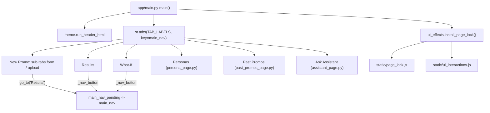
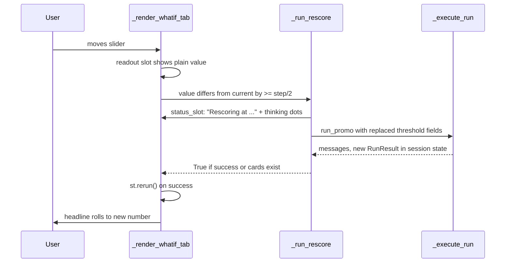
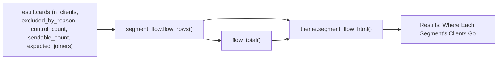
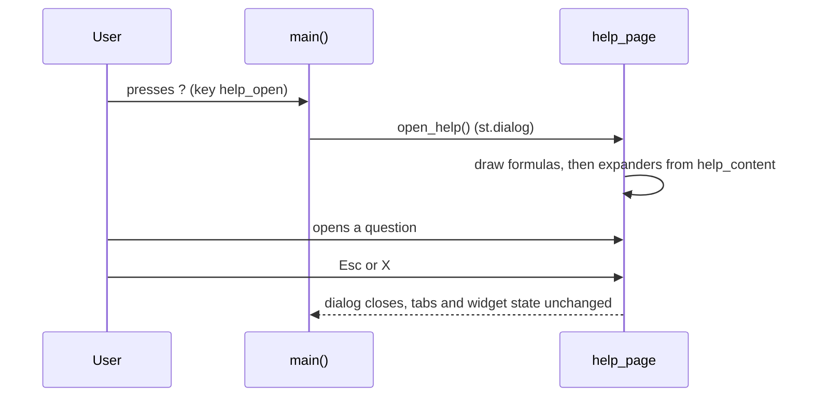

# Design Document: Part 9 Layout Fixes

## Overview

Part 9 is presentation only. It was written after the code on branch `part9-layout-fixes`, so this document records how the code works. It changes `app/` (composition, theme helpers, CSS, two static scripts, the picker iframe), one line in `src/ai/bedrock.py`, `.streamlit/config.toml`, and a few test expectations.

What stays untouched: Parts 1 to 4, `run_pipeline.py`, `outputs/`, `data/`, `labels.py`, `part5_personas`, and every calculation in `src/webapp_core`.

Basis and limits: I read the diff `207d6a3..HEAD` and the final text of `app/main.py`, `app/theme.py` and `app/static/ui_interactions.js`. I did not read every rule body in `styles.css` or `picker.js`, and I did not run the app or the tests. Where a claim comes only from the diff, it is marked "from diff".

## Architecture

Layering is unchanged: `app/` wires widgets and builds HTML through `app/theme.py`. `src/webapp_core` holds logic and has no Streamlit imports. All Part 9 logic is in `app/`, because it is layout and wording.

## Components and interfaces

### 1. Header (`app/theme.py`, `app/main.py`)

`run_header_html(number, label, *, has_run, prev=None, title=APP_TITLE)` returns `<header class="pan-shell">` with `<h1 class="pan-wordmark">` and a `.pan-run-kpi` block. With no run the block has `is-empty` and `aria-hidden="true"` and is `visibility: hidden`, so layout is stable. `_kpi_number_html(number, prev)` is shared with `hero_kpi_html` and `whatif_change_html`: count-up inside `theme.counting`, a roll when `prev` differs, else plain text.

The wordmark rule is `.stApp h1.pan-wordmark` (styles.css section 25). It uses `--pan-type-section-size` (24 px, a step larger than the earlier `--pan-type-card-title-size` in the base `.pan-wordmark` rule), the heading font, bold, with `line-height: var(--pan-control-h)`. The hidden `div.pan-nav-state` marker is still emitted, and `[data-testid="stElementContainer"]:has(.pan-nav-state)` is `display: none`. No CSS reads its classes for step states any more.

`main()` draws the header inside `theme.counting(*ui_effects.reveal("analysis"))` with `prev=ui_effects.number_prev("hero", number)`. `nav_state_html(has_run, has_personas)` follows it as a hidden marker for CSS.

### 2. Navigation (`app/main.py`)

| Name | Kind | Role |
|---|---|---|
| `NAV_KEY = "main_nav"` | session key | Selected tab, bound to `st.tabs(key=...)` |
| `NAV_PENDING_KEY = "main_nav_pending"` | session key | A section asked for after the tabs exist |
| `go_to(label)` | function | Sets `NAV_PENDING_KEY` |
| `_go_to_now(label)` | callback | Sets `NAV_KEY` before the next render |
| `_nav_button(label, section, *, key, primary=False)` | function | `st.button` with `on_click=_go_to_now` |

`main()` pops `NAV_PENDING_KEY` before creating the tabs and copies it into `NAV_KEY` if it is in `theme.TAB_LABELS`. `on_change="rerun"` means every tab switch reruns the script, which is why `past_promos_page` caches its data.

Stepper (styles.css, "Tabs (Part 9)"): `.st-key-main_nav > div > [role="tablist"]` resets a CSS counter (`pan-step`). The first four tabs (`:nth-child(-n+4)`) draw `::before` with `counter(pan-step)` as a 20 px grey circle (1 px `--pan-border-control`, muted number, `--pan-font-number`). Only `[aria-selected="true"]` fills its circle with `--pan-primary` and adds a 2 px red `::after` rule on the divider. The fifth tab has `margin-left: auto`, so Past Promos and Ask Assistant sit apart on the right with no number. The tab list wraps (`flex-wrap: wrap`) and `stTabsScroll*` is hidden. The earlier "done" check mark and dashed "needs a run first" circle were removed on request; a comment in the CSS says so. The sub-tab switch (`.stTabs:not(.st-key-main_nav)`) is a separate two-option pill.

Nav button keys: `nav_newpromo_results`, `nav_results_empty`, `nav_results_personas`, `nav_results_whatif`, `nav_whatif_empty`, `nav_whatif_results`.

Streamlit 1.66.1 dependency: a keyed `st.tabs` with `on_change` and a settable session value. Recheck after upgrades.

### 3. New Promo (`app/main.py`)

`_render_new_promo_tab()` shows the threshold-changed banner, then `st.tabs([FORM_TAB_LABEL, UPLOAD_TAB_LABEL], key="new_promo_mode")`. The upload tab body is rendered first in code and the form second, so prefill reaches session state before the widgets are created.

`_render_fill_in_details()` draws `theme.section_label("Promo Basics", ...)` before the half-width Promo ID input. `MECHANIC_DISPLAY` maps codes to words; the selectbox uses `format_func` and keeps the key `upload_panel.MECHANIC_KEY`. `assistant_page._MECHANIC_NAMES` repeats the mapping.

On a successful Job, after `loader.keep()`: `go_to("Results")`, store `WHATIF_BASELINE_KEY` and `WHATIF_SEGMENTS_KEY`, pop `WHATIF_RESET_KEY`, then `st.rerun()`. When a Run exists, `_nav_button("View Results", ...)` follows the form.

### 4. Results (`app/main.py`, `app/theme.py`)

Order on the page: `_render_threshold_context` → `_render_results_actions` → Results Grid → Impact Summary → Decision Cards → Download Leads → `pan_next_actions`.

Threshold helpers:

| Function | Returns |
|---|---|
| `_current_threshold(result)` | `(ThresholdType, value)`; `threshold_pct` for Balance Increase, else `threshold_php` |
| `_as_run_threshold(t_type)` | `(label, value)` from `WHATIF_BASELINE_KEY`, or `None` if the type differs |
| `_threshold_context(result)` | `(label, as_run_label | None, changed)`; `changed` when the gap is at least `step / 2` |
| `_threshold_slug(result)` | digits of the label, plus `pct` for percent thresholds |
| `_leads_file_name(result, segment)` | `{promo_id}_{slug}_{segment_snake}_leads.csv` |
| `_segment_figures(result)` | `{segment: (n_clients, expected_joiners, len(sendable))}` |

Recommended segments: `RECOMMENDED_ACTION = "Prioritize"`. `ACTION_ORDER = ["Prioritize", "Offer lower tier", "Include", "Skip"]`; `_action_rank(card)` returns `(index, -expected_joiners)` with unknown actions last.

Grid: `RESULTS_GRID` keeps its row and column layout. `theme.results_grid_html(rows, recommended)` builds `.pan-grid` with `.pan-grid-corner`, `.pan-grid-col` and `.pan-grid-row` (vertical text), using `GRID_AXIS_LABELS`. `tile_html(title, body, recommended)` adds `.is-recommended` and `act_first_tag_html()` (`ACT_FIRST = "Act first"`). `theme.tile()` and `_tile_body_html(card, emphasis=False)` remain.

Cards: `theme.card(heading, body, recommended=...)` splits `"A · B"` into a muted `span.pan-card-pre` and the segment. `decision_card_body_html(view)` puts drivers and exclusions inside `

Targeting Details
`. `decision_card_split_body_html(view)` returns `.pan-card-split` with main and side columns, built with `dataclasses.replace(view, persona_lines=None)`. `stat_tile_html` uses `_stat_parts` and `_ABOUT_RE` to render key over value (class `pan-stat--kv`).

Counting: only the header and the grid are inside `theme.counting`. The Impact Summary and cards show final numbers, because about 70 rolling digit columns stuttered on slower machines.

Download rows: container `pan_dl_row_{i}`, columns `[2.6, 1, 2.6, 1.2, 1, 2]` centred vertically, cells from `_download_cell(label, value, notes)`. Reasons come from `build_card_view(card).exclusions`. The first row has a top border in CSS. `DOWNLOAD_NOTE` follows the rows. Segments not in the grid order are appended after the rest.

### 5. What-If (`app/main.py`, `app/theme.py`)

Session keys: `WHATIF_BASELINE_KEY`, `WHATIF_SEGMENTS_KEY`, `WHATIF_RESET_KEY`, `WHATIF_RESET_COUNT_KEY`, `WHATIF_FLASH_KEY`.

Flow of `_render_whatif_tab()`:

`_run_rescore(result, t_type, value, fields, *, status_slot=None)` no longer uses `start_job("rescore")`, `theme.loading("rescore")` or `end_job`. It stores only non-success messages in `WHATIF_FLASH_KEY`. On a failed rescore the caller does not rerun (a rerun would retry forever) and shows the messages in place.

Reset: `_request_threshold_reset` sets `WHATIF_RESET_KEY`. The What-If render pops it, rescores at the as-run value if it differs, pops the old slider key, increments `WHATIF_RESET_COUNT_KEY` and reruns. The slider key is `whatif_threshold_{TYPE}` plus `_r{n}` once a reset has happened, because the browser keeps a slider's last value.

HTML builders: `whatif_change_html(label, number, now_label, *, base_number, base_label, prev)` → `section.pan-wi` with `.pan-wi-fig` figures; `_delta_text(delta, digits)` returns `.pan-delta` with `is-up`, `is-down` or `is-flat` and an arrow (so the change is never colour alone); `whatif_segments_html(rows)` returns `.pan-wis`.

### 6. Personas (`app/persona_page.py`)

`EJ_SEGMENT_KEY = "persona_ej_segment"` and `EJ_SEGMENT_ORDER`. With two or more segments, a half-width selectbox picks one. With a single card and `mode != "all"`, the card is full width and uses `decision_card_split_body_html`; otherwise the two-up grid with `decision_card_body_html`. The comparison table call is removed; `_render_persona_comparison` stays.

`theme.loading(..., slot=None)` accepts a page-drawn `st.empty()`. The Suggest helper passes `slot=suggest_slot`. Build Personas passes `loader_slot=st.empty()` through `_handle_run`, drawn on every render.

### 7. Past Promos (`app/past_promos_page.py`)

`gap_text(predicted, actual)`; a Gap column in `predicted_actual_html`; `theme.unavailable_line_html(label)` for unavailable components; `theme.fields_row_html(rows)` for the facts row; `_load_past_data()` over `@st.cache_data _cached_past_data(stamps)` keyed on file modified times; two captions that say what Most Similar compares with.

### 8. Ask Assistant (`app/assistant_page.py`, `app/theme.py`)

`bedrock_html(state)` with `state` in `spin`, `finish`, `rest` builds `.pan-cube-slot.is-{state}` and six faces from `_CUBE_FACES`; `finish` adds `_CUBE_SPARKS` as `b.pan-cube-spark` with `--dx` and `--dy`. `thinking_html(text="Thinking")` builds `.pan-thinking` with three dots.

`_handle_question(question, history, thread)` draws into a `thread` container created before the input: user message, then an assistant message whose slot shows `bedrock_html("spin") + thinking_html()`, then `answer()`, then `finish` for `_finish_seconds()` (parsed from `--pan-dur-cube-finish` with `ui_effects._parse_duration_s`, fallback 0.9 s, using `time.sleep`). Assistant messages end in `bedrock_html("rest")` beside the Demo badge.

`build_grounding` reads the threshold from `result.promo_spec` once a run exists.

### 9. Tokens and CSS (`app/styles.css`, `app/theme.py`)

Section 1 changes:

| Token | Before | After |
|---|---|---|
| `--pan-radius-sm` | 6px | 4px |
| `--pan-radius-md` | 10px | 6px |
| `--pan-radius-lg` | 14px | 8px |
| `--pan-radius-textarea` | 20px | `var(--pan-radius-md)` |
| `--pan-dur-hold` | 250ms | 150ms |
| `--pan-reveal-step` | 250ms | 60ms |
| `--pan-dur-swoop` | 1000ms | 240ms |
| `--pan-dur-finish` | 1600ms | 800ms |
| `--pan-dur-finish-linger` | 500ms | 200ms |

New tokens: `--pan-control-h` (40px), `--pan-dur-tip` (160ms), `--pan-dur-theme-fill` (1100ms), `--pan-ease-bubble`, `--pan-dur-bounce` (420ms), `--pan-ease-bounce`, `--pan-dur-press-out` (600ms), `--pan-on-gold`, `--pan-dur-think` (1200ms), `--pan-think-step` (160ms), `--pan-dur-think-calm` (1600ms), `--pan-ease-constant`, `--pan-dur-carousel` (900ms), `--pan-ease-carousel`, `--pan-cube-base` (#5E5E5E), `--pan-cube-size` (19px), `--pan-dur-cube-spin` (1600ms), `--pan-dur-cube-finish` (900ms), `--pan-cube-tex` (inline SVG data URI). `--pan-reveal-start` no longer includes `--pan-dur-spark`. The group picker receives `--pan-dur-carousel` and `--pan-ease-carousel` through `_EXTRA_TOKENS` in `group_picker.py`.

Sections: 20 hover texts (`stTooltipContent`, `p9-tip-in`, `p9-tip-out`); 21 theme switch (`.p9-liquid*`, `p9-bubble-size`, `p9-bubble-move`); 22 assistant thinking (`.pan-thinking*`, `p9-think-dot`); 24 assistant avatars (cube, sparks, gold user avatar, `pan-cube-breathe` for Reduced_Motion); 25 round 3 (header, stat key/value, card titles, outlined secondary buttons, blue focus, What-If table, hairline tables, facts row, chat width, 640px tooltip anchor); 27 buttons (see "Buttons" below); 23 the flat background, which now holds only the stone block texture `--pan-cube-tex` (an 8x8 pixel SVG data URI set on `.stApp`) inside the `PART 9 MOTIFS (generated)` markers. The woven lattice and its sparkles are gone; the page is the flat `--pan-bg` token. The order in the file is 20, 21, 22, 24, 25, 27, 23; there is no section 26.

Buttons (section 27). Selectors are descendant selectors on `.stApp :is(.stButton, .stDownloadButton, .stFormSubmitButton) button`, because a button with a help tip sits inside a tooltip wrapper.

| State | Look |
|---|---|
| Rest | `--pan-surface` fill, `--pan-text` label, 1 px `--pan-border-control`, `box-shadow: 0 2px 0 var(--pan-border)` (the key edge), demi weight. No red fill, including Download Recommended Leads. |
| Main action | Primary buttons (`stBaseButton-primary`, `kind="primary"`) and Job buttons (`st-key-p8_btn_*`): `--pan-text` border and a red key edge (`0 2px 0 var(--pan-primary)`). |
| Hover | Only under `(hover: hover) and (pointer: fine)`: 1 px lift, ink border, `0 3px 0` edge. Job buttons have no red hover plate (`::after { display: none }`). |
| Active | Red fill, `--pan-on-primary` label, no edge, `translateY(2px) scale(0.96)`, with zero colour delay. Release springs back over `--pan-dur-bounce` with `--pan-ease-bounce`. |
| Disabled | `--pan-surface-2`, muted label, no edge. |
| Pressed | `button[data-p9-pressed]` is red over hover and disabled. Its colours transition out over `--pan-dur-press-out` when the attribute goes. |
| Reduced_Motion | `transform: none`; only colour changes. |

`ui_interactions.js` decides when the attribute goes. `busy()` is true when `data-test-script-state="running"`, or `html[data-p8-locked]`, or `html.p9-await-run`. It does not look at `.pan-loading`, because a faded loader element stays in the DOM and would keep every button red.

Other Part 9 rules sit near the components they style: `.pan-shell`, `.pan-wordmark`, `.pan-run-kpi*`, `.pan-grid*`, `.pan-act`, `.pan-dl-*`, `.pan-wi*`, `.pan-details`, `.pan-card-split*`, `.st-key-pan_next_actions`, `.st-key-pan_results_actions`, `.st-key-new_promo_mode`, and `@media (max-width: 900px)` and `(max-width: 640px)` blocks.

Removed or replaced: `.pan-tile.white` and the 5px segment border, the 3px side bar on notes, `.pan-section-label::before`, the red emphasis tile, the old `[data-baseweb="tab-list"]` tab rules (rewritten for react-aria tabs), the fireworks (`.pan-fin-sparks`), and the lattice and dot-grid background. The hero CSS (`.pan-hero-text`, `.pan-hero-title`, `.pan-hero-sub`, `.pan-hero-kpi`, and the `--pan-hero-*` and `--pan-dot` tokens) is still in `styles.css`. It is unused by `main()` now, but `theme.hero_kpi_html`, `hero_text_html` and `metric_panel` still emit those classes.

`.streamlit/config.toml`: `baseRadius` and `buttonRadius` 10px → 6px. A server restart is needed.

### 10. Scripts

`ui_interactions.js` (new, IIFE, DOM only, never talks to Streamlit):

| Part | Trigger | Behavior |
|---|---|---|
| Theme switch | capture-phase click on `[data-testid^="stMainMenuItem-theme-"]` not `aria-checked` | Bubbling liquid, not a View Transition. `preventDefault` + `stopImmediatePropagation`; `bgFor(target)` resolves `--pan-bg` for the new scheme through a probe element with that `color-scheme`; `liquid(colour)` builds an SVG filter `#p9-blob` (`feGaussianBlur` `stdDeviation` 10, then `feColorMatrix` alpha threshold `19 -9`) and a `.p9-liquid` box holding `.p9-liquid-rise`, 48 bubbles (`.p9-liquid-bubbles > i`, 2 to 6 rem, 2 to 4 s) and `.p9-liquid-body`. `.is-rising` lifts it over `--pan-dur-theme-fill`. Once the page is covered the click is replayed (`replaying` flag), the script waits up to 800 ms for the scheme to change, adds `.is-done` (fade over `--pan-dur-slow`) and removes the box 50 ms later. One pour at a time (`filling`). Skipped for Reduced_Motion, an already-checked item, or no visible change. |
| Hover texts | `focusin`/`focus` within 800 ms of `pointerdown` on `[data-testid="stTooltipHoverTarget"]` | `stopImmediatePropagation`. A MutationObserver re-appends a removed tooltip with `p9-tip-out` and removes it on `animationend` or after 400 ms. |
| Menu hide | capture scroll on `stMain` or the document scroller | Toggles `html.p9-menu-away` (`top < 48` removes; `> last + 4` adds; `< last - 4` removes). CSS applies it under 900px. |
| Pressed buttons | click on `.stButton button, .stDownloadButton button, .stFormSubmitButton button` | Sets `data-p9-pressed`; polls every 100 ms; `busy()` is true while `data-test-script-state="running"`, `data-p8-locked` is set, or `p9-await-run` is present; `settleMs(key)` is 300 ms, or for `st-key-p8_btn_*` adds finish, hold and linger; removes the attribute when quiet and work was seen, or after 1.5 s of nothing, or at 15 min. Re-finds the button by its `st-key-*` class if Streamlit redraws it. |

`page_lock.js` gains `running()`, `tokenMs()` and `awaitRun()`. After the finish releases, at `finish + hold + linger - 60 ms`, if the script is still running it adds `p9-await-run` to `html`, polls every 50 ms, and removes it when the run ends or after 4 s.

`ui_effects.py`: `_LOCK_JS_PATH` → `page_lock.js`, `_P9_JS_PATH` → `ui_interactions.js`; `_page_lock_html(code, script_id="p8-page-lock")` takes a script id; `_draw_page_lock()` concatenates both scripts (ids `p8-page-lock` and `p9-ui`) into one zero-height `components.html` frame, each with a double-inject guard. A missing file is skipped and the CSS click block still applies.

Picker (`picker.css`, `picker.js`): the ring is a real 3D carousel. `.view.ring` gets a perspective set by the script (`max(900, R * 3.2)px`, origin 50% 18%); `.stage` is `preserve-3d` with `translateZ(-R)`; each `.item` uses `rotateY(--a) translateZ(--R) rotateY(-a)`, so every card turns back to face the viewer and labels never read mirrored; `@property --a` (`<angle>`, `inherits: false`) is registered and `.item` transitions `--a` on `--pan-dur-carousel` and `--pan-ease-carousel`, so a turn is one CSS transition and the script only writes end values (`--a = (i - S.pos) * step`); `S.pos` is never wrapped, so turns take the short way and can be retargeted mid-turn; `settleRing()` places items without motion on first draw, resize and Reduced_Motion; `.no-anim .item` and the Reduced_Motion rule set `transition: none`; `html, body` use `overflow: clip`. The old rAF animation and queue are removed (from diff).

### 11. Backend

`ai.bedrock._build_client` adds `aws_session_token=os.environ.get("AWS_SESSION_TOKEN") or None`. `win_ca.pem` is added at the repo root.

## Error handling

- Rescore failure: result unchanged, messages shown in place, no rerun.
- Missing `page_lock.js` or `ui_interactions.js`: skipped; the CSS click block still applies.
- Unknown action in `_action_rank`: sorted last.
- Percent versus peso threshold: `_as_run_threshold` returns `None` when the type differs, so no false "changed" banner.
- No Run: Results and What-If show an info message and a "Go To New Promo" button.

## Testing strategy

Changed tests (from diff):

| File | Change |
|---|---|
| `test_part5_personas_apptest_smoke.py` | "How the Personas Differ" absent, `len(at.dataframe) == 0`; card heading compared with tags stripped |
| `test_part7_apptest_smoke.py` | Subheaders Results Grid, Decision Cards, Download Leads; "Export Summary" among download labels |
| `test_part8_tokens_unit.py` | Scans `page_lock.js` |

Gaps: no tests for the new pure helpers listed in Requirement 19.4, and none for `ui_interactions.js`. Affected-test set for Part 9: `test_part5_theme`, `test_part5_personas_apptest_smoke`, `test_part7_apptest_smoke` and every `tests/test_part8_*_unit.py`.

Browser checks (not automatable here): liquid theme switch in both directions, tooltip click and keyboard behavior, menu hide under 900 px, pressed-button red and fade on Run Analysis, no sideways scroll at 390 px, dark-mode contrast of the new surfaces.

## Known risks

- Keyed `st.tabs` and `components.html` depend on Streamlit 1.66.1 internals.
- The theme switch depends on the test ids `stMainMenuItem-theme-*`, `stTooltipHoverTarget`, `stTooltipContent` and `data-test-script-state`.
- `time.sleep` in the assistant finish blocks the script for about 0.9 s per answer.
- Not verified: whether the 3D carousel still posts a value per step and can rerun on rapid input (the open item in `plans/README.md`). Check in the browser.

## Round 2 design (specified, not yet built)

This section designs Requirements 20 to 28. Nothing here is in the code yet. It changes presentation only. It was checked against the current `app/main.py`, `app/theme.py`, `app/styles.css`, `src/webapp_core/card_view.py` and the installed Streamlit 1.66.1, where `st.dialog` and `st.expander` exist (checked by import, not in a browser).

### New and changed modules

| File | Kind | Role |
|---|---|---|
| `src/webapp_core/number_format.py` | new, pure | `shown_joiners(x) -> int` (calls `card_view.round_half_up`), `forecast_text(x) -> "Forecasted: 87.3"`, `share_pct(part, whole) -> str \| None` (one decimal, `None` when `whole` is 0) |
| `src/webapp_core/segment_flow.py` | new, pure | `SEGMENT_DISPLAY_ORDER`, `flow_rows(cards) -> list[FlowRow]`, `flow_total(rows) -> FlowRow`, `reconciles(row) -> bool` |
| `src/webapp_core/number_help.py` | new, pure | One plain description per figure (Requirement 22), built from `part4_cards.config` constants |
| `src/webapp_core/help_content.py` | new, pure | Ordered FAQ entries and formulas (Requirement 28) |
| `app/help_page.py` | new | `@st.dialog("Help And FAQs", width="large")` that draws `help_content` |
| `app/theme.py` | changed | `APP_TITLE`, `joiners_pair_html`, `run_header_html` sub-line, `segment_flow_html`, `whatif_segments_html` order and cells, help button helper |
| `app/main.py` | changed | Title, header data, tile body, Download Leads expander, Segment_Flow block, help button |
| `app/styles.css` | changed | Tokens `--pan-flow-*`, section 28 (Round 2), button padding, dialog styling |

`webapp_core` keeps no Streamlit imports. `number_help` and `help_content` may import `part4_cards.config` (an allowed reuse of Part 4 constants). All of them stay pure, so Hypothesis tests can cover them.

### 1. Rounded joiners with the forecast (Requirement 20)

`joiners_pair_html(forecast, *, size, full=True)` in `theme.py` returns `87 (Forecasted: 87.3)`. With `full=False` the bracket is `(87.3)` for table cells. `pan-jp-fc` uses the caption size, the muted colour and regular weight. The main figure keeps the existing `tabular-nums` rule.

Where it is used:

| Place | Function changed | Note |
|---|---|---|
| Header number | `_metric_from_run`, `run_header_html` | `_metric_from_run` returns the Forecast and the Shown_Joiners |
| Results Grid tile | `_tile_body_html` | replaces `{joiners:,.1f}` |
| What-If headline | `whatif_change_html` | Change is `shown_now - shown_base` |
| What-If segment table | `whatif_segments_html` | cell is `87 (87.3)` and the heading reads "Expected Joiners (Forecast)" |
| Decision Card stat | `card_view.build_card_view` | already `About N`; use `round_half_up` for N so it matches |

Rounding the total from the unrounded sum means rows can differ from the total by 1. The FAQ explains it.

Counting: `count_text_html` and `plan_roll` act on the whole number. The bracket text is plain and fades with `.p8-fade-in`; it adds no digit columns.

### 2. Header sub-line (Requirement 21)

`run_header_html(number, label, *, has_run, prev, forecast, sendable_total, title)` adds `
out of 1,595 sendable leads (12.8%)
` under the number. `sendable_total` is `sum(len(df) for df in result.sendable_by_segment.values())`. The percentage is `share_pct(forecast, sendable_total)`. With 0 sendable leads the text is `out of 0 sendable leads` and no percentage. The empty-run slot also holds the sub-line (hidden), so the header does not grow. The right padding of `.pan-shell` grows from 56 px to a token (`--pan-help-clearance`) so the KPI clears both the Settings menu and the help button.

### 3. Plain descriptions (Requirement 22)

`number_help.py` exposes one function per description, so the Help_Dialog and the page share wording:

| Function | Text (example) |
|---|---|
| `clients_help()` | "Everyone in this group." |
| `joiners_of_sendable(forecast, sendable)` | "out of 282 sendable leads (31.0%)" |
| `not_contacted_help()` | "Left out: do-not-bother list, contacted too often, or no channel." |
| `control_help()` | "Held back (about 10%) so you can measure the promo's effect." (10% from `CONTROL_FRACTION`) |
| `sendable_help()` | "The leads in the file. You can message these." |
| `value_help()` | "Joiners at ₱1,000 each, minus the cost of the messages." (₱1,000 from `VALUE_PER_JOIN_PHP`) |
| `range_help()` | "We are 90% sure the number who join will land in this range." |
| `threshold_help()` | "Clients at or above this amount qualify." |
| `adb_help()` | "ADB is the average daily balance." |
| `gap_help()`, `predicted_actual_help()`, `similarity_help()` | Past Promos captions in the table in Requirement 22 |

Placement rules: one caption line per block of figures, in the muted caption style, or the existing `.pan-tip` hover text where a caption would crowd a tile. The Results Grid tile gets the `joiners_of_sendable` line only. The Download Leads rows get their descriptions as the cell hover text (`tooltip_html`), so the closed dropdown stays clean. The card stats already have tooltips (`LIKELY_TOOLTIP`, `RANGE_TOOLTIP`, `VALUE_TOOLTIP` in `card_view.py`); only `VALUE_TOOLTIP` is reworded to name the ₱1,000.

Persona group captions come from `webapp_core.personas.group_summary_by_card` data already on the page: `<group> · 376 of 1,595 sendable leads`.

### 4. Title (Requirement 23)

`APP_TITLE`, `st.set_page_config(page_title=...)`, `app/__init__.py`, and the docstring and comment lines named in the requirement change. No logic changes. Tests to update: `test_part5_theme.py` lines asserting `"Promo Audience Navigator"`, `theme.APP_TITLE` and the `styles.css` first-line comment, and `test_part8_assets_unit.py` (`APP_TITLE`).

### 5. Segment order (Requirement 24)

`segment_flow.SEGMENT_DISPLAY_ORDER = ("Ready Toppers", "Willing but Stretched", "Untapped Wealth", "Not Now")`. `_render_whatif_segments` sorts by it, instead of by `RESULTS_GRID`. Unknown names go last in name order. `main.SEGMENT_ORDER` (Past Promos) and `RESULTS_GRID` do not change.

### 6. Download Leads dropdown (Requirement 25)

`st.subheader("Download Leads")` becomes `with st.expander(f"Download Leads ({n} files)", expanded=False):`. The rows, `DOWNLOAD_NOTE` and the empty caption move inside. Keys are unchanged, so Streamlit keeps each download button's identity. A closed `st.expander` still renders its children, so there is no extra work on a rerun. CSS: the expander summary shares the `.pan-details > summary` look (chevron, caption size, `--pan-focus` ring). The `pan_dl_row_*` hairlines stay.

Why an expander and not a selectbox: a selectbox would change the page from "all files visible" to "pick one, then download", and would add a widget key and session state. An expander only hides the existing rows. See the decisions log.

### 7. Button label space (Requirement 26)

Section 27 gets `padding-inline: var(--pan-space-4)` for `.stApp :is(.stButton, .stDownloadButton, .stFormSubmitButton) button`, and `text-align: center`, with `white-space: normal` so a long label wraps. The tertiary rule `.st-key-persona_suggest_row [data-testid="stBaseButton-tertiary"]` (styles.css near line 2796) is checked for its own padding and border so the label is centred inside it. The existing `min-height: var(--pan-control-h)` stays. The explicit check list is in task 16.7.

### 8. Segment Flow chart (Requirement 27)

`FlowRow` is a frozen dataclass: `segment`, `clients`, `not_contacted`, `control`, `sendable`, `forecast`. `flow_rows(cards)` returns rows in the Display_Order. `reconciles(row)` is `clients == not_contacted + control + sendable`.

`theme.segment_flow_html(rows, total, *, animate)` draws:

- A legend with three swatches: Not Contacted, Control Group, Sendable.
- One `.pan-flow-row` per segment: segment marker and name, then a `.pan-flow-bar` whose width is `clients / total.clients` as a percentage, with three `.pan-flow-part` children whose `flex-grow` is the part count and whose `min-inline-size` keeps a thin visible part for a small count. Each part shows its number when wide enough (a CSS container query on the part).
- A Total row with the same structure.
- A table (`.pan-table`) with the columns of Requirement 27.7 and a bold Total row, then the caption.

Colours (section 1, `light-dark()` aliases of the chart series so they follow the theme):

| Token | Alias of | Light | Dark | Part |
|---|---|---|---|---|
| `--pan-flow-sendable` | `--pan-series-2` | #0B7285 | #4FC3D6 | Sendable |
| `--pan-flow-control` | `--pan-series-3` | #5B3FA6 | #A592E8 | Control Group |
| `--pan-flow-excluded` | `--pan-series-6` | #5B616B | #A7ADB8 | Not Contacted |

These three hues (teal, purple, slate) are cool and sit beside the red primary and gold notes used elsewhere. They are the same series tokens the app already uses for its other charts (`.pan-bar-fill` uses `--pan-series-2`; `config.toml` lists the same colours as `chartCategoricalColors`). Their contrast on the page surface has not been measured for bar fills. Part labels use `--pan-on-primary` or `--pan-text` chosen per token so text on a bar meets 4.5:1; this is checked in the browser in task 18.

Motion: on the render where a new Run arrived (`ui_effects.reveal("analysis")` generation), each bar grows with `transform: scaleX` from 0 over `--pan-dur-reveal`, staggered by `--pan-reveal-step`. The transform origin is the left edge. Static on any other render. Reduced_Motion: none.

Accessibility: `role="img"` on the bar group with an `aria-label` such as "Ready Toppers: 34 not contacted, 31 control, 282 sendable of 347 clients", and the table gives the same numbers in text.

### 9. Help And FAQs (Requirement 28)

Why a dialog: a separate page or a hidden seventh tab would unmount the other widgets. Streamlit drops the state of widgets that are not rendered in a run, so the New Promo form would lose its values. A dialog draws over the page and leaves every tab rendered.

Button placement: `main()` draws `st.button("?", key="help_open", help="Help And FAQs")` inside `st.container(key="pan_help")`. CSS fixes `.st-key-pan_help` to the top right, left of `[data-testid="stMainMenu"]`, round (`--pan-radius-pill`), `--pan-control-h` square, and the wrapping `stElementContainer` takes no row (`display: none` on the container that has no other child, as for `pan-nav-state`). Under 900 px the `html.p9-menu-away` rule also moves it away. A `?` glyph is plain text in the button label, with `aria-label="Help And FAQs"`. Neutral at rest like every button (Requirement 12), red on press.

Dialog content is drawn from `help_content.ENTRIES`, a tuple of frozen `HelpEntry(id, question, answer, formula, where)`. `help_page` draws:

1. `st.subheader("How The Numbers Fit Together")` and a compact formula list (`.pan-formulas`, label over formula, tabular numbers).
2. `st.subheader("Common Questions")` and one `st.expander(entry.question)` per entry: the answer text, the formula in a code-style block (`.pan-formula`) when there is one, and a muted "Where to see it: Results" line.
3. `st.subheader("Where To Go Next")` with `_nav_button`-style buttons that call `_go_to_now`. Pressing one switches the tab and the dialog closes on the rerun.

Worked example in the answers uses the default run (threshold 530,000): 2,000 clients = 230 + 175 + 1,595; Ready Toppers 87.3 forecast among 282 sendable leads; total 204.4. Entries quote constants from `part4_cards.config`, so a changed assumption changes the help text.

CSS section 28 (new) styles `[data-testid="stDialog"]` (surface, border, `--pan-radius-lg`, tokens only), the dialog title in the heading font, the expander summaries (shared with Requirement 25) and the formula block. Light and dark both use tokens. The dialog open animation is Streamlit's own; section 28 adds none, and Reduced_Motion needs no extra rule.

### Tests for Round 2

- Property tests (Hypothesis, `deadline=None`): `shown_joiners(x)` is within 0.5 of `x` and is an int; `forecast_text` has one decimal; `share_pct` never divides by zero; `flow_rows` parts add to Clients for any valid card; `SEGMENT_DISPLAY_ORDER` sorting is stable and total.
- Unit: `joiners_pair_html`, `run_header_html` (sub-line, zero-sendable case), `whatif_segments_html` (order and cell text), `segment_flow_html` (three parts, legend, table, aria-label, mismatch caption), `help_content` (every entry has a question, answer and `where`; formulas contain the config constants).
- AppTest smoke: the Results tab with a seeded run shows the "Download Leads" expander label, the flow heading and the help button key. `test_part7_apptest_smoke.py` changes its subheader list. AppTest does not open dialogs reliably, so the dialog body is covered by calling `help_page` content builders directly.
- Browser (task 18): see the checklist.

### Risks for Round 2

- `st.dialog` is newer Streamlit API. It is present in 1.66.1. Recheck after upgrades.
- A fixed-position `st.button` depends on the `st-key-pan_help` class and on `stMainMenu` for its anchor.
- Container queries for the in-bar numbers are a newer CSS feature. The table shows the same numbers, so a browser without them loses nothing.
- Fix 7 is read as button padding. The owner may have meant page gutters (task 14.6).

## Rejected options

Do not reintroduce these without a new decision from the owner.

### Full-width layout (rejected)

A full-width layout was built and then reverted on request. It let the content grow to 1680 px and used four decision cards per row, three persona cards per row and a two-column Past Promos page. The reason for the revert was not recorded. Content stays centred at a maximum of 1200 px (`.block-container { max-width: 1200px; margin: 0 auto }`), with decision cards two per row (`st.columns(2)` in `main.py`), persona cards two per row (`persona_page.py`) and Past Promos as it was before the full-width attempt. `st.set_page_config(layout="wide")` stays, because the 1200 px cap is applied by CSS.

### Other options not taken

- A View Transition for the theme switch. The liquid overlay is used instead (see the decisions log).
- A "done" check mark and a dashed "needs a run first" circle on the stepper. They were removed on request.
- A page lock, loader and finish animation for a What-If slider move. A slider move is not a Job.

## Decisions log

The date column is the date this entry was written into the spec (2026-11-13). The exact day each decision was made was not captured in the code or the history, so correct a date here if you know it.

| Date | Decision | Why |
|---|---|---|
| 2026-11-13 | The site background is flat (`--pan-bg` only). The woven red lattice and its sparkles were removed. Section 23 keeps only the stone block texture. | The code comment says the lattice was removed in Part 9 and the page is the flat background token only. This fits the guiding principle of a calm, flat look. A more specific reason was not recorded. |
| 2026-11-13 | Buttons rest neutral (surface, ink label, grey hairline, 2 px key edge). No filled red button at rest, including Download Recommended Leads. The main action is marked by an ink outline and a red key edge. | Red marks a risk, an error or a press (Requirement 11.5). The CSS comment says a neutral button with a key edge reads as pressable without shouting. |
| 2026-11-13 | A pressed button turns red, sinks and springs back, and stays red (`data-p9-pressed`) until the rerun or Job it started has finished. It then fades out over `--pan-dur-press-out` (600 ms). Job buttons also wait out the loader's finish. | The red shows that the click was heard and that work is still running. The busy check ignores `.pan-loading` because a faded loader element stays in the DOM and would keep the button red. |
| 2026-11-13 | The four numbered steps are plain grey circles. Only the current tab's circle is filled red. The "done" check mark and the dashed "needs a run first" circle were removed. | Removed on request. The hidden `pan-nav-state` marker is still emitted, but no CSS reads it for step states. |
| 2026-11-13 | The full-width layout (up to 1680 px, four decision cards per row, three persona cards per row, two-column Past Promos) was reverted. Content stays centred at 1200 px. | Reverted on request after it was built. See "Rejected options". |
| 2026-11-13 | The theme switch is a bubbling-liquid overlay in the new theme's `--pan-bg` colour, not a View Transition. | The CSS comment says the length (1.1 s) was asked for on purpose and the action is rare. The layer holds the click and replays it once the page is covered, so the colour change happens under cover. |
| 2026-11-13 | Each carousel card faces the viewer (`rotateY(a) translateZ(R) rotateY(-a)`), and a turn is one CSS transition on the registered property `--a`. | Labels must never read mirrored. A single registered-property transition needs no per-frame script, and an unwrapped `S.pos` lets a turn take the short way and be retargeted mid-turn. |
| 2026-11-13 | The Ask Assistant avatar is a small 3D stone block (`bedrock_html`), with a gold user avatar. This is an owner decision. Keep it. | Owner decision. Do not replace it with a generic icon or remove it in a later cleanup. |
| 2026-11-13 | Title Case labels stay as written in `labels.py` (for example "Expected Joiners", "Not Contacted"). The stepper numbers are added by CSS counters, so the tab labels stay exactly as written. | `labels.py` is the one source of plain-language wording (Part 7 Requirements 4.1 to 4.3) and Part 9 does not change wording. Tests and the Past Promos and Personas pages depend on the exact text. |
| 2026-11-13 | Round 2 fix 1: Expected Joiners shows a rounded whole number with `(Forecasted: 87.3)` beside it, everywhere a count appears. Rounding is to the nearest whole number, halves up. | Owner request, so a CRM manager is not confused by a count of people with a decimal. `round_half_up` already exists in `card_view` and is the rule the cards use. The total is rounded from the unrounded sum, so rows can differ from it by 1, and the FAQ says so. |
| 2026-11-13 | Round 2 fix 2: the Header shows `out of <Sendable_Total> sendable leads (<pct>%)`. The denominator is sendable leads, not all 2,000 clients. | Expected Joiners is the sum of `p_join` over sendable leads only, so the ratio is only honest against the same group. The clients-to-sendable gap is explained by the Segment_Flow chart. The 12.8% example is 204.4 / 1,595. |
| 2026-11-13 | Round 2 fix 3: one short plain description per figure that needs context, kept in one module and reused by the Help_Dialog. At most one line per block, at most 90 characters. | Owner request: more specific, but no clutter. One source avoids two wordings of the same figure. This also settles the open captions item (task 14.2) and the open decimals item (task 14.1). |
| 2026-11-13 | Round 2 fix 4: the title is "Promo Audience Manager". DataWave stays the project name. Older specs keep their wording. | Owner request. Only the on-screen title, browser tab title, docstrings and the tests that assert the old title change. |
| 2026-11-13 | Round 2 fix 5: What-If rows run Ready Toppers, Willing but Stretched, Untapped Wealth, Not Now, from one shared constant that the Segment_Flow chart also uses. Past Promos and the Results Grid layout keep their own order. | Owner request for the What-If table. Sharing the constant keeps the new chart and table in the same order. The reference table the owner supplied used a different order (Not Now before Untapped Wealth); the stated order for What-If was used for both. |
| 2026-11-13 | Round 2 fix 6: Download Leads becomes a closed `st.expander` holding the existing rows. It is not a selectbox. | "Dropdown" is read as a collapsible section. An expander hides the existing rows without adding a widget, a key or any state, and keeps every download button as it is. If a "pick a segment, then download" control was meant, say so. |
| 2026-11-13 | Round 2 fix 7: the reference image shows the Personas button "Not sure how many? Suggest a number" with its label touching both borders. This is read as a button padding fix: at least `--pan-space-4` each side, label centred, applied to every button. | The image is of that button, not of the page layout. The page is already centred at 1200 px. This is an interpretation, recorded as task 14.6 so the owner can correct it. |
| 2026-11-13 | Round 2 fix 8: a stacked bar per segment (Not Contacted, Control Group, Sendable) built from HTML and CSS with the chart series tokens teal, purple and slate, plus the reference table. | The owner asked for different colours with the same hue and feel, not only red and gold. Cool series colours that already exist in the chart tokens fit that and need no new dependency. HTML bars follow light and dark mode and the page radius and type. A table beside the chart keeps the numbers readable without relying on colour. |
| 2026-11-13 | Round 2 fix 9: Help And FAQs opens in an `st.dialog` from a "?" button at the top right, outside the tab bar. Content lives in a pure module and is drawn by `app/help_page.py`. | A separate page or a seventh tab would unmount the other widgets, and Streamlit drops the state of widgets that are not rendered, so the New Promo form would lose its values. A dialog keeps every tab rendered. Keeping the text in a pure module lets tests check that each formula uses the real constants. |
